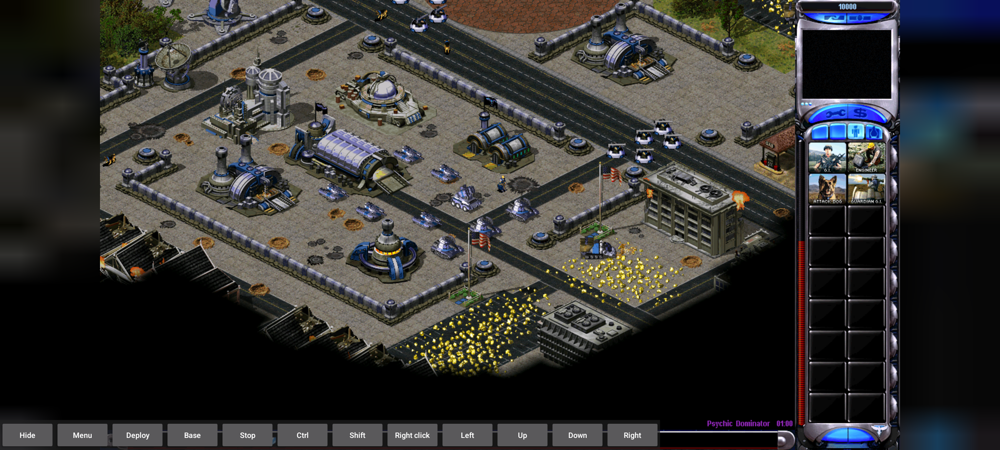
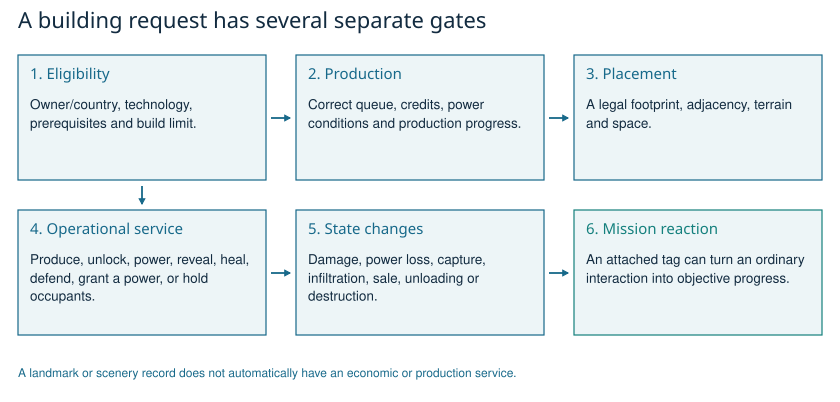

# Every structure: production, defenses, landmarks and props

[Guide index](README.md) | [Engine workflow](01-ENGINE-WORKFLOW.md)

<!-- ILLUSTRATIONS:START -->

*Time Lapse provides a real view of power, research, production and resource infrastructure. Historical local Android-emulator campaign-start capture; not a completed campaign.*

*Separate the eligibility, construction, placement and service stages. Explanatory diagram derived from the guide and local data; not a screenshot.*
<!-- ILLUSTRATIONS:END -->

A catalogue entry is not a promise that you can construct it. This book covers every distinct registered type in either effective ruleset, including scenery, hidden/dormant records and weapon-managed objects. The same ID can change role between RA2 and Yuri. Campaign-only additions are listed at the end. Missing properties stay unspecified; a missing permission is not silently treated as yes or no.

Each card gives an ordinary-language workflow, then explicit rule settings. Workflows apply when the object is active and the relevant orders are legal; special map scripts can intervene. Numeric movement/sight/range settings are game units; delays are not automatically wall-clock seconds. For the shared firing procedure see [Combat](03-COMBAT-ECONOMY.md).

## Read these independent questions first

1. Can this owner build it, or must it be found/captured/scripted?
2. Which prerequisites and producer are required?
3. Does it generate or consume power?
4. Does it produce, unlock technology, provide a service, fire a weapon, hold occupants, or only exist as scenery?
5. Can it be captured, infiltrated, repaired or sold?
6. Does this mission attach an objective to this particular instance?

An ordinary occupiable civilian building admits eligible infantry, contributes their garrison fire, and releases them through unload/damage handling. An unoccupied prop has no army-production queue merely because it belongs to the building registry. A light-post record contributes lighting; it is not a power generator unless its power data says so.

## Type index

[Power Plant (GAPOWR)](#gapowr), [Allied Ore Refinery (GAREFN)](#garefn), [Allied Construction Yard (GACNST)](#gacnst), [Allied Barracks (GAPILE)](#gapile), [Sandbags (GASAND)](#gasand), [Allied Repair Depot (GADEPT)](#gadept), [Allied Battle Lab (GATECH)](#gatech), [Allied War Factory (GAWEAP)](#gaweap), [Einstein's Laboratory (CALAB)](#calab), [Tesla Reactor (NAPOWR)](#napowr), [Soviet Battle Lab (NATECH)](#natech), [Soviet Barracks (NAHAND)](#nahand), [Allied Wall (GAWALL)](#gawall), [Radar Tower (NARADR)](#naradr), [Soviet War Factory (NAWEAP)](#naweap), [Soviet Ore Refinery (NAREFN)](#narefn), [Soviet Wall (NAWALL)](#nawall), [House (CAHSE07)](#cahse07), [Psychic Radar (NAPSIS)](#napsis), [NAWAST (NAWAST)](#nawast), [Sentry Gun (NALASR)](#nalasr), [Patriot Missile (NASAM)](#nasam), [GARADR (GARADR)](#garadr), [Allied Shipyard (GAYARD)](#gayard), [Iron Curtain Device (NAIRON)](#nairon), [Soviet Construction Yard (NACNST)](#nacnst), [Soviet Repair Depot (NADEPT)](#nadept), [Chrono Sphere (GACSPH)](#gacsph), [Chrono Sphere (GADUMY)](#gadumy), [Weather Controller (GAWEAT)](#gaweat), [Bridge Repair Hut (CABHUT)](#cabhut), [Light Post (GALITE)](#galite), [Red Light Post (REDLAMP)](#redlamp), [Green Light Post (GRENLAMP)](#grenlamp), [Blue Light Post (BLUELAMP)](#bluelamp), [Yellow Light Post (YELWLAMP)](#yelwlamp), [Purple Light Post (PURPLAMP)](#purplamp), [Orange Light Post (INORANLAMP)](#inoranlamp), [Invisible Green Light Post (INGRNLMP)](#ingrnlmp), [Invisible Red Light Post (INREDLMP)](#inredlmp), [Invisible Blue Light Post (INBLULMP)](#inblulmp), [Connelly Court Apts. (CITY01)](#city01), [Lightner's Luxury Suites (CITY02)](#city02), [Office Building (CITY03)](#city03), [Westwood Stock Exchange (CITY04)](#city04), [Daily Sun Times (CITY05)](#city05), [YEO-CA Cola Corp. (CITY06)](#city06), [Civilian Hospital (CAHOSP)](#cahosp), [Invisible Light Post (INGALITE)](#ingalite), [Invisible Yellow Light Post (INYELWLAMP)](#inyelwlamp), [Invisible Purple Light Post (INPURPLAMP)](#inpurplamp), [Negative Light Post (NEGLAMP)](#neglamp), [Negative Red Light (NEGRED)](#negred), [Tesla Coil (TESLA)](#tesla), [Nuclear Missile Silo (NAMISL)](#namisl), [Prism Tower (ATESLA)](#atesla), [Civilian Armory (CAARMR)](#caarmr), [AlphaLightPost (TSTLAMP)](#tstlamp), [NAHPAD (NAHPAD)](#nahpad), [Ammo Crate (AMMOCRAT)](#ammocrat), [Green Building (GAGREEN)](#gagreen), [Soviet Shipyard (NAYARD)](#nayard), [SpySat Uplink (GASPYSAT)](#gaspysat), [Gap Generator (GAGAP)](#gagap), [Grand Cannon (GTGCAN)](#gtgcan), [Nuclear Reactor (NANRCT)](#nanrct), [Pill Box (GAPILL)](#gapill), [Flak Cannon (NAFLAK)](#naflak), [Tech Outpost (CAOUTP)](#caoutp), [Civilian Hospital (CATHOSP)](#cathosp), [Tech Airport (CAAIRP)](#caairp), [Tech Oil Derrick (CAOILD)](#caoild), [Cloning Vats (NACLON)](#naclon), [Ore Purifier (GAOREP)](#gaorep), [Building (CACITY01)](#cacity01), [Building (CACITY02)](#cacity02), [Building (CACITY03)](#cacity03), [Building (CACITY04)](#cacity04), [Building (CANEWY01)](#canewy01), [Statue of Liberty (CANEWY04)](#canewy04), [World Trade Center (CANEWY05)](#canewy05), [Building (CASWST01)](#caswst01), [Communications Center (CATECH01)](#catech01), [Building (CATEXS01)](#catexs01), [Alamo (CATEXS02)](#catexs02), [White House (CAWASH01)](#cawash01), [Farm (CAFARM01)](#cafarm01), [Farm Silo (CAFARM02)](#cafarm02), [Light (CALIT01E)](#calit01e), [Light (CALIT01N)](#calit01n), [Light (CALIT01S)](#calit01s), [Light (CALIT01W)](#calit01w), [Barrels (CAMISC01)](#camisc01), [Barrel (CAMISC02)](#camisc02), [Dumpster (CAMISC03)](#camisc03), [Mailbox (CAMISC04)](#camisc04), [Telephone Pole (CAPOL01E)](#capol01e), [Telephone Pole (CAPOL01N)](#capol01n), [Telephone Pole (CAPOL01S)](#capol01s), [Telephone Pole (CAPOL01W)](#capol01w), [Stop Sign (CASIN01E)](#casin01e), [Stop Sign (CASIN01N)](#casin01n), [Stop Sign (CASIN01S)](#casin01s), [Stop Sign (CASIN01W)](#casin01w), [Paris Tower (CAPARS01)](#capars01), [Air Force Command Headquarters (GAAIRC)](#gaairc), [Farm House (CAFRMA)](#cafrma), [Outhouse (CAFRMB)](#cafrmb), [Building (CAWASH05)](#cawash05), [Building (CAWASH04)](#cawash04), [Building (CAWASH03)](#cawash03), [Building (CAWASH07)](#cawash07), [Building (CAWASH11)](#cawash11), [Washington Monument (CAWSH12)](#cawsh12), [Jefferson Memorial (CAWASH14)](#cawash14), [Building (CAWASH09)](#cawash09), [Building (CAWASH10)](#cawash10), [Building (CAWASH13)](#cawash13), [Army Tents (CAARMY01)](#caarmy01), [US Flag (CAUSFGL)](#causfgl), [Building (CAWASH08)](#cawash08), [Light3E (CALIT03E)](#calit03e), [Light3N (CALIT03N)](#calit03n), [Light3S (CALIT03S)](#calit03s), [Light3W (CALIT03W)](#calit03w), [Light2L (CALIT02L)](#calit02l), [Light2R (CALIT02R)](#calit02r), [House (CAHSE01)](#cahse01), [Water Tower (CAWT01)](#cawt01), [Grain Silo (CATS01)](#cats01), [Barn (CABARN02)](#cabarn02), [Pentagon (CAWA2A)](#cawa2a), [Pentagon (CAWA2B)](#cawa2b), [Pentagon (CAWA2C)](#cawa2c), [Pentagon (CAWA2D)](#cawa2d), [Air Force Command Headquarters (AMRADR)](#amradr), [Generic World-Famous Museum (CAPRS03)](#caprs03), [Guard Shack (CAGARD01)](#cagard01), [St. Basil's Cathedral (CARUS01)](#carus01), [Hotel (CAMIAM01)](#camiam01), [CAEURO01 (CAEURO01)](#caeuro01), [Hotel (CAMIAM02)](#camiam02), [Building (CANWY05)](#canwy05), [Mayan Pyramid (MAYAN)](#mayan), [Cottage (CAEUR1)](#caeur1), [Cottage (CAEUR2)](#caeur2), [Building (CAEUR04)](#caeur04), [Mayan Pyramid (CAMEX01)](#camex01), [Russain Kremlin Wall LTower (CARUS02A)](#carus02a), [Russain Kremlin Wall STower (CARUS02B)](#carus02b), [Russain Kremlin Wall North (CARUS02C)](#carus02c), [Russain Kremlin Wall East (CARUS02D)](#carus02d), [Russain Kremlin Wall South (CARUS02E)](#carus02e), [Russain Kremlin Wall West (CARUS02F)](#carus02f), [Building (CANEWY06)](#canewy06), [Building (CANEWY07)](#canewy07), [Building (CANEWY08)](#canewy08), [Building (CAPARS02)](#capars02), [Building (CAPARS08)](#capars08), [Building (CAPARS09)](#capars09), [Kremlin (CARUS03)](#carus03), [Building (CANEWY10)](#canewy10), [Building (CANEWY11)](#canewy11), [Building (CANEWY12)](#canewy12), [Building (CANEWY13)](#canewy13), [Building (CANEWY14)](#canewy14), [Building (CANEWY15)](#canewy15), [Building (CANEWY16)](#canewy16), [Building (CANEWY17)](#canewy17), [Building (CANEWY18)](#canewy18), [Building (CAPARS04)](#capars04), [Building (CAPARS05)](#capars05), [Building (CAPARS06)](#capars06), [Phone Booth (CAPARS07)](#capars07), [Lincoln Memorial (CAWASH15)](#cawash15), [Building (CAPARS10)](#capars10), [Building (CAPARS13)](#capars13), [Building (CAPARS14)](#capars14), [Gas Station (CAGAS01)](#cagas01), [Paris Arch of Winning (CAPARS11)](#capars11), [Cathedral (CAPARS12)](#capars12), [Light House (CAFARM06)](#cafarm06), [Lifeguard (CAMIAM04)](#camiam04), [Psychic Beacon (NAPSYB)](#napsyb), [Psychic Amplifier (NAPSYA)](#napsya), [Factory (CAIND01)](#caind01), [Air Force Academy Chapel (CACOLO01)](#cacolo01), [Building (CANWY09)](#canwy09), [Building (CANWY22)](#canwy22), [Building (CANWY23)](#canwy23), [Building (CANWY24)](#canwy24), [Building (CANWY25)](#canwy25), [Building (CANWY26)](#canwy26), [Building (CATEXS03)](#catexs03), [Building (CATEXS04)](#catexs04), [Building (CATEXS05)](#catexs05), [Russain Kremlin Wall Clock Tower (CARUS02G)](#carus02g), [Chicago Associates Center (CACHIG04)](#cachig04), [Hotel (CAMIAM03)](#camiam03), [Red Square (CARUS07)](#carus07), [Office Building (CATEXS06)](#catexs06), [Office Building (CATEXS07)](#catexs07), [Office Building (CATEXS08)](#catexs08), [Building (CACHIG01)](#cachig01), [Building (CACHIG02)](#cachig02), [Building (CACHIG03)](#cachig03), [Smithsonian Castle (CAWASH16)](#cawash16), [Smithsonian Natural History Museum (CAWASH17)](#cawash17), [Sears Tower (CACHIG05)](#cachig05), [Iwo Jima Victory Monument (CAWASH19)](#cawash19), [Russain Gum Corner (CARUS08)](#carus08), [Russian Gum Middle (CARUS09)](#carus09), [Russian Gum Wall N_S (CARUS10)](#carus10), [Russian Gum Wall E_W (CARUS11)](#carus11), [Warehouse (CANEWY20)](#canewy20), [Warehouse (CANEWY21)](#canewy21), [Building (CARUS04)](#carus04), [Building (CARUS05)](#carus05), [Building (CARUS06)](#carus06), [Mr. Yummy's Hot Dogs! (CAMSC01)](#camsc01), [Umbrellas (CAMSC02)](#camsc02), [Umbrellas (CAMSC03)](#camsc03), [Beach Towels (CAMSC04)](#camsc04), [Beach Towels (CAMSC05)](#camsc05), [Camp Fire (CAMSC06)](#camsc06), [Hut (CAMSC07)](#camsc07), [Fountain (CAWASH18)](#cawash18), [Statue (CAEURO05)](#caeuro05), [Park Bench (CAPARK01)](#capark01), [Swing Set (CAPARK02)](#capark02), [Merry-Go-Round (CAPARK03)](#capark03), [House (CAHSE02)](#cahse02), [House (CAHSE03)](#cahse03), [House (CAHSE04)](#cahse04), [Traffic Light (CASTRT01)](#castrt01), [Traffic Light (CASTRT02)](#castrt02), [Building (CASTL01)](#castl01), [Building (CASTL02)](#castl02), [Building (CASTL03)](#castl03), [Arch (CASTL04)](#castl04), [Mobile Home (CAHSE05)](#cahse05), [Mobile Home (CAHSE06)](#cahse06), [Hotel (CAMIAM05)](#camiam05), [Hotel (CAMIAM06)](#camiam06), [Hotel (CAMIAM07)](#camiam07), [Fence Black (CAFNCB)](#cafncb), [Fence White (CAFNCW)](#cafncw), [Mayan Ruins (CAMEX02)](#camex02), [Mayan Ruins (CAMEX03)](#camex03), [Mayan Temple (CAMEX04)](#camex04), [Mayan Ruins (CAMEX05)](#camex05), [Water Tower (CACHIG06)](#cachig06), [Hut (CAMSC08)](#camsc08), [Hut (CAMSC09)](#camsc09), [Army Tents (CAARMY02)](#caarmy02), [Army Tents (CAARMY03)](#caarmy03), [Army Tents (CAARMY04)](#caarmy04), [InvisibleTemperateMorningLamp (TEMMORLAMP)](#temmorlamp), [InvisibleTemperateDayLamp (TEMDAYLAMP)](#temdaylamp), [InvisibleTemperateDuskLamp (TEMDUSLAMP)](#temduslamp), [InvisibleTemperateNightLamp (TEMNITLAMP)](#temnitlamp), [InvisibleSnowMorningLamp (SNOMORLAMP)](#snomorlamp), [InvisibleSnowDayLamp (SNODAYLAMP)](#snodaylamp), [InvisibleSnowDuskLamp (SNODUSLAMP)](#snoduslamp), [InvisibleSnowNightLamp (SNONITLAMP)](#snonitlamp), [Kremlen Walls (CAKRMW)](#cakrmw), [Russian Flag (CARUFGL)](#carufgl), [French Flag (CAFRFGL)](#cafrfgl), [CAIRSFGL (CAIRSFGL)](#cairsfgl), [Cuban Flag (CACUFGL)](#cacufgl), [Korean Flag (CASKFGL)](#caskfgl), [Lybian Flag (CALBFGL)](#calbfgl), [Arizona Memorial (CAMIAM08)](#camiam08), [Pipes (CAMISC05)](#camisc05), [V3 Ammunition (CAMISC06)](#camisc06), [Stadium (CASTL05A)](#castl05a), [Stadium (CASTL05B)](#castl05b), [Stadium (CASTL05C)](#castl05c), [Stadium (CASTL05D)](#castl05d), [Stadium (CASTL05E)](#castl05e), [Stadium (CASTL05F)](#castl05f), [Stadium (CASTL05G)](#castl05g), [Stadium (CASTL05H)](#castl05h), [McBurger Kong (CAMSC10)](#camsc10), [German Flag (CAGEFGL)](#cagefgl), [British Flag (CAUKFGL)](#caukfgl), [Building (CAWASH06)](#cawash06), [Tires (CAMSC11)](#camsc11), [Practice Target (CAMSC12)](#camsc12), [Derelict Tank (CAMSC13)](#camsc13), [Polish Flag (CAPOFGL)](#capofgl), [Practice Target (CAMSC12A)](#camsc12a), [Movie Screen (CAMOV01)](#camov01), [Concession Stand (CAMOV02)](#camov02), [Bunker (CABUNK01)](#cabunk01), [Bunker (CABUNK02)](#cabunk02), [Fence Prison Camp (CAFNCP)](#cafncp), [Traffic Light (CASTRT03)](#castrt03), [Traffic Light (CASTRT04)](#castrt04), [Bus Stop (CASTRT05)](#castrt05), [CASYDN01 (CASYDN01)](#casydn01), [McRoo Burger (CASYDN02)](#casydn02), [Tech Machine Shop (CAMACH)](#camach), [Sydney Opera House (CASYDN03)](#casydn03), [Crypt (CATRAN01)](#catran01), [Crypt (CATRAN02)](#catran02), [Yuri Construction Yard (YACNST)](#yacnst), [Bio Reactor (YAPOWR)](#yapowr), [Yuri Barracks (YABRCK)](#yabrck), [Yuri War Factory (YAWEAP)](#yaweap), [Yuri Naval Yard (YAYARD)](#yayard), [Allied Repair Depot (YADEPT)](#yadept), [Yuri Battle Lab (YATECH)](#yatech), [Citadel Walls (GAFWLL)](#gafwll), [Gattling Cannon (YAGGUN)](#yaggun), [Psychic Tower (YAPSYT)](#yapsyt), [Industrial Plant (NAINDP)](#naindp), [Grinder (YAGRND)](#yagrnd), [Genetic Mutator (YAGNTC)](#yagntc), [Tech Secret Lab (CASLAB)](#caslab), [CATIME (CATIME)](#catime), [Psychic Dominator (YAPPET)](#yappet), [British Parliament (CALOND04)](#calond04), [Big Ben (CALOND05)](#calond05), [Tower of London (CALOND06)](#calond06), [ZZZ LAUNCH PAD (CAMOON01)](#camoon01), [Yuri's Fortress (CATRAN03)](#catran03), [Moai (CAEAST01)](#caeast01), [Pyramid (CAEGYP01)](#caegyp01), [Pyramid (CAEGYP02)](#caegyp02), [Sphinx (CAEGYP03)](#caegyp03), [Building (CALA01)](#cala01), [CALA02 (CALA02)](#cala02), [Hollywood Sign (CALA03)](#cala03), [Hollywood Bowl (CALA04)](#cala04), [LAX (CALA05)](#cala05), [Building (CALOND01)](#calond01), [CALOND02 (CALOND02)](#calond02), [Building (CALOND03)](#calond03), [Building (CAMORR01)](#camorr01), [Building (CAMORR02)](#camorr02), [Building (CAMORR03)](#camorr03), [Building (CASANF01)](#casanf01), [Building (CASANF02)](#casanf02), [Building (CASANF03)](#casanf03), [Golden Gate Bridge (CASANF04)](#casanf04), [Alcatraz (CASANF05)](#casanf05), [Seattle Space Needle (CASEAT01)](#caseat01), [Tank Bunker (NATBNK)](#natbnk), [Gate (GAGATE_A)](#gagate_a), [Golden Gate Bridge (CASANF09)](#casanf09), [Golden Gate Bridge (CASANF10)](#casanf10), [Golden Gate Bridge (CASANF11)](#casanf11), [Golden Gate Bridge (CASANF12)](#casanf12), [Golden Gate Bridge (CASANF13)](#casanf13), [Golden Gate Bridge (CASANF14)](#casanf14), [Building (CASANF06)](#casanf06), [Building (CASANF07)](#casanf07), [Building (CASANF08)](#casanf08), [MassiveSoft Campus (CASEAT02)](#caseat02), [Yuri´s Command Center (YACOMD)](#yacomd), [Psychic Dominator (YAPPPT)](#yapppt), [Robot Control Center (GAROBO)](#garobo), [Slave Miner (YAREFN)](#yarefn), [Unknown Building (YAROCK)](#yarock), [Battle Bunker (NABNKR)](#nabnkr), [Alcatraz Water Tower (CASANF15)](#casanf15), [Light House (CASANF16)](#casanf16), [Building (CASANF17)](#casanf17), [Building (CASANF18)](#casanf18), [Construction Sign (CASIN03E)](#casin03e), [Construction Sign (CASIN03S)](#casin03s), [Telephone Booth (CAURB01)](#caurb01), [Fire Hydrant (CAURB02)](#caurb02), [Spotlight (CAURB03)](#caurb03), [Tech Power Plant (CAPOWR)](#capowr), [Movie Theater (CALA07)](#cala07), [Pyramid (CAEGYP06)](#caegyp06), [Car Dealership (CALA08)](#cala08), [Yuri Statue (CAEAST02)](#caeast02), [Hedgehog (CABARR01)](#cabarr01), [Hedgehog (CABARR02)](#cabarr02), [Building (CAMORR04)](#camorr04), [Building (CAMORR05)](#camorr05), [Convenience Store (CALA09)](#cala09), [Pyramid (CAEGYP04)](#caegyp04), [Pyramid (CAEGYP05)](#caegyp05), [LAX Control Tower (CALA06)](#cala06), [Rick's Place (CAMORR06)](#camorr06), [Building (CAMORR07)](#camorr07), [Building (CAMORR08)](#camorr08), [Building (CAMORR09)](#camorr09), [Building (CAMORR10)](#camorr10), [Time Machine (CATIME01)](#catime01), [Time Machine (CATIME02)](#catime02), [Billboard (CALA10)](#cala10), [Hollywood Bowl (CALA11)](#cala11), [Hollywood Bowl (CALA12)](#cala12), [Hollywood Sign (CALA13)](#cala13), [Park Bench (CAPARK04)](#capark04), [Park Bench (CAPARK05)](#capark05), [Park Bench (CAPARK06)](#capark06), [Mini Mall (CALA14)](#cala14), [Mini Mall (CALA15)](#cala15), [Bunker (CABUNK03)](#cabunk03), [Bunker (CABUNK04)](#cabunk04), [Lunar Lander (CALUNR01)](#calunr01), [US Flag (CALUNR02)](#calunr02)

## Power Plant - GAPOWR

**Registered in:** Red Alert 2, Yuri's Revenge.

1. Join the owner's generating structures when active.
2. Contribute its configured output under current state/damage handling.
3. Recalculate power when captured, damaged, removed or otherwise changed.

| Setting | Red Alert 2 | Yuri's Revenge |
| --- | --- | --- |
| Price in credits | 800 | 800 |
| Starting health capacity | 750 | 750 |
| Armor class | wood | wood |
| Sight radius setting | 4 | 4 |
| Technology level | 1 | 1 |
| Permitted country list | British,French,Germans,Americans,Alliance,Russians,Confederation,Africans,Arabs | British,French,Germans,Americans,Alliance,Russians,Confederation,Africans,Arabs,YuriCountry |
| Required structures/groups | GACNST | GACNST |
| Signed power contribution | 200 | 200 |
| Engineer-capture permission | true | true |
| Spy-infiltration permission | yes | yes |
| Threat contribution | 0 | 0 |
| Player power toggle allowed | no | no |
| Placement adjacency setting | 2 | 2 |
| Construction category | Power | Power |
| Immune to ordinary psychic control | Not explicitly set | no |
| Special powered operation | Not explicitly set | yes |

**Data source:** ra2.mix/local.mix/rules.ini, section GAPOWR, first property line 8893.

**Data source:** expandmd01.mix/rulesmd.ini, section GAPOWR, first property line 11656.

## Allied Ore Refinery - GAREFN

**Registered in:** Red Alert 2, Yuri's Revenge.

1. Provide a resource destination and the configured free-unit delivery on normal construction.
2. Accept compatible miner unloading.
3. Convert delivered cargo into the owner's economy.

| Setting | Red Alert 2 | Yuri's Revenge |
| --- | --- | --- |
| Price in credits | 2000 | 2000 |
| Starting health capacity | 1000 | 1000 |
| Armor class | wood | wood |
| Sight radius setting | 6 | 6 |
| Technology level | 1 | 1 |
| Permitted country list | British,French,Germans,Americans,Alliance,Russians,Confederation,Africans,Arabs | British,French,Germans,Americans,Alliance,Russians,Confederation,Africans,Arabs,YuriCountry |
| Required structures/groups | POWER,GACNST | POWER,GACNST |
| Resource cargo capacity | 200 | 200 |
| Signed power contribution | -50 | -50 |
| Engineer-capture permission | true | true |
| Spy-infiltration permission | yes | yes |
| Free unit on supported construction | CMIN | CMIN |
| Threat contribution | 0 | 0 |
| Player power toggle allowed | no | no |
| Placement adjacency setting | 2 | 2 |
| Recycling value setting | 300 | 300 |
| Construction category | Resource | Resource |
| Immune to ordinary psychic control | Not explicitly set | no |
| Resource-delivery destination | Not explicitly set | yes |

**Data source:** ra2.mix/local.mix/rules.ini, section GAREFN, first property line 8555.

**Data source:** expandmd01.mix/rulesmd.ini, section GAREFN, first property line 11723.

## Allied Construction Yard - GACNST

**Registered in:** Red Alert 2, Yuri's Revenge.

1. Receive eligible Allied building requests and advance their construction queue.
2. Require legal placement for a completed structure and add its services when placed.
3. Loss of the yard affects future construction; undeployment depends on the relevant settings.

| Setting | Red Alert 2 | Yuri's Revenge |
| --- | --- | --- |
| Price in credits | 3000 | 3000 |
| Starting health capacity | 1000 | 1000 |
| Armor class | concrete | concrete |
| Sight radius setting | 8 | 8 |
| Technology level | -1 | -1 |
| Permitted country list | British,French,Germans,Americans,Alliance | British,French,Germans,Americans,Alliance |
| Signed power contribution | 0 | 0 |
| Production category | BuildingType | BuildingType |
| Engineer-capture permission | true | true |
| Undeploys into | AMCV | AMCV |
| Threat contribution | 0 | 0 |
| Player power toggle allowed | no | no |
| Placement adjacency setting | 2 | 2 |
| Construction-yard service | yes | yes |
| Immune to ordinary psychic control | Not explicitly set | no |

**Data source:** ra2.mix/local.mix/rules.ini, section GACNST, first property line 8493.

**Data source:** expandmd01.mix/rulesmd.ini, section GACNST, first property line 11623.

## Allied Barracks - GAPILE

**Registered in:** Red Alert 2, Yuri's Revenge.

1. Unlock/produce eligible Allied infantry.
2. Spend credits and advance the infantry queue.
3. Release the completed soldier through an available exit and initial/rally order.

| Setting | Red Alert 2 | Yuri's Revenge |
| --- | --- | --- |
| Price in credits | 500 | 500 |
| Starting health capacity | 500 | 500 |
| Armor class | steel | steel |
| Sight radius setting | 5 | 5 |
| Technology level | 2 | 2 |
| Permitted country list | British,French,Germans,Americans,Alliance,Russians,Confederation,Africans,Arabs | British,French,Germans,Americans,Alliance,Russians,Confederation,Africans,Arabs,YuriCountry |
| Required structures/groups | POWER,GACNST | POWER,GACNST |
| Signed power contribution | -10 | -10 |
| Production category | InfantryType | InfantryType |
| Engineer-capture permission | true | true |
| Spy-infiltration permission | yes | yes |
| Threat contribution | 0 | 0 |
| Placement adjacency setting | 2 | 2 |
| Construction category | Tech | Tech |
| Immune to ordinary psychic control | Not explicitly set | no |

**Data source:** ra2.mix/local.mix/rules.ini, section GAPILE, first property line 9047.

**Data source:** expandmd01.mix/rulesmd.ini, section GAPILE, first property line 11689.

## Sandbags - GASAND

**Registered in:** Red Alert 2, Yuri's Revenge.

1. Occupy its wall/fence cells.
2. Block supported movement or shots according to the wall/weapon interaction.
3. Remove or breach the segment through allowed damage/crushing; it has no production queue.

| Setting | Red Alert 2 | Yuri's Revenge |
| --- | --- | --- |
| Price in credits | 25 | 25 |
| Starting health capacity | 100 | 100 |
| Armor class | wood | wood |
| Sight radius setting | 0 | 0 |
| Technology level | -1 | -1 |
| Permitted country list | British,French,Germans,Americans,Alliance,Russians,Confederation,Africans,Arabs | British,French,Germans,Americans,Alliance,Russians,Confederation,Africans,Arabs,YuriCountry |
| Required structures/groups | BARRACKS | BARRACKS |
| Can be crushed | yes | yes |
| Threat contribution | 0 | 0 |
| Insignificant-object flag | yes | yes |
| Normal base-adjacency role | no | no |
| Placement adjacency setting | 4 | 4 |
| Construction category | Combat | Combat |
| Wall behavior | yes | yes |

**Data source:** ra2.mix/local.mix/rules.ini, section GASAND, first property line 9135.

**Data source:** expandmd01.mix/rulesmd.ini, section GASAND, first property line 16380.

## Allied Repair Depot - GADEPT

**Registered in:** Red Alert 2, Yuri's Revenge.

1. Accept a compatible damaged vehicle at a legal repair point.
2. Apply funded vehicle repairs under depot rules.
3. Release it when repaired or redirected.

| Setting | Red Alert 2 | Yuri's Revenge |
| --- | --- | --- |
| Price in credits | 800 | 800 |
| Starting health capacity | 1200 | 1200 |
| Armor class | wood | wood |
| Sight radius setting | 5 | 5 |
| Technology level | 6 | 6 |
| Permitted country list | British,French,Germans,Americans,Alliance,Russians,Confederation,Africans,Arabs | British,French,Germans,Americans,Alliance,Russians,Confederation,Africans,Arabs,YuriCountry |
| Required structures/groups | GAWEAP,GACNST | GAWEAP,GACNST |
| Signed power contribution | -25 | -25 |
| Engineer-capture permission | true | true |
| Vehicle repair service | yes | yes |
| Threat contribution | 0 | 0 |
| Placement adjacency setting | 2 | 2 |
| Construction category | Tech | Tech |
| Immune to ordinary psychic control | Not explicitly set | no |

**Data source:** ra2.mix/local.mix/rules.ini, section GADEPT, first property line 9080.

**Data source:** expandmd01.mix/rulesmd.ini, section GADEPT, first property line 11886.

## Allied Battle Lab - GATECH

**Registered in:** Red Alert 2, Yuri's Revenge.

1. Satisfy Allied advanced-technology prerequisites while owned.
2. Unlock eligible units/structures as other conditions permit.
3. Removing it can remove eligibility for future construction without erasing every existing advanced unit.

| Setting | Red Alert 2 | Yuri's Revenge |
| --- | --- | --- |
| Price in credits | 2000 | 2000 |
| Starting health capacity | 500 | 500 |
| Armor class | wood | wood |
| Sight radius setting | 6 | 6 |
| Technology level | 8 | 8 |
| Permitted country list | British,French,Germans,Americans,Alliance,Russians,Confederation,Africans,Arabs | British,French,Germans,Americans,Alliance,Russians,Confederation,Africans,Arabs,YuriCountry |
| Required structures/groups | GAWEAP,RADAR,GACNST | GAWEAP,RADAR,GACNST |
| Signed power contribution | -100 | -100 |
| Engineer-capture permission | true | true |
| Spy-infiltration permission | yes | yes |
| Threat contribution | 0 | 0 |
| Player power toggle allowed | no | no |
| Placement adjacency setting | 2 | 2 |
| Construction category | Tech | Tech |
| Immune to ordinary psychic control | Not explicitly set | no |
| Primary granted special weapon | Not explicitly set | ForceShieldSpecial |

**Data source:** ra2.mix/local.mix/rules.ini, section GATECH, first property line 8389.

**Data source:** expandmd01.mix/rulesmd.ini, section GATECH, first property line 11918.

## Allied War Factory - GAWEAP

**Registered in:** Red Alert 2, Yuri's Revenge.

1. Produce eligible Allied ground/hover/vehicle-record units.
2. Wait for completion and a usable production exit.
3. Release the unit and its initial order.

| Setting | Red Alert 2 | Yuri's Revenge |
| --- | --- | --- |
| Price in credits | 2000 | 2000 |
| Starting health capacity | 1000 | 1000 |
| Armor class | wood | wood |
| Sight radius setting | 4 | 4 |
| Technology level | 2 | 2 |
| Permitted country list | British,French,Germans,Americans,Alliance,Russians,Confederation,Africans,Arabs | British,French,Germans,Americans,Alliance,Russians,Confederation,Africans,Arabs,YuriCountry |
| Required structures/groups | PROC,GAPILE,GACNST | PROC,GAPILE,GACNST |
| Signed power contribution | -25 | -25 |
| Production category | UnitType | UnitType |
| Engineer-capture permission | true | true |
| Spy-infiltration permission | yes | yes |
| Threat contribution | 0 | 0 |
| Placement adjacency setting | 2 | 2 |
| Vehicle-factory service | yes | yes |
| Construction category | Tech | Tech |
| Immune to ordinary psychic control | Not explicitly set | no |

**Data source:** ra2.mix/local.mix/rules.ini, section GAWEAP, first property line 8419.

**Data source:** expandmd01.mix/rulesmd.ini, section GAWEAP, first property line 11771.

## Einstein's Laboratory - CALAB

**Registered in:** Red Alert 2, Yuri's Revenge.

1. Exist as the specific Einstein laboratory objective/landmark record.
2. Respond to permitted capture, damage and other interactions on its card.
3. Use its attached mission triggers to determine rescue, technology or win/loss consequences.

| Setting | Red Alert 2 | Yuri's Revenge |
| --- | --- | --- |
| Starting health capacity | 1000 | 1000 |
| Armor class | steel | steel |
| Sight radius setting | 6 | 6 |
| Technology level | -1 | -1 |
| Repair-tool permission | no | no |
| Garrison capacity | 10 | 10 |
| Hidden from radar | yes | Not explicitly set |
| Insignificant-object flag | yes | yes |
| Leaves rubble | yes | yes |
| Normal base-adjacency role | no | no |
| Infantry garrison permitted | yes | yes |
| Occupants can fire | Not explicitly set | yes |

**Red Alert 2 weapon paths:** Primary: [AlliedOccupyW](reference/WEAPONS.md#ra2-alliedoccupyw); Secondary: [SovietOccupyW](reference/WEAPONS.md#ra2-sovietoccupyw).

**Data source:** ra2.mix/local.mix/rules.ini, section CALAB, first property line 15183.

**Data source:** expandmd01.mix/rulesmd.ini, section CALAB, first property line 14977.

## Tesla Reactor - NAPOWR

**Registered in:** Red Alert 2, Yuri's Revenge.

1. Provide Soviet base power.
2. Contribute output under the current building state.
3. A power shortage affects dependent services rather than simply lowering every weapon's damage.

| Setting | Red Alert 2 | Yuri's Revenge |
| --- | --- | --- |
| Price in credits | 600 | 600 |
| Starting health capacity | 750 | 750 |
| Armor class | wood | wood |
| Sight radius setting | 4 | 4 |
| Technology level | 1 | 1 |
| Permitted country list | British,French,Germans,Americans,Alliance,Russians,Confederation,Africans,Arabs | British,French,Germans,Americans,Alliance,Russians,Confederation,Africans,Arabs,YuriCountry |
| Required structures/groups | NACNST | NACNST |
| Signed power contribution | 150 | 150 |
| Engineer-capture permission | true | true |
| Spy-infiltration permission | yes | yes |
| Threat contribution | 0 | 0 |
| Player power toggle allowed | no | no |
| Placement adjacency setting | 2 | 2 |
| Construction category | Power | Power |
| Immune to ordinary psychic control | Not explicitly set | no |
| Special powered operation | Not explicitly set | yes |

**Data source:** ra2.mix/local.mix/rules.ini, section NAPOWR, first property line 8923.

**Data source:** expandmd01.mix/rulesmd.ini, section NAPOWR, first property line 12451.

## Soviet Battle Lab - NATECH

**Registered in:** Red Alert 2, Yuri's Revenge.

1. Satisfy Soviet advanced-technology prerequisites.
2. Unlock eligible production or special infrastructure.
3. Also respond to any mission tags attached to this particular placed laboratory.

| Setting | Red Alert 2 | Yuri's Revenge |
| --- | --- | --- |
| Price in credits | 2000 | 2000 |
| Starting health capacity | 500 | 500 |
| Armor class | wood | wood |
| Sight radius setting | 6 | 6 |
| Technology level | 7 | 7 |
| Permitted country list | British,French,Germans,Americans,Alliance,Russians,Confederation,Africans,Arabs | British,French,Germans,Americans,Alliance,Russians,Confederation,Africans,Arabs,YuriCountry |
| Required structures/groups | NAWEAP,RADAR,NACNST | NAWEAP,RADAR,NACNST |
| Signed power contribution | -100 | -100 |
| Engineer-capture permission | true | true |
| Spy-infiltration permission | yes | yes |
| Threat contribution | 0 | 0 |
| Player power toggle allowed | no | no |
| Placement adjacency setting | 2 | 2 |
| Construction category | Tech | Tech |
| Immune to ordinary psychic control | Not explicitly set | no |
| Primary granted special weapon | Not explicitly set | ForceShieldSpecial |

**Data source:** ra2.mix/local.mix/rules.ini, section NATECH, first property line 8952.

**Data source:** expandmd01.mix/rulesmd.ini, section NATECH, first property line 12706.

## Soviet Barracks - NAHAND

**Registered in:** Red Alert 2, Yuri's Revenge.

1. Produce eligible Soviet infantry.
2. Advance the funded infantry queue.
3. Create the soldier at a usable exit and apply the initial order.

| Setting | Red Alert 2 | Yuri's Revenge |
| --- | --- | --- |
| Price in credits | 500 | 500 |
| Starting health capacity | 500 | 500 |
| Armor class | steel | steel |
| Sight radius setting | 6 | 6 |
| Technology level | 2 | 2 |
| Permitted country list | British,French,Germans,Americans,Alliance,Russians,Confederation,Africans,Arabs | British,French,Germans,Americans,Alliance,Russians,Confederation,Africans,Arabs,YuriCountry |
| Required structures/groups | POWER,NACNST | POWER,NACNST |
| Signed power contribution | -10 | -10 |
| Production category | InfantryType | InfantryType |
| Engineer-capture permission | true | true |
| Spy-infiltration permission | yes | yes |
| Threat contribution | 0 | 0 |
| Placement adjacency setting | 2 | 2 |
| Construction category | Tech | Tech |
| Immune to ordinary psychic control | Not explicitly set | no |

**Data source:** ra2.mix/local.mix/rules.ini, section NAHAND, first property line 8982.

**Data source:** expandmd01.mix/rulesmd.ini, section NAHAND, first property line 12483.

## Allied Wall - GAWALL

**Registered in:** Red Alert 2, Yuri's Revenge.

1. Occupy its wall/fence cells.
2. Block supported movement or shots according to the wall/weapon interaction.
3. Remove or breach the segment through allowed damage/crushing; it has no production queue.

| Setting | Red Alert 2 | Yuri's Revenge |
| --- | --- | --- |
| Price in credits | 100 | 100 |
| Starting health capacity | 300 | 300 |
| Armor class | concrete | concrete |
| Sight radius setting | 1 | 1 |
| Technology level | 1 | 1 |
| Permitted country list | British,French,Germans,Americans,Alliance,Russians,Confederation,Africans,Arabs | British,French,Germans,Americans,Alliance,Russians,Confederation,Africans,Arabs,YuriCountry |
| Required structures/groups | GAPILE | GAPILE |
| Threat contribution | 0 | 0 |
| Insignificant-object flag | yes | yes |
| Normal base-adjacency role | no | no |
| Placement adjacency setting | 8 | 8 |
| Construction category | Combat | Combat |
| Wall behavior | yes | yes |

**Data source:** ra2.mix/local.mix/rules.ini, section GAWALL, first property line 9342.

**Data source:** expandmd01.mix/rulesmd.ini, section GAWALL, first property line 12023.

## Radar Tower - NARADR

**Registered in:** Red Alert 2, Yuri's Revenge.

1. Provide the Soviet radar service when operational.
2. In Yuri, also grant the configured Spy Plane ability.
3. Recalculate availability on power/ownership/destruction changes.

| Setting | Red Alert 2 | Yuri's Revenge |
| --- | --- | --- |
| Price in credits | 1000 | 1000 |
| Starting health capacity | 1000 | 1000 |
| Armor class | wood | wood |
| Sight radius setting | 10 | 10 |
| Technology level | 3 | 3 |
| Permitted country list | British,French,Germans,Americans,Alliance,Russians,Confederation,Africans,Arabs | British,French,Germans,Americans,Alliance,Russians,Confederation,Africans,Arabs,YuriCountry |
| Required structures/groups | NAREFN,NACNST | NAREFN,NACNST |
| Signed power contribution | -50 | -50 |
| Engineer-capture permission | true | true |
| Spy-infiltration permission | yes | yes |
| Radar service | yes | yes |
| Depends on power | true | true |
| Threat contribution | 0 | 0 |
| Placement adjacency setting | 2 | 2 |
| Construction category | Tech | Tech |
| Immune to ordinary psychic control | Not explicitly set | no |
| Primary granted special weapon | Not explicitly set | SpyPlaneSpecial |

**Data source:** ra2.mix/local.mix/rules.ini, section NARADR, first property line 10181.

**Data source:** expandmd01.mix/rulesmd.ini, section NARADR, first property line 12602.

## Soviet War Factory - NAWEAP

**Registered in:** Red Alert 2, Yuri's Revenge.

1. Produce eligible Soviet vehicle records.
2. Advance production and ensure the exit can be used.
3. Release the completed object and update the queue.

| Setting | Red Alert 2 | Yuri's Revenge |
| --- | --- | --- |
| Price in credits | 2000 | 2000 |
| Starting health capacity | 1000 | 1000 |
| Armor class | wood | wood |
| Sight radius setting | 4 | 4 |
| Technology level | 2 | 2 |
| Permitted country list | British,French,Germans,Americans,Alliance,Russians,Confederation,Africans,Arabs | British,French,Germans,Americans,Alliance,Russians,Confederation,Africans,Arabs,YuriCountry |
| Required structures/groups | PROC,NAHAND,NACNST | PROC,NAHAND,NACNST |
| Signed power contribution | -25 | -25 |
| Production category | UnitType | UnitType |
| Engineer-capture permission | true | true |
| Spy-infiltration permission | yes | yes |
| Threat contribution | 0 | 0 |
| Placement adjacency setting | 2 | 2 |
| Vehicle-factory service | yes | yes |
| Construction category | Tech | Tech |
| Immune to ordinary psychic control | Not explicitly set | no |

**Data source:** ra2.mix/local.mix/rules.ini, section NAWEAP, first property line 8455.

**Data source:** expandmd01.mix/rulesmd.ini, section NAWEAP, first property line 12562.

## Soviet Ore Refinery - NAREFN

**Registered in:** Red Alert 2, Yuri's Revenge.

1. Provide the Soviet resource-unloading destination.
2. Receive War Miner deliveries and process cargo.
3. Keep docking/entry usable so miners can repeat their cycle.

| Setting | Red Alert 2 | Yuri's Revenge |
| --- | --- | --- |
| Price in credits | 2000 | 2000 |
| Starting health capacity | 1000 | 1000 |
| Armor class | wood | wood |
| Sight radius setting | 6 | 6 |
| Technology level | 1 | 1 |
| Permitted country list | British,French,Germans,Americans,Alliance,Russians,Confederation,Africans,Arabs | British,French,Germans,Americans,Alliance,Russians,Confederation,Africans,Arabs,YuriCountry |
| Required structures/groups | POWER,NACNST | POWER,NACNST |
| Resource cargo capacity | 200 | 200 |
| Signed power contribution | -50 | -50 |
| Engineer-capture permission | true | true |
| Spy-infiltration permission | yes | yes |
| Free unit on supported construction | HARV | HARV |
| Threat contribution | 0 | 0 |
| Player power toggle allowed | no | no |
| Placement adjacency setting | 2 | 2 |
| Recycling value setting | 300 | 300 |
| Construction category | Resource | Resource |
| Immune to ordinary psychic control | Not explicitly set | no |
| Resource-delivery destination | Not explicitly set | yes |

**Data source:** ra2.mix/local.mix/rules.ini, section NAREFN, first property line 8598.

**Data source:** expandmd01.mix/rulesmd.ini, section NAREFN, first property line 12516.

## Soviet Wall - NAWALL

**Registered in:** Red Alert 2, Yuri's Revenge.

1. Occupy its wall/fence cells.
2. Block supported movement or shots according to the wall/weapon interaction.
3. Remove or breach the segment through allowed damage/crushing; it has no production queue.

| Setting | Red Alert 2 | Yuri's Revenge |
| --- | --- | --- |
| Price in credits | 100 | 100 |
| Starting health capacity | 300 | 300 |
| Armor class | concrete | concrete |
| Sight radius setting | 1 | 1 |
| Technology level | 1 | 1 |
| Permitted country list | British,French,Germans,Americans,Alliance,Russians,Confederation,Africans,Arabs | British,French,Germans,Americans,Alliance,Russians,Confederation,Africans,Arabs,YuriCountry |
| Required structures/groups | NAHAND | NAHAND |
| Threat contribution | 0 | 0 |
| Insignificant-object flag | yes | yes |
| Normal base-adjacency role | no | no |
| Placement adjacency setting | 8 | 8 |
| Construction category | Combat | Combat |
| Wall behavior | yes | yes |

**Data source:** ra2.mix/local.mix/rules.ini, section NAWALL, first property line 9423.

**Data source:** expandmd01.mix/rulesmd.ini, section NAWALL, first property line 12819.

## House - CAHSE07

**Registered in:** Red Alert 2, Yuri's Revenge.

1. Exist at the map's placed position with its current owner and health.
2. Admit eligible infantry up to its garrison capacity and use supported occupant fire.
3. Release occupants or leave rubble through the damage/unload procedure; follow attached mission tags if any.

| Setting | Red Alert 2 | Yuri's Revenge |
| --- | --- | --- |
| Starting health capacity | 600 | 600 |
| Armor class | wood | wood |
| Sight radius setting | 6 | 6 |
| Technology level | -1 | -1 |
| Repair-tool permission | no | no |
| Garrison capacity | 5 | 5 |
| Hidden from radar | yes | Not explicitly set |
| Insignificant-object flag | yes | yes |
| Leaves rubble | yes | yes |
| Normal base-adjacency role | no | no |
| Infantry garrison permitted | yes | yes |
| Occupants can fire | Not explicitly set | yes |

**Red Alert 2 weapon paths:** Primary: [AlliedOccupyW](reference/WEAPONS.md#ra2-alliedoccupyw); Secondary: [SovietOccupyW](reference/WEAPONS.md#ra2-sovietoccupyw).

**Data source:** ra2.mix/local.mix/rules.ini, section CAHSE07, first property line 14098.

**Data source:** expandmd01.mix/rulesmd.ini, section CAHSE07, first property line 20773.

## Psychic Radar - NAPSIS

**Registered in:** Red Alert 2, Yuri's Revenge.

1. Compare versions: the RA2 Psychic Sensor and Yuri Psychic Radar share this ID.
2. Provide the configured psychic sensing service.
3. In Yuri, also provide its radar/reveal-ability role under that record's conditions.

| Setting | Red Alert 2 | Yuri's Revenge |
| --- | --- | --- |
| Price in credits | 1000 | 1000 |
| Starting health capacity | 750 | 750 |
| Armor class | wood | wood |
| Sight radius setting | 10 | 10 |
| Technology level | 10 | 3 |
| Permitted country list | British,French,Germans,Americans,Alliance,Russians,Confederation,Africans,Arabs | British,French,Germans,Americans,Alliance,Russians,Confederation,Africans,Arabs,YuriCountry |
| Required structures/groups | NATECH,NACNST | YACNST,PROC |
| Signed power contribution | -50 | -50 |
| Engineer-capture permission | true | true |
| Detection range setting | 15 | 15 |
| Depends on power | true | true |
| Threat contribution | 0 | 0 |
| Placement adjacency setting | 2 | 2 |
| Construction category | Combat | Tech |
| Spy-infiltration permission | Not explicitly set | yes |
| Immune to ordinary psychic control | Not explicitly set | no |
| Primary granted special weapon | Not explicitly set | PsychicRevealSpecial |
| Radar service | Not explicitly set | yes |

**Data source:** ra2.mix/local.mix/rules.ini, section NAPSIS, first property line 10211.

**Data source:** expandmd01.mix/rulesmd.ini, section NAPSIS, first property line 13343.

## NAWAST - NAWAST

**Registered in:** Red Alert 2.

1. Exist as this specific placed structure/prop with its configured health, art and interaction permissions.
2. Process supported damage, capture or other interaction; no extra economic service is inferred from its name.
3. Notify any attached mission tags on relevant events; the map, not a generic landmark label, determines objective consequences.

| Setting | Red Alert 2 |
| --- | --- |

**Data source:** ra2.mix/local.mix/rules.ini, section NAWAST, first property line 0.

## Sentry Gun - NALASR

**Registered in:** Red Alert 2, Yuri's Revenge.

1. Acquire supported ground targets.
2. Fire the Sentry Gun weapon.
3. Recheck range/reload and its operational state.

| Setting | Red Alert 2 | Yuri's Revenge |
| --- | --- | --- |
| Price in credits | 500 | 500 |
| Starting health capacity | 400 | 400 |
| Armor class | steel | steel |
| Sight radius setting | 7 | 7 |
| Technology level | 1 | 1 |
| Permitted country list | British,French,Germans,Americans,Alliance,Russians,Confederation,Africans,Arabs | British,French,Germans,Americans,Alliance,Russians,Confederation,Africans,Arabs,YuriCountry |
| Required structures/groups | BARRACKS,NACNST | BARRACKS,NACNST |
| Signed power contribution | 0 | 0 |
| Engineer-capture permission | false | false |
| Depends on power | yes | yes |
| Threat contribution | 30 | 30 |
| Base-defense role | yes | yes |
| Normal base-adjacency role | no | no |
| Placement adjacency setting | 4 | 4 |
| Construction category | Combat | Combat |
| Immune to ordinary psychic control | Not explicitly set | no |

**Red Alert 2 weapon paths:** Primary: [Vulcan](reference/WEAPONS.md#ra2-vulcan).

**Data source:** ra2.mix/local.mix/rules.ini, section NALASR, first property line 10368.

**Yuri's Revenge weapon paths:** Primary: [Vulcan](reference/WEAPONS.md#yr-vulcan).

**Data source:** expandmd01.mix/rulesmd.ini, section NALASR, first property line 12845.

## Patriot Missile - NASAM

**Registered in:** Red Alert 2, Yuri's Revenge.

1. Require the relevant operational/power state.
2. Acquire eligible airborne targets and launch missiles.
3. Resolve target-domain, tracking and warhead effects.

| Setting | Red Alert 2 | Yuri's Revenge |
| --- | --- | --- |
| Price in credits | 1000 | 1000 |
| Starting health capacity | 900 | 900 |
| Armor class | steel | steel |
| Sight radius setting | 10 | 10 |
| Technology level | 4 | 4 |
| Permitted country list | British,French,Germans,Americans,Alliance,Russians,Confederation,Africans,Arabs | British,French,Germans,Americans,Alliance,Russians,Confederation,Africans,Arabs,YuriCountry |
| Required structures/groups | BARRACKS,GACNST | BARRACKS,GACNST |
| Signed power contribution | -50 | -50 |
| Engineer-capture permission | false | false |
| Depends on power | yes | yes |
| Ground-target selection mode | 1 | 1 |
| Naval-target selection mode | 6 | 6 |
| Threat contribution | 0 | 0 |
| Base-defense role | yes | yes |
| Normal base-adjacency role | no | no |
| Placement adjacency setting | 4 | 4 |
| Construction category | Combat | Combat |
| Immune to ordinary psychic control | Not explicitly set | no |

**Red Alert 2 weapon paths:** Primary: [RedEye2](reference/WEAPONS.md#ra2-redeye2).

**Data source:** ra2.mix/local.mix/rules.ini, section NASAM, first property line 10444.

**Yuri's Revenge weapon paths:** Primary: [RedEye2](reference/WEAPONS.md#yr-redeye2).

**Data source:** expandmd01.mix/rulesmd.ini, section NASAM, first property line 12092.

## GARADR - GARADR

**Registered in:** Red Alert 2.

1. Exist as this specific placed structure/prop with its configured health, art and interaction permissions.
2. Process supported damage, capture or other interaction; no extra economic service is inferred from its name.
3. Notify any attached mission tags on relevant events; the map, not a generic landmark label, determines objective consequences.

| Setting | Red Alert 2 |
| --- | --- |

**Data source:** ra2.mix/local.mix/rules.ini, section GARADR, first property line 0.

## Allied Shipyard - GAYARD

**Registered in:** Red Alert 2, Yuri's Revenge.

1. Require valid shore/water placement.
2. Produce the owner's eligible naval/transport units.
3. Create them at a usable naval exit.

| Setting | Red Alert 2 | Yuri's Revenge |
| --- | --- | --- |
| Price in credits | 1000 | 1000 |
| Starting health capacity | 1500 | 1500 |
| Armor class | concrete | concrete |
| Sight radius setting | 10 | 10 |
| Technology level | 4 | 4 |
| Permitted country list | British,French,Germans,Americans,Alliance,Russians,Confederation,Africans,Arabs | British,French,Germans,Americans,Alliance,Russians,Confederation,Africans,Arabs,YuriCountry |
| Required structures/groups | PROC,POWER,GACNST | PROC,POWER,GACNST |
| Signed power contribution | -25 | -25 |
| Production category | UnitType | UnitType |
| Engineer-capture permission | no | no |
| Vehicle repair service | yes | yes |
| Depends on power | true | false |
| Naval role | yes | yes |
| Threat contribution | 0 | 0 |
| Explosive destruction flag | yes | yes |
| Normal base-adjacency role | no | no |
| Placement adjacency setting | 12 | 12 |
| Vehicle-factory service | yes | yes |
| Construction category | Tech | Tech |
| Immune to ordinary psychic control | Not explicitly set | no |

**Data source:** ra2.mix/local.mix/rules.ini, section GAYARD, first property line 8677.

**Data source:** expandmd01.mix/rulesmd.ini, section GAYARD, first property line 11846.

## Iron Curtain Device - NAIRON

**Registered in:** Red Alert 2, Yuri's Revenge.

1. Grant its configured special weapon when the owner and operational conditions permit.
2. Advance its charging state, then accept a legal target/request.
3. Execute the dedicated temporary Iron Curtain protection procedure and reset/recharge as configured.

| Setting | Red Alert 2 | Yuri's Revenge |
| --- | --- | --- |
| Price in credits | 2500 | 2500 |
| Starting health capacity | 750 | 750 |
| Armor class | concrete | concrete |
| Sight radius setting | 4 | 4 |
| Technology level | 10 | 10 |
| Permitted country list | British,French,Germans,Americans,Alliance,Russians,Confederation,Africans,Arabs | British,French,Germans,Americans,Alliance,Russians,Confederation,Africans,Arabs,YuriCountry |
| Required structures/groups | NATECH,NACNST | NATECH,NACNST |
| Build limit | 1 | 1 |
| Signed power contribution | -200 | -200 |
| Engineer-capture permission | false | false |
| Spy-infiltration permission | yes | yes |
| Primary granted special weapon | IronCurtainSpecial | IronCurtainSpecial |
| Depends on power | true | true |
| Threat contribution | 1 | 1 |
| Placement adjacency setting | 2 | 2 |
| Construction category | Combat | Combat |

**Data source:** ra2.mix/local.mix/rules.ini, section NAIRON, first property line 10050.

**Data source:** expandmd01.mix/rulesmd.ini, section NAIRON, first property line 13012.

## Soviet Construction Yard - NACNST

**Registered in:** Red Alert 2, Yuri's Revenge.

1. Receive eligible Soviet building requests.
2. Complete production and place on a legal foundation.
3. Update services and technology availability; retain the distinction between the yard and mobile MCV.

| Setting | Red Alert 2 | Yuri's Revenge |
| --- | --- | --- |
| Price in credits | 3000 | 3000 |
| Starting health capacity | 1000 | 1000 |
| Armor class | concrete | concrete |
| Sight radius setting | 8 | 8 |
| Technology level | -1 | -1 |
| Permitted country list | Russians,Confederation,Africans,Arabs | Russians,Confederation,Africans,Arabs |
| Signed power contribution | 0 | 0 |
| Production category | BuildingType | BuildingType |
| Engineer-capture permission | true | true |
| Undeploys into | SMCV | SMCV |
| Threat contribution | 0 | 0 |
| Player power toggle allowed | no | no |
| Placement adjacency setting | 2 | 2 |
| Construction-yard service | yes | yes |
| Immune to ordinary psychic control | Not explicitly set | no |

**Data source:** ra2.mix/local.mix/rules.ini, section NACNST, first property line 8524.

**Data source:** expandmd01.mix/rulesmd.ini, section NACNST, first property line 12419.

## Soviet Repair Depot - NADEPT

**Registered in:** Red Alert 2, Yuri's Revenge.

1. Provide the Soviet service-depot repair path.
2. Accept and repair compatible damaged vehicles.
3. Keep entry/exit accessible.

| Setting | Red Alert 2 | Yuri's Revenge |
| --- | --- | --- |
| Price in credits | 800 | 800 |
| Starting health capacity | 1200 | 1200 |
| Armor class | wood | wood |
| Sight radius setting | 5 | 5 |
| Technology level | 6 | 6 |
| Permitted country list | British,French,Germans,Americans,Alliance,Russians,Confederation,Africans,Arabs | British,French,Germans,Americans,Alliance,Russians,Confederation,Africans,Arabs,YuriCountry |
| Required structures/groups | NAWEAP,NACNST | NAWEAP,NACNST |
| Signed power contribution | -20 | -20 |
| Engineer-capture permission | true | true |
| Vehicle repair service | yes | yes |
| Threat contribution | 0 | 0 |
| Placement adjacency setting | 2 | 2 |
| Construction category | Tech | Tech |
| Immune to ordinary psychic control | Not explicitly set | no |

**Data source:** ra2.mix/local.mix/rules.ini, section NADEPT, first property line 10518.

**Data source:** expandmd01.mix/rulesmd.ini, section NADEPT, first property line 12674.

## Chrono Sphere - GACSPH

**Registered in:** Red Alert 2, Yuri's Revenge.

1. Grant its configured special weapon when the owner and operational conditions permit.
2. Advance its charging state, then accept a legal target/request.
3. Execute the dedicated Chronosphere selection and destination transfer procedure and reset/recharge as configured.

| Setting | Red Alert 2 | Yuri's Revenge |
| --- | --- | --- |
| Price in credits | 2500 | 2500 |
| Starting health capacity | 750 | 750 |
| Armor class | concrete | concrete |
| Sight radius setting | 5 | 5 |
| Technology level | 10 | 10 |
| Permitted country list | British,French,Germans,Americans,Alliance,Russians,Confederation,Africans,Arabs | British,French,Germans,Americans,Alliance,Russians,Confederation,Africans,Arabs,YuriCountry |
| Required structures/groups | GATECH,GACNST | GATECH,GACNST |
| Build limit | 1 | 1 |
| Signed power contribution | -200 | -200 |
| Engineer-capture permission | false | false |
| Spy-infiltration permission | yes | yes |
| Primary granted special weapon | ChronoSphereSpecial | ChronoSphereSpecial |
| Depends on power | true | true |
| Threat contribution | 1 | 1 |
| Placement adjacency setting | 2 | 2 |
| Construction category | Combat | Combat |

**Data source:** ra2.mix/local.mix/rules.ini, section GACSPH, first property line 10119.

**Data source:** expandmd01.mix/rulesmd.ini, section GACSPH, first property line 12256.

## Chrono Sphere - GADUMY

**Registered in:** Red Alert 2, Yuri's Revenge.

1. Exist as this specific placed structure/prop with its configured health, art and interaction permissions.
2. Process supported damage, capture or other interaction; no extra economic service is inferred from its name.
3. Notify any attached mission tags on relevant events; the map, not a generic landmark label, determines objective consequences.

| Setting | Red Alert 2 | Yuri's Revenge |
| --- | --- | --- |
| Price in credits | 2800 | 2800 |
| Starting health capacity | 1000 | 1000 |
| Armor class | wood | wood |
| Sight radius setting | 5 | 5 |
| Technology level | -1 | -1 |
| Permitted country list | British,French,Germans,Americans,Alliance | British,French,Germans,Americans,Alliance |
| Required structures/groups | GATECH | GATECH |
| Signed power contribution | -150 | -150 |
| Engineer-capture permission | no | no |
| Spy-infiltration permission | yes | yes |
| Primary granted special weapon | ChronoWarpSpecial | ChronoWarpSpecial |
| Depends on power | true | true |
| Threat contribution | 1 | 1 |
| Placement adjacency setting | 2 | 2 |
| Construction category | Tech | Tech |

**Data source:** ra2.mix/local.mix/rules.ini, section GADUMY, first property line 10155.

**Data source:** expandmd01.mix/rulesmd.ini, section GADUMY, first property line 17798.

## Weather Controller - GAWEAT

**Registered in:** Red Alert 2, Yuri's Revenge.

1. Grant its configured special weapon when the owner and operational conditions permit.
2. Advance its charging state, then accept a legal target/request.
3. Execute the dedicated weather-storm attack procedure and reset/recharge as configured.

| Setting | Red Alert 2 | Yuri's Revenge |
| --- | --- | --- |
| Price in credits | 5000 | 5000 |
| Starting health capacity | 1000 | 1000 |
| Armor class | concrete | concrete |
| Sight radius setting | 5 | 5 |
| Technology level | 10 | 10 |
| Permitted country list | British,French,Germans,Americans,Alliance,Russians,Confederation,Africans,Arabs | British,French,Germans,Americans,Alliance,Russians,Confederation,Africans,Arabs,YuriCountry |
| Required structures/groups | GATECH,GACNST | GATECH,GACNST |
| Build limit | 1 | 1 |
| Signed power contribution | -200 | -200 |
| Engineer-capture permission | false | false |
| Spy-infiltration permission | yes | yes |
| Primary granted special weapon | LightningStormSpecial | LightningStormSpecial |
| Depends on power | true | true |
| Threat contribution | 1 | 1 |
| Placement adjacency setting | 2 | 2 |
| Construction category | Combat | Combat |

**Data source:** ra2.mix/local.mix/rules.ini, section GAWEAT, first property line 10084.

**Data source:** expandmd01.mix/rulesmd.ini, section GAWEAT, first property line 12292.

## Bridge Repair Hut - CABHUT

**Registered in:** Red Alert 2, Yuri's Revenge.

1. Receive a compatible Engineer entry.
2. Invoke bridge repair for its linked bridge.
3. Update passability and any bridge-related mission events.

| Setting | Red Alert 2 | Yuri's Revenge |
| --- | --- | --- |
| Starting health capacity | 2000 | 2000 |
| Technology level | -1 | -1 |
| Hidden from radar | yes | Not explicitly set |
| Threat contribution | 0 | 0 |
| General immunity flag | yes | yes |
| Insignificant-object flag | yes | yes |
| Normal base-adjacency role | no | no |
| Placement adjacency setting | 0 | 0 |

**Data source:** ra2.mix/local.mix/rules.ini, section CABHUT, first property line 9449.

**Data source:** expandmd01.mix/rulesmd.ini, section CABHUT, first property line 16337.

## Light Post - GALITE

**Registered in:** Red Alert 2, Yuri's Revenge.

1. Exist as a map lighting object.
2. Contribute its configured local light to presentation.
3. Apply any explicit damage/interaction permissions; it does not automatically produce units or credits.

| Setting | Red Alert 2 | Yuri's Revenge |
| --- | --- | --- |
| Price in credits | 200 | 200 |
| Starting health capacity | 600 | 600 |
| Armor class | wood | wood |
| Sight radius setting | 0 | 0 |
| Technology level | -1 | -1 |
| Permitted country list | British,French,Germans,Americans,Alliance,Russians,Confederation,Africans,Arabs | British,French,Germans,Americans,Alliance,Russians,Confederation,Africans,Arabs,YuriCountry |
| Signed power contribution | 0 | 0 |
| Depends on power | true | true |
| Threat contribution | 0 | 0 |
| Local light intensity | 0.2 | 0.2 |
| Local light reach | 5000 | 5000 |

**Data source:** ra2.mix/local.mix/rules.ini, section GALITE, first property line 9487.

**Data source:** expandmd01.mix/rulesmd.ini, section GALITE, first property line 17234.

## Red Light Post - REDLAMP

**Registered in:** Red Alert 2, Yuri's Revenge.

1. Exist as a map lighting object.
2. Contribute its configured local light to presentation.
3. Apply any explicit damage/interaction permissions; it does not automatically produce units or credits.

| Setting | Red Alert 2 | Yuri's Revenge |
| --- | --- | --- |
| Starting health capacity | 600 | 600 |
| Armor class | wood | wood |
| Sight radius setting | 0 | 0 |
| Technology level | -1 | -1 |
| Signed power contribution | 0 | 0 |
| Depends on power | true | true |
| Threat contribution | 0 | 0 |
| Insignificant-object flag | yes | yes |
| Local light intensity | 0.01 | 0.01 |
| Local light reach | 4000 | 4000 |

**Data source:** ra2.mix/local.mix/rules.ini, section REDLAMP, first property line 9564.

**Data source:** expandmd01.mix/rulesmd.ini, section REDLAMP, first property line 17311.

## Green Light Post - GRENLAMP

**Registered in:** Red Alert 2, Yuri's Revenge.

1. Exist as a map lighting object.
2. Contribute its configured local light to presentation.
3. Apply any explicit damage/interaction permissions; it does not automatically produce units or credits.

| Setting | Red Alert 2 | Yuri's Revenge |
| --- | --- | --- |
| Starting health capacity | 600 | 600 |
| Armor class | wood | wood |
| Sight radius setting | 0 | 0 |
| Technology level | -1 | -1 |
| Signed power contribution | 0 | 0 |
| Depends on power | true | true |
| Threat contribution | 0 | 0 |
| Insignificant-object flag | yes | yes |
| Local light intensity | 0.01 | 0.01 |
| Local light reach | 4000 | 4000 |

**Data source:** ra2.mix/local.mix/rules.ini, section GRENLAMP, first property line 9612.

**Data source:** expandmd01.mix/rulesmd.ini, section GRENLAMP, first property line 17359.

## Blue Light Post - BLUELAMP

**Registered in:** Red Alert 2, Yuri's Revenge.

1. Exist as a map lighting object.
2. Contribute its configured local light to presentation.
3. Apply any explicit damage/interaction permissions; it does not automatically produce units or credits.

| Setting | Red Alert 2 | Yuri's Revenge |
| --- | --- | --- |
| Starting health capacity | 600 | 600 |
| Armor class | wood | wood |
| Sight radius setting | 0 | 0 |
| Technology level | -1 | -1 |
| Signed power contribution | 0 | 0 |
| Depends on power | true | true |
| Threat contribution | 0 | 0 |
| Insignificant-object flag | yes | yes |
| Local light intensity | 0.01 | 0.01 |
| Local light reach | 4000 | 4000 |

**Data source:** ra2.mix/local.mix/rules.ini, section BLUELAMP, first property line 9637.

**Data source:** expandmd01.mix/rulesmd.ini, section BLUELAMP, first property line 17384.

## Yellow Light Post - YELWLAMP

**Registered in:** Red Alert 2, Yuri's Revenge.

1. Exist as a map lighting object.
2. Contribute its configured local light to presentation.
3. Apply any explicit damage/interaction permissions; it does not automatically produce units or credits.

| Setting | Red Alert 2 | Yuri's Revenge |
| --- | --- | --- |
| Starting health capacity | 600 | 600 |
| Armor class | wood | wood |
| Sight radius setting | 0 | 0 |
| Technology level | -1 | -1 |
| Signed power contribution | 0 | 0 |
| Depends on power | true | true |
| Threat contribution | 0 | 0 |
| Insignificant-object flag | yes | yes |
| Local light intensity | .01 | .01 |
| Local light reach | 4000 | 4000 |

**Data source:** ra2.mix/local.mix/rules.ini, section YELWLAMP, first property line 9662.

**Data source:** expandmd01.mix/rulesmd.ini, section YELWLAMP, first property line 17409.

## Purple Light Post - PURPLAMP

**Registered in:** Red Alert 2, Yuri's Revenge.

1. Exist as a map lighting object.
2. Contribute its configured local light to presentation.
3. Apply any explicit damage/interaction permissions; it does not automatically produce units or credits.

| Setting | Red Alert 2 | Yuri's Revenge |
| --- | --- | --- |
| Starting health capacity | 600 | 600 |
| Armor class | wood | wood |
| Sight radius setting | 0 | 0 |
| Technology level | -1 | -1 |
| Signed power contribution | 0 | 0 |
| Depends on power | true | true |
| Threat contribution | 0 | 0 |
| Insignificant-object flag | yes | yes |
| Local light intensity | 0.01 | 0.01 |
| Local light reach | 3000 | 3000 |

**Data source:** ra2.mix/local.mix/rules.ini, section PURPLAMP, first property line 9712.

**Data source:** expandmd01.mix/rulesmd.ini, section PURPLAMP, first property line 17459.

## Orange Light Post - INORANLAMP

**Registered in:** Red Alert 2, Yuri's Revenge.

1. Exist as a map lighting object.
2. Contribute its configured local light to presentation.
3. Apply any explicit damage/interaction permissions; it does not automatically produce units or credits.

| Setting | Red Alert 2 | Yuri's Revenge |
| --- | --- | --- |
| Starting health capacity | 600 | 600 |
| Armor class | wood | wood |
| Sight radius setting | 0 | 0 |
| Technology level | -1 | -1 |
| Signed power contribution | 0 | 0 |
| Depends on power | true | true |
| Insignificant-object flag | yes | yes |
| Local light intensity | 0.01 | 0.01 |
| Local light reach | 3000 | 3000 |

**Data source:** ra2.mix/local.mix/rules.ini, section INORANLAMP, first property line 9762.

**Data source:** expandmd01.mix/rulesmd.ini, section INORANLAMP, first property line 17509.

## Invisible Green Light Post - INGRNLMP

**Registered in:** Red Alert 2, Yuri's Revenge.

1. Exist as a map lighting object.
2. Contribute its configured local light to presentation.
3. Apply any explicit damage/interaction permissions; it does not automatically produce units or credits.

| Setting | Red Alert 2 | Yuri's Revenge |
| --- | --- | --- |
| Starting health capacity | 6000 | 6000 |
| Armor class | wood | wood |
| Sight radius setting | 0 | 0 |
| Technology level | -1 | -1 |
| Signed power contribution | 0 | 0 |
| Depends on power | true | true |
| Insignificant-object flag | yes | yes |
| Local light intensity | 0.01 | 0.01 |
| Local light reach | 4000 | 4000 |

**Data source:** ra2.mix/local.mix/rules.ini, section INGRNLMP, first property line 9786.

**Data source:** expandmd01.mix/rulesmd.ini, section INGRNLMP, first property line 17533.

## Invisible Red Light Post - INREDLMP

**Registered in:** Red Alert 2, Yuri's Revenge.

1. Exist as a map lighting object.
2. Contribute its configured local light to presentation.
3. Apply any explicit damage/interaction permissions; it does not automatically produce units or credits.

| Setting | Red Alert 2 | Yuri's Revenge |
| --- | --- | --- |
| Starting health capacity | 6000 | 6000 |
| Armor class | wood | wood |
| Sight radius setting | 0 | 0 |
| Technology level | -1 | -1 |
| Signed power contribution | 0 | 0 |
| Depends on power | true | true |
| Insignificant-object flag | yes | yes |
| Local light intensity | 0.01 | 0.01 |
| Local light reach | 4000 | 4000 |

**Data source:** ra2.mix/local.mix/rules.ini, section INREDLMP, first property line 9810.

**Data source:** expandmd01.mix/rulesmd.ini, section INREDLMP, first property line 17557.

## Invisible Blue Light Post - INBLULMP

**Registered in:** Red Alert 2, Yuri's Revenge.

1. Exist as a map lighting object.
2. Contribute its configured local light to presentation.
3. Apply any explicit damage/interaction permissions; it does not automatically produce units or credits.

| Setting | Red Alert 2 | Yuri's Revenge |
| --- | --- | --- |
| Starting health capacity | 6000 | 6000 |
| Armor class | wood | wood |
| Sight radius setting | 0 | 0 |
| Technology level | -1 | -1 |
| Signed power contribution | 0 | 0 |
| Depends on power | true | true |
| Insignificant-object flag | yes | yes |
| Local light intensity | 0.01 | 0.01 |
| Local light reach | 4000 | 4000 |

**Data source:** ra2.mix/local.mix/rules.ini, section INBLULMP, first property line 9834.

**Data source:** expandmd01.mix/rulesmd.ini, section INBLULMP, first property line 17581.

## Connelly Court Apts. - CITY01

**Registered in:** Red Alert 2, Yuri's Revenge.

1. Exist as this specific placed structure/prop with its configured health, art and interaction permissions.
2. Process supported damage, capture or other interaction; no extra economic service is inferred from its name.
3. Notify any attached mission tags on relevant events; the map, not a generic landmark label, determines objective consequences.

| Setting | Red Alert 2 | Yuri's Revenge |
| --- | --- | --- |
| Starting health capacity | 1000 | 1000 |
| Armor class | wood | wood |
| Technology level | -1 | -1 |
| Hidden from radar | yes | Not explicitly set |
| Insignificant-object flag | yes | yes |
| Normal base-adjacency role | no | no |

**Data source:** ra2.mix/local.mix/rules.ini, section CITY01, first property line 10675.

**Data source:** expandmd01.mix/rulesmd.ini, section CITY01, first property line 17823.

## Lightner's Luxury Suites - CITY02

**Registered in:** Red Alert 2, Yuri's Revenge.

1. Exist as this specific placed structure/prop with its configured health, art and interaction permissions.
2. Process supported damage, capture or other interaction; no extra economic service is inferred from its name.
3. Notify any attached mission tags on relevant events; the map, not a generic landmark label, determines objective consequences.

| Setting | Red Alert 2 | Yuri's Revenge |
| --- | --- | --- |
| Starting health capacity | 1000 | 1000 |
| Armor class | steel | steel |
| Technology level | -1 | -1 |
| Hidden from radar | yes | Not explicitly set |
| Insignificant-object flag | yes | yes |
| Normal base-adjacency role | no | no |

**Data source:** ra2.mix/local.mix/rules.ini, section CITY02, first property line 10691.

**Data source:** expandmd01.mix/rulesmd.ini, section CITY02, first property line 17839.

## Office Building - CITY03

**Registered in:** Red Alert 2, Yuri's Revenge.

1. Exist as this specific placed structure/prop with its configured health, art and interaction permissions.
2. Process supported damage, capture or other interaction; no extra economic service is inferred from its name.
3. Notify any attached mission tags on relevant events; the map, not a generic landmark label, determines objective consequences.

| Setting | Red Alert 2 | Yuri's Revenge |
| --- | --- | --- |
| Starting health capacity | 1000 | 1000 |
| Armor class | steel | steel |
| Technology level | -1 | -1 |
| Hidden from radar | yes | Not explicitly set |
| Insignificant-object flag | yes | yes |
| Normal base-adjacency role | no | no |

**Data source:** ra2.mix/local.mix/rules.ini, section CITY03, first property line 10707.

**Data source:** expandmd01.mix/rulesmd.ini, section CITY03, first property line 17855.

## Westwood Stock Exchange - CITY04

**Registered in:** Red Alert 2, Yuri's Revenge.

1. Exist as this specific placed structure/prop with its configured health, art and interaction permissions.
2. Process supported damage, capture or other interaction; no extra economic service is inferred from its name.
3. Notify any attached mission tags on relevant events; the map, not a generic landmark label, determines objective consequences.

| Setting | Red Alert 2 | Yuri's Revenge |
| --- | --- | --- |
| Starting health capacity | 1000 | 1000 |
| Armor class | steel | steel |
| Technology level | -1 | -1 |
| Hidden from radar | yes | Not explicitly set |
| Insignificant-object flag | yes | yes |
| Normal base-adjacency role | no | no |

**Data source:** ra2.mix/local.mix/rules.ini, section CITY04, first property line 10723.

**Data source:** expandmd01.mix/rulesmd.ini, section CITY04, first property line 17871.

## Daily Sun Times - CITY05

**Registered in:** Red Alert 2, Yuri's Revenge.

1. Exist as this specific placed structure/prop with its configured health, art and interaction permissions.
2. Process supported damage, capture or other interaction; no extra economic service is inferred from its name.
3. Notify any attached mission tags on relevant events; the map, not a generic landmark label, determines objective consequences.

| Setting | Red Alert 2 | Yuri's Revenge |
| --- | --- | --- |
| Starting health capacity | 1000 | 1000 |
| Armor class | steel | steel |
| Technology level | -1 | -1 |
| Hidden from radar | yes | Not explicitly set |
| Insignificant-object flag | yes | yes |
| Normal base-adjacency role | no | no |

**Data source:** ra2.mix/local.mix/rules.ini, section CITY05, first property line 10739.

**Data source:** expandmd01.mix/rulesmd.ini, section CITY05, first property line 17887.

## YEO-CA Cola Corp. - CITY06

**Registered in:** Red Alert 2, Yuri's Revenge.

1. Exist as this specific placed structure/prop with its configured health, art and interaction permissions.
2. Process supported damage, capture or other interaction; no extra economic service is inferred from its name.
3. Notify any attached mission tags on relevant events; the map, not a generic landmark label, determines objective consequences.

| Setting | Red Alert 2 | Yuri's Revenge |
| --- | --- | --- |
| Starting health capacity | 1000 | 1000 |
| Armor class | steel | steel |
| Technology level | -1 | -1 |
| Hidden from radar | yes | Not explicitly set |
| Insignificant-object flag | yes | yes |
| Normal base-adjacency role | no | no |

**Data source:** ra2.mix/local.mix/rules.ini, section CITY06, first property line 10755.

**Data source:** expandmd01.mix/rulesmd.ini, section CITY06, first property line 17903.

## Civilian Hospital - CAHOSP

**Registered in:** Red Alert 2, Yuri's Revenge.

1. Use this specific hospital record where a map supplies it.
2. Accept eligible infantry for its supported healing role.
3. Do not assume identical behavior to the other hospital ID solely from the shared displayed name.

| Setting | Red Alert 2 | Yuri's Revenge |
| --- | --- | --- |
| Starting health capacity | 800 | 800 |
| Armor class | concrete | concrete |
| Technology level | -1 | -1 |
| Engineer-capture permission | yes | yes |
| Selling forbidden | yes | yes |
| Hidden from radar | yes | Not explicitly set |
| Hospital role | yes | Not explicitly set |
| Insignificant-object flag | yes | yes |
| Leaves rubble | yes | yes |
| Normal base-adjacency role | yes | Not explicitly set |
| Sight radius setting | Not explicitly set | 6 |
| Granted infantry-healing level | Not explicitly set | 1 |
| Capture notification | Not explicitly set | EVA_HospitalCaptured |

**Data source:** ra2.mix/local.mix/rules.ini, section CAHOSP, first property line 10572.

**Data source:** expandmd01.mix/rulesmd.ini, section CAHOSP, first property line 14030.

## Invisible Light Post - INGALITE

**Registered in:** Red Alert 2, Yuri's Revenge.

1. Exist as a map lighting object.
2. Contribute its configured local light to presentation.
3. Apply any explicit damage/interaction permissions; it does not automatically produce units or credits.

| Setting | Red Alert 2 | Yuri's Revenge |
| --- | --- | --- |
| Starting health capacity | 6000 | 6000 |
| Armor class | wood | wood |
| Sight radius setting | 0 | 0 |
| Technology level | -1 | -1 |
| Signed power contribution | 0 | 0 |
| Depends on power | true | true |
| Threat contribution | 0 | 0 |
| Insignificant-object flag | yes | yes |
| Local light intensity | 0.2 | 0.2 |
| Local light reach | 5000 | 5000 |

**Data source:** ra2.mix/local.mix/rules.ini, section INGALITE, first property line 9538.

**Data source:** expandmd01.mix/rulesmd.ini, section INGALITE, first property line 17285.

## Invisible Yellow Light Post - INYELWLAMP

**Registered in:** Red Alert 2, Yuri's Revenge.

1. Exist as a map lighting object.
2. Contribute its configured local light to presentation.
3. Apply any explicit damage/interaction permissions; it does not automatically produce units or credits.

| Setting | Red Alert 2 | Yuri's Revenge |
| --- | --- | --- |
| Starting health capacity | 6000 | 6000 |
| Armor class | wood | wood |
| Sight radius setting | 0 | 0 |
| Technology level | -1 | -1 |
| Signed power contribution | 0 | 0 |
| Depends on power | true | true |
| Threat contribution | 0 | 0 |
| Insignificant-object flag | yes | yes |
| Local light intensity | .01 | .01 |
| Local light reach | 4000 | 4000 |

**Data source:** ra2.mix/local.mix/rules.ini, section INYELWLAMP, first property line 9686.

**Data source:** expandmd01.mix/rulesmd.ini, section INYELWLAMP, first property line 17433.

## Invisible Purple Light Post - INPURPLAMP

**Registered in:** Red Alert 2, Yuri's Revenge.

1. Exist as a map lighting object.
2. Contribute its configured local light to presentation.
3. Apply any explicit damage/interaction permissions; it does not automatically produce units or credits.

| Setting | Red Alert 2 | Yuri's Revenge |
| --- | --- | --- |
| Starting health capacity | 6000 | 6000 |
| Armor class | wood | wood |
| Sight radius setting | 0 | 0 |
| Technology level | -1 | -1 |
| Signed power contribution | 0 | 0 |
| Depends on power | true | true |
| Threat contribution | 0 | 0 |
| Insignificant-object flag | yes | yes |
| Local light intensity | 0.01 | 0.01 |
| Local light reach | 3000 | 3000 |

**Data source:** ra2.mix/local.mix/rules.ini, section INPURPLAMP, first property line 9737.

**Data source:** expandmd01.mix/rulesmd.ini, section INPURPLAMP, first property line 17484.

## Negative Light Post - NEGLAMP

**Registered in:** Red Alert 2, Yuri's Revenge.

1. Exist as a map lighting object.
2. Contribute its configured local light to presentation.
3. Apply any explicit damage/interaction permissions; it does not automatically produce units or credits.

| Setting | Red Alert 2 | Yuri's Revenge |
| --- | --- | --- |
| Starting health capacity | 1000 | 1000 |
| Armor class | wood | wood |
| Sight radius setting | 0 | 0 |
| Technology level | -1 | -1 |
| Signed power contribution | 0 | 0 |
| Threat contribution | 0 | 0 |
| Insignificant-object flag | yes | yes |
| Local light intensity | -0.15 | -0.15 |
| Local light reach | 3500 | 3500 |

**Data source:** ra2.mix/local.mix/rules.ini, section NEGLAMP, first property line 9514.

**Data source:** expandmd01.mix/rulesmd.ini, section NEGLAMP, first property line 17261.

## Negative Red Light - NEGRED

**Registered in:** Red Alert 2, Yuri's Revenge.

1. Exist as a map lighting object.
2. Contribute its configured local light to presentation.
3. Apply any explicit damage/interaction permissions; it does not automatically produce units or credits.

| Setting | Red Alert 2 | Yuri's Revenge |
| --- | --- | --- |
| Starting health capacity | 6000 | 6000 |
| Armor class | wood | wood |
| Sight radius setting | 0 | 0 |
| Technology level | -1 | -1 |
| Signed power contribution | 0 | 0 |
| Threat contribution | 0 | 0 |
| Insignificant-object flag | yes | yes |
| Local light intensity | -0.05 | -0.05 |
| Local light reach | 4000 | 4000 |

**Data source:** ra2.mix/local.mix/rules.ini, section NEGRED, first property line 9589.

**Data source:** expandmd01.mix/rulesmd.ini, section NEGRED, first property line 17336.

## Tesla Coil - TESLA

**Registered in:** Red Alert 2, Yuri's Revenge.

1. Check operational power and any trooper support.
2. Acquire an eligible target and charge/fire the appropriate Tesla attack.
3. Trooper-assisted behavior uses dedicated rules; it is not simply extra occupants shooting from windows.

| Setting | Red Alert 2 | Yuri's Revenge |
| --- | --- | --- |
| Price in credits | 1500 | 1500 |
| Starting health capacity | 600 | 600 |
| Armor class | steel | steel |
| Sight radius setting | 8 | 8 |
| Technology level | 5 | 5 |
| Permitted country list | British,French,Germans,Americans,Alliance,Russians,Confederation,Africans,Arabs | British,French,Germans,Americans,Alliance,Russians,Confederation,Africans,Arabs,YuriCountry |
| Required structures/groups | POWER,RADAR,NACNST | POWER,RADAR,NACNST |
| Signed power contribution | -75 | -75 |
| Engineer-capture permission | false | false |
| Depends on power | yes | yes |
| Threat contribution | 40 | 40 |
| Base-defense role | yes | yes |
| Normal base-adjacency role | no | no |
| Placement adjacency setting | 2 | 2 |
| Construction category | Combat | Combat |
| Immune to ordinary psychic control | Not explicitly set | no |

**Red Alert 2 weapon paths:** Primary: [CoilBolt](reference/WEAPONS.md#ra2-coilbolt); Secondary: [OPCoilBolt](reference/WEAPONS.md#ra2-opcoilbolt).

**Data source:** ra2.mix/local.mix/rules.ini, section TESLA, first property line 10247.

**Yuri's Revenge weapon paths:** Primary: [CoilBolt](reference/WEAPONS.md#yr-coilbolt); Secondary: [OPCoilBolt](reference/WEAPONS.md#yr-opcoilbolt).

**Data source:** expandmd01.mix/rulesmd.ini, section TESLA, first property line 12935.

## Nuclear Missile Silo - NAMISL

**Registered in:** Red Alert 2, Yuri's Revenge.

1. Grant its configured special weapon when the owner and operational conditions permit.
2. Advance its charging state, then accept a legal target/request.
3. Execute the dedicated nuclear launch and impact procedure and reset/recharge as configured.

| Setting | Red Alert 2 | Yuri's Revenge |
| --- | --- | --- |
| Price in credits | 5000 | 5000 |
| Starting health capacity | 1000 | 1000 |
| Armor class | concrete | concrete |
| Sight radius setting | 4 | 4 |
| Technology level | 10 | 10 |
| Permitted country list | British,French,Germans,Americans,Alliance,Russians,Confederation,Africans,Arabs | British,French,Germans,Americans,Alliance,Russians,Confederation,Africans,Arabs,YuriCountry |
| Required structures/groups | NATECH,NACNST | NATECH,NACNST |
| Build limit | 1 | 1 |
| Signed power contribution | -200 | -200 |
| Engineer-capture permission | false | false |
| Spy-infiltration permission | yes | yes |
| Primary granted special weapon | MultiSpecial | NukeSpecial |
| Threat contribution | 0 | 0 |
| Placement adjacency setting | 2 | 2 |
| Construction category | Combat | Combat |

**Data source:** ra2.mix/local.mix/rules.ini, section NAMISL, first property line 10328.

**Data source:** expandmd01.mix/rulesmd.ini, section NAMISL, first property line 13047.

## Prism Tower - ATESLA

**Registered in:** Red Alert 2, Yuri's Revenge.

1. Acquire a supported target while operational.
2. Use connected support from other eligible Prism Towers where the support logic permits.
3. Fire/resolve the resulting prism attack and reset the appropriate timers.

| Setting | Red Alert 2 | Yuri's Revenge |
| --- | --- | --- |
| Price in credits | 1500 | 1500 |
| Starting health capacity | 600 | 600 |
| Armor class | steel | steel |
| Sight radius setting | 8 | 8 |
| Technology level | 6 | 6 |
| Permitted country list | British,French,Germans,Americans,Alliance,Russians,Confederation,Africans,Arabs | British,French,Germans,Americans,Alliance,Russians,Confederation,Africans,Arabs,YuriCountry |
| Required structures/groups | POWER,RADAR,GACNST | POWER,RADAR,GACNST |
| Signed power contribution | -75 | -75 |
| Engineer-capture permission | false | false |
| Depends on power | yes | yes |
| Threat contribution | 40 | 40 |
| Base-defense role | yes | yes |
| Normal base-adjacency role | no | no |
| Placement adjacency setting | 2 | 2 |
| Construction category | Combat | Combat |
| Immune to ordinary psychic control | Not explicitly set | no |

**Red Alert 2 weapon paths:** Primary: [PrismShot](reference/WEAPONS.md#ra2-prismshot); Secondary: [PrismSupport](reference/WEAPONS.md#ra2-prismsupport).

**Data source:** ra2.mix/local.mix/rules.ini, section ATESLA, first property line 10288.

**Yuri's Revenge weapon paths:** Primary: [PrismShot](reference/WEAPONS.md#yr-prismshot); Secondary: [PrismSupport](reference/WEAPONS.md#yr-prismsupport).

**Data source:** expandmd01.mix/rulesmd.ini, section ATESLA, first property line 12143.

## Civilian Armory - CAARMR

**Registered in:** Red Alert 2.

1. Exist as this specific placed structure/prop with its configured health, art and interaction permissions.
2. Process supported damage, capture or other interaction; no extra economic service is inferred from its name.
3. Notify any attached mission tags on relevant events; the map, not a generic landmark label, determines objective consequences.

| Setting | Red Alert 2 |
| --- | --- |
| Starting health capacity | 800 |
| Armor class | concrete |
| Technology level | -1 |
| Hidden from radar | yes |
| General immunity flag | no |
| Insignificant-object flag | yes |
| Normal base-adjacency role | no |

**Data source:** ra2.mix/local.mix/rules.ini, section CAARMR, first property line 10651.

## AlphaLightPost - TSTLAMP

**Registered in:** Red Alert 2, Yuri's Revenge.

1. Exist as this specific placed structure/prop with its configured health, art and interaction permissions.
2. Process supported damage, capture or other interaction; no extra economic service is inferred from its name.
3. Notify any attached mission tags on relevant events; the map, not a generic landmark label, determines objective consequences.

| Setting | Red Alert 2 | Yuri's Revenge |
| --- | --- | --- |
| Starting health capacity | 600 | 600 |
| Armor class | wood | wood |
| Sight radius setting | 0 | 0 |
| Technology level | -1 | -1 |
| Signed power contribution | 0 | 0 |
| Threat contribution | 0 | 0 |
| Insignificant-object flag | yes | yes |

**Data source:** ra2.mix/local.mix/rules.ini, section TSTLAMP, first property line 9468.

**Data source:** expandmd01.mix/rulesmd.ini, section TSTLAMP, first property line 17215.

## NAHPAD - NAHPAD

**Registered in:** Red Alert 2.

1. Exist as this specific placed structure/prop with its configured health, art and interaction permissions.
2. Process supported damage, capture or other interaction; no extra economic service is inferred from its name.
3. Notify any attached mission tags on relevant events; the map, not a generic landmark label, determines objective consequences.

| Setting | Red Alert 2 |
| --- | --- |

**Data source:** ra2.mix/local.mix/rules.ini, section NAHPAD, first property line 0.

## Ammo Crate - AMMOCRAT

**Registered in:** Red Alert 2, Yuri's Revenge.

1. Exist as this specific placed structure/prop with its configured health, art and interaction permissions.
2. Process supported damage, capture or other interaction; no extra economic service is inferred from its name.
3. Notify any attached mission tags on relevant events; the map, not a generic landmark label, determines objective consequences.

| Setting | Red Alert 2 | Yuri's Revenge |
| --- | --- | --- |
| Starting health capacity | 1 | 1 |
| Armor class | wood | wood |
| Technology level | -1 | -1 |
| Hidden from radar | yes | Not explicitly set |
| Threat contribution | 10 | 10 |
| Insignificant-object flag | yes | yes |
| Explosive destruction flag | yes | yes |
| Normal base-adjacency role | no | no |

**Red Alert 2 weapon paths:** Death Weapon: [BarrelExplosion](reference/WEAPONS.md#ra2-barrelexplosion).

**Data source:** ra2.mix/local.mix/rules.ini, section AMMOCRAT, first property line 15921.

**Yuri's Revenge weapon paths:** Death Weapon: [BarrelExplosion](reference/WEAPONS.md#yr-barrelexplosion).

**Data source:** expandmd01.mix/rulesmd.ini, section AMMOCRAT, first property line 22278.

## Green Building - GAGREEN

**Registered in:** Red Alert 2, Yuri's Revenge.

1. Exist as this specific placed structure/prop with its configured health, art and interaction permissions.
2. Process supported damage, capture or other interaction; no extra economic service is inferred from its name.
3. Notify any attached mission tags on relevant events; the map, not a generic landmark label, determines objective consequences.

| Setting | Red Alert 2 | Yuri's Revenge |
| --- | --- | --- |
| Price in credits | 100 | 100 |
| Starting health capacity | 150 | 150 |
| Armor class | wood | wood |
| Sight radius setting | 0 | 0 |
| Technology level | -1 | -1 |
| Permitted country list | British,French,Germans,Americans,Alliance,Russians,Confederation,Africans,Arabs | British,French,Germans,Americans,Alliance,Russians,Confederation,Africans,Arabs,YuriCountry |
| Required structures/groups | GAPILE | GAPILE |
| Threat contribution | 0 | 0 |
| Insignificant-object flag | yes | yes |
| Normal base-adjacency role | no | no |
| Placement adjacency setting | 3 | 3 |

**Data source:** ra2.mix/local.mix/rules.ini, section GAGREEN, first property line 9111.

**Data source:** expandmd01.mix/rulesmd.ini, section GAGREEN, first property line 16356.

## Soviet Shipyard - NAYARD

**Registered in:** Red Alert 2, Yuri's Revenge.

1. Provide Soviet naval production at a legal shoreline.
2. Construct eligible ships/submarines/transports.
3. Release them through usable water/exit space.

| Setting | Red Alert 2 | Yuri's Revenge |
| --- | --- | --- |
| Price in credits | 1000 | 1000 |
| Starting health capacity | 1500 | 1500 |
| Armor class | concrete | concrete |
| Sight radius setting | 10 | 10 |
| Technology level | 2 | 2 |
| Permitted country list | British,French,Germans,Americans,Alliance,Russians,Confederation,Africans,Arabs | British,French,Germans,Americans,Alliance,Russians,Confederation,Africans,Arabs,YuriCountry |
| Required structures/groups | PROC,POWER,NACNST | PROC,POWER,NACNST |
| Signed power contribution | -20 | -20 |
| Production category | UnitType | UnitType |
| Engineer-capture permission | no | no |
| Vehicle repair service | yes | yes |
| Depends on power | true | false |
| Naval role | yes | yes |
| Threat contribution | 0 | 0 |
| Explosive destruction flag | yes | yes |
| Normal base-adjacency role | no | no |
| Placement adjacency setting | 12 | 12 |
| Vehicle-factory service | yes | yes |
| Construction category | Tech | Tech |
| Immune to ordinary psychic control | Not explicitly set | no |

**Data source:** ra2.mix/local.mix/rules.ini, section NAYARD, first property line 8716.

**Data source:** expandmd01.mix/rulesmd.ini, section NAYARD, first property line 12634.

## SpySat Uplink - GASPYSAT

**Registered in:** Red Alert 2, Yuri's Revenge.

1. When operational, provide its map-reveal service.
2. Update visibility information through the game's reveal logic.
3. Visibility does not itself issue attack orders or remove target immunities.

| Setting | Red Alert 2 | Yuri's Revenge |
| --- | --- | --- |
| Price in credits | 1500 | 1500 |
| Starting health capacity | 1000 | 1000 |
| Armor class | wood | wood |
| Sight radius setting | 5 | 5 |
| Technology level | 9 | 9 |
| Permitted country list | British,French,Germans,Americans,Alliance,Russians,Confederation,Africans,Arabs | British,French,Germans,Americans,Alliance,Russians,Confederation,Africans,Arabs,YuriCountry |
| Required structures/groups | GATECH,GACNST | GATECH,GACNST |
| Signed power contribution | -100 | -100 |
| Engineer-capture permission | true | true |
| Radar service | yes | yes |
| Whole-map reveal service | yes | yes |
| Depends on power | true | true |
| Threat contribution | 0 | 0 |
| Placement adjacency setting | 2 | 2 |
| Construction category | Combat | Combat |

**Data source:** ra2.mix/local.mix/rules.ini, section GASPYSAT, first property line 8826.

**Data source:** expandmd01.mix/rulesmd.ini, section GASPYSAT, first property line 12188.

## Gap Generator - GAGAP

**Registered in:** Red Alert 2, Yuri's Revenge.

1. When operational, apply its shroud/gap service to its area.
2. Update that effect with ownership/power/state changes.
3. Do not interpret reshrouding as destruction of objects beneath it.

| Setting | Red Alert 2 | Yuri's Revenge |
| --- | --- | --- |
| Price in credits | 1000 | 1000 |
| Starting health capacity | 600 | 600 |
| Armor class | wood | wood |
| Sight radius setting | 5 | 5 |
| Technology level | 7 | 7 |
| Permitted country list | British,French,Germans,Americans,Alliance,Russians,Confederation,Africans,Arabs | British,French,Germans,Americans,Alliance,Russians,Confederation,Africans,Arabs,YuriCountry |
| Required structures/groups | GATECH,GACNST | GATECH,GACNST |
| Signed power contribution | -100 | -100 |
| Engineer-capture permission | false | false |
| Shroud-generator service | yes | yes |
| Depends on power | true | true |
| Threat contribution | 0 | 0 |
| Placement adjacency setting | 2 | 2 |
| Power contribution per supported occupant | -9000 | -9000 |
| Construction category | Combat | Combat |
| Immune to ordinary psychic control | Not explicitly set | no |

**Data source:** ra2.mix/local.mix/rules.ini, section GAGAP, first property line 8860.

**Data source:** expandmd01.mix/rulesmd.ini, section GAGAP, first property line 12222.

## Grand Cannon - GTGCAN

**Registered in:** Red Alert 2, Yuri's Revenge.

1. Use its French/country-limited build eligibility where applicable.
2. Acquire a legal target within its usable firing range.
3. Fire its artillery attack and resolve spread/armor effects.

| Setting | Red Alert 2 | Yuri's Revenge |
| --- | --- | --- |
| Price in credits | 2000 | 2000 |
| Starting health capacity | 900 | 900 |
| Armor class | steel | steel |
| Sight radius setting | 10 | 10 |
| Technology level | 7 | 7 |
| Permitted country list | British,French,Germans,Americans,Alliance | British,French,Germans,Americans,Alliance,Russians,Confederation,Africans,Arabs,YuriCountry |
| Required countries | French | French |
| Required structures/groups | RADAR,GACNST | RADAR,GACNST |
| Signed power contribution | -100 | -100 |
| Engineer-capture permission | false | false |
| Depends on power | yes | yes |
| Normal base-adjacency role | no | no |
| Placement adjacency setting | 2 | 2 |
| Construction category | Combat | Combat |
| Immune to ordinary psychic control | Not explicitly set | no |

**Red Alert 2 weapon paths:** Primary: [GrandCannonWeapon](reference/WEAPONS.md#ra2-grandcannonweapon).

**Data source:** ra2.mix/local.mix/rules.ini, section GTGCAN, first property line 15946.

**Yuri's Revenge weapon paths:** Primary: [GrandCannonWeapon](reference/WEAPONS.md#yr-grandcannonweapon).

**Data source:** expandmd01.mix/rulesmd.ini, section GTGCAN, first property line 12367.

## Nuclear Reactor - NANRCT

**Registered in:** Red Alert 2, Yuri's Revenge.

1. Provide high power output under its rules.
2. Remain a vulnerable structure that can be attacked.
3. Resolve its configured destruction/explosion consequences if destroyed.

| Setting | Red Alert 2 | Yuri's Revenge |
| --- | --- | --- |
| Price in credits | 1000 | 1000 |
| Starting health capacity | 1000 | 1000 |
| Armor class | concrete | concrete |
| Sight radius setting | 5 | 5 |
| Technology level | 9 | 9 |
| Permitted country list | British,French,Germans,Americans,Alliance,Russians,Confederation,Africans,Arabs | British,French,Germans,Americans,Alliance,Russians,Confederation,Africans,Arabs,YuriCountry |
| Required structures/groups | NATECH,NACNST | NATECH,NACNST |
| Signed power contribution | 2000 | 2000 |
| Engineer-capture permission | true | true |
| Spy-infiltration permission | yes | yes |
| Depends on power | no | no |
| Explosive destruction flag | yes | yes |
| Placement adjacency setting | 2 | 2 |
| Construction category | Power | Power |
| Immune to ordinary psychic control | Not explicitly set | no |
| Special powered operation | Not explicitly set | yes |

**Red Alert 2 weapon paths:** Death Weapon: [NukePayload](reference/WEAPONS.md#ra2-nukepayload).

**Data source:** ra2.mix/local.mix/rules.ini, section NANRCT, first property line 15991.

**Yuri's Revenge weapon paths:** Death Weapon: [NukePayload](reference/WEAPONS.md#yr-nukepayload).

**Data source:** expandmd01.mix/rulesmd.ini, section NANRCT, first property line 12738.

## Pill Box - GAPILL

**Registered in:** Red Alert 2, Yuri's Revenge.

1. Acquire supported close ground targets.
2. Fire the Pill Box weapon when ready.
3. Recheck target, range and owner relations.

| Setting | Red Alert 2 | Yuri's Revenge |
| --- | --- | --- |
| Price in credits | 500 | 500 |
| Starting health capacity | 400 | 400 |
| Armor class | steel | steel |
| Sight radius setting | 7 | 7 |
| Technology level | 1 | 1 |
| Permitted country list | British,French,Germans,Americans,Alliance,Russians,Confederation,Africans,Arabs | British,French,Germans,Americans,Alliance,Russians,Confederation,Africans,Arabs,YuriCountry |
| Required structures/groups | BARRACKS,GACNST | BARRACKS,GACNST |
| Signed power contribution | 0 | 0 |
| Engineer-capture permission | false | false |
| Threat contribution | 30 | 30 |
| Base-defense role | yes | yes |
| Normal base-adjacency role | no | no |
| Placement adjacency setting | 4 | 4 |
| Construction category | Combat | Combat |
| Immune to ordinary psychic control | Not explicitly set | no |

**Red Alert 2 weapon paths:** Primary: [Vulcan2](reference/WEAPONS.md#ra2-vulcan2).

**Data source:** ra2.mix/local.mix/rules.ini, section GAPILL, first property line 10407.

**Yuri's Revenge weapon paths:** Primary: [Vulcan2](reference/WEAPONS.md#yr-vulcan2).

**Data source:** expandmd01.mix/rulesmd.ini, section GAPILL, first property line 12050.

## Flak Cannon - NAFLAK

**Registered in:** Red Alert 2, Yuri's Revenge.

1. Check its powered operational state.
2. Acquire eligible aircraft and fire flak.
3. Apply the configured warhead/spread rules.

| Setting | Red Alert 2 | Yuri's Revenge |
| --- | --- | --- |
| Price in credits | 1000 | 1000 |
| Starting health capacity | 900 | 900 |
| Armor class | steel | steel |
| Sight radius setting | 5 | 5 |
| Technology level | 4 | 4 |
| Permitted country list | British,French,Germans,Americans,Alliance,Russians,Confederation,Africans,Arabs | British,French,Germans,Americans,Alliance,Russians,Confederation,Africans,Arabs,YuriCountry |
| Required structures/groups | BARRACKS,NACNST | BARRACKS,NACNST |
| Signed power contribution | -50 | -50 |
| Engineer-capture permission | false | false |
| Depends on power | yes | yes |
| Ground-target selection mode | 1 | 1 |
| Naval-target selection mode | 6 | 6 |
| Threat contribution | 0 | 0 |
| Base-defense role | yes | yes |
| Normal base-adjacency role | no | no |
| Placement adjacency setting | 2 | 2 |
| Construction category | Combat | Combat |
| Immune to ordinary psychic control | Not explicitly set | no |

**Red Alert 2 weapon paths:** Primary: [FlakWeapon](reference/WEAPONS.md#ra2-flakweapon).

**Data source:** ra2.mix/local.mix/rules.ini, section NAFLAK, first property line 16020.

**Yuri's Revenge weapon paths:** Primary: [FlakWeapon](reference/WEAPONS.md#yr-flakweapon).

**Data source:** expandmd01.mix/rulesmd.ini, section NAFLAK, first property line 12887.

## Tech Outpost - CAOUTP

**Registered in:** Red Alert 2, Yuri's Revenge.

1. After legal capture, provide the tech outpost's repair service.
2. Engage supported targets with its defensive weapon.
3. Repair eligible visiting vehicles under the depot-like workflow.

| Setting | Red Alert 2 | Yuri's Revenge |
| --- | --- | --- |
| Starting health capacity | 2000 | 2000 |
| Armor class | concrete | concrete |
| Technology level | -1 | -1 |
| Engineer-capture permission | yes | yes |
| Selling forbidden | yes | yes |
| Vehicle repair service | yes | yes |
| Insignificant-object flag | yes | yes |
| Leaves rubble | yes | yes |
| Sight radius setting | Not explicitly set | 6 |
| Capture notification | Not explicitly set | EVA_RepairFacilityCaptured |

**Red Alert 2 weapon paths:** Primary: [HoverMissile](reference/WEAPONS.md#ra2-hovermissile).

**Data source:** ra2.mix/local.mix/rules.ini, section CAOUTP, first property line 10486.

**Yuri's Revenge weapon paths:** Primary: [HoverMissile](reference/WEAPONS.md#yr-hovermissile).

**Data source:** expandmd01.mix/rulesmd.ini, section CAOUTP, first property line 13871.

## Civilian Hospital - CATHOSP

**Registered in:** Red Alert 2, Yuri's Revenge.

1. Accept legal capture and provide the selected ruleset's hospital/healing benefit.
2. Use its infantry-healing settings rather than vehicle repair.
3. Check campaign overrides and eligibility before assuming an entry or global healing method.

| Setting | Red Alert 2 | Yuri's Revenge |
| --- | --- | --- |
| Starting health capacity | 800 | 800 |
| Armor class | concrete | concrete |
| Technology level | -1 | -1 |
| Engineer-capture permission | yes | yes |
| Selling forbidden | yes | yes |
| Hidden from radar | yes | Not explicitly set |
| Hospital role | yes | Not explicitly set |
| Insignificant-object flag | yes | yes |
| Sight radius setting | Not explicitly set | 6 |
| Leaves rubble | Not explicitly set | yes |
| Granted infantry-healing level | Not explicitly set | 1 |
| Capture notification | Not explicitly set | EVA_HospitalCaptured |

**Data source:** ra2.mix/local.mix/rules.ini, section CATHOSP, first property line 10549.

**Data source:** expandmd01.mix/rulesmd.ini, section CATHOSP, first property line 14006.

## Tech Airport - CAAIRP

**Registered in:** Red Alert 2, Yuri's Revenge.

1. Accept a legal Engineer capture.
2. Grant the configured paradrop ability to the owner.
3. Charge and dispatch its delivery according to the selected side and scenario rules.

| Setting | Red Alert 2 | Yuri's Revenge |
| --- | --- | --- |
| Starting health capacity | 800 | 800 |
| Armor class | concrete | concrete |
| Technology level | -1 | -1 |
| Engineer-capture permission | yes | yes |
| Selling forbidden | yes | yes |
| Primary granted special weapon | ParaDropSpecial | ParaDropSpecial |
| Insignificant-object flag | yes | yes |
| Leaves rubble | yes | yes |
| Sight radius setting | Not explicitly set | 6 |
| Capture notification | Not explicitly set | EVA_AirfieldCaptured |

**Data source:** ra2.mix/local.mix/rules.ini, section CAAIRP, first property line 10602.

**Data source:** expandmd01.mix/rulesmd.ini, section CAAIRP, first property line 13905.

## Tech Oil Derrick - CAOILD

**Registered in:** Red Alert 2, Yuri's Revenge.

1. Accept a legal Engineer capture.
2. Apply the configured capture startup cash and recurring income.
3. On destruction, resolve its explosive death weapon and stop its service.

| Setting | Red Alert 2 | Yuri's Revenge |
| --- | --- | --- |
| Starting health capacity | 1000 | 1000 |
| Armor class | steel | steel |
| Sight radius setting | 4 | 6 |
| Technology level | -1 | -1 |
| Engineer-capture permission | yes | yes |
| Selling forbidden | yes | yes |
| Capture/startup income | 1000 | 1000 |
| Recurring income amount | 20 | 20 |
| Recurring income delay | 100 | 100 |
| Insignificant-object flag | yes | yes |
| Leaves rubble | yes | yes |
| Explosive destruction flag | yes | yes |
| Capture notification | Not explicitly set | EVA_OilRefineryCaptured |

**Red Alert 2 weapon paths:** Death Weapon: [OilExplosion](reference/WEAPONS.md#ra2-oilexplosion).

**Data source:** ra2.mix/local.mix/rules.ini, section CAOILD, first property line 10623.

**Yuri's Revenge weapon paths:** Death Weapon: [OilExplosion](reference/WEAPONS.md#yr-oilexplosion).

**Data source:** expandmd01.mix/rulesmd.ini, section CAOILD, first property line 13929.

## Cloning Vats - NACLON

**Registered in:** Red Alert 2, Yuri's Revenge.

1. Compare versions: Soviet access in RA2 changes to Yuri technology in the expansion.
2. On eligible infantry production, create a supported duplicate through its cloning procedure.
3. Check cloning restrictions, build limits and the expansion's removal of old recycling behavior.

| Setting | Red Alert 2 | Yuri's Revenge |
| --- | --- | --- |
| Price in credits | 2500 | 2500 |
| Starting health capacity | 1000 | 1000 |
| Armor class | wood | wood |
| Sight radius setting | 5 | 5 |
| Technology level | 9 | 9 |
| Permitted country list | British,French,Germans,Americans,Alliance,Russians,Confederation,Africans,Arabs | British,French,Germans,Americans,Alliance,Russians,Confederation,Africans,Arabs,YuriCountry |
| Required structures/groups | NATECH,NACNST | YATECH,YACNST |
| Build limit | 1 | 1 |
| Signed power contribution | -200 | -200 |
| Engineer-capture permission | false | false |
| Infantry-cloning service | yes | yes |
| Threat contribution | 0 | 0 |
| Placement adjacency setting | 2 | 2 |
| Construction category | Tech | Combat |

**Data source:** ra2.mix/local.mix/rules.ini, section NACLON, first property line 9014.

**Data source:** expandmd01.mix/rulesmd.ini, section NACLON, first property line 13527.

## Ore Purifier - GAOREP

**Registered in:** Red Alert 2, Yuri's Revenge.

1. Join the owner's resource-income modifier service.
2. Apply the configured purifier bonus to supported resource processing.
3. Stop contributing if its required ownership/operational conditions fail.

| Setting | Red Alert 2 | Yuri's Revenge |
| --- | --- | --- |
| Price in credits | 2500 | 2500 |
| Starting health capacity | 900 | 900 |
| Armor class | wood | wood |
| Sight radius setting | 5 | 5 |
| Technology level | 10 | 10 |
| Permitted country list | British,French,Germans,Americans,Alliance,Russians,Confederation,Africans,Arabs | British,French,Germans,Americans,Alliance,Russians,Confederation,Africans,Arabs,YuriCountry |
| Required structures/groups | GATECH,PROC,GACNST | GATECH,PROC,GACNST |
| Build limit | 1 | 1 |
| Signed power contribution | -200 | -200 |
| Engineer-capture permission | false | false |
| Depends on power | true | true |
| Threat contribution | 0 | 0 |
| Player power toggle allowed | no | no |
| Placement adjacency setting | 2 | 2 |
| Recycling value setting | 1250 | 1250 |
| Construction category | Resource | Resource |

**Data source:** ra2.mix/local.mix/rules.ini, section GAOREP, first property line 8639.

**Data source:** expandmd01.mix/rulesmd.ini, section GAOREP, first property line 11950.

## Building - CACITY01

**Registered in:** Red Alert 2, Yuri's Revenge.

1. Exist at the map's placed position with its current owner and health.
2. Admit eligible infantry up to its garrison capacity and use supported occupant fire.
3. Release occupants or leave rubble through the damage/unload procedure; follow attached mission tags if any.

| Setting | Red Alert 2 | Yuri's Revenge |
| --- | --- | --- |
| Starting health capacity | 1000 | 1000 |
| Armor class | steel | steel |
| Sight radius setting | 4 | 4 |
| Technology level | -1 | -1 |
| Repair-tool permission | no | no |
| Garrison capacity | 10 | 10 |
| Hidden from radar | yes | Not explicitly set |
| Insignificant-object flag | yes | yes |
| Normal base-adjacency role | no | no |
| Infantry garrison permitted | yes | yes |
| Occupants can fire | Not explicitly set | yes |

**Red Alert 2 weapon paths:** Primary: [AlliedOccupyW](reference/WEAPONS.md#ra2-alliedoccupyw); Secondary: [SovietOccupyW](reference/WEAPONS.md#ra2-sovietoccupyw).

**Data source:** ra2.mix/local.mix/rules.ini, section CACITY01, first property line 10797.

**Data source:** expandmd01.mix/rulesmd.ini, section CACITY01, first property line 17945.

## Building - CACITY02

**Registered in:** Red Alert 2, Yuri's Revenge.

1. Exist at the map's placed position with its current owner and health.
2. Admit eligible infantry up to its garrison capacity and use supported occupant fire.
3. Release occupants or leave rubble through the damage/unload procedure; follow attached mission tags if any.

| Setting | Red Alert 2 | Yuri's Revenge |
| --- | --- | --- |
| Starting health capacity | 1000 | 1000 |
| Armor class | steel | steel |
| Sight radius setting | 4 | 4 |
| Technology level | -1 | -1 |
| Repair-tool permission | no | no |
| Garrison capacity | 10 | 10 |
| Hidden from radar | yes | Not explicitly set |
| Insignificant-object flag | yes | yes |
| Normal base-adjacency role | no | no |
| Infantry garrison permitted | yes | yes |
| Occupants can fire | Not explicitly set | yes |

**Red Alert 2 weapon paths:** Primary: [AlliedOccupyW](reference/WEAPONS.md#ra2-alliedoccupyw); Secondary: [SovietOccupyW](reference/WEAPONS.md#ra2-sovietoccupyw).

**Data source:** ra2.mix/local.mix/rules.ini, section CACITY02, first property line 10820.

**Data source:** expandmd01.mix/rulesmd.ini, section CACITY02, first property line 17968.

## Building - CACITY03

**Registered in:** Red Alert 2, Yuri's Revenge.

1. Exist at the map's placed position with its current owner and health.
2. Admit eligible infantry up to its garrison capacity and use supported occupant fire.
3. Release occupants or leave rubble through the damage/unload procedure; follow attached mission tags if any.

| Setting | Red Alert 2 | Yuri's Revenge |
| --- | --- | --- |
| Starting health capacity | 1000 | 1000 |
| Armor class | steel | steel |
| Sight radius setting | 4 | 4 |
| Technology level | -1 | -1 |
| Repair-tool permission | no | no |
| Garrison capacity | 10 | 10 |
| Hidden from radar | yes | Not explicitly set |
| Insignificant-object flag | yes | yes |
| Normal base-adjacency role | no | no |
| Infantry garrison permitted | yes | yes |
| Occupants can fire | Not explicitly set | yes |

**Red Alert 2 weapon paths:** Primary: [AlliedOccupyW](reference/WEAPONS.md#ra2-alliedoccupyw); Secondary: [SovietOccupyW](reference/WEAPONS.md#ra2-sovietoccupyw).

**Data source:** ra2.mix/local.mix/rules.ini, section CACITY03, first property line 10843.

**Data source:** expandmd01.mix/rulesmd.ini, section CACITY03, first property line 17991.

## Building - CACITY04

**Registered in:** Red Alert 2, Yuri's Revenge.

1. Exist at the map's placed position with its current owner and health.
2. Admit eligible infantry up to its garrison capacity and use supported occupant fire.
3. Release occupants or leave rubble through the damage/unload procedure; follow attached mission tags if any.

| Setting | Red Alert 2 | Yuri's Revenge |
| --- | --- | --- |
| Starting health capacity | 1000 | 1000 |
| Armor class | steel | steel |
| Sight radius setting | 4 | 4 |
| Technology level | -1 | -1 |
| Repair-tool permission | no | no |
| Garrison capacity | 10 | 10 |
| Hidden from radar | yes | Not explicitly set |
| Insignificant-object flag | yes | yes |
| Normal base-adjacency role | no | no |
| Infantry garrison permitted | yes | yes |
| Occupants can fire | Not explicitly set | yes |

**Red Alert 2 weapon paths:** Primary: [AlliedOccupyW](reference/WEAPONS.md#ra2-alliedoccupyw); Secondary: [SovietOccupyW](reference/WEAPONS.md#ra2-sovietoccupyw).

**Data source:** ra2.mix/local.mix/rules.ini, section CACITY04, first property line 10866.

**Data source:** expandmd01.mix/rulesmd.ini, section CACITY04, first property line 18014.

## Building - CANEWY01

**Registered in:** Red Alert 2, Yuri's Revenge.

1. Exist at the map's placed position with its current owner and health.
2. Admit eligible infantry up to its garrison capacity and use supported occupant fire.
3. Release occupants or leave rubble through the damage/unload procedure; follow attached mission tags if any.

| Setting | Red Alert 2 | Yuri's Revenge |
| --- | --- | --- |
| Starting health capacity | 1000 | 1000 |
| Armor class | steel | steel |
| Sight radius setting | 4 | 4 |
| Technology level | -1 | -1 |
| Repair-tool permission | no | no |
| Garrison capacity | 10 | 10 |
| Hidden from radar | yes | Not explicitly set |
| Insignificant-object flag | yes | yes |
| Leaves rubble | yes | yes |
| Normal base-adjacency role | no | no |
| Infantry garrison permitted | yes | yes |
| Occupants can fire | Not explicitly set | yes |

**Red Alert 2 weapon paths:** Primary: [AlliedOccupyW](reference/WEAPONS.md#ra2-alliedoccupyw); Secondary: [SovietOccupyW](reference/WEAPONS.md#ra2-sovietoccupyw).

**Data source:** ra2.mix/local.mix/rules.ini, section CANEWY01, first property line 10889.

**Data source:** expandmd01.mix/rulesmd.ini, section CANEWY01, first property line 18037.

## Statue of Liberty - CANEWY04

**Registered in:** Red Alert 2, Yuri's Revenge.

1. Exist as this specific placed structure/prop with its configured health, art and interaction permissions.
2. Process supported damage, capture or other interaction; no extra economic service is inferred from its name.
3. Notify any attached mission tags on relevant events; the map, not a generic landmark label, determines objective consequences.

| Setting | Red Alert 2 | Yuri's Revenge |
| --- | --- | --- |
| Starting health capacity | 1000 | 1000 |
| Armor class | concrete | concrete |
| Sight radius setting | 4 | 4 |
| Technology level | -1 | -1 |
| Repair-tool permission | no | no |
| Hidden from radar | yes | Not explicitly set |
| Insignificant-object flag | yes | yes |
| Leaves rubble | yes | yes |
| Normal base-adjacency role | no | no |
| Infantry garrison permitted | no | no |

**Data source:** ra2.mix/local.mix/rules.ini, section CANEWY04, first property line 10914.

**Data source:** expandmd01.mix/rulesmd.ini, section CANEWY04, first property line 18062.

## World Trade Center - CANEWY05

**Registered in:** Red Alert 2, Yuri's Revenge.

1. Exist at the map's placed position with its current owner and health.
2. Admit eligible infantry up to its garrison capacity and use supported occupant fire.
3. Release occupants or leave rubble through the damage/unload procedure; follow attached mission tags if any.

| Setting | Red Alert 2 | Yuri's Revenge |
| --- | --- | --- |
| Starting health capacity | 1000 | 1000 |
| Armor class | concrete | concrete |
| Sight radius setting | 4 | 4 |
| Technology level | -1 | -1 |
| Repair-tool permission | no | no |
| Garrison capacity | 10 | 10 |
| Hidden from radar | yes | Not explicitly set |
| Radar service | yes | yes |
| Whole-map reveal service | yes | yes |
| Insignificant-object flag | yes | yes |
| Normal base-adjacency role | no | no |
| Infantry garrison permitted | yes | yes |
| Occupants can fire | Not explicitly set | yes |

**Red Alert 2 weapon paths:** Primary: [AlliedOccupyW](reference/WEAPONS.md#ra2-alliedoccupyw); Secondary: [SovietOccupyW](reference/WEAPONS.md#ra2-sovietoccupyw).

**Data source:** ra2.mix/local.mix/rules.ini, section CANEWY05, first property line 10939.

**Data source:** expandmd01.mix/rulesmd.ini, section CANEWY05, first property line 18087.

## Building - CASWST01

**Registered in:** Red Alert 2, Yuri's Revenge.

1. Exist at the map's placed position with its current owner and health.
2. Admit eligible infantry up to its garrison capacity and use supported occupant fire.
3. Release occupants or leave rubble through the damage/unload procedure; follow attached mission tags if any.

| Setting | Red Alert 2 | Yuri's Revenge |
| --- | --- | --- |
| Starting health capacity | 1000 | 1000 |
| Armor class | steel | steel |
| Sight radius setting | 4 | 4 |
| Technology level | -1 | -1 |
| Repair-tool permission | no | no |
| Garrison capacity | 10 | 10 |
| Hidden from radar | yes | Not explicitly set |
| Insignificant-object flag | yes | yes |
| Leaves rubble | yes | yes |
| Normal base-adjacency role | no | no |
| Infantry garrison permitted | yes | yes |
| Occupants can fire | Not explicitly set | yes |

**Red Alert 2 weapon paths:** Primary: [AlliedOccupyW](reference/WEAPONS.md#ra2-alliedoccupyw); Secondary: [SovietOccupyW](reference/WEAPONS.md#ra2-sovietoccupyw).

**Data source:** ra2.mix/local.mix/rules.ini, section CASWST01, first property line 10964.

**Data source:** expandmd01.mix/rulesmd.ini, section CASWST01, first property line 18112.

## Communications Center - CATECH01

**Registered in:** Red Alert 2, Yuri's Revenge.

1. Exist at the map's placed position with its current owner and health.
2. Admit eligible infantry up to its garrison capacity and use supported occupant fire.
3. Release occupants or leave rubble through the damage/unload procedure; follow attached mission tags if any.

| Setting | Red Alert 2 | Yuri's Revenge |
| --- | --- | --- |
| Starting health capacity | 400 | 400 |
| Armor class | steel | steel |
| Sight radius setting | 4 | 4 |
| Technology level | -1 | -1 |
| Repair-tool permission | no | no |
| Garrison capacity | 10 | 10 |
| Hidden from radar | yes | Not explicitly set |
| Insignificant-object flag | yes | yes |
| Leaves rubble | yes | yes |
| Normal base-adjacency role | no | no |
| Infantry garrison permitted | yes | yes |
| Occupants can fire | Not explicitly set | yes |

**Red Alert 2 weapon paths:** Primary: [AlliedOccupyW](reference/WEAPONS.md#ra2-alliedoccupyw); Secondary: [SovietOccupyW](reference/WEAPONS.md#ra2-sovietoccupyw).

**Data source:** ra2.mix/local.mix/rules.ini, section CATECH01, first property line 10989.

**Data source:** expandmd01.mix/rulesmd.ini, section CATECH01, first property line 18137.

## Building - CATEXS01

**Registered in:** Red Alert 2, Yuri's Revenge.

1. Exist at the map's placed position with its current owner and health.
2. Admit eligible infantry up to its garrison capacity and use supported occupant fire.
3. Release occupants or leave rubble through the damage/unload procedure; follow attached mission tags if any.

| Setting | Red Alert 2 | Yuri's Revenge |
| --- | --- | --- |
| Starting health capacity | 1000 | 1000 |
| Armor class | steel | steel |
| Sight radius setting | 4 | 4 |
| Technology level | -1 | -1 |
| Repair-tool permission | no | no |
| Garrison capacity | 10 | 10 |
| Hidden from radar | yes | Not explicitly set |
| Insignificant-object flag | yes | yes |
| Leaves rubble | Yes | Yes |
| Normal base-adjacency role | no | no |
| Infantry garrison permitted | yes | yes |
| Occupants can fire | Not explicitly set | yes |

**Red Alert 2 weapon paths:** Primary: [AlliedOccupyW](reference/WEAPONS.md#ra2-alliedoccupyw); Secondary: [SovietOccupyW](reference/WEAPONS.md#ra2-sovietoccupyw).

**Data source:** ra2.mix/local.mix/rules.ini, section CATEXS01, first property line 11015.

**Data source:** expandmd01.mix/rulesmd.ini, section CATEXS01, first property line 18163.

## Alamo - CATEXS02

**Registered in:** Red Alert 2, Yuri's Revenge.

1. Exist at the map's placed position with its current owner and health.
2. Admit eligible infantry up to its garrison capacity and use supported occupant fire.
3. Release occupants or leave rubble through the damage/unload procedure; follow attached mission tags if any.

| Setting | Red Alert 2 | Yuri's Revenge |
| --- | --- | --- |
| Starting health capacity | 2000 | 2000 |
| Armor class | concrete | concrete |
| Sight radius setting | 6 | 6 |
| Technology level | -1 | -1 |
| Repair-tool permission | no | no |
| Garrison capacity | 10 | 10 |
| Hidden from radar | yes | Not explicitly set |
| Insignificant-object flag | yes | yes |
| Leaves rubble | Yes | Yes |
| Normal base-adjacency role | no | no |
| Infantry garrison permitted | yes | yes |
| Occupants can fire | Not explicitly set | yes |

**Red Alert 2 weapon paths:** Primary: [AlliedOccupyW](reference/WEAPONS.md#ra2-alliedoccupyw); Secondary: [SovietOccupyW](reference/WEAPONS.md#ra2-sovietoccupyw).

**Data source:** ra2.mix/local.mix/rules.ini, section CATEXS02, first property line 11042.

**Data source:** expandmd01.mix/rulesmd.ini, section CATEXS02, first property line 14090.

## White House - CAWASH01

**Registered in:** Red Alert 2, Yuri's Revenge.

1. Exist as this specific placed structure/prop with its configured health, art and interaction permissions.
2. Process supported damage, capture or other interaction; no extra economic service is inferred from its name.
3. Notify any attached mission tags on relevant events; the map, not a generic landmark label, determines objective consequences.

| Setting | Red Alert 2 | Yuri's Revenge |
| --- | --- | --- |
| Starting health capacity | 1000 | 1000 |
| Armor class | concrete | concrete |
| Sight radius setting | 6 | 6 |
| Technology level | -1 | -1 |
| Repair-tool permission | no | no |
| Hidden from radar | yes | Not explicitly set |
| Insignificant-object flag | yes | yes |
| Leaves rubble | Yes | Yes |
| Normal base-adjacency role | no | no |
| Infantry garrison permitted | no | no |

**Data source:** ra2.mix/local.mix/rules.ini, section CAWASH01, first property line 11070.

**Data source:** expandmd01.mix/rulesmd.ini, section CAWASH01, first property line 14117.

## Farm - CAFARM01

**Registered in:** Red Alert 2, Yuri's Revenge.

1. Exist at the map's placed position with its current owner and health.
2. Admit eligible infantry up to its garrison capacity and use supported occupant fire.
3. Release occupants or leave rubble through the damage/unload procedure; follow attached mission tags if any.

| Setting | Red Alert 2 | Yuri's Revenge |
| --- | --- | --- |
| Starting health capacity | 400 | 400 |
| Armor class | wood | wood |
| Sight radius setting | 4 | 4 |
| Technology level | -1 | -1 |
| Repair-tool permission | no | no |
| Garrison capacity | 6 | 6 |
| Hidden from radar | yes | Not explicitly set |
| Insignificant-object flag | yes | yes |
| Normal base-adjacency role | no | no |
| Infantry garrison permitted | yes | yes |
| Occupants can fire | Not explicitly set | yes |

**Red Alert 2 weapon paths:** Primary: [AlliedOccupyW](reference/WEAPONS.md#ra2-alliedoccupyw); Secondary: [SovietOccupyW](reference/WEAPONS.md#ra2-sovietoccupyw).

**Data source:** ra2.mix/local.mix/rules.ini, section CAFARM01, first property line 14508.

**Data source:** expandmd01.mix/rulesmd.ini, section CAFARM01, first property line 21153.

## Farm Silo - CAFARM02

**Registered in:** Red Alert 2, Yuri's Revenge.

1. Exist as this specific placed structure/prop with its configured health, art and interaction permissions.
2. Process supported damage, capture or other interaction; no extra economic service is inferred from its name.
3. Notify any attached mission tags on relevant events; the map, not a generic landmark label, determines objective consequences.

| Setting | Red Alert 2 | Yuri's Revenge |
| --- | --- | --- |
| Starting health capacity | 400 | 400 |
| Armor class | wood | wood |
| Technology level | -1 | -1 |
| Hidden from radar | yes | Not explicitly set |
| Insignificant-object flag | yes | yes |
| Normal base-adjacency role | no | no |

**Data source:** ra2.mix/local.mix/rules.ini, section CAFARM02, first property line 14533.

**Data source:** expandmd01.mix/rulesmd.ini, section CAFARM02, first property line 21178.

## Light - CALIT01E

**Registered in:** Red Alert 2, Yuri's Revenge.

1. Exist as this specific placed structure/prop with its configured health, art and interaction permissions.
2. Process supported damage, capture or other interaction; no extra economic service is inferred from its name.
3. Notify any attached mission tags on relevant events; the map, not a generic landmark label, determines objective consequences.

| Setting | Red Alert 2 | Yuri's Revenge |
| --- | --- | --- |
| Starting health capacity | 50 | 50 |
| Armor class | steel | steel |
| Technology level | -1 | -1 |
| Hidden from radar | yes | Not explicitly set |
| Insignificant-object flag | yes | yes |
| Normal base-adjacency role | no | no |

**Data source:** ra2.mix/local.mix/rules.ini, section CALIT01E, first property line 14603.

**Data source:** expandmd01.mix/rulesmd.ini, section CALIT01E, first property line 21248.

## Light - CALIT01N

**Registered in:** Red Alert 2, Yuri's Revenge.

1. Exist as this specific placed structure/prop with its configured health, art and interaction permissions.
2. Process supported damage, capture or other interaction; no extra economic service is inferred from its name.
3. Notify any attached mission tags on relevant events; the map, not a generic landmark label, determines objective consequences.

| Setting | Red Alert 2 | Yuri's Revenge |
| --- | --- | --- |
| Starting health capacity | 50 | 50 |
| Armor class | steel | steel |
| Technology level | -1 | -1 |
| Hidden from radar | yes | Not explicitly set |
| Insignificant-object flag | yes | yes |
| Normal base-adjacency role | no | no |

**Data source:** ra2.mix/local.mix/rules.ini, section CALIT01N, first property line 14619.

**Data source:** expandmd01.mix/rulesmd.ini, section CALIT01N, first property line 21264.

## Light - CALIT01S

**Registered in:** Red Alert 2, Yuri's Revenge.

1. Exist as this specific placed structure/prop with its configured health, art and interaction permissions.
2. Process supported damage, capture or other interaction; no extra economic service is inferred from its name.
3. Notify any attached mission tags on relevant events; the map, not a generic landmark label, determines objective consequences.

| Setting | Red Alert 2 | Yuri's Revenge |
| --- | --- | --- |
| Starting health capacity | 50 | 50 |
| Armor class | steel | steel |
| Technology level | -1 | -1 |
| Hidden from radar | yes | Not explicitly set |
| Insignificant-object flag | yes | yes |
| Normal base-adjacency role | no | no |

**Data source:** ra2.mix/local.mix/rules.ini, section CALIT01S, first property line 14635.

**Data source:** expandmd01.mix/rulesmd.ini, section CALIT01S, first property line 21280.

## Light - CALIT01W

**Registered in:** Red Alert 2, Yuri's Revenge.

1. Exist as this specific placed structure/prop with its configured health, art and interaction permissions.
2. Process supported damage, capture or other interaction; no extra economic service is inferred from its name.
3. Notify any attached mission tags on relevant events; the map, not a generic landmark label, determines objective consequences.

| Setting | Red Alert 2 | Yuri's Revenge |
| --- | --- | --- |
| Starting health capacity | 50 | 50 |
| Armor class | steel | steel |
| Technology level | -1 | -1 |
| Hidden from radar | yes | Not explicitly set |
| Insignificant-object flag | yes | yes |
| Normal base-adjacency role | no | no |

**Data source:** ra2.mix/local.mix/rules.ini, section CALIT01W, first property line 14651.

**Data source:** expandmd01.mix/rulesmd.ini, section CALIT01W, first property line 21296.

## Barrels - CAMISC01

**Registered in:** Red Alert 2, Yuri's Revenge.

1. Exist as this specific placed structure/prop with its configured health, art and interaction permissions.
2. Process supported damage, capture or other interaction; no extra economic service is inferred from its name.
3. Notify any attached mission tags on relevant events; the map, not a generic landmark label, determines objective consequences.

| Setting | Red Alert 2 | Yuri's Revenge |
| --- | --- | --- |
| Starting health capacity | 5 | 5 |
| Armor class | concrete | concrete |
| Technology level | -1 | -1 |
| Hidden from radar | yes | Not explicitly set |
| Insignificant-object flag | yes | yes |
| Explosive destruction flag | yes | yes |
| Normal base-adjacency role | no | no |

**Red Alert 2 weapon paths:** Death Weapon: [BarrelExplosion](reference/WEAPONS.md#ra2-barrelexplosion).

**Data source:** ra2.mix/local.mix/rules.ini, section CAMISC01, first property line 14974.

**Yuri's Revenge weapon paths:** Death Weapon: [BarrelExplosion](reference/WEAPONS.md#yr-barrelexplosion).

**Data source:** expandmd01.mix/rulesmd.ini, section CAMISC01, first property line 14931.

## Barrel - CAMISC02

**Registered in:** Red Alert 2, Yuri's Revenge.

1. Exist as this specific placed structure/prop with its configured health, art and interaction permissions.
2. Process supported damage, capture or other interaction; no extra economic service is inferred from its name.
3. Notify any attached mission tags on relevant events; the map, not a generic landmark label, determines objective consequences.

| Setting | Red Alert 2 | Yuri's Revenge |
| --- | --- | --- |
| Starting health capacity | 5 | 5 |
| Armor class | concrete | concrete |
| Technology level | -1 | -1 |
| Hidden from radar | yes | Not explicitly set |
| Insignificant-object flag | yes | yes |
| Explosive destruction flag | yes | yes |
| Normal base-adjacency role | no | no |

**Red Alert 2 weapon paths:** Death Weapon: [BarrelExplosion](reference/WEAPONS.md#ra2-barrelexplosion).

**Data source:** ra2.mix/local.mix/rules.ini, section CAMISC02, first property line 14996.

**Yuri's Revenge weapon paths:** Death Weapon: [BarrelExplosion](reference/WEAPONS.md#yr-barrelexplosion).

**Data source:** expandmd01.mix/rulesmd.ini, section CAMISC02, first property line 14953.

## Dumpster - CAMISC03

**Registered in:** Red Alert 2, Yuri's Revenge.

1. Exist as this specific placed structure/prop with its configured health, art and interaction permissions.
2. Process supported damage, capture or other interaction; no extra economic service is inferred from its name.
3. Notify any attached mission tags on relevant events; the map, not a generic landmark label, determines objective consequences.

| Setting | Red Alert 2 | Yuri's Revenge |
| --- | --- | --- |
| Starting health capacity | 100 | 100 |
| Armor class | concrete | concrete |
| Technology level | -1 | -1 |
| Hidden from radar | yes | Not explicitly set |
| Insignificant-object flag | yes | yes |
| Normal base-adjacency role | no | no |

**Data source:** ra2.mix/local.mix/rules.ini, section CAMISC03, first property line 15018.

**Data source:** expandmd01.mix/rulesmd.ini, section CAMISC03, first property line 21511.

## Mailbox - CAMISC04

**Registered in:** Red Alert 2, Yuri's Revenge.

1. Exist as this specific placed structure/prop with its configured health, art and interaction permissions.
2. Process supported damage, capture or other interaction; no extra economic service is inferred from its name.
3. Notify any attached mission tags on relevant events; the map, not a generic landmark label, determines objective consequences.

| Setting | Red Alert 2 | Yuri's Revenge |
| --- | --- | --- |
| Starting health capacity | 10 | 10 |
| Armor class | concrete | concrete |
| Technology level | -1 | -1 |
| Hidden from radar | yes | Not explicitly set |
| Insignificant-object flag | yes | yes |
| Normal base-adjacency role | no | no |

**Data source:** ra2.mix/local.mix/rules.ini, section CAMISC04, first property line 15038.

**Data source:** expandmd01.mix/rulesmd.ini, section CAMISC04, first property line 21531.

## Telephone Pole - CAPOL01E

**Registered in:** Red Alert 2, Yuri's Revenge.

1. Exist as this specific placed structure/prop with its configured health, art and interaction permissions.
2. Process supported damage, capture or other interaction; no extra economic service is inferred from its name.
3. Notify any attached mission tags on relevant events; the map, not a generic landmark label, determines objective consequences.

| Setting | Red Alert 2 | Yuri's Revenge |
| --- | --- | --- |
| Starting health capacity | 20 | 20 |
| Armor class | concrete | concrete |
| Technology level | -1 | -1 |
| Hidden from radar | yes | Not explicitly set |
| Insignificant-object flag | yes | yes |
| Normal base-adjacency role | no | no |

**Data source:** ra2.mix/local.mix/rules.ini, section CAPOL01E, first property line 15508.

**Data source:** expandmd01.mix/rulesmd.ini, section CAPOL01E, first property line 21849.

## Telephone Pole - CAPOL01N

**Registered in:** Red Alert 2, Yuri's Revenge.

1. Exist as this specific placed structure/prop with its configured health, art and interaction permissions.
2. Process supported damage, capture or other interaction; no extra economic service is inferred from its name.
3. Notify any attached mission tags on relevant events; the map, not a generic landmark label, determines objective consequences.

| Setting | Red Alert 2 | Yuri's Revenge |
| --- | --- | --- |
| Starting health capacity | 20 | 20 |
| Armor class | concrete | concrete |
| Technology level | -1 | -1 |
| Hidden from radar | yes | Not explicitly set |
| Insignificant-object flag | yes | yes |
| Normal base-adjacency role | no | no |

**Data source:** ra2.mix/local.mix/rules.ini, section CAPOL01N, first property line 15524.

**Data source:** expandmd01.mix/rulesmd.ini, section CAPOL01N, first property line 21865.

## Telephone Pole - CAPOL01S

**Registered in:** Red Alert 2, Yuri's Revenge.

1. Exist as this specific placed structure/prop with its configured health, art and interaction permissions.
2. Process supported damage, capture or other interaction; no extra economic service is inferred from its name.
3. Notify any attached mission tags on relevant events; the map, not a generic landmark label, determines objective consequences.

| Setting | Red Alert 2 | Yuri's Revenge |
| --- | --- | --- |
| Starting health capacity | 20 | 20 |
| Armor class | concrete | concrete |
| Technology level | -1 | -1 |
| Hidden from radar | yes | Not explicitly set |
| Insignificant-object flag | yes | yes |
| Normal base-adjacency role | no | no |

**Data source:** ra2.mix/local.mix/rules.ini, section CAPOL01S, first property line 15540.

**Data source:** expandmd01.mix/rulesmd.ini, section CAPOL01S, first property line 21881.

## Telephone Pole - CAPOL01W

**Registered in:** Red Alert 2, Yuri's Revenge.

1. Exist as this specific placed structure/prop with its configured health, art and interaction permissions.
2. Process supported damage, capture or other interaction; no extra economic service is inferred from its name.
3. Notify any attached mission tags on relevant events; the map, not a generic landmark label, determines objective consequences.

| Setting | Red Alert 2 | Yuri's Revenge |
| --- | --- | --- |
| Starting health capacity | 20 | 20 |
| Armor class | concrete | concrete |
| Technology level | -1 | -1 |
| Hidden from radar | yes | Not explicitly set |
| Insignificant-object flag | yes | yes |
| Normal base-adjacency role | no | no |

**Data source:** ra2.mix/local.mix/rules.ini, section CAPOL01W, first property line 15558.

**Data source:** expandmd01.mix/rulesmd.ini, section CAPOL01W, first property line 21899.

## Stop Sign - CASIN01E

**Registered in:** Red Alert 2, Yuri's Revenge.

1. Exist as this specific placed structure/prop with its configured health, art and interaction permissions.
2. Process supported damage, capture or other interaction; no extra economic service is inferred from its name.
3. Notify any attached mission tags on relevant events; the map, not a generic landmark label, determines objective consequences.

| Setting | Red Alert 2 | Yuri's Revenge |
| --- | --- | --- |
| Starting health capacity | 5 | 5 |
| Armor class | concrete | concrete |
| Technology level | -1 | -1 |
| Hidden from radar | yes | Not explicitly set |
| Insignificant-object flag | yes | yes |
| Normal base-adjacency role | no | no |

**Data source:** ra2.mix/local.mix/rules.ini, section CASIN01E, first property line 15576.

**Data source:** expandmd01.mix/rulesmd.ini, section CASIN01E, first property line 21971.

## Stop Sign - CASIN01N

**Registered in:** Red Alert 2, Yuri's Revenge.

1. Exist as this specific placed structure/prop with its configured health, art and interaction permissions.
2. Process supported damage, capture or other interaction; no extra economic service is inferred from its name.
3. Notify any attached mission tags on relevant events; the map, not a generic landmark label, determines objective consequences.

| Setting | Red Alert 2 | Yuri's Revenge |
| --- | --- | --- |
| Starting health capacity | 5 | 5 |
| Armor class | concrete | concrete |
| Technology level | -1 | -1 |
| Hidden from radar | yes | Not explicitly set |
| Insignificant-object flag | yes | yes |
| Normal base-adjacency role | no | no |

**Data source:** ra2.mix/local.mix/rules.ini, section CASIN01N, first property line 15625.

**Data source:** expandmd01.mix/rulesmd.ini, section CASIN01N, first property line 22020.

## Stop Sign - CASIN01S

**Registered in:** Red Alert 2, Yuri's Revenge.

1. Exist as this specific placed structure/prop with its configured health, art and interaction permissions.
2. Process supported damage, capture or other interaction; no extra economic service is inferred from its name.
3. Notify any attached mission tags on relevant events; the map, not a generic landmark label, determines objective consequences.

| Setting | Red Alert 2 | Yuri's Revenge |
| --- | --- | --- |
| Starting health capacity | 5 | 5 |
| Armor class | concrete | concrete |
| Technology level | -1 | -1 |
| Hidden from radar | yes | Not explicitly set |
| Insignificant-object flag | yes | yes |
| Normal base-adjacency role | no | no |

**Data source:** ra2.mix/local.mix/rules.ini, section CASIN01S, first property line 15610.

**Data source:** expandmd01.mix/rulesmd.ini, section CASIN01S, first property line 22005.

## Stop Sign - CASIN01W

**Registered in:** Red Alert 2, Yuri's Revenge.

1. Exist as this specific placed structure/prop with its configured health, art and interaction permissions.
2. Process supported damage, capture or other interaction; no extra economic service is inferred from its name.
3. Notify any attached mission tags on relevant events; the map, not a generic landmark label, determines objective consequences.

| Setting | Red Alert 2 | Yuri's Revenge |
| --- | --- | --- |
| Starting health capacity | 5 | 5 |
| Armor class | concrete | concrete |
| Technology level | -1 | -1 |
| Hidden from radar | yes | Not explicitly set |
| Insignificant-object flag | yes | yes |
| Normal base-adjacency role | no | no |

**Data source:** ra2.mix/local.mix/rules.ini, section CASIN01W, first property line 15593.

**Data source:** expandmd01.mix/rulesmd.ini, section CASIN01W, first property line 21988.

## Paris Tower - CAPARS01

**Registered in:** Red Alert 2, Yuri's Revenge.

1. Exist as this specific placed structure/prop with its configured health, art and interaction permissions.
2. Process supported damage, capture or other interaction; no extra economic service is inferred from its name.
3. Notify any attached mission tags on relevant events; the map, not a generic landmark label, determines objective consequences.

| Setting | Red Alert 2 | Yuri's Revenge |
| --- | --- | --- |
| Starting health capacity | 3000 | 3000 |
| Armor class | steel | steel |
| Technology level | -1 | -1 |
| Signed power contribution | -100 | -100 |
| Hidden from radar | no | no |
| Depends on power | Yes | Yes |
| Insignificant-object flag | no | no |
| Leaves rubble | yes | yes |
| Normal base-adjacency role | no | no |

**Red Alert 2 weapon paths:** Primary: [EiffelBolt](reference/WEAPONS.md#ra2-eiffelbolt).

**Data source:** ra2.mix/local.mix/rules.ini, section CAPARS01, first property line 10772.

**Yuri's Revenge weapon paths:** Primary: [EiffelBolt](reference/WEAPONS.md#yr-eiffelbolt).

**Data source:** expandmd01.mix/rulesmd.ini, section CAPARS01, first property line 17920.

## Air Force Command Headquarters - GAAIRC

**Registered in:** Red Alert 2, Yuri's Revenge.

1. Provide Allied radar/aircraft-related infrastructure.
2. Supply aircraft docking slots and unlock the corresponding production.
3. Handle power and aircraft rearming availability.

| Setting | Red Alert 2 | Yuri's Revenge |
| --- | --- | --- |
| Price in credits | 1000 | 1000 |
| Starting health capacity | 600 | 600 |
| Armor class | steel | steel |
| Sight radius setting | 5 | 5 |
| Technology level | 3 | 3 |
| Permitted country list | British,French,Germans,Americans,Alliance,Russians,Confederation,Africans,Arabs | British,French,Germans,Americans,Alliance,Russians,Confederation,Africans,Arabs,YuriCountry |
| Excluded countries | Americans | Americans |
| Required structures/groups | GAREFN,GACNST | GAREFN,GACNST |
| Signed power contribution | -50 | -50 |
| Production category | AircraftType | AircraftType |
| Engineer-capture permission | true | true |
| Spy-infiltration permission | yes | yes |
| Radar service | yes | yes |
| Threat contribution | 0 | 0 |
| Placement adjacency setting | 2 | 2 |
| Construction category | Tech | Tech |
| Aircraft-pad service | yes | yes |
| Immune to ordinary psychic control | Not explicitly set | no |

**Data source:** ra2.mix/local.mix/rules.ini, section GAAIRC, first property line 8755.

**Data source:** expandmd01.mix/rulesmd.ini, section GAAIRC, first property line 11809.

## Farm House - CAFRMA

**Registered in:** Red Alert 2, Yuri's Revenge.

1. Exist at the map's placed position with its current owner and health.
2. Admit eligible infantry up to its garrison capacity and use supported occupant fire.
3. Release occupants or leave rubble through the damage/unload procedure; follow attached mission tags if any.

| Setting | Red Alert 2 | Yuri's Revenge |
| --- | --- | --- |
| Starting health capacity | 400 | 400 |
| Armor class | wood | wood |
| Sight radius setting | 4 | 4 |
| Technology level | -1 | -1 |
| Repair-tool permission | no | no |
| Garrison capacity | 10 | 10 |
| Hidden from radar | yes | Not explicitly set |
| Insignificant-object flag | yes | yes |
| Normal base-adjacency role | no | no |
| Infantry garrison permitted | yes | yes |
| Occupants can fire | Not explicitly set | yes |

**Red Alert 2 weapon paths:** Primary: [AlliedOccupyW](reference/WEAPONS.md#ra2-alliedoccupyw); Secondary: [SovietOccupyW](reference/WEAPONS.md#ra2-sovietoccupyw).

**Data source:** ra2.mix/local.mix/rules.ini, section CAFRMA, first property line 14551.

**Data source:** expandmd01.mix/rulesmd.ini, section CAFRMA, first property line 21196.

## Outhouse - CAFRMB

**Registered in:** Red Alert 2, Yuri's Revenge.

1. Exist at the map's placed position with its current owner and health.
2. Admit eligible infantry up to its garrison capacity and use supported occupant fire.
3. Release occupants or leave rubble through the damage/unload procedure; follow attached mission tags if any.

| Setting | Red Alert 2 | Yuri's Revenge |
| --- | --- | --- |
| Starting health capacity | 50 | 50 |
| Armor class | wood | wood |
| Sight radius setting | 4 | 4 |
| Technology level | -1 | -1 |
| Repair-tool permission | no | no |
| Garrison capacity | 1 | 1 |
| Hidden from radar | yes | Not explicitly set |
| Insignificant-object flag | yes | yes |
| Normal base-adjacency role | no | no |
| Infantry garrison permitted | yes | yes |
| Occupants can fire | Not explicitly set | yes |

**Red Alert 2 weapon paths:** Primary: [AlliedOccupyW](reference/WEAPONS.md#ra2-alliedoccupyw); Secondary: [SovietOccupyW](reference/WEAPONS.md#ra2-sovietoccupyw).

**Data source:** ra2.mix/local.mix/rules.ini, section CAFRMB, first property line 14576.

**Data source:** expandmd01.mix/rulesmd.ini, section CAFRMB, first property line 21221.

## Building - CAWASH05

**Registered in:** Red Alert 2, Yuri's Revenge.

1. Exist at the map's placed position with its current owner and health.
2. Admit eligible infantry up to its garrison capacity and use supported occupant fire.
3. Release occupants or leave rubble through the damage/unload procedure; follow attached mission tags if any.

| Setting | Red Alert 2 | Yuri's Revenge |
| --- | --- | --- |
| Starting health capacity | 1000 | 1000 |
| Armor class | steel | steel |
| Sight radius setting | 6 | 6 |
| Technology level | -1 | -1 |
| Repair-tool permission | no | no |
| Garrison capacity | 10 | 10 |
| Hidden from radar | yes | Not explicitly set |
| Insignificant-object flag | yes | yes |
| Leaves rubble | yes | yes |
| Normal base-adjacency role | no | no |
| Infantry garrison permitted | yes | yes |
| Occupants can fire | Not explicitly set | yes |

**Red Alert 2 weapon paths:** Primary: [AlliedOccupyW](reference/WEAPONS.md#ra2-alliedoccupyw); Secondary: [SovietOccupyW](reference/WEAPONS.md#ra2-sovietoccupyw).

**Data source:** ra2.mix/local.mix/rules.ini, section CAWASH05, first property line 11101.

**Data source:** expandmd01.mix/rulesmd.ini, section CAWASH05, first property line 18191.

## Building - CAWASH04

**Registered in:** Red Alert 2, Yuri's Revenge.

1. Exist at the map's placed position with its current owner and health.
2. Admit eligible infantry up to its garrison capacity and use supported occupant fire.
3. Release occupants or leave rubble through the damage/unload procedure; follow attached mission tags if any.

| Setting | Red Alert 2 | Yuri's Revenge |
| --- | --- | --- |
| Starting health capacity | 1000 | 1000 |
| Armor class | steel | steel |
| Sight radius setting | 6 | 6 |
| Technology level | -1 | -1 |
| Repair-tool permission | no | no |
| Garrison capacity | 10 | 10 |
| Hidden from radar | yes | Not explicitly set |
| Insignificant-object flag | yes | yes |
| Leaves rubble | yes | yes |
| Normal base-adjacency role | no | no |
| Infantry garrison permitted | yes | yes |
| Occupants can fire | Not explicitly set | yes |

**Red Alert 2 weapon paths:** Primary: [AlliedOccupyW](reference/WEAPONS.md#ra2-alliedoccupyw); Secondary: [SovietOccupyW](reference/WEAPONS.md#ra2-sovietoccupyw).

**Data source:** ra2.mix/local.mix/rules.ini, section CAWASH04, first property line 11154.

**Data source:** expandmd01.mix/rulesmd.ini, section CAWASH04, first property line 18244.

## Building - CAWASH03

**Registered in:** Red Alert 2, Yuri's Revenge.

1. Exist at the map's placed position with its current owner and health.
2. Admit eligible infantry up to its garrison capacity and use supported occupant fire.
3. Release occupants or leave rubble through the damage/unload procedure; follow attached mission tags if any.

| Setting | Red Alert 2 | Yuri's Revenge |
| --- | --- | --- |
| Starting health capacity | 1000 | 1000 |
| Armor class | steel | steel |
| Sight radius setting | 6 | 6 |
| Technology level | -1 | -1 |
| Repair-tool permission | no | no |
| Garrison capacity | 10 | 10 |
| Hidden from radar | yes | Not explicitly set |
| Insignificant-object flag | yes | yes |
| Leaves rubble | yes | yes |
| Normal base-adjacency role | no | no |
| Infantry garrison permitted | yes | yes |
| Occupants can fire | Not explicitly set | yes |

**Red Alert 2 weapon paths:** Primary: [AlliedOccupyW](reference/WEAPONS.md#ra2-alliedoccupyw); Secondary: [SovietOccupyW](reference/WEAPONS.md#ra2-sovietoccupyw).

**Data source:** ra2.mix/local.mix/rules.ini, section CAWASH03, first property line 11181.

**Data source:** expandmd01.mix/rulesmd.ini, section CAWASH03, first property line 18271.

## Building - CAWASH07

**Registered in:** Red Alert 2, Yuri's Revenge.

1. Exist at the map's placed position with its current owner and health.
2. Admit eligible infantry up to its garrison capacity and use supported occupant fire.
3. Release occupants or leave rubble through the damage/unload procedure; follow attached mission tags if any.

| Setting | Red Alert 2 | Yuri's Revenge |
| --- | --- | --- |
| Starting health capacity | 1000 | 1000 |
| Armor class | steel | steel |
| Sight radius setting | 6 | 6 |
| Technology level | -1 | -1 |
| Repair-tool permission | no | no |
| Garrison capacity | 10 | 10 |
| Hidden from radar | yes | Not explicitly set |
| Insignificant-object flag | yes | yes |
| Leaves rubble | yes | yes |
| Normal base-adjacency role | no | no |
| Infantry garrison permitted | yes | yes |
| Occupants can fire | Not explicitly set | yes |

**Red Alert 2 weapon paths:** Primary: [AlliedOccupyW](reference/WEAPONS.md#ra2-alliedoccupyw); Secondary: [SovietOccupyW](reference/WEAPONS.md#ra2-sovietoccupyw).

**Data source:** ra2.mix/local.mix/rules.ini, section CAWASH07, first property line 11209.

**Data source:** expandmd01.mix/rulesmd.ini, section CAWASH07, first property line 18299.

## Building - CAWASH11

**Registered in:** Red Alert 2, Yuri's Revenge.

1. Exist at the map's placed position with its current owner and health.
2. Admit eligible infantry up to its garrison capacity and use supported occupant fire.
3. Release occupants or leave rubble through the damage/unload procedure; follow attached mission tags if any.

| Setting | Red Alert 2 | Yuri's Revenge |
| --- | --- | --- |
| Starting health capacity | 1000 | 1000 |
| Armor class | steel | steel |
| Sight radius setting | 6 | 6 |
| Technology level | -1 | -1 |
| Repair-tool permission | no | no |
| Garrison capacity | 10 | 10 |
| Hidden from radar | yes | Not explicitly set |
| Insignificant-object flag | yes | yes |
| Leaves rubble | yes | yes |
| Normal base-adjacency role | no | no |
| Infantry garrison permitted | yes | yes |
| Occupants can fire | Not explicitly set | yes |

**Red Alert 2 weapon paths:** Primary: [AlliedOccupyW](reference/WEAPONS.md#ra2-alliedoccupyw); Secondary: [SovietOccupyW](reference/WEAPONS.md#ra2-sovietoccupyw).

**Data source:** ra2.mix/local.mix/rules.ini, section CAWASH11, first property line 11236.

**Data source:** expandmd01.mix/rulesmd.ini, section CAWASH11, first property line 18326.

## Washington Monument - CAWSH12

**Registered in:** Red Alert 2, Yuri's Revenge.

1. Exist as this specific placed structure/prop with its configured health, art and interaction permissions.
2. Process supported damage, capture or other interaction; no extra economic service is inferred from its name.
3. Notify any attached mission tags on relevant events; the map, not a generic landmark label, determines objective consequences.

| Setting | Red Alert 2 | Yuri's Revenge |
| --- | --- | --- |
| Starting health capacity | 1000 | 1000 |
| Armor class | concrete | concrete |
| Sight radius setting | 6 | 6 |
| Technology level | -1 | -1 |
| Repair-tool permission | no | no |
| Hidden from radar | yes | Not explicitly set |
| Insignificant-object flag | yes | yes |
| Leaves rubble | true | true |
| Normal base-adjacency role | no | no |
| Infantry garrison permitted | no | no |

**Data source:** ra2.mix/local.mix/rules.ini, section CAWSH12, first property line 11263.

**Data source:** expandmd01.mix/rulesmd.ini, section CAWSH12, first property line 14148.

## Jefferson Memorial - CAWASH14

**Registered in:** Red Alert 2, Yuri's Revenge.

1. Exist as this specific placed structure/prop with its configured health, art and interaction permissions.
2. Process supported damage, capture or other interaction; no extra economic service is inferred from its name.
3. Notify any attached mission tags on relevant events; the map, not a generic landmark label, determines objective consequences.

| Setting | Red Alert 2 | Yuri's Revenge |
| --- | --- | --- |
| Starting health capacity | 1000 | 1000 |
| Armor class | concrete | concrete |
| Technology level | -1 | -1 |
| Hidden from radar | yes | Not explicitly set |
| Insignificant-object flag | yes | yes |
| Leaves rubble | true | true |
| Normal base-adjacency role | no | no |
| Infantry garrison permitted | no | no |

**Data source:** ra2.mix/local.mix/rules.ini, section CAWASH14, first property line 11294.

**Data source:** expandmd01.mix/rulesmd.ini, section CAWASH14, first property line 14179.

## Building - CAWASH09

**Registered in:** Red Alert 2, Yuri's Revenge.

1. Exist at the map's placed position with its current owner and health.
2. Admit eligible infantry up to its garrison capacity and use supported occupant fire.
3. Release occupants or leave rubble through the damage/unload procedure; follow attached mission tags if any.

| Setting | Red Alert 2 | Yuri's Revenge |
| --- | --- | --- |
| Starting health capacity | 1000 | 1000 |
| Armor class | steel | steel |
| Sight radius setting | 6 | 6 |
| Technology level | -1 | -1 |
| Repair-tool permission | no | no |
| Garrison capacity | 10 | 10 |
| Hidden from radar | yes | Not explicitly set |
| Insignificant-object flag | yes | yes |
| Leaves rubble | yes | yes |
| Normal base-adjacency role | no | no |
| Infantry garrison permitted | yes | yes |
| Occupants can fire | Not explicitly set | yes |

**Red Alert 2 weapon paths:** Primary: [AlliedOccupyW](reference/WEAPONS.md#ra2-alliedoccupyw); Secondary: [SovietOccupyW](reference/WEAPONS.md#ra2-sovietoccupyw).

**Data source:** ra2.mix/local.mix/rules.ini, section CAWASH09, first property line 11344.

**Data source:** expandmd01.mix/rulesmd.ini, section CAWASH09, first property line 18380.

## Building - CAWASH10

**Registered in:** Red Alert 2, Yuri's Revenge.

1. Exist at the map's placed position with its current owner and health.
2. Admit eligible infantry up to its garrison capacity and use supported occupant fire.
3. Release occupants or leave rubble through the damage/unload procedure; follow attached mission tags if any.

| Setting | Red Alert 2 | Yuri's Revenge |
| --- | --- | --- |
| Starting health capacity | 1000 | 1000 |
| Armor class | steel | steel |
| Sight radius setting | 6 | 6 |
| Technology level | -1 | -1 |
| Repair-tool permission | no | no |
| Garrison capacity | 10 | 10 |
| Hidden from radar | yes | Not explicitly set |
| Insignificant-object flag | yes | yes |
| Leaves rubble | yes | yes |
| Normal base-adjacency role | no | no |
| Infantry garrison permitted | yes | yes |
| Occupants can fire | Not explicitly set | yes |

**Red Alert 2 weapon paths:** Primary: [AlliedOccupyW](reference/WEAPONS.md#ra2-alliedoccupyw); Secondary: [SovietOccupyW](reference/WEAPONS.md#ra2-sovietoccupyw).

**Data source:** ra2.mix/local.mix/rules.ini, section CAWASH10, first property line 11371.

**Data source:** expandmd01.mix/rulesmd.ini, section CAWASH10, first property line 18407.

## Building - CAWASH13

**Registered in:** Red Alert 2, Yuri's Revenge.

1. Exist at the map's placed position with its current owner and health.
2. Admit eligible infantry up to its garrison capacity and use supported occupant fire.
3. Release occupants or leave rubble through the damage/unload procedure; follow attached mission tags if any.

| Setting | Red Alert 2 | Yuri's Revenge |
| --- | --- | --- |
| Starting health capacity | 1000 | 1000 |
| Armor class | steel | steel |
| Sight radius setting | 6 | 6 |
| Technology level | -1 | -1 |
| Repair-tool permission | no | no |
| Garrison capacity | 10 | 10 |
| Hidden from radar | yes | Not explicitly set |
| Insignificant-object flag | yes | yes |
| Leaves rubble | yes | yes |
| Normal base-adjacency role | no | no |
| Infantry garrison permitted | yes | yes |
| Occupants can fire | Not explicitly set | yes |

**Red Alert 2 weapon paths:** Primary: [AlliedOccupyW](reference/WEAPONS.md#ra2-alliedoccupyw); Secondary: [SovietOccupyW](reference/WEAPONS.md#ra2-sovietoccupyw).

**Data source:** ra2.mix/local.mix/rules.ini, section CAWASH13, first property line 11398.

**Data source:** expandmd01.mix/rulesmd.ini, section CAWASH13, first property line 18434.

## Army Tents - CAARMY01

**Registered in:** Red Alert 2, Yuri's Revenge.

1. Exist at the map's placed position with its current owner and health.
2. Admit eligible infantry up to its garrison capacity and use supported occupant fire.
3. Release occupants or leave rubble through the damage/unload procedure; follow attached mission tags if any.

| Setting | Red Alert 2 | Yuri's Revenge |
| --- | --- | --- |
| Starting health capacity | 200 | 200 |
| Armor class | wood | wood |
| Sight radius setting | 6 | 6 |
| Technology level | -1 | -1 |
| Repair-tool permission | no | no |
| Garrison capacity | 8 | 8 |
| Hidden from radar | yes | Not explicitly set |
| Insignificant-object flag | yes | yes |
| Normal base-adjacency role | no | no |
| Infantry garrison permitted | yes | yes |
| Occupants can fire | Not explicitly set | yes |

**Red Alert 2 weapon paths:** Primary: [AlliedOccupyW](reference/WEAPONS.md#ra2-alliedoccupyw); Secondary: [SovietOccupyW](reference/WEAPONS.md#ra2-sovietoccupyw).

**Data source:** ra2.mix/local.mix/rules.ini, section CAARMY01, first property line 14326.

**Data source:** expandmd01.mix/rulesmd.ini, section CAARMY01, first property line 21002.

## US Flag - CAUSFGL

**Registered in:** Red Alert 2, Yuri's Revenge.

1. Exist as this specific placed structure/prop with its configured health, art and interaction permissions.
2. Process supported damage, capture or other interaction; no extra economic service is inferred from its name.
3. Notify any attached mission tags on relevant events; the map, not a generic landmark label, determines objective consequences.

| Setting | Red Alert 2 | Yuri's Revenge |
| --- | --- | --- |
| Starting health capacity | 20 | 20 |
| Armor class | steel | steel |
| Sight radius setting | 6 | 6 |
| Technology level | -1 | -1 |
| Repair-tool permission | no | no |
| Garrison capacity | 0 | 0 |
| Hidden from radar | yes | Not explicitly set |
| Insignificant-object flag | yes | yes |
| Normal base-adjacency role | no | no |
| Infantry garrison permitted | no | no |

**Data source:** ra2.mix/local.mix/rules.ini, section CAUSFGL, first property line 14430.

**Data source:** expandmd01.mix/rulesmd.ini, section CAUSFGL, first property line 21106.

## Building - CAWASH08

**Registered in:** Red Alert 2, Yuri's Revenge.

1. Exist at the map's placed position with its current owner and health.
2. Admit eligible infantry up to its garrison capacity and use supported occupant fire.
3. Release occupants or leave rubble through the damage/unload procedure; follow attached mission tags if any.

| Setting | Red Alert 2 | Yuri's Revenge |
| --- | --- | --- |
| Starting health capacity | 1000 | 1000 |
| Armor class | steel | steel |
| Sight radius setting | 6 | 6 |
| Technology level | -1 | -1 |
| Repair-tool permission | no | no |
| Garrison capacity | 10 | 10 |
| Hidden from radar | yes | Not explicitly set |
| Insignificant-object flag | yes | yes |
| Leaves rubble | true | true |
| Normal base-adjacency role | no | no |
| Infantry garrison permitted | yes | yes |
| Occupants can fire | Not explicitly set | yes |

**Red Alert 2 weapon paths:** Primary: [AlliedOccupyW](reference/WEAPONS.md#ra2-alliedoccupyw); Secondary: [SovietOccupyW](reference/WEAPONS.md#ra2-sovietoccupyw).

**Data source:** ra2.mix/local.mix/rules.ini, section CAWASH08, first property line 11317.

**Data source:** expandmd01.mix/rulesmd.ini, section CAWASH08, first property line 18353.

## Light3E - CALIT03E

**Registered in:** Red Alert 2, Yuri's Revenge.

1. Exist as this specific placed structure/prop with its configured health, art and interaction permissions.
2. Process supported damage, capture or other interaction; no extra economic service is inferred from its name.
3. Notify any attached mission tags on relevant events; the map, not a generic landmark label, determines objective consequences.

| Setting | Red Alert 2 | Yuri's Revenge |
| --- | --- | --- |
| Starting health capacity | 50 | 50 |
| Armor class | steel | steel |
| Technology level | -1 | -1 |
| Hidden from radar | yes | Not explicitly set |
| Insignificant-object flag | yes | yes |
| Normal base-adjacency role | no | no |

**Data source:** ra2.mix/local.mix/rules.ini, section CALIT03E, first property line 14667.

**Data source:** expandmd01.mix/rulesmd.ini, section CALIT03E, first property line 21312.

## Light3N - CALIT03N

**Registered in:** Red Alert 2, Yuri's Revenge.

1. Exist as this specific placed structure/prop with its configured health, art and interaction permissions.
2. Process supported damage, capture or other interaction; no extra economic service is inferred from its name.
3. Notify any attached mission tags on relevant events; the map, not a generic landmark label, determines objective consequences.

| Setting | Red Alert 2 | Yuri's Revenge |
| --- | --- | --- |
| Starting health capacity | 50 | 50 |
| Armor class | steel | steel |
| Technology level | -1 | -1 |
| Hidden from radar | yes | Not explicitly set |
| Insignificant-object flag | yes | yes |
| Normal base-adjacency role | no | no |

**Data source:** ra2.mix/local.mix/rules.ini, section CALIT03N, first property line 14683.

**Data source:** expandmd01.mix/rulesmd.ini, section CALIT03N, first property line 21328.

## Light3S - CALIT03S

**Registered in:** Red Alert 2, Yuri's Revenge.

1. Exist as this specific placed structure/prop with its configured health, art and interaction permissions.
2. Process supported damage, capture or other interaction; no extra economic service is inferred from its name.
3. Notify any attached mission tags on relevant events; the map, not a generic landmark label, determines objective consequences.

| Setting | Red Alert 2 | Yuri's Revenge |
| --- | --- | --- |
| Starting health capacity | 50 | 50 |
| Armor class | steel | steel |
| Technology level | -1 | -1 |
| Hidden from radar | yes | Not explicitly set |
| Insignificant-object flag | yes | yes |
| Normal base-adjacency role | no | no |

**Data source:** ra2.mix/local.mix/rules.ini, section CALIT03S, first property line 14699.

**Data source:** expandmd01.mix/rulesmd.ini, section CALIT03S, first property line 21344.

## Light3W - CALIT03W

**Registered in:** Red Alert 2, Yuri's Revenge.

1. Exist as this specific placed structure/prop with its configured health, art and interaction permissions.
2. Process supported damage, capture or other interaction; no extra economic service is inferred from its name.
3. Notify any attached mission tags on relevant events; the map, not a generic landmark label, determines objective consequences.

| Setting | Red Alert 2 | Yuri's Revenge |
| --- | --- | --- |
| Starting health capacity | 50 | 50 |
| Armor class | steel | steel |
| Technology level | -1 | -1 |
| Hidden from radar | yes | Not explicitly set |
| Insignificant-object flag | yes | yes |
| Normal base-adjacency role | no | no |

**Data source:** ra2.mix/local.mix/rules.ini, section CALIT03W, first property line 14715.

**Data source:** expandmd01.mix/rulesmd.ini, section CALIT03W, first property line 21360.

## Light2L - CALIT02L

**Registered in:** Red Alert 2, Yuri's Revenge.

1. Exist as this specific placed structure/prop with its configured health, art and interaction permissions.
2. Process supported damage, capture or other interaction; no extra economic service is inferred from its name.
3. Notify any attached mission tags on relevant events; the map, not a generic landmark label, determines objective consequences.

| Setting | Red Alert 2 | Yuri's Revenge |
| --- | --- | --- |
| Starting health capacity | 50 | 50 |
| Armor class | steel | steel |
| Technology level | -1 | -1 |
| Hidden from radar | yes | Not explicitly set |
| Insignificant-object flag | yes | yes |
| Normal base-adjacency role | no | no |

**Data source:** ra2.mix/local.mix/rules.ini, section CALIT02L, first property line 14731.

**Data source:** expandmd01.mix/rulesmd.ini, section CALIT02L, first property line 21376.

## Light2R - CALIT02R

**Registered in:** Red Alert 2, Yuri's Revenge.

1. Exist as this specific placed structure/prop with its configured health, art and interaction permissions.
2. Process supported damage, capture or other interaction; no extra economic service is inferred from its name.
3. Notify any attached mission tags on relevant events; the map, not a generic landmark label, determines objective consequences.

| Setting | Red Alert 2 | Yuri's Revenge |
| --- | --- | --- |
| Starting health capacity | 50 | 50 |
| Armor class | steel | steel |
| Technology level | -1 | -1 |
| Hidden from radar | yes | Not explicitly set |
| Insignificant-object flag | yes | yes |
| Normal base-adjacency role | no | no |

**Data source:** ra2.mix/local.mix/rules.ini, section CALIT02R, first property line 14747.

**Data source:** expandmd01.mix/rulesmd.ini, section CALIT02R, first property line 21392.

## House - CAHSE01

**Registered in:** Red Alert 2, Yuri's Revenge.

1. Exist at the map's placed position with its current owner and health.
2. Admit eligible infantry up to its garrison capacity and use supported occupant fire.
3. Release occupants or leave rubble through the damage/unload procedure; follow attached mission tags if any.

| Setting | Red Alert 2 | Yuri's Revenge |
| --- | --- | --- |
| Starting health capacity | 600 | 600 |
| Armor class | wood | wood |
| Sight radius setting | 6 | 6 |
| Technology level | -1 | -1 |
| Repair-tool permission | no | no |
| Garrison capacity | 5 | 5 |
| Hidden from radar | yes | Not explicitly set |
| Insignificant-object flag | yes | yes |
| Leaves rubble | yes | yes |
| Normal base-adjacency role | no | no |
| Infantry garrison permitted | yes | yes |
| Occupants can fire | Not explicitly set | yes |

**Red Alert 2 weapon paths:** Primary: [AlliedOccupyW](reference/WEAPONS.md#ra2-alliedoccupyw); Secondary: [SovietOccupyW](reference/WEAPONS.md#ra2-sovietoccupyw).

**Data source:** ra2.mix/local.mix/rules.ini, section CAHSE01, first property line 14764.

**Data source:** expandmd01.mix/rulesmd.ini, section CAHSE01, first property line 21409.

## Water Tower - CAWT01

**Registered in:** Red Alert 2, Yuri's Revenge.

1. Exist as this specific placed structure/prop with its configured health, art and interaction permissions.
2. Process supported damage, capture or other interaction; no extra economic service is inferred from its name.
3. Notify any attached mission tags on relevant events; the map, not a generic landmark label, determines objective consequences.

| Setting | Red Alert 2 | Yuri's Revenge |
| --- | --- | --- |
| Starting health capacity | 400 | 400 |
| Armor class | steel | steel |
| Sight radius setting | 6 | 6 |
| Technology level | -1 | -1 |
| Repair-tool permission | no | no |
| Garrison capacity | 0 | 0 |
| Hidden from radar | yes | Not explicitly set |
| Insignificant-object flag | yes | yes |
| Normal base-adjacency role | no | no |
| Infantry garrison permitted | no | no |

**Data source:** ra2.mix/local.mix/rules.ini, section CAWT01, first property line 14791.

**Data source:** expandmd01.mix/rulesmd.ini, section CAWT01, first property line 21436.

## Grain Silo - CATS01

**Registered in:** Red Alert 2, Yuri's Revenge.

1. Exist as this specific placed structure/prop with its configured health, art and interaction permissions.
2. Process supported damage, capture or other interaction; no extra economic service is inferred from its name.
3. Notify any attached mission tags on relevant events; the map, not a generic landmark label, determines objective consequences.

| Setting | Red Alert 2 | Yuri's Revenge |
| --- | --- | --- |
| Starting health capacity | 300 | 300 |
| Armor class | steel | steel |
| Sight radius setting | 6 | 6 |
| Technology level | -1 | -1 |
| Repair-tool permission | no | no |
| Garrison capacity | 0 | 0 |
| Hidden from radar | yes | Not explicitly set |
| Insignificant-object flag | yes | yes |
| Normal base-adjacency role | no | no |
| Infantry garrison permitted | no | no |

**Data source:** ra2.mix/local.mix/rules.ini, section CATS01, first property line 14816.

**Data source:** expandmd01.mix/rulesmd.ini, section CATS01, first property line 21461.

## Barn - CABARN02

**Registered in:** Red Alert 2, Yuri's Revenge.

1. Exist at the map's placed position with its current owner and health.
2. Admit eligible infantry up to its garrison capacity and use supported occupant fire.
3. Release occupants or leave rubble through the damage/unload procedure; follow attached mission tags if any.

| Setting | Red Alert 2 | Yuri's Revenge |
| --- | --- | --- |
| Starting health capacity | 500 | 500 |
| Armor class | wood | wood |
| Sight radius setting | 6 | 6 |
| Technology level | -1 | -1 |
| Repair-tool permission | no | no |
| Garrison capacity | 5 | 5 |
| Hidden from radar | yes | Not explicitly set |
| Insignificant-object flag | yes | yes |
| Leaves rubble | yes | yes |
| Normal base-adjacency role | no | no |
| Infantry garrison permitted | yes | yes |
| Occupants can fire | Not explicitly set | yes |

**Red Alert 2 weapon paths:** Primary: [AlliedOccupyW](reference/WEAPONS.md#ra2-alliedoccupyw); Secondary: [SovietOccupyW](reference/WEAPONS.md#ra2-sovietoccupyw).

**Data source:** ra2.mix/local.mix/rules.ini, section CABARN02, first property line 14840.

**Data source:** expandmd01.mix/rulesmd.ini, section CABARN02, first property line 21485.

## Pentagon - CAWA2A

**Registered in:** Red Alert 2, Yuri's Revenge.

1. Exist at the map's placed position with its current owner and health.
2. Admit eligible infantry up to its garrison capacity and use supported occupant fire.
3. Release occupants or leave rubble through the damage/unload procedure; follow attached mission tags if any.

| Setting | Red Alert 2 | Yuri's Revenge |
| --- | --- | --- |
| Starting health capacity | 600 | 600 |
| Armor class | concrete | concrete |
| Sight radius setting | 6 | 6 |
| Technology level | -1 | -1 |
| Repair-tool permission | no | no |
| Garrison capacity | 10 | 10 |
| Hidden from radar | yes | Not explicitly set |
| Insignificant-object flag | yes | yes |
| Leaves rubble | yes | yes |
| Normal base-adjacency role | no | no |
| Infantry garrison permitted | yes | yes |
| Occupants can fire | Not explicitly set | yes |

**Red Alert 2 weapon paths:** Primary: [AlliedOccupyW](reference/WEAPONS.md#ra2-alliedoccupyw); Secondary: [SovietOccupyW](reference/WEAPONS.md#ra2-sovietoccupyw).

**Data source:** ra2.mix/local.mix/rules.ini, section CAWA2A, first property line 14867.

**Data source:** expandmd01.mix/rulesmd.ini, section CAWA2A, first property line 14702.

## Pentagon - CAWA2B

**Registered in:** Red Alert 2, Yuri's Revenge.

1. Exist at the map's placed position with its current owner and health.
2. Admit eligible infantry up to its garrison capacity and use supported occupant fire.
3. Release occupants or leave rubble through the damage/unload procedure; follow attached mission tags if any.

| Setting | Red Alert 2 | Yuri's Revenge |
| --- | --- | --- |
| Starting health capacity | 600 | 600 |
| Armor class | concrete | concrete |
| Sight radius setting | 6 | 6 |
| Technology level | -1 | -1 |
| Repair-tool permission | no | no |
| Garrison capacity | 10 | 10 |
| Hidden from radar | yes | Not explicitly set |
| Insignificant-object flag | yes | yes |
| Leaves rubble | yes | yes |
| Normal base-adjacency role | no | no |
| Infantry garrison permitted | yes | yes |
| Occupants can fire | Not explicitly set | yes |

**Red Alert 2 weapon paths:** Primary: [AlliedOccupyW](reference/WEAPONS.md#ra2-alliedoccupyw); Secondary: [SovietOccupyW](reference/WEAPONS.md#ra2-sovietoccupyw).

**Data source:** ra2.mix/local.mix/rules.ini, section CAWA2B, first property line 14894.

**Data source:** expandmd01.mix/rulesmd.ini, section CAWA2B, first property line 14729.

## Pentagon - CAWA2C

**Registered in:** Red Alert 2, Yuri's Revenge.

1. Exist at the map's placed position with its current owner and health.
2. Admit eligible infantry up to its garrison capacity and use supported occupant fire.
3. Release occupants or leave rubble through the damage/unload procedure; follow attached mission tags if any.

| Setting | Red Alert 2 | Yuri's Revenge |
| --- | --- | --- |
| Starting health capacity | 600 | 600 |
| Armor class | concrete | concrete |
| Sight radius setting | 6 | 6 |
| Technology level | -1 | -1 |
| Repair-tool permission | no | no |
| Garrison capacity | 10 | 10 |
| Hidden from radar | yes | Not explicitly set |
| Insignificant-object flag | yes | yes |
| Leaves rubble | yes | yes |
| Normal base-adjacency role | no | no |
| Infantry garrison permitted | yes | yes |
| Occupants can fire | Not explicitly set | yes |

**Red Alert 2 weapon paths:** Primary: [AlliedOccupyW](reference/WEAPONS.md#ra2-alliedoccupyw); Secondary: [SovietOccupyW](reference/WEAPONS.md#ra2-sovietoccupyw).

**Data source:** ra2.mix/local.mix/rules.ini, section CAWA2C, first property line 14921.

**Data source:** expandmd01.mix/rulesmd.ini, section CAWA2C, first property line 14756.

## Pentagon - CAWA2D

**Registered in:** Red Alert 2, Yuri's Revenge.

1. Exist at the map's placed position with its current owner and health.
2. Admit eligible infantry up to its garrison capacity and use supported occupant fire.
3. Release occupants or leave rubble through the damage/unload procedure; follow attached mission tags if any.

| Setting | Red Alert 2 | Yuri's Revenge |
| --- | --- | --- |
| Starting health capacity | 600 | 600 |
| Armor class | concrete | concrete |
| Sight radius setting | 6 | 6 |
| Technology level | -1 | -1 |
| Repair-tool permission | no | no |
| Garrison capacity | 10 | 10 |
| Hidden from radar | yes | Not explicitly set |
| Insignificant-object flag | yes | yes |
| Leaves rubble | yes | yes |
| Normal base-adjacency role | no | no |
| Infantry garrison permitted | yes | yes |
| Occupants can fire | Not explicitly set | yes |

**Red Alert 2 weapon paths:** Primary: [AlliedOccupyW](reference/WEAPONS.md#ra2-alliedoccupyw); Secondary: [SovietOccupyW](reference/WEAPONS.md#ra2-sovietoccupyw).

**Data source:** ra2.mix/local.mix/rules.ini, section CAWA2D, first property line 14948.

**Data source:** expandmd01.mix/rulesmd.ini, section CAWA2D, first property line 14783.

## Air Force Command Headquarters - AMRADR

**Registered in:** Red Alert 2, Yuri's Revenge.

1. Use the American variant of the Air Force Command record.
2. Provide its aircraft/radar services and special-weapon grant.
3. Keep the distinction from the generic Allied record when reading prerequisites and country restrictions.

| Setting | Red Alert 2 | Yuri's Revenge |
| --- | --- | --- |
| Price in credits | 1000 | 1000 |
| Starting health capacity | 600 | 600 |
| Armor class | steel | steel |
| Sight radius setting | 5 | 5 |
| Technology level | 3 | 3 |
| Permitted country list | British,French,Germans,Americans,Alliance,Russians,Confederation,Africans,Arabs | British,French,Germans,Americans,Alliance,Russians,Confederation,Africans,Arabs,YuriCountry |
| Required countries | Americans | Americans |
| Required structures/groups | GAREFN,GACNST | GAREFN,GACNST |
| Signed power contribution | -50 | -50 |
| Production category | AircraftType | AircraftType |
| Engineer-capture permission | true | true |
| Spy-infiltration permission | yes | yes |
| Primary granted special weapon | AmericanParaDropSpecial | AmericanParaDropSpecial |
| Radar service | yes | yes |
| Threat contribution | 0 | 0 |
| Placement adjacency setting | 2 | 2 |
| Construction category | Tech | Tech |
| Aircraft-pad service | yes | yes |
| Immune to ordinary psychic control | Not explicitly set | no |

**Data source:** ra2.mix/local.mix/rules.ini, section AMRADR, first property line 8790.

**Data source:** expandmd01.mix/rulesmd.ini, section AMRADR, first property line 12330.

## Generic World-Famous Museum - CAPRS03

**Registered in:** Red Alert 2, Yuri's Revenge.

1. Exist at the map's placed position with its current owner and health.
2. Admit eligible infantry up to its garrison capacity and use supported occupant fire.
3. Release occupants or leave rubble through the damage/unload procedure; follow attached mission tags if any.

| Setting | Red Alert 2 | Yuri's Revenge |
| --- | --- | --- |
| Starting health capacity | 500 | 500 |
| Armor class | concrete | concrete |
| Sight radius setting | 6 | 6 |
| Technology level | -1 | -1 |
| Repair-tool permission | no | no |
| Garrison capacity | 10 | 10 |
| Hidden from radar | yes | Not explicitly set |
| Insignificant-object flag | yes | yes |
| Leaves rubble | Yes | Yes |
| Normal base-adjacency role | no | no |
| Infantry garrison permitted | yes | yes |
| Occupants can fire | Not explicitly set | yes |

**Red Alert 2 weapon paths:** Primary: [AlliedOccupyW](reference/WEAPONS.md#ra2-alliedoccupyw); Secondary: [SovietOccupyW](reference/WEAPONS.md#ra2-sovietoccupyw).

**Data source:** ra2.mix/local.mix/rules.ini, section CAPRS03, first property line 11506.

**Data source:** expandmd01.mix/rulesmd.ini, section CAPRS03, first property line 14202.

## Guard Shack - CAGARD01

**Registered in:** Red Alert 2, Yuri's Revenge.

1. Exist as this specific placed structure/prop with its configured health, art and interaction permissions.
2. Process supported damage, capture or other interaction; no extra economic service is inferred from its name.
3. Notify any attached mission tags on relevant events; the map, not a generic landmark label, determines objective consequences.

| Setting | Red Alert 2 | Yuri's Revenge |
| --- | --- | --- |
| Starting health capacity | 100 | 100 |
| Armor class | steel | steel |
| Sight radius setting | 6 | 6 |
| Technology level | -1 | -1 |
| Repair-tool permission | no | no |
| Hidden from radar | yes | Not explicitly set |
| Insignificant-object flag | yes | yes |
| Normal base-adjacency role | no | no |
| Infantry garrison permitted | no | no |

**Data source:** ra2.mix/local.mix/rules.ini, section CAGARD01, first property line 14454.

**Data source:** expandmd01.mix/rulesmd.ini, section CAGARD01, first property line 21130.

## St. Basil's Cathedral - CARUS01

**Registered in:** Red Alert 2, Yuri's Revenge.

1. Exist at the map's placed position with its current owner and health.
2. Admit eligible infantry up to its garrison capacity and use supported occupant fire.
3. Release occupants or leave rubble through the damage/unload procedure; follow attached mission tags if any.

| Setting | Red Alert 2 | Yuri's Revenge |
| --- | --- | --- |
| Starting health capacity | 1000 | 1000 |
| Armor class | concrete | concrete |
| Sight radius setting | 6 | 6 |
| Technology level | -1 | -1 |
| Repair-tool permission | no | no |
| Garrison capacity | 10 | 10 |
| Hidden from radar | yes | Not explicitly set |
| Insignificant-object flag | yes | yes |
| Leaves rubble | yes | yes |
| Normal base-adjacency role | no | no |
| Infantry garrison permitted | yes | yes |
| Occupants can fire | Not explicitly set | yes |

**Red Alert 2 weapon paths:** Primary: [AlliedOccupyW](reference/WEAPONS.md#ra2-alliedoccupyw); Secondary: [SovietOccupyW](reference/WEAPONS.md#ra2-sovietoccupyw).

**Data source:** ra2.mix/local.mix/rules.ini, section CARUS01, first property line 14478.

**Data source:** expandmd01.mix/rulesmd.ini, section CARUS01, first property line 14671.

## Hotel - CAMIAM01

**Registered in:** Red Alert 2, Yuri's Revenge.

1. Exist at the map's placed position with its current owner and health.
2. Admit eligible infantry up to its garrison capacity and use supported occupant fire.
3. Release occupants or leave rubble through the damage/unload procedure; follow attached mission tags if any.

| Setting | Red Alert 2 | Yuri's Revenge |
| --- | --- | --- |
| Starting health capacity | 1000 | 1000 |
| Armor class | steel | steel |
| Sight radius setting | 6 | 6 |
| Technology level | -1 | -1 |
| Repair-tool permission | no | no |
| Garrison capacity | 10 | 10 |
| Hidden from radar | yes | Not explicitly set |
| Insignificant-object flag | yes | yes |
| Leaves rubble | yes | yes |
| Normal base-adjacency role | no | no |
| Infantry garrison permitted | yes | yes |
| Occupants can fire | Not explicitly set | yes |

**Red Alert 2 weapon paths:** Primary: [AlliedOccupyW](reference/WEAPONS.md#ra2-alliedoccupyw); Secondary: [SovietOccupyW](reference/WEAPONS.md#ra2-sovietoccupyw).

**Data source:** ra2.mix/local.mix/rules.ini, section CAMIAM01, first property line 12973.

**Data source:** expandmd01.mix/rulesmd.ini, section CAMIAM01, first property line 19736.

## CAEURO01 - CAEURO01

**Registered in:** Red Alert 2.

1. Exist as this specific placed structure/prop with its configured health, art and interaction permissions.
2. Process supported damage, capture or other interaction; no extra economic service is inferred from its name.
3. Notify any attached mission tags on relevant events; the map, not a generic landmark label, determines objective consequences.

| Setting | Red Alert 2 |
| --- | --- |

**Data source:** ra2.mix/local.mix/rules.ini, section CAEURO01, first property line 0.

## Hotel - CAMIAM02

**Registered in:** Red Alert 2, Yuri's Revenge.

1. Exist at the map's placed position with its current owner and health.
2. Admit eligible infantry up to its garrison capacity and use supported occupant fire.
3. Release occupants or leave rubble through the damage/unload procedure; follow attached mission tags if any.

| Setting | Red Alert 2 | Yuri's Revenge |
| --- | --- | --- |
| Starting health capacity | 1000 | 1000 |
| Armor class | steel | steel |
| Sight radius setting | 6 | 6 |
| Technology level | -1 | -1 |
| Repair-tool permission | no | no |
| Garrison capacity | 10 | 10 |
| Hidden from radar | yes | Not explicitly set |
| Insignificant-object flag | yes | yes |
| Leaves rubble | yes | yes |
| Normal base-adjacency role | no | no |
| Infantry garrison permitted | yes | yes |
| Occupants can fire | Not explicitly set | yes |

**Red Alert 2 weapon paths:** Primary: [AlliedOccupyW](reference/WEAPONS.md#ra2-alliedoccupyw); Secondary: [SovietOccupyW](reference/WEAPONS.md#ra2-sovietoccupyw).

**Data source:** ra2.mix/local.mix/rules.ini, section CAMIAM02, first property line 11479.

**Data source:** expandmd01.mix/rulesmd.ini, section CAMIAM02, first property line 18515.

## Building - CANWY05

**Registered in:** Red Alert 2, Yuri's Revenge.

1. Exist at the map's placed position with its current owner and health.
2. Admit eligible infantry up to its garrison capacity and use supported occupant fire.
3. Release occupants or leave rubble through the damage/unload procedure; follow attached mission tags if any.

| Setting | Red Alert 2 | Yuri's Revenge |
| --- | --- | --- |
| Starting health capacity | 1000 | 1000 |
| Armor class | steel | steel |
| Sight radius setting | 6 | 6 |
| Technology level | -1 | -1 |
| Repair-tool permission | no | no |
| Garrison capacity | 10 | 10 |
| Hidden from radar | yes | Not explicitly set |
| Insignificant-object flag | yes | yes |
| Leaves rubble | yes | yes |
| Normal base-adjacency role | no | no |
| Infantry garrison permitted | yes | yes |
| Occupants can fire | Not explicitly set | yes |

**Red Alert 2 weapon paths:** Primary: [AlliedOccupyW](reference/WEAPONS.md#ra2-alliedoccupyw); Secondary: [SovietOccupyW](reference/WEAPONS.md#ra2-sovietoccupyw).

**Data source:** ra2.mix/local.mix/rules.ini, section CANWY05, first property line 11536.

**Data source:** expandmd01.mix/rulesmd.ini, section CANWY05, first property line 18542.

## Mayan Pyramid - MAYAN

**Registered in:** Red Alert 2, Yuri's Revenge.

1. Exist as this specific placed structure/prop with its configured health, art and interaction permissions.
2. Process supported damage, capture or other interaction; no extra economic service is inferred from its name.
3. Notify any attached mission tags on relevant events; the map, not a generic landmark label, determines objective consequences.

| Setting | Red Alert 2 | Yuri's Revenge |
| --- | --- | --- |
| Starting health capacity | 2000 | 2000 |
| Armor class | concrete | concrete |
| Sight radius setting | 6 | 6 |
| Technology level | -1 | -1 |
| Repair-tool permission | no | no |
| Hidden from radar | no | no |
| Insignificant-object flag | yes | yes |
| Normal base-adjacency role | no | no |

**Red Alert 2 weapon paths:** Primary: [MayanPrism](reference/WEAPONS.md#ra2-mayanprism).

**Data source:** ra2.mix/local.mix/rules.ini, section MAYAN, first property line 11613.

**Yuri's Revenge weapon paths:** Primary: [MayanPrism](reference/WEAPONS.md#yr-mayanprism).

**Data source:** expandmd01.mix/rulesmd.ini, section MAYAN, first property line 14255.

## Cottage - CAEUR1

**Registered in:** Red Alert 2, Yuri's Revenge.

1. Exist at the map's placed position with its current owner and health.
2. Admit eligible infantry up to its garrison capacity and use supported occupant fire.
3. Release occupants or leave rubble through the damage/unload procedure; follow attached mission tags if any.

| Setting | Red Alert 2 | Yuri's Revenge |
| --- | --- | --- |
| Starting health capacity | 300 | 300 |
| Armor class | wood | wood |
| Sight radius setting | 6 | 6 |
| Technology level | -1 | -1 |
| Repair-tool permission | no | no |
| Garrison capacity | 3 | 3 |
| Hidden from radar | yes | Not explicitly set |
| Insignificant-object flag | yes | yes |
| Leaves rubble | Yes | Yes |
| Normal base-adjacency role | no | no |
| Infantry garrison permitted | yes | yes |
| Occupants can fire | Not explicitly set | yes |

**Red Alert 2 weapon paths:** Primary: [AlliedOccupyW](reference/WEAPONS.md#ra2-alliedoccupyw); Secondary: [SovietOccupyW](reference/WEAPONS.md#ra2-sovietoccupyw).

**Data source:** ra2.mix/local.mix/rules.ini, section CAEUR1, first property line 11425.

**Data source:** expandmd01.mix/rulesmd.ini, section CAEUR1, first property line 18461.

## Cottage - CAEUR2

**Registered in:** Red Alert 2, Yuri's Revenge.

1. Exist at the map's placed position with its current owner and health.
2. Admit eligible infantry up to its garrison capacity and use supported occupant fire.
3. Release occupants or leave rubble through the damage/unload procedure; follow attached mission tags if any.

| Setting | Red Alert 2 | Yuri's Revenge |
| --- | --- | --- |
| Starting health capacity | 300 | 300 |
| Armor class | wood | wood |
| Sight radius setting | 6 | 6 |
| Technology level | -1 | -1 |
| Repair-tool permission | no | no |
| Garrison capacity | 3 | 3 |
| Hidden from radar | yes | Not explicitly set |
| Insignificant-object flag | yes | yes |
| Leaves rubble | Yes | Yes |
| Normal base-adjacency role | no | no |
| Infantry garrison permitted | yes | yes |
| Occupants can fire | Not explicitly set | yes |

**Red Alert 2 weapon paths:** Primary: [AlliedOccupyW](reference/WEAPONS.md#ra2-alliedoccupyw); Secondary: [SovietOccupyW](reference/WEAPONS.md#ra2-sovietoccupyw).

**Data source:** ra2.mix/local.mix/rules.ini, section CAEUR2, first property line 11452.

**Data source:** expandmd01.mix/rulesmd.ini, section CAEUR2, first property line 18488.

## Building - CAEUR04

**Registered in:** Red Alert 2, Yuri's Revenge.

1. Exist at the map's placed position with its current owner and health.
2. Admit eligible infantry up to its garrison capacity and use supported occupant fire.
3. Release occupants or leave rubble through the damage/unload procedure; follow attached mission tags if any.

| Setting | Red Alert 2 | Yuri's Revenge |
| --- | --- | --- |
| Starting health capacity | 400 | 400 |
| Armor class | steel | steel |
| Sight radius setting | 6 | 6 |
| Technology level | -1 | -1 |
| Repair-tool permission | no | no |
| Garrison capacity | 10 | 10 |
| Hidden from radar | yes | Not explicitly set |
| Insignificant-object flag | yes | yes |
| Leaves rubble | Yes | Yes |
| Normal base-adjacency role | no | no |
| Infantry garrison permitted | yes | yes |
| Occupants can fire | Not explicitly set | yes |

**Red Alert 2 weapon paths:** Primary: [AlliedOccupyW](reference/WEAPONS.md#ra2-alliedoccupyw); Secondary: [SovietOccupyW](reference/WEAPONS.md#ra2-sovietoccupyw).

**Data source:** ra2.mix/local.mix/rules.ini, section CAEUR04, first property line 11563.

**Data source:** expandmd01.mix/rulesmd.ini, section CAEUR04, first property line 18569.

## Mayan Pyramid - CAMEX01

**Registered in:** Red Alert 2, Yuri's Revenge.

1. Exist as this specific placed structure/prop with its configured health, art and interaction permissions.
2. Process supported damage, capture or other interaction; no extra economic service is inferred from its name.
3. Notify any attached mission tags on relevant events; the map, not a generic landmark label, determines objective consequences.

| Setting | Red Alert 2 | Yuri's Revenge |
| --- | --- | --- |
| Starting health capacity | 2000 | 2000 |
| Armor class | concrete | concrete |
| Sight radius setting | 12 | 12 |
| Technology level | -1 | -1 |
| Repair-tool permission | no | no |
| Leaves rubble | Yes | Yes |
| Normal base-adjacency role | no | no |
| Infantry garrison permitted | no | no |

**Red Alert 2 weapon paths:** Primary: [MayanPrism](reference/WEAPONS.md#ra2-mayanprism).

**Data source:** ra2.mix/local.mix/rules.ini, section CAMEX01, first property line 11590.

**Yuri's Revenge weapon paths:** Primary: [MayanPrism](reference/WEAPONS.md#yr-mayanprism).

**Data source:** expandmd01.mix/rulesmd.ini, section CAMEX01, first property line 14232.

## Russain Kremlin Wall LTower - CARUS02A

**Registered in:** Red Alert 2, Yuri's Revenge.

1. Exist as this specific placed structure/prop with its configured health, art and interaction permissions.
2. Process supported damage, capture or other interaction; no extra economic service is inferred from its name.
3. Notify any attached mission tags on relevant events; the map, not a generic landmark label, determines objective consequences.

| Setting | Red Alert 2 | Yuri's Revenge |
| --- | --- | --- |
| Starting health capacity | 800 | 800 |
| Armor class | steel | steel |
| Technology level | -1 | -1 |
| Hidden from radar | yes | Not explicitly set |
| Insignificant-object flag | yes | yes |
| Normal base-adjacency role | no | no |

**Data source:** ra2.mix/local.mix/rules.ini, section CARUS02A, first property line 11632.

**Data source:** expandmd01.mix/rulesmd.ini, section CARUS02A, first property line 18596.

## Russain Kremlin Wall STower - CARUS02B

**Registered in:** Red Alert 2, Yuri's Revenge.

1. Exist as this specific placed structure/prop with its configured health, art and interaction permissions.
2. Process supported damage, capture or other interaction; no extra economic service is inferred from its name.
3. Notify any attached mission tags on relevant events; the map, not a generic landmark label, determines objective consequences.

| Setting | Red Alert 2 | Yuri's Revenge |
| --- | --- | --- |
| Starting health capacity | 500 | 500 |
| Armor class | steel | steel |
| Hidden from radar | yes | Not explicitly set |
| Insignificant-object flag | yes | yes |
| Normal base-adjacency role | no | no |

**Data source:** ra2.mix/local.mix/rules.ini, section CARUS02B, first property line 11651.

**Data source:** expandmd01.mix/rulesmd.ini, section CARUS02B, first property line 18615.

## Russain Kremlin Wall North - CARUS02C

**Registered in:** Red Alert 2, Yuri's Revenge.

1. Exist as this specific placed structure/prop with its configured health, art and interaction permissions.
2. Process supported damage, capture or other interaction; no extra economic service is inferred from its name.
3. Notify any attached mission tags on relevant events; the map, not a generic landmark label, determines objective consequences.

| Setting | Red Alert 2 | Yuri's Revenge |
| --- | --- | --- |
| Starting health capacity | 1000 | 1000 |
| Armor class | concrete | concrete |
| Can be crushed | no | no |
| Hidden from radar | yes | Not explicitly set |
| Insignificant-object flag | yes | yes |
| Normal base-adjacency role | no | no |

**Data source:** ra2.mix/local.mix/rules.ini, section CARUS02C, first property line 11668.

**Data source:** expandmd01.mix/rulesmd.ini, section CARUS02C, first property line 18632.

## Russain Kremlin Wall East - CARUS02D

**Registered in:** Red Alert 2, Yuri's Revenge.

1. Exist as this specific placed structure/prop with its configured health, art and interaction permissions.
2. Process supported damage, capture or other interaction; no extra economic service is inferred from its name.
3. Notify any attached mission tags on relevant events; the map, not a generic landmark label, determines objective consequences.

| Setting | Red Alert 2 | Yuri's Revenge |
| --- | --- | --- |
| Starting health capacity | 1000 | 1000 |
| Armor class | concrete | concrete |
| Can be crushed | no | no |
| Hidden from radar | yes | Not explicitly set |
| Insignificant-object flag | yes | yes |
| Normal base-adjacency role | no | no |

**Data source:** ra2.mix/local.mix/rules.ini, section CARUS02D, first property line 11686.

**Data source:** expandmd01.mix/rulesmd.ini, section CARUS02D, first property line 18650.

## Russain Kremlin Wall South - CARUS02E

**Registered in:** Red Alert 2, Yuri's Revenge.

1. Exist as this specific placed structure/prop with its configured health, art and interaction permissions.
2. Process supported damage, capture or other interaction; no extra economic service is inferred from its name.
3. Notify any attached mission tags on relevant events; the map, not a generic landmark label, determines objective consequences.

| Setting | Red Alert 2 | Yuri's Revenge |
| --- | --- | --- |
| Starting health capacity | 1000 | 1000 |
| Armor class | concrete | concrete |
| Can be crushed | no | no |
| Hidden from radar | yes | Not explicitly set |
| Insignificant-object flag | yes | yes |
| Normal base-adjacency role | no | no |

**Data source:** ra2.mix/local.mix/rules.ini, section CARUS02E, first property line 11704.

**Data source:** expandmd01.mix/rulesmd.ini, section CARUS02E, first property line 18668.

## Russain Kremlin Wall West - CARUS02F

**Registered in:** Red Alert 2, Yuri's Revenge.

1. Exist as this specific placed structure/prop with its configured health, art and interaction permissions.
2. Process supported damage, capture or other interaction; no extra economic service is inferred from its name.
3. Notify any attached mission tags on relevant events; the map, not a generic landmark label, determines objective consequences.

| Setting | Red Alert 2 | Yuri's Revenge |
| --- | --- | --- |
| Starting health capacity | 1000 | 1000 |
| Armor class | concrete | concrete |
| Can be crushed | no | no |
| Hidden from radar | yes | Not explicitly set |
| Insignificant-object flag | yes | yes |
| Normal base-adjacency role | no | no |

**Data source:** ra2.mix/local.mix/rules.ini, section CARUS02F, first property line 11722.

**Data source:** expandmd01.mix/rulesmd.ini, section CARUS02F, first property line 18686.

## Building - CANEWY06

**Registered in:** Red Alert 2, Yuri's Revenge.

1. Exist at the map's placed position with its current owner and health.
2. Admit eligible infantry up to its garrison capacity and use supported occupant fire.
3. Release occupants or leave rubble through the damage/unload procedure; follow attached mission tags if any.

| Setting | Red Alert 2 | Yuri's Revenge |
| --- | --- | --- |
| Starting health capacity | 1000 | 1000 |
| Armor class | steel | steel |
| Sight radius setting | 6 | 6 |
| Technology level | -1 | -1 |
| Repair-tool permission | no | no |
| Garrison capacity | 10 | 10 |
| Hidden from radar | yes | Not explicitly set |
| Insignificant-object flag | yes | yes |
| Leaves rubble | yes | yes |
| Normal base-adjacency role | no | no |
| Infantry garrison permitted | yes | yes |
| Occupants can fire | Not explicitly set | yes |

**Red Alert 2 weapon paths:** Primary: [AlliedOccupyW](reference/WEAPONS.md#ra2-alliedoccupyw); Secondary: [SovietOccupyW](reference/WEAPONS.md#ra2-sovietoccupyw).

**Data source:** ra2.mix/local.mix/rules.ini, section CANEWY06, first property line 11741.

**Data source:** expandmd01.mix/rulesmd.ini, section CANEWY06, first property line 18705.

## Building - CANEWY07

**Registered in:** Red Alert 2, Yuri's Revenge.

1. Exist at the map's placed position with its current owner and health.
2. Admit eligible infantry up to its garrison capacity and use supported occupant fire.
3. Release occupants or leave rubble through the damage/unload procedure; follow attached mission tags if any.

| Setting | Red Alert 2 | Yuri's Revenge |
| --- | --- | --- |
| Starting health capacity | 1000 | 1000 |
| Armor class | steel | steel |
| Sight radius setting | 6 | 6 |
| Technology level | -1 | -1 |
| Repair-tool permission | no | no |
| Garrison capacity | 10 | 10 |
| Hidden from radar | yes | Not explicitly set |
| Insignificant-object flag | yes | yes |
| Leaves rubble | yes | yes |
| Normal base-adjacency role | no | no |
| Infantry garrison permitted | yes | yes |
| Occupants can fire | Not explicitly set | yes |

**Red Alert 2 weapon paths:** Primary: [AlliedOccupyW](reference/WEAPONS.md#ra2-alliedoccupyw); Secondary: [SovietOccupyW](reference/WEAPONS.md#ra2-sovietoccupyw).

**Data source:** ra2.mix/local.mix/rules.ini, section CANEWY07, first property line 11769.

**Data source:** expandmd01.mix/rulesmd.ini, section CANEWY07, first property line 18733.

## Building - CANEWY08

**Registered in:** Red Alert 2, Yuri's Revenge.

1. Exist at the map's placed position with its current owner and health.
2. Admit eligible infantry up to its garrison capacity and use supported occupant fire.
3. Release occupants or leave rubble through the damage/unload procedure; follow attached mission tags if any.

| Setting | Red Alert 2 | Yuri's Revenge |
| --- | --- | --- |
| Starting health capacity | 1000 | 1000 |
| Armor class | steel | steel |
| Sight radius setting | 6 | 6 |
| Technology level | -1 | -1 |
| Repair-tool permission | no | no |
| Garrison capacity | 10 | 10 |
| Hidden from radar | yes | Not explicitly set |
| Insignificant-object flag | yes | yes |
| Leaves rubble | yes | yes |
| Normal base-adjacency role | no | no |
| Infantry garrison permitted | yes | yes |
| Occupants can fire | Not explicitly set | yes |

**Red Alert 2 weapon paths:** Primary: [AlliedOccupyW](reference/WEAPONS.md#ra2-alliedoccupyw); Secondary: [SovietOccupyW](reference/WEAPONS.md#ra2-sovietoccupyw).

**Data source:** ra2.mix/local.mix/rules.ini, section CANEWY08, first property line 11797.

**Data source:** expandmd01.mix/rulesmd.ini, section CANEWY08, first property line 18761.

## Building - CAPARS02

**Registered in:** Red Alert 2, Yuri's Revenge.

1. Exist at the map's placed position with its current owner and health.
2. Admit eligible infantry up to its garrison capacity and use supported occupant fire.
3. Release occupants or leave rubble through the damage/unload procedure; follow attached mission tags if any.

| Setting | Red Alert 2 | Yuri's Revenge |
| --- | --- | --- |
| Starting health capacity | 1000 | 1000 |
| Armor class | steel | steel |
| Sight radius setting | 6 | 6 |
| Technology level | -1 | -1 |
| Repair-tool permission | no | no |
| Garrison capacity | 10 | 10 |
| Hidden from radar | yes | Not explicitly set |
| Insignificant-object flag | yes | yes |
| Leaves rubble | yes | yes |
| Normal base-adjacency role | no | no |
| Infantry garrison permitted | yes | yes |
| Occupants can fire | Not explicitly set | yes |

**Red Alert 2 weapon paths:** Primary: [AlliedOccupyW](reference/WEAPONS.md#ra2-alliedoccupyw); Secondary: [SovietOccupyW](reference/WEAPONS.md#ra2-sovietoccupyw).

**Data source:** ra2.mix/local.mix/rules.ini, section CAPARS02, first property line 11825.

**Data source:** expandmd01.mix/rulesmd.ini, section CAPARS02, first property line 18789.

## Building - CAPARS08

**Registered in:** Red Alert 2, Yuri's Revenge.

1. Exist at the map's placed position with its current owner and health.
2. Admit eligible infantry up to its garrison capacity and use supported occupant fire.
3. Release occupants or leave rubble through the damage/unload procedure; follow attached mission tags if any.

| Setting | Red Alert 2 | Yuri's Revenge |
| --- | --- | --- |
| Starting health capacity | 1000 | 1000 |
| Armor class | steel | steel |
| Sight radius setting | 6 | 6 |
| Technology level | -1 | -1 |
| Repair-tool permission | no | no |
| Garrison capacity | 10 | 10 |
| Hidden from radar | yes | Not explicitly set |
| Insignificant-object flag | yes | yes |
| Leaves rubble | yes | yes |
| Normal base-adjacency role | no | no |
| Infantry garrison permitted | yes | yes |
| Occupants can fire | Not explicitly set | yes |

**Red Alert 2 weapon paths:** Primary: [AlliedOccupyW](reference/WEAPONS.md#ra2-alliedoccupyw); Secondary: [SovietOccupyW](reference/WEAPONS.md#ra2-sovietoccupyw).

**Data source:** ra2.mix/local.mix/rules.ini, section CAPARS08, first property line 11853.

**Data source:** expandmd01.mix/rulesmd.ini, section CAPARS08, first property line 18817.

## Building - CAPARS09

**Registered in:** Red Alert 2, Yuri's Revenge.

1. Exist at the map's placed position with its current owner and health.
2. Admit eligible infantry up to its garrison capacity and use supported occupant fire.
3. Release occupants or leave rubble through the damage/unload procedure; follow attached mission tags if any.

| Setting | Red Alert 2 | Yuri's Revenge |
| --- | --- | --- |
| Starting health capacity | 1000 | 1000 |
| Armor class | steel | steel |
| Sight radius setting | 6 | 6 |
| Technology level | -1 | -1 |
| Repair-tool permission | no | no |
| Garrison capacity | 10 | 10 |
| Hidden from radar | yes | Not explicitly set |
| Insignificant-object flag | yes | yes |
| Leaves rubble | yes | yes |
| Normal base-adjacency role | no | no |
| Infantry garrison permitted | yes | yes |
| Occupants can fire | Not explicitly set | yes |

**Red Alert 2 weapon paths:** Primary: [AlliedOccupyW](reference/WEAPONS.md#ra2-alliedoccupyw); Secondary: [SovietOccupyW](reference/WEAPONS.md#ra2-sovietoccupyw).

**Data source:** ra2.mix/local.mix/rules.ini, section CAPARS09, first property line 11881.

**Data source:** expandmd01.mix/rulesmd.ini, section CAPARS09, first property line 18845.

## Kremlin - CARUS03

**Registered in:** Red Alert 2, Yuri's Revenge.

1. Exist at the map's placed position with its current owner and health.
2. Admit eligible infantry up to its garrison capacity and use supported occupant fire.
3. Release occupants or leave rubble through the damage/unload procedure; follow attached mission tags if any.

| Setting | Red Alert 2 | Yuri's Revenge |
| --- | --- | --- |
| Starting health capacity | 1000 | 1000 |
| Armor class | concrete | concrete |
| Sight radius setting | 6 | 6 |
| Technology level | -1 | -1 |
| Repair-tool permission | no | no |
| Garrison capacity | 10 | 10 |
| Hidden from radar | yes | Not explicitly set |
| Insignificant-object flag | yes | yes |
| Leaves rubble | yes | yes |
| Normal base-adjacency role | no | no |
| Infantry garrison permitted | yes | yes |
| Occupants can fire | Not explicitly set | yes |

**Red Alert 2 weapon paths:** Primary: [AlliedOccupyW](reference/WEAPONS.md#ra2-alliedoccupyw); Secondary: [SovietOccupyW](reference/WEAPONS.md#ra2-sovietoccupyw).

**Data source:** ra2.mix/local.mix/rules.ini, section CARUS03, first property line 11909.

**Data source:** expandmd01.mix/rulesmd.ini, section CARUS03, first property line 14274.

## Building - CANEWY10

**Registered in:** Red Alert 2, Yuri's Revenge.

1. Exist at the map's placed position with its current owner and health.
2. Admit eligible infantry up to its garrison capacity and use supported occupant fire.
3. Release occupants or leave rubble through the damage/unload procedure; follow attached mission tags if any.

| Setting | Red Alert 2 | Yuri's Revenge |
| --- | --- | --- |
| Starting health capacity | 1000 | 1000 |
| Armor class | steel | steel |
| Sight radius setting | 6 | 6 |
| Technology level | -1 | -1 |
| Repair-tool permission | no | no |
| Garrison capacity | 10 | 10 |
| Hidden from radar | yes | Not explicitly set |
| Insignificant-object flag | yes | yes |
| Leaves rubble | yes | yes |
| Normal base-adjacency role | no | no |
| Infantry garrison permitted | yes | yes |
| Occupants can fire | Not explicitly set | yes |

**Red Alert 2 weapon paths:** Primary: [AlliedOccupyW](reference/WEAPONS.md#ra2-alliedoccupyw); Secondary: [SovietOccupyW](reference/WEAPONS.md#ra2-sovietoccupyw).

**Data source:** ra2.mix/local.mix/rules.ini, section CANEWY10, first property line 11936.

**Data source:** expandmd01.mix/rulesmd.ini, section CANEWY10, first property line 18873.

## Building - CANEWY11

**Registered in:** Red Alert 2, Yuri's Revenge.

1. Exist at the map's placed position with its current owner and health.
2. Admit eligible infantry up to its garrison capacity and use supported occupant fire.
3. Release occupants or leave rubble through the damage/unload procedure; follow attached mission tags if any.

| Setting | Red Alert 2 | Yuri's Revenge |
| --- | --- | --- |
| Starting health capacity | 1000 | 1000 |
| Armor class | steel | steel |
| Sight radius setting | 6 | 6 |
| Technology level | -1 | -1 |
| Repair-tool permission | no | no |
| Garrison capacity | 10 | 10 |
| Hidden from radar | yes | Not explicitly set |
| Insignificant-object flag | yes | yes |
| Leaves rubble | yes | yes |
| Normal base-adjacency role | no | no |
| Infantry garrison permitted | yes | yes |
| Occupants can fire | Not explicitly set | yes |

**Red Alert 2 weapon paths:** Primary: [AlliedOccupyW](reference/WEAPONS.md#ra2-alliedoccupyw); Secondary: [SovietOccupyW](reference/WEAPONS.md#ra2-sovietoccupyw).

**Data source:** ra2.mix/local.mix/rules.ini, section CANEWY11, first property line 11963.

**Data source:** expandmd01.mix/rulesmd.ini, section CANEWY11, first property line 18900.

## Building - CANEWY12

**Registered in:** Red Alert 2, Yuri's Revenge.

1. Exist at the map's placed position with its current owner and health.
2. Admit eligible infantry up to its garrison capacity and use supported occupant fire.
3. Release occupants or leave rubble through the damage/unload procedure; follow attached mission tags if any.

| Setting | Red Alert 2 | Yuri's Revenge |
| --- | --- | --- |
| Starting health capacity | 1000 | 1000 |
| Armor class | steel | steel |
| Sight radius setting | 6 | 6 |
| Technology level | -1 | -1 |
| Repair-tool permission | no | no |
| Garrison capacity | 10 | 10 |
| Hidden from radar | yes | Not explicitly set |
| Insignificant-object flag | yes | yes |
| Leaves rubble | yes | yes |
| Normal base-adjacency role | no | no |
| Infantry garrison permitted | yes | yes |
| Occupants can fire | Not explicitly set | yes |

**Red Alert 2 weapon paths:** Primary: [AlliedOccupyW](reference/WEAPONS.md#ra2-alliedoccupyw); Secondary: [SovietOccupyW](reference/WEAPONS.md#ra2-sovietoccupyw).

**Data source:** ra2.mix/local.mix/rules.ini, section CANEWY12, first property line 11990.

**Data source:** expandmd01.mix/rulesmd.ini, section CANEWY12, first property line 18927.

## Building - CANEWY13

**Registered in:** Red Alert 2, Yuri's Revenge.

1. Exist at the map's placed position with its current owner and health.
2. Admit eligible infantry up to its garrison capacity and use supported occupant fire.
3. Release occupants or leave rubble through the damage/unload procedure; follow attached mission tags if any.

| Setting | Red Alert 2 | Yuri's Revenge |
| --- | --- | --- |
| Starting health capacity | 1000 | 1000 |
| Armor class | steel | steel |
| Sight radius setting | 6 | 6 |
| Technology level | -1 | -1 |
| Repair-tool permission | no | no |
| Garrison capacity | 10 | 10 |
| Hidden from radar | yes | Not explicitly set |
| Insignificant-object flag | yes | yes |
| Leaves rubble | yes | yes |
| Normal base-adjacency role | no | no |
| Infantry garrison permitted | yes | yes |
| Occupants can fire | Not explicitly set | yes |

**Red Alert 2 weapon paths:** Primary: [AlliedOccupyW](reference/WEAPONS.md#ra2-alliedoccupyw); Secondary: [SovietOccupyW](reference/WEAPONS.md#ra2-sovietoccupyw).

**Data source:** ra2.mix/local.mix/rules.ini, section CANEWY13, first property line 12017.

**Data source:** expandmd01.mix/rulesmd.ini, section CANEWY13, first property line 18954.

## Building - CANEWY14

**Registered in:** Red Alert 2, Yuri's Revenge.

1. Exist at the map's placed position with its current owner and health.
2. Admit eligible infantry up to its garrison capacity and use supported occupant fire.
3. Release occupants or leave rubble through the damage/unload procedure; follow attached mission tags if any.

| Setting | Red Alert 2 | Yuri's Revenge |
| --- | --- | --- |
| Starting health capacity | 1000 | 1000 |
| Armor class | steel | steel |
| Sight radius setting | 6 | 6 |
| Technology level | -1 | -1 |
| Repair-tool permission | no | no |
| Garrison capacity | 10 | 10 |
| Hidden from radar | yes | Not explicitly set |
| Insignificant-object flag | yes | yes |
| Leaves rubble | yes | yes |
| Normal base-adjacency role | no | no |
| Infantry garrison permitted | yes | yes |
| Occupants can fire | Not explicitly set | yes |

**Red Alert 2 weapon paths:** Primary: [AlliedOccupyW](reference/WEAPONS.md#ra2-alliedoccupyw); Secondary: [SovietOccupyW](reference/WEAPONS.md#ra2-sovietoccupyw).

**Data source:** ra2.mix/local.mix/rules.ini, section CANEWY14, first property line 12044.

**Data source:** expandmd01.mix/rulesmd.ini, section CANEWY14, first property line 18981.

## Building - CANEWY15

**Registered in:** Red Alert 2, Yuri's Revenge.

1. Exist at the map's placed position with its current owner and health.
2. Admit eligible infantry up to its garrison capacity and use supported occupant fire.
3. Release occupants or leave rubble through the damage/unload procedure; follow attached mission tags if any.

| Setting | Red Alert 2 | Yuri's Revenge |
| --- | --- | --- |
| Starting health capacity | 1000 | 1000 |
| Armor class | steel | steel |
| Sight radius setting | 6 | 6 |
| Technology level | -1 | -1 |
| Repair-tool permission | no | no |
| Garrison capacity | 10 | 10 |
| Hidden from radar | yes | Not explicitly set |
| Insignificant-object flag | yes | yes |
| Leaves rubble | yes | yes |
| Normal base-adjacency role | no | no |
| Infantry garrison permitted | yes | yes |
| Occupants can fire | Not explicitly set | yes |

**Red Alert 2 weapon paths:** Primary: [AlliedOccupyW](reference/WEAPONS.md#ra2-alliedoccupyw); Secondary: [SovietOccupyW](reference/WEAPONS.md#ra2-sovietoccupyw).

**Data source:** ra2.mix/local.mix/rules.ini, section CANEWY15, first property line 12071.

**Data source:** expandmd01.mix/rulesmd.ini, section CANEWY15, first property line 19008.

## Building - CANEWY16

**Registered in:** Red Alert 2, Yuri's Revenge.

1. Exist at the map's placed position with its current owner and health.
2. Admit eligible infantry up to its garrison capacity and use supported occupant fire.
3. Release occupants or leave rubble through the damage/unload procedure; follow attached mission tags if any.

| Setting | Red Alert 2 | Yuri's Revenge |
| --- | --- | --- |
| Starting health capacity | 1000 | 1000 |
| Armor class | steel | steel |
| Sight radius setting | 6 | 6 |
| Technology level | -1 | -1 |
| Repair-tool permission | no | no |
| Garrison capacity | 10 | 10 |
| Hidden from radar | yes | Not explicitly set |
| Insignificant-object flag | yes | yes |
| Leaves rubble | yes | yes |
| Normal base-adjacency role | no | no |
| Infantry garrison permitted | yes | yes |
| Occupants can fire | Not explicitly set | yes |

**Red Alert 2 weapon paths:** Primary: [AlliedOccupyW](reference/WEAPONS.md#ra2-alliedoccupyw); Secondary: [SovietOccupyW](reference/WEAPONS.md#ra2-sovietoccupyw).

**Data source:** ra2.mix/local.mix/rules.ini, section CANEWY16, first property line 12098.

**Data source:** expandmd01.mix/rulesmd.ini, section CANEWY16, first property line 19035.

## Building - CANEWY17

**Registered in:** Red Alert 2, Yuri's Revenge.

1. Exist at the map's placed position with its current owner and health.
2. Admit eligible infantry up to its garrison capacity and use supported occupant fire.
3. Release occupants or leave rubble through the damage/unload procedure; follow attached mission tags if any.

| Setting | Red Alert 2 | Yuri's Revenge |
| --- | --- | --- |
| Starting health capacity | 1000 | 1000 |
| Armor class | steel | steel |
| Sight radius setting | 6 | 6 |
| Technology level | -1 | -1 |
| Repair-tool permission | no | no |
| Garrison capacity | 10 | 10 |
| Hidden from radar | yes | Not explicitly set |
| Insignificant-object flag | yes | yes |
| Leaves rubble | yes | yes |
| Normal base-adjacency role | no | no |
| Infantry garrison permitted | yes | yes |
| Occupants can fire | Not explicitly set | yes |

**Red Alert 2 weapon paths:** Primary: [AlliedOccupyW](reference/WEAPONS.md#ra2-alliedoccupyw); Secondary: [SovietOccupyW](reference/WEAPONS.md#ra2-sovietoccupyw).

**Data source:** ra2.mix/local.mix/rules.ini, section CANEWY17, first property line 12125.

**Data source:** expandmd01.mix/rulesmd.ini, section CANEWY17, first property line 19062.

## Building - CANEWY18

**Registered in:** Red Alert 2, Yuri's Revenge.

1. Exist at the map's placed position with its current owner and health.
2. Admit eligible infantry up to its garrison capacity and use supported occupant fire.
3. Release occupants or leave rubble through the damage/unload procedure; follow attached mission tags if any.

| Setting | Red Alert 2 | Yuri's Revenge |
| --- | --- | --- |
| Starting health capacity | 1000 | 1000 |
| Armor class | steel | steel |
| Sight radius setting | 6 | 6 |
| Technology level | -1 | -1 |
| Repair-tool permission | no | no |
| Garrison capacity | 10 | 10 |
| Hidden from radar | yes | Not explicitly set |
| Insignificant-object flag | yes | yes |
| Leaves rubble | yes | yes |
| Normal base-adjacency role | no | no |
| Infantry garrison permitted | yes | yes |
| Occupants can fire | Not explicitly set | yes |

**Red Alert 2 weapon paths:** Primary: [AlliedOccupyW](reference/WEAPONS.md#ra2-alliedoccupyw); Secondary: [SovietOccupyW](reference/WEAPONS.md#ra2-sovietoccupyw).

**Data source:** ra2.mix/local.mix/rules.ini, section CANEWY18, first property line 12152.

**Data source:** expandmd01.mix/rulesmd.ini, section CANEWY18, first property line 19089.

## Building - CAPARS04

**Registered in:** Red Alert 2, Yuri's Revenge.

1. Exist at the map's placed position with its current owner and health.
2. Admit eligible infantry up to its garrison capacity and use supported occupant fire.
3. Release occupants or leave rubble through the damage/unload procedure; follow attached mission tags if any.

| Setting | Red Alert 2 | Yuri's Revenge |
| --- | --- | --- |
| Starting health capacity | 500 | 500 |
| Armor class | steel | steel |
| Sight radius setting | 6 | 6 |
| Technology level | -1 | -1 |
| Repair-tool permission | no | no |
| Garrison capacity | 6 | 6 |
| Hidden from radar | yes | Not explicitly set |
| Insignificant-object flag | yes | yes |
| Leaves rubble | yes | yes |
| Normal base-adjacency role | no | no |
| Infantry garrison permitted | yes | yes |
| Occupants can fire | Not explicitly set | yes |

**Red Alert 2 weapon paths:** Primary: [AlliedOccupyW](reference/WEAPONS.md#ra2-alliedoccupyw); Secondary: [SovietOccupyW](reference/WEAPONS.md#ra2-sovietoccupyw).

**Data source:** ra2.mix/local.mix/rules.ini, section CAPARS04, first property line 12179.

**Data source:** expandmd01.mix/rulesmd.ini, section CAPARS04, first property line 19116.

## Building - CAPARS05

**Registered in:** Red Alert 2, Yuri's Revenge.

1. Exist at the map's placed position with its current owner and health.
2. Admit eligible infantry up to its garrison capacity and use supported occupant fire.
3. Release occupants or leave rubble through the damage/unload procedure; follow attached mission tags if any.

| Setting | Red Alert 2 | Yuri's Revenge |
| --- | --- | --- |
| Starting health capacity | 500 | 500 |
| Armor class | steel | steel |
| Sight radius setting | 6 | 6 |
| Technology level | -1 | -1 |
| Repair-tool permission | no | no |
| Garrison capacity | 6 | 6 |
| Hidden from radar | yes | Not explicitly set |
| Insignificant-object flag | yes | yes |
| Leaves rubble | yes | yes |
| Normal base-adjacency role | no | no |
| Infantry garrison permitted | yes | yes |
| Occupants can fire | Not explicitly set | yes |

**Red Alert 2 weapon paths:** Primary: [AlliedOccupyW](reference/WEAPONS.md#ra2-alliedoccupyw); Secondary: [SovietOccupyW](reference/WEAPONS.md#ra2-sovietoccupyw).

**Data source:** ra2.mix/local.mix/rules.ini, section CAPARS05, first property line 12206.

**Data source:** expandmd01.mix/rulesmd.ini, section CAPARS05, first property line 19143.

## Building - CAPARS06

**Registered in:** Red Alert 2, Yuri's Revenge.

1. Exist at the map's placed position with its current owner and health.
2. Admit eligible infantry up to its garrison capacity and use supported occupant fire.
3. Release occupants or leave rubble through the damage/unload procedure; follow attached mission tags if any.

| Setting | Red Alert 2 | Yuri's Revenge |
| --- | --- | --- |
| Starting health capacity | 500 | 500 |
| Armor class | steel | steel |
| Sight radius setting | 6 | 6 |
| Technology level | -1 | -1 |
| Repair-tool permission | no | no |
| Garrison capacity | 6 | 6 |
| Hidden from radar | yes | Not explicitly set |
| Insignificant-object flag | yes | yes |
| Leaves rubble | yes | yes |
| Normal base-adjacency role | no | no |
| Infantry garrison permitted | yes | yes |
| Occupants can fire | Not explicitly set | yes |

**Red Alert 2 weapon paths:** Primary: [AlliedOccupyW](reference/WEAPONS.md#ra2-alliedoccupyw); Secondary: [SovietOccupyW](reference/WEAPONS.md#ra2-sovietoccupyw).

**Data source:** ra2.mix/local.mix/rules.ini, section CAPARS06, first property line 12233.

**Data source:** expandmd01.mix/rulesmd.ini, section CAPARS06, first property line 19170.

## Phone Booth - CAPARS07

**Registered in:** Red Alert 2, Yuri's Revenge.

1. Exist as this specific placed structure/prop with its configured health, art and interaction permissions.
2. Process supported damage, capture or other interaction; no extra economic service is inferred from its name.
3. Notify any attached mission tags on relevant events; the map, not a generic landmark label, determines objective consequences.

| Setting | Red Alert 2 | Yuri's Revenge |
| --- | --- | --- |
| Starting health capacity | 100 | 100 |
| Armor class | wood | wood |
| Sight radius setting | 6 | 6 |
| Technology level | -1 | -1 |
| Repair-tool permission | no | no |
| Hidden from radar | yes | Not explicitly set |
| Insignificant-object flag | yes | yes |
| Normal base-adjacency role | no | no |
| Infantry garrison permitted | no | no |

**Data source:** ra2.mix/local.mix/rules.ini, section CAPARS07, first property line 12260.

**Data source:** expandmd01.mix/rulesmd.ini, section CAPARS07, first property line 19197.

## Lincoln Memorial - CAWASH15

**Registered in:** Red Alert 2, Yuri's Revenge.

1. Exist as this specific placed structure/prop with its configured health, art and interaction permissions.
2. Process supported damage, capture or other interaction; no extra economic service is inferred from its name.
3. Notify any attached mission tags on relevant events; the map, not a generic landmark label, determines objective consequences.

| Setting | Red Alert 2 | Yuri's Revenge |
| --- | --- | --- |
| Starting health capacity | 1000 | 1000 |
| Armor class | concrete | concrete |
| Technology level | -1 | -1 |
| Hidden from radar | yes | Not explicitly set |
| Insignificant-object flag | yes | yes |
| Leaves rubble | yes | yes |
| Normal base-adjacency role | no | no |
| Infantry garrison permitted | no | no |

**Data source:** ra2.mix/local.mix/rules.ini, section CAWASH15, first property line 12280.

**Data source:** expandmd01.mix/rulesmd.ini, section CAWASH15, first property line 14301.

## Building - CAPARS10

**Registered in:** Red Alert 2, Yuri's Revenge.

1. Exist at the map's placed position with its current owner and health.
2. Admit eligible infantry up to its garrison capacity and use supported occupant fire.
3. Release occupants or leave rubble through the damage/unload procedure; follow attached mission tags if any.

| Setting | Red Alert 2 | Yuri's Revenge |
| --- | --- | --- |
| Starting health capacity | 1000 | 1000 |
| Armor class | wood | wood |
| Sight radius setting | 6 | 6 |
| Technology level | -1 | -1 |
| Repair-tool permission | no | no |
| Garrison capacity | 10 | 10 |
| Hidden from radar | yes | Not explicitly set |
| Insignificant-object flag | yes | yes |
| Leaves rubble | true | true |
| Normal base-adjacency role | no | no |
| Infantry garrison permitted | yes | yes |
| Occupants can fire | Not explicitly set | yes |

**Red Alert 2 weapon paths:** Primary: [AlliedOccupyW](reference/WEAPONS.md#ra2-alliedoccupyw); Secondary: [SovietOccupyW](reference/WEAPONS.md#ra2-sovietoccupyw).

**Data source:** ra2.mix/local.mix/rules.ini, section CAPARS10, first property line 12308.

**Data source:** expandmd01.mix/rulesmd.ini, section CAPARS10, first property line 19217.

## Building - CAPARS13

**Registered in:** Red Alert 2, Yuri's Revenge.

1. Exist at the map's placed position with its current owner and health.
2. Admit eligible infantry up to its garrison capacity and use supported occupant fire.
3. Release occupants or leave rubble through the damage/unload procedure; follow attached mission tags if any.

| Setting | Red Alert 2 | Yuri's Revenge |
| --- | --- | --- |
| Starting health capacity | 1000 | 1000 |
| Armor class | concrete | concrete |
| Sight radius setting | 6 | 6 |
| Technology level | -1 | -1 |
| Repair-tool permission | no | no |
| Garrison capacity | 10 | 10 |
| Hidden from radar | yes | Not explicitly set |
| Insignificant-object flag | yes | yes |
| Leaves rubble | true | true |
| Normal base-adjacency role | no | no |
| Infantry garrison permitted | yes | yes |
| Occupants can fire | Not explicitly set | yes |

**Red Alert 2 weapon paths:** Primary: [AlliedOccupyW](reference/WEAPONS.md#ra2-alliedoccupyw); Secondary: [SovietOccupyW](reference/WEAPONS.md#ra2-sovietoccupyw).

**Data source:** ra2.mix/local.mix/rules.ini, section CAPARS13, first property line 12337.

**Data source:** expandmd01.mix/rulesmd.ini, section CAPARS13, first property line 19246.

## Building - CAPARS14

**Registered in:** Red Alert 2, Yuri's Revenge.

1. Exist at the map's placed position with its current owner and health.
2. Admit eligible infantry up to its garrison capacity and use supported occupant fire.
3. Release occupants or leave rubble through the damage/unload procedure; follow attached mission tags if any.

| Setting | Red Alert 2 | Yuri's Revenge |
| --- | --- | --- |
| Starting health capacity | 1000 | 1000 |
| Armor class | concrete | concrete |
| Sight radius setting | 6 | 6 |
| Technology level | -1 | -1 |
| Repair-tool permission | no | no |
| Garrison capacity | 10 | 10 |
| Hidden from radar | yes | Not explicitly set |
| Insignificant-object flag | yes | yes |
| Leaves rubble | true | true |
| Normal base-adjacency role | no | no |
| Infantry garrison permitted | yes | yes |
| Occupants can fire | Not explicitly set | yes |

**Red Alert 2 weapon paths:** Primary: [AlliedOccupyW](reference/WEAPONS.md#ra2-alliedoccupyw); Secondary: [SovietOccupyW](reference/WEAPONS.md#ra2-sovietoccupyw).

**Data source:** ra2.mix/local.mix/rules.ini, section CAPARS14, first property line 12366.

**Data source:** expandmd01.mix/rulesmd.ini, section CAPARS14, first property line 19275.

## Gas Station - CAGAS01

**Registered in:** Red Alert 2, Yuri's Revenge.

1. Exist at the map's placed position with its current owner and health.
2. Admit eligible infantry up to its garrison capacity and use supported occupant fire.
3. Release occupants or leave rubble through the damage/unload procedure; follow attached mission tags if any.

| Setting | Red Alert 2 | Yuri's Revenge |
| --- | --- | --- |
| Starting health capacity | 1000 | 1000 |
| Armor class | wood | wood |
| Sight radius setting | 6 | 6 |
| Technology level | -1 | -1 |
| Repair-tool permission | no | no |
| Garrison capacity | 10 | 10 |
| Hidden from radar | yes | Not explicitly set |
| Insignificant-object flag | yes | yes |
| Leaves rubble | yes | yes |
| Normal base-adjacency role | no | no |
| Infantry garrison permitted | yes | yes |
| Occupants can fire | Not explicitly set | yes |

**Red Alert 2 weapon paths:** Primary: [AlliedOccupyW](reference/WEAPONS.md#ra2-alliedoccupyw); Secondary: [SovietOccupyW](reference/WEAPONS.md#ra2-sovietoccupyw).

**Data source:** ra2.mix/local.mix/rules.ini, section CAGAS01, first property line 12394.

**Data source:** expandmd01.mix/rulesmd.ini, section CAGAS01, first property line 19303.

## Paris Arch of Winning - CAPARS11

**Registered in:** Red Alert 2, Yuri's Revenge.

1. Exist as this specific placed structure/prop with its configured health, art and interaction permissions.
2. Process supported damage, capture or other interaction; no extra economic service is inferred from its name.
3. Notify any attached mission tags on relevant events; the map, not a generic landmark label, determines objective consequences.

| Setting | Red Alert 2 | Yuri's Revenge |
| --- | --- | --- |
| Starting health capacity | 1000 | 1000 |
| Armor class | concrete | concrete |
| Sight radius setting | 6 | 6 |
| Technology level | -1 | -1 |
| Repair-tool permission | no | no |
| Hidden from radar | yes | Not explicitly set |
| Insignificant-object flag | yes | yes |
| Leaves rubble | yes | yes |
| Normal base-adjacency role | no | no |
| Infantry garrison permitted | no | no |

**Data source:** ra2.mix/local.mix/rules.ini, section CAPARS11, first property line 12422.

**Data source:** expandmd01.mix/rulesmd.ini, section CAPARS11, first property line 14329.

## Cathedral - CAPARS12

**Registered in:** Red Alert 2, Yuri's Revenge.

1. Exist at the map's placed position with its current owner and health.
2. Admit eligible infantry up to its garrison capacity and use supported occupant fire.
3. Release occupants or leave rubble through the damage/unload procedure; follow attached mission tags if any.

| Setting | Red Alert 2 | Yuri's Revenge |
| --- | --- | --- |
| Starting health capacity | 1000 | 1000 |
| Armor class | concrete | concrete |
| Sight radius setting | 6 | 6 |
| Technology level | -1 | -1 |
| Repair-tool permission | no | no |
| Garrison capacity | 10 | 10 |
| Hidden from radar | yes | Not explicitly set |
| Insignificant-object flag | yes | yes |
| Leaves rubble | yes | yes |
| Normal base-adjacency role | no | no |
| Infantry garrison permitted | yes | yes |
| Occupants can fire | Not explicitly set | yes |

**Red Alert 2 weapon paths:** Primary: [AlliedOccupyW](reference/WEAPONS.md#ra2-alliedoccupyw); Secondary: [SovietOccupyW](reference/WEAPONS.md#ra2-sovietoccupyw).

**Data source:** ra2.mix/local.mix/rules.ini, section CAPARS12, first property line 12449.

**Data source:** expandmd01.mix/rulesmd.ini, section CAPARS12, first property line 14356.

## Light House - CAFARM06

**Registered in:** Red Alert 2, Yuri's Revenge.

1. Exist at the map's placed position with its current owner and health.
2. Admit eligible infantry up to its garrison capacity and use supported occupant fire.
3. Release occupants or leave rubble through the damage/unload procedure; follow attached mission tags if any.

| Setting | Red Alert 2 | Yuri's Revenge |
| --- | --- | --- |
| Starting health capacity | 500 | 500 |
| Armor class | steel | steel |
| Sight radius setting | 6 | 6 |
| Technology level | -1 | -1 |
| Repair-tool permission | no | no |
| Garrison capacity | 5 | 5 |
| Hidden from radar | yes | Not explicitly set |
| Insignificant-object flag | yes | yes |
| Leaves rubble | yes | yes |
| Normal base-adjacency role | no | no |
| Infantry garrison permitted | yes | yes |
| Occupants can fire | Not explicitly set | yes |

**Red Alert 2 weapon paths:** Primary: [AlliedOccupyW](reference/WEAPONS.md#ra2-alliedoccupyw); Secondary: [SovietOccupyW](reference/WEAPONS.md#ra2-sovietoccupyw).

**Data source:** ra2.mix/local.mix/rules.ini, section CAFARM06, first property line 12480.

**Data source:** expandmd01.mix/rulesmd.ini, section CAFARM06, first property line 19331.

## Lifeguard - CAMIAM04

**Registered in:** Red Alert 2, Yuri's Revenge.

1. Exist at the map's placed position with its current owner and health.
2. Admit eligible infantry up to its garrison capacity and use supported occupant fire.
3. Release occupants or leave rubble through the damage/unload procedure; follow attached mission tags if any.

| Setting | Red Alert 2 | Yuri's Revenge |
| --- | --- | --- |
| Starting health capacity | 200 | 200 |
| Armor class | wood | wood |
| Sight radius setting | 6 | 6 |
| Technology level | -1 | -1 |
| Repair-tool permission | no | no |
| Garrison capacity | 3 | 3 |
| Hidden from radar | yes | Not explicitly set |
| Insignificant-object flag | yes | yes |
| Normal base-adjacency role | no | no |
| Infantry garrison permitted | yes | yes |
| Occupants can fire | Not explicitly set | yes |

**Red Alert 2 weapon paths:** Primary: [AlliedOccupyW](reference/WEAPONS.md#ra2-alliedoccupyw); Secondary: [SovietOccupyW](reference/WEAPONS.md#ra2-sovietoccupyw).

**Data source:** ra2.mix/local.mix/rules.ini, section CAMIAM04, first property line 12507.

**Data source:** expandmd01.mix/rulesmd.ini, section CAMIAM04, first property line 19358.

## Psychic Beacon - NAPSYB

**Registered in:** Red Alert 2, Yuri's Revenge.

1. Exist as a Psychic Beacon object used by mission logic.
2. Receive relevant damage/ownership interactions.
3. Its attached triggers implement the mission-scale control/release consequence; do not infer a universal automatic city effect from its name.

| Setting | Red Alert 2 | Yuri's Revenge |
| --- | --- | --- |
| Price in credits | 1000 | 1000 |
| Starting health capacity | 750 | 750 |
| Armor class | wood | wood |
| Sight radius setting | 10 | 10 |
| Technology level | -1 | -1 |
| Permitted country list | Russians,Confederation,Africans,Arabs | Russians,Confederation,Africans,Arabs,YuriCountry |
| Required structures/groups | NATECH | NATECH |
| Signed power contribution | -100 | -100 |
| Engineer-capture permission | true | true |
| Depends on power | true | true |
| Threat contribution | 0 | 0 |
| Normal base-adjacency role | yes | yes |
| Placement adjacency setting | 2 | 2 |
| Construction category | Tech | Tech |

**Data source:** ra2.mix/local.mix/rules.ini, section NAPSYB, first property line 12533.

**Data source:** expandmd01.mix/rulesmd.ini, section NAPSYB, first property line 14387.

## Psychic Amplifier - NAPSYA

**Registered in:** Red Alert 2, Yuri's Revenge.

1. Represent the Psychic Amplifier objective structure.
2. Participate in scenario countdown and destruction events.
3. Follow the mission trigger chain for activation/failure rather than treating it as a normal buildable superweapon.

| Setting | Red Alert 2 | Yuri's Revenge |
| --- | --- | --- |
| Starting health capacity | 1000 | 1000 |
| Armor class | concrete | concrete |
| Sight radius setting | 6 | 6 |
| Technology level | -1 | -1 |
| Signed power contribution | -100 | -100 |
| Repair-tool permission | no | no |
| Hidden from radar | yes | Not explicitly set |
| Depends on power | true | true |
| Insignificant-object flag | yes | yes |
| Normal base-adjacency role | no | no |

**Data source:** ra2.mix/local.mix/rules.ini, section NAPSYA, first property line 12566.

**Data source:** expandmd01.mix/rulesmd.ini, section NAPSYA, first property line 14420.

## Factory - CAIND01

**Registered in:** Red Alert 2, Yuri's Revenge.

1. Exist at the map's placed position with its current owner and health.
2. Admit eligible infantry up to its garrison capacity and use supported occupant fire.
3. Release occupants or leave rubble through the damage/unload procedure; follow attached mission tags if any.

| Setting | Red Alert 2 | Yuri's Revenge |
| --- | --- | --- |
| Starting health capacity | 1000 | 1000 |
| Armor class | steel | steel |
| Sight radius setting | 6 | 6 |
| Technology level | -1 | -1 |
| Repair-tool permission | no | no |
| Garrison capacity | 10 | 10 |
| Hidden from radar | yes | Not explicitly set |
| Insignificant-object flag | yes | yes |
| Leaves rubble | yes | yes |
| Normal base-adjacency role | no | no |
| Infantry garrison permitted | yes | yes |
| Occupants can fire | Not explicitly set | yes |

**Red Alert 2 weapon paths:** Primary: [AlliedOccupyW](reference/WEAPONS.md#ra2-alliedoccupyw); Secondary: [SovietOccupyW](reference/WEAPONS.md#ra2-sovietoccupyw).

**Data source:** ra2.mix/local.mix/rules.ini, section CAIND01, first property line 12591.

**Data source:** expandmd01.mix/rulesmd.ini, section CAIND01, first property line 19384.

## Air Force Academy Chapel - CACOLO01

**Registered in:** Red Alert 2, Yuri's Revenge.

1. Exist as this specific placed structure/prop with its configured health, art and interaction permissions.
2. Process supported damage, capture or other interaction; no extra economic service is inferred from its name.
3. Notify any attached mission tags on relevant events; the map, not a generic landmark label, determines objective consequences.

| Setting | Red Alert 2 | Yuri's Revenge |
| --- | --- | --- |
| Starting health capacity | 1000 | 1000 |
| Armor class | concrete | concrete |
| Sight radius setting | 6 | 6 |
| Technology level | -1 | -1 |
| Repair-tool permission | no | no |
| Hidden from radar | yes | Not explicitly set |
| Insignificant-object flag | yes | yes |
| Leaves rubble | yes | yes |
| Normal base-adjacency role | no | no |
| Infantry garrison permitted | no | no |

**Data source:** ra2.mix/local.mix/rules.ini, section CACOLO01, first property line 12619.

**Data source:** expandmd01.mix/rulesmd.ini, section CACOLO01, first property line 14445.

## Building - CANWY09

**Registered in:** Red Alert 2, Yuri's Revenge.

1. Exist at the map's placed position with its current owner and health.
2. Admit eligible infantry up to its garrison capacity and use supported occupant fire.
3. Release occupants or leave rubble through the damage/unload procedure; follow attached mission tags if any.

| Setting | Red Alert 2 | Yuri's Revenge |
| --- | --- | --- |
| Starting health capacity | 400 | 400 |
| Armor class | steel | steel |
| Sight radius setting | 6 | 6 |
| Technology level | -1 | -1 |
| Repair-tool permission | no | no |
| Garrison capacity | 10 | 10 |
| Hidden from radar | yes | Not explicitly set |
| Insignificant-object flag | yes | yes |
| Leaves rubble | yes | yes |
| Normal base-adjacency role | no | no |
| Infantry garrison permitted | yes | yes |
| Occupants can fire | Not explicitly set | yes |

**Red Alert 2 weapon paths:** Primary: [AlliedOccupyW](reference/WEAPONS.md#ra2-alliedoccupyw); Secondary: [SovietOccupyW](reference/WEAPONS.md#ra2-sovietoccupyw).

**Data source:** ra2.mix/local.mix/rules.ini, section CANWY09, first property line 12649.

**Data source:** expandmd01.mix/rulesmd.ini, section CANWY09, first property line 19412.

## Building - CANWY22

**Registered in:** Red Alert 2, Yuri's Revenge.

1. Exist at the map's placed position with its current owner and health.
2. Admit eligible infantry up to its garrison capacity and use supported occupant fire.
3. Release occupants or leave rubble through the damage/unload procedure; follow attached mission tags if any.

| Setting | Red Alert 2 | Yuri's Revenge |
| --- | --- | --- |
| Starting health capacity | 400 | 400 |
| Armor class | steel | steel |
| Sight radius setting | 6 | 6 |
| Technology level | -1 | -1 |
| Repair-tool permission | no | no |
| Garrison capacity | 10 | 10 |
| Hidden from radar | yes | Not explicitly set |
| Insignificant-object flag | yes | yes |
| Leaves rubble | Yes | Yes |
| Normal base-adjacency role | no | no |
| Infantry garrison permitted | yes | yes |
| Occupants can fire | Not explicitly set | yes |

**Red Alert 2 weapon paths:** Primary: [AlliedOccupyW](reference/WEAPONS.md#ra2-alliedoccupyw); Secondary: [SovietOccupyW](reference/WEAPONS.md#ra2-sovietoccupyw).

**Data source:** ra2.mix/local.mix/rules.ini, section CANWY22, first property line 12676.

**Data source:** expandmd01.mix/rulesmd.ini, section CANWY22, first property line 19439.

## Building - CANWY23

**Registered in:** Red Alert 2, Yuri's Revenge.

1. Exist at the map's placed position with its current owner and health.
2. Admit eligible infantry up to its garrison capacity and use supported occupant fire.
3. Release occupants or leave rubble through the damage/unload procedure; follow attached mission tags if any.

| Setting | Red Alert 2 | Yuri's Revenge |
| --- | --- | --- |
| Starting health capacity | 400 | 400 |
| Armor class | steel | steel |
| Sight radius setting | 6 | 6 |
| Technology level | -1 | -1 |
| Repair-tool permission | no | no |
| Garrison capacity | 10 | 10 |
| Hidden from radar | yes | Not explicitly set |
| Insignificant-object flag | yes | yes |
| Leaves rubble | Yes | Yes |
| Normal base-adjacency role | no | no |
| Infantry garrison permitted | yes | yes |
| Occupants can fire | Not explicitly set | yes |

**Red Alert 2 weapon paths:** Primary: [AlliedOccupyW](reference/WEAPONS.md#ra2-alliedoccupyw); Secondary: [SovietOccupyW](reference/WEAPONS.md#ra2-sovietoccupyw).

**Data source:** ra2.mix/local.mix/rules.ini, section CANWY23, first property line 12703.

**Data source:** expandmd01.mix/rulesmd.ini, section CANWY23, first property line 19466.

## Building - CANWY24

**Registered in:** Red Alert 2, Yuri's Revenge.

1. Exist at the map's placed position with its current owner and health.
2. Admit eligible infantry up to its garrison capacity and use supported occupant fire.
3. Release occupants or leave rubble through the damage/unload procedure; follow attached mission tags if any.

| Setting | Red Alert 2 | Yuri's Revenge |
| --- | --- | --- |
| Starting health capacity | 400 | 400 |
| Armor class | steel | steel |
| Sight radius setting | 6 | 6 |
| Technology level | -1 | -1 |
| Repair-tool permission | no | no |
| Garrison capacity | 10 | 10 |
| Hidden from radar | yes | Not explicitly set |
| Insignificant-object flag | yes | yes |
| Leaves rubble | Yes | Yes |
| Normal base-adjacency role | no | no |
| Infantry garrison permitted | yes | yes |
| Occupants can fire | Not explicitly set | yes |

**Red Alert 2 weapon paths:** Primary: [AlliedOccupyW](reference/WEAPONS.md#ra2-alliedoccupyw); Secondary: [SovietOccupyW](reference/WEAPONS.md#ra2-sovietoccupyw).

**Data source:** ra2.mix/local.mix/rules.ini, section CANWY24, first property line 12730.

**Data source:** expandmd01.mix/rulesmd.ini, section CANWY24, first property line 19493.

## Building - CANWY25

**Registered in:** Red Alert 2, Yuri's Revenge.

1. Exist at the map's placed position with its current owner and health.
2. Admit eligible infantry up to its garrison capacity and use supported occupant fire.
3. Release occupants or leave rubble through the damage/unload procedure; follow attached mission tags if any.

| Setting | Red Alert 2 | Yuri's Revenge |
| --- | --- | --- |
| Starting health capacity | 400 | 400 |
| Armor class | steel | steel |
| Sight radius setting | 6 | 6 |
| Technology level | -1 | -1 |
| Repair-tool permission | no | no |
| Garrison capacity | 10 | 10 |
| Hidden from radar | yes | Not explicitly set |
| Insignificant-object flag | yes | yes |
| Leaves rubble | Yes | Yes |
| Normal base-adjacency role | no | no |
| Infantry garrison permitted | yes | yes |
| Occupants can fire | Not explicitly set | yes |

**Red Alert 2 weapon paths:** Primary: [AlliedOccupyW](reference/WEAPONS.md#ra2-alliedoccupyw); Secondary: [SovietOccupyW](reference/WEAPONS.md#ra2-sovietoccupyw).

**Data source:** ra2.mix/local.mix/rules.ini, section CANWY25, first property line 12757.

**Data source:** expandmd01.mix/rulesmd.ini, section CANWY25, first property line 19520.

## Building - CANWY26

**Registered in:** Red Alert 2, Yuri's Revenge.

1. Exist at the map's placed position with its current owner and health.
2. Admit eligible infantry up to its garrison capacity and use supported occupant fire.
3. Release occupants or leave rubble through the damage/unload procedure; follow attached mission tags if any.

| Setting | Red Alert 2 | Yuri's Revenge |
| --- | --- | --- |
| Starting health capacity | 400 | 400 |
| Armor class | steel | steel |
| Sight radius setting | 6 | 6 |
| Technology level | -1 | -1 |
| Repair-tool permission | no | no |
| Garrison capacity | 10 | 10 |
| Hidden from radar | yes | Not explicitly set |
| Insignificant-object flag | yes | yes |
| Leaves rubble | Yes | Yes |
| Normal base-adjacency role | no | no |
| Infantry garrison permitted | yes | yes |
| Occupants can fire | Not explicitly set | yes |

**Red Alert 2 weapon paths:** Primary: [AlliedOccupyW](reference/WEAPONS.md#ra2-alliedoccupyw); Secondary: [SovietOccupyW](reference/WEAPONS.md#ra2-sovietoccupyw).

**Data source:** ra2.mix/local.mix/rules.ini, section CANWY26, first property line 12784.

**Data source:** expandmd01.mix/rulesmd.ini, section CANWY26, first property line 19547.

## Building - CATEXS03

**Registered in:** Red Alert 2, Yuri's Revenge.

1. Exist at the map's placed position with its current owner and health.
2. Admit eligible infantry up to its garrison capacity and use supported occupant fire.
3. Release occupants or leave rubble through the damage/unload procedure; follow attached mission tags if any.

| Setting | Red Alert 2 | Yuri's Revenge |
| --- | --- | --- |
| Starting health capacity | 1000 | 1000 |
| Armor class | steel | steel |
| Sight radius setting | 6 | 6 |
| Technology level | -1 | -1 |
| Repair-tool permission | no | no |
| Garrison capacity | 10 | 10 |
| Hidden from radar | yes | Not explicitly set |
| Insignificant-object flag | yes | yes |
| Leaves rubble | yes | yes |
| Normal base-adjacency role | no | no |
| Infantry garrison permitted | yes | yes |
| Occupants can fire | Not explicitly set | yes |

**Red Alert 2 weapon paths:** Primary: [AlliedOccupyW](reference/WEAPONS.md#ra2-alliedoccupyw); Secondary: [SovietOccupyW](reference/WEAPONS.md#ra2-sovietoccupyw).

**Data source:** ra2.mix/local.mix/rules.ini, section CATEXS03, first property line 12811.

**Data source:** expandmd01.mix/rulesmd.ini, section CATEXS03, first property line 19574.

## Building - CATEXS04

**Registered in:** Red Alert 2, Yuri's Revenge.

1. Exist at the map's placed position with its current owner and health.
2. Admit eligible infantry up to its garrison capacity and use supported occupant fire.
3. Release occupants or leave rubble through the damage/unload procedure; follow attached mission tags if any.

| Setting | Red Alert 2 | Yuri's Revenge |
| --- | --- | --- |
| Starting health capacity | 1000 | 1000 |
| Armor class | steel | steel |
| Sight radius setting | 6 | 6 |
| Technology level | -1 | -1 |
| Repair-tool permission | no | no |
| Garrison capacity | 10 | 10 |
| Hidden from radar | yes | Not explicitly set |
| Insignificant-object flag | yes | yes |
| Leaves rubble | yes | yes |
| Normal base-adjacency role | no | no |
| Infantry garrison permitted | yes | yes |
| Occupants can fire | Not explicitly set | yes |

**Red Alert 2 weapon paths:** Primary: [AlliedOccupyW](reference/WEAPONS.md#ra2-alliedoccupyw); Secondary: [SovietOccupyW](reference/WEAPONS.md#ra2-sovietoccupyw).

**Data source:** ra2.mix/local.mix/rules.ini, section CATEXS04, first property line 12839.

**Data source:** expandmd01.mix/rulesmd.ini, section CATEXS04, first property line 19602.

## Building - CATEXS05

**Registered in:** Red Alert 2, Yuri's Revenge.

1. Exist at the map's placed position with its current owner and health.
2. Admit eligible infantry up to its garrison capacity and use supported occupant fire.
3. Release occupants or leave rubble through the damage/unload procedure; follow attached mission tags if any.

| Setting | Red Alert 2 | Yuri's Revenge |
| --- | --- | --- |
| Starting health capacity | 1000 | 1000 |
| Armor class | steel | steel |
| Sight radius setting | 6 | 6 |
| Technology level | -1 | -1 |
| Repair-tool permission | no | no |
| Garrison capacity | 10 | 10 |
| Hidden from radar | yes | Not explicitly set |
| Insignificant-object flag | yes | yes |
| Leaves rubble | yes | yes |
| Normal base-adjacency role | no | no |
| Infantry garrison permitted | yes | yes |
| Occupants can fire | Not explicitly set | yes |

**Red Alert 2 weapon paths:** Primary: [AlliedOccupyW](reference/WEAPONS.md#ra2-alliedoccupyw); Secondary: [SovietOccupyW](reference/WEAPONS.md#ra2-sovietoccupyw).

**Data source:** ra2.mix/local.mix/rules.ini, section CATEXS05, first property line 12867.

**Data source:** expandmd01.mix/rulesmd.ini, section CATEXS05, first property line 19630.

## Russain Kremlin Wall Clock Tower - CARUS02G

**Registered in:** Red Alert 2, Yuri's Revenge.

1. Exist at the map's placed position with its current owner and health.
2. Admit eligible infantry up to its garrison capacity and use supported occupant fire.
3. Release occupants or leave rubble through the damage/unload procedure; follow attached mission tags if any.

| Setting | Red Alert 2 | Yuri's Revenge |
| --- | --- | --- |
| Starting health capacity | 1000 | 1000 |
| Armor class | concrete | concrete |
| Sight radius setting | 6 | 6 |
| Technology level | -1 | -1 |
| Repair-tool permission | no | no |
| Garrison capacity | 10 | 10 |
| Hidden from radar | yes | Not explicitly set |
| Insignificant-object flag | yes | yes |
| Normal base-adjacency role | no | no |
| Infantry garrison permitted | yes | yes |
| Occupants can fire | Not explicitly set | yes |

**Red Alert 2 weapon paths:** Primary: [AlliedOccupyW](reference/WEAPONS.md#ra2-alliedoccupyw); Secondary: [SovietOccupyW](reference/WEAPONS.md#ra2-sovietoccupyw).

**Data source:** ra2.mix/local.mix/rules.ini, section CARUS02G, first property line 12895.

**Data source:** expandmd01.mix/rulesmd.ini, section CARUS02G, first property line 19658.

## Chicago Associates Center - CACHIG04

**Registered in:** Red Alert 2, Yuri's Revenge.

1. Exist at the map's placed position with its current owner and health.
2. Admit eligible infantry up to its garrison capacity and use supported occupant fire.
3. Release occupants or leave rubble through the damage/unload procedure; follow attached mission tags if any.

| Setting | Red Alert 2 | Yuri's Revenge |
| --- | --- | --- |
| Starting health capacity | 1000 | 1000 |
| Armor class | concrete | concrete |
| Sight radius setting | 6 | 6 |
| Technology level | -1 | -1 |
| Repair-tool permission | no | no |
| Garrison capacity | 10 | 10 |
| Hidden from radar | yes | Not explicitly set |
| Insignificant-object flag | yes | yes |
| Leaves rubble | yes | yes |
| Normal base-adjacency role | no | no |
| Infantry garrison permitted | yes | yes |
| Occupants can fire | Not explicitly set | yes |

**Red Alert 2 weapon paths:** Primary: [AlliedOccupyW](reference/WEAPONS.md#ra2-alliedoccupyw); Secondary: [SovietOccupyW](reference/WEAPONS.md#ra2-sovietoccupyw).

**Data source:** ra2.mix/local.mix/rules.ini, section CACHIG04, first property line 12918.

**Data source:** expandmd01.mix/rulesmd.ini, section CACHIG04, first property line 19681.

## Hotel - CAMIAM03

**Registered in:** Red Alert 2, Yuri's Revenge.

1. Exist at the map's placed position with its current owner and health.
2. Admit eligible infantry up to its garrison capacity and use supported occupant fire.
3. Release occupants or leave rubble through the damage/unload procedure; follow attached mission tags if any.

| Setting | Red Alert 2 | Yuri's Revenge |
| --- | --- | --- |
| Starting health capacity | 1000 | 1000 |
| Armor class | steel | steel |
| Sight radius setting | 6 | 6 |
| Technology level | -1 | -1 |
| Repair-tool permission | no | no |
| Garrison capacity | 10 | 10 |
| Hidden from radar | yes | Not explicitly set |
| Insignificant-object flag | yes | yes |
| Leaves rubble | yes | yes |
| Normal base-adjacency role | no | no |
| Infantry garrison permitted | yes | yes |
| Occupants can fire | Not explicitly set | yes |

**Red Alert 2 weapon paths:** Primary: [AlliedOccupyW](reference/WEAPONS.md#ra2-alliedoccupyw); Secondary: [SovietOccupyW](reference/WEAPONS.md#ra2-sovietoccupyw).

**Data source:** ra2.mix/local.mix/rules.ini, section CAMIAM03, first property line 12946.

**Data source:** expandmd01.mix/rulesmd.ini, section CAMIAM03, first property line 19709.

## Red Square - CARUS07

**Registered in:** Red Alert 2, Yuri's Revenge.

1. Exist at the map's placed position with its current owner and health.
2. Admit eligible infantry up to its garrison capacity and use supported occupant fire.
3. Release occupants or leave rubble through the damage/unload procedure; follow attached mission tags if any.

| Setting | Red Alert 2 | Yuri's Revenge |
| --- | --- | --- |
| Starting health capacity | 1000 | 1000 |
| Armor class | concrete | concrete |
| Sight radius setting | 6 | 6 |
| Technology level | -1 | -1 |
| Repair-tool permission | no | no |
| Garrison capacity | 10 | 10 |
| Hidden from radar | yes | Not explicitly set |
| Insignificant-object flag | yes | yes |
| Leaves rubble | yes | yes |
| Normal base-adjacency role | no | no |
| Infantry garrison permitted | yes | yes |
| Occupants can fire | Not explicitly set | yes |

**Red Alert 2 weapon paths:** Primary: [AlliedOccupyW](reference/WEAPONS.md#ra2-alliedoccupyw); Secondary: [SovietOccupyW](reference/WEAPONS.md#ra2-sovietoccupyw).

**Data source:** ra2.mix/local.mix/rules.ini, section CARUS07, first property line 13000.

**Data source:** expandmd01.mix/rulesmd.ini, section CARUS07, first property line 14475.

## Office Building - CATEXS06

**Registered in:** Red Alert 2, Yuri's Revenge.

1. Exist at the map's placed position with its current owner and health.
2. Admit eligible infantry up to its garrison capacity and use supported occupant fire.
3. Release occupants or leave rubble through the damage/unload procedure; follow attached mission tags if any.

| Setting | Red Alert 2 | Yuri's Revenge |
| --- | --- | --- |
| Starting health capacity | 1000 | 1000 |
| Armor class | steel | steel |
| Sight radius setting | 6 | 6 |
| Technology level | -1 | -1 |
| Repair-tool permission | no | no |
| Garrison capacity | 10 | 10 |
| Hidden from radar | yes | Not explicitly set |
| Insignificant-object flag | yes | yes |
| Leaves rubble | yes | yes |
| Normal base-adjacency role | no | no |
| Infantry garrison permitted | yes | yes |
| Occupants can fire | Not explicitly set | yes |

**Red Alert 2 weapon paths:** Primary: [AlliedOccupyW](reference/WEAPONS.md#ra2-alliedoccupyw); Secondary: [SovietOccupyW](reference/WEAPONS.md#ra2-sovietoccupyw).

**Data source:** ra2.mix/local.mix/rules.ini, section CATEXS06, first property line 13028.

**Data source:** expandmd01.mix/rulesmd.ini, section CATEXS06, first property line 19763.

## Office Building - CATEXS07

**Registered in:** Red Alert 2, Yuri's Revenge.

1. Exist at the map's placed position with its current owner and health.
2. Admit eligible infantry up to its garrison capacity and use supported occupant fire.
3. Release occupants or leave rubble through the damage/unload procedure; follow attached mission tags if any.

| Setting | Red Alert 2 | Yuri's Revenge |
| --- | --- | --- |
| Starting health capacity | 1000 | 1000 |
| Armor class | steel | steel |
| Sight radius setting | 6 | 6 |
| Technology level | -1 | -1 |
| Repair-tool permission | no | no |
| Garrison capacity | 10 | 10 |
| Hidden from radar | yes | Not explicitly set |
| Insignificant-object flag | yes | yes |
| Leaves rubble | yes | yes |
| Normal base-adjacency role | no | no |
| Infantry garrison permitted | yes | yes |
| Occupants can fire | Not explicitly set | yes |

**Red Alert 2 weapon paths:** Primary: [AlliedOccupyW](reference/WEAPONS.md#ra2-alliedoccupyw); Secondary: [SovietOccupyW](reference/WEAPONS.md#ra2-sovietoccupyw).

**Data source:** ra2.mix/local.mix/rules.ini, section CATEXS07, first property line 13056.

**Data source:** expandmd01.mix/rulesmd.ini, section CATEXS07, first property line 19791.

## Office Building - CATEXS08

**Registered in:** Red Alert 2, Yuri's Revenge.

1. Exist at the map's placed position with its current owner and health.
2. Admit eligible infantry up to its garrison capacity and use supported occupant fire.
3. Release occupants or leave rubble through the damage/unload procedure; follow attached mission tags if any.

| Setting | Red Alert 2 | Yuri's Revenge |
| --- | --- | --- |
| Starting health capacity | 1000 | 1000 |
| Armor class | steel | steel |
| Sight radius setting | 6 | 6 |
| Technology level | -1 | -1 |
| Repair-tool permission | no | no |
| Garrison capacity | 10 | 10 |
| Hidden from radar | yes | Not explicitly set |
| Insignificant-object flag | yes | yes |
| Leaves rubble | yes | yes |
| Normal base-adjacency role | no | no |
| Infantry garrison permitted | yes | yes |
| Occupants can fire | Not explicitly set | yes |

**Red Alert 2 weapon paths:** Primary: [AlliedOccupyW](reference/WEAPONS.md#ra2-alliedoccupyw); Secondary: [SovietOccupyW](reference/WEAPONS.md#ra2-sovietoccupyw).

**Data source:** ra2.mix/local.mix/rules.ini, section CATEXS08, first property line 13084.

**Data source:** expandmd01.mix/rulesmd.ini, section CATEXS08, first property line 19819.

## Building - CACHIG01

**Registered in:** Red Alert 2, Yuri's Revenge.

1. Exist at the map's placed position with its current owner and health.
2. Admit eligible infantry up to its garrison capacity and use supported occupant fire.
3. Release occupants or leave rubble through the damage/unload procedure; follow attached mission tags if any.

| Setting | Red Alert 2 | Yuri's Revenge |
| --- | --- | --- |
| Starting health capacity | 1000 | 1000 |
| Armor class | steel | steel |
| Sight radius setting | 6 | 6 |
| Technology level | -1 | -1 |
| Repair-tool permission | no | no |
| Garrison capacity | 10 | 10 |
| Hidden from radar | yes | Not explicitly set |
| Insignificant-object flag | yes | yes |
| Leaves rubble | Yes | Yes |
| Normal base-adjacency role | no | no |
| Infantry garrison permitted | yes | yes |
| Occupants can fire | Not explicitly set | yes |

**Red Alert 2 weapon paths:** Primary: [AlliedOccupyW](reference/WEAPONS.md#ra2-alliedoccupyw); Secondary: [SovietOccupyW](reference/WEAPONS.md#ra2-sovietoccupyw).

**Data source:** ra2.mix/local.mix/rules.ini, section CACHIG01, first property line 13112.

**Data source:** expandmd01.mix/rulesmd.ini, section CACHIG01, first property line 19847.

## Building - CACHIG02

**Registered in:** Red Alert 2, Yuri's Revenge.

1. Exist at the map's placed position with its current owner and health.
2. Admit eligible infantry up to its garrison capacity and use supported occupant fire.
3. Release occupants or leave rubble through the damage/unload procedure; follow attached mission tags if any.

| Setting | Red Alert 2 | Yuri's Revenge |
| --- | --- | --- |
| Starting health capacity | 1000 | 1000 |
| Armor class | steel | steel |
| Sight radius setting | 6 | 6 |
| Technology level | -1 | -1 |
| Repair-tool permission | no | no |
| Garrison capacity | 10 | 10 |
| Hidden from radar | yes | Not explicitly set |
| Insignificant-object flag | yes | yes |
| Leaves rubble | Yes | Yes |
| Normal base-adjacency role | no | no |
| Infantry garrison permitted | yes | yes |
| Occupants can fire | Not explicitly set | yes |

**Red Alert 2 weapon paths:** Primary: [AlliedOccupyW](reference/WEAPONS.md#ra2-alliedoccupyw); Secondary: [SovietOccupyW](reference/WEAPONS.md#ra2-sovietoccupyw).

**Data source:** ra2.mix/local.mix/rules.ini, section CACHIG02, first property line 13140.

**Data source:** expandmd01.mix/rulesmd.ini, section CACHIG02, first property line 19875.

## Building - CACHIG03

**Registered in:** Red Alert 2, Yuri's Revenge.

1. Exist at the map's placed position with its current owner and health.
2. Admit eligible infantry up to its garrison capacity and use supported occupant fire.
3. Release occupants or leave rubble through the damage/unload procedure; follow attached mission tags if any.

| Setting | Red Alert 2 | Yuri's Revenge |
| --- | --- | --- |
| Starting health capacity | 1000 | 1000 |
| Armor class | steel | steel |
| Sight radius setting | 6 | 6 |
| Technology level | -1 | -1 |
| Repair-tool permission | no | no |
| Garrison capacity | 10 | 10 |
| Hidden from radar | yes | Not explicitly set |
| Insignificant-object flag | yes | yes |
| Leaves rubble | Yes | Yes |
| Normal base-adjacency role | no | no |
| Infantry garrison permitted | yes | yes |
| Occupants can fire | Not explicitly set | yes |

**Red Alert 2 weapon paths:** Primary: [AlliedOccupyW](reference/WEAPONS.md#ra2-alliedoccupyw); Secondary: [SovietOccupyW](reference/WEAPONS.md#ra2-sovietoccupyw).

**Data source:** ra2.mix/local.mix/rules.ini, section CACHIG03, first property line 13168.

**Data source:** expandmd01.mix/rulesmd.ini, section CACHIG03, first property line 19903.

## Smithsonian Castle - CAWASH16

**Registered in:** Red Alert 2, Yuri's Revenge.

1. Exist as this specific placed structure/prop with its configured health, art and interaction permissions.
2. Process supported damage, capture or other interaction; no extra economic service is inferred from its name.
3. Notify any attached mission tags on relevant events; the map, not a generic landmark label, determines objective consequences.

| Setting | Red Alert 2 | Yuri's Revenge |
| --- | --- | --- |
| Starting health capacity | 1000 | 1000 |
| Armor class | concrete | concrete |
| Sight radius setting | 6 | 6 |
| Technology level | -1 | -1 |
| Repair-tool permission | no | no |
| Hidden from radar | yes | Not explicitly set |
| Insignificant-object flag | yes | yes |
| Leaves rubble | Yes | Yes |
| Normal base-adjacency role | no | no |
| Infantry garrison permitted | no | no |

**Data source:** ra2.mix/local.mix/rules.ini, section CAWASH16, first property line 13196.

**Data source:** expandmd01.mix/rulesmd.ini, section CAWASH16, first property line 14503.

## Smithsonian Natural History Museum - CAWASH17

**Registered in:** Red Alert 2, Yuri's Revenge.

1. Exist at the map's placed position with its current owner and health.
2. Admit eligible infantry up to its garrison capacity and use supported occupant fire.
3. Release occupants or leave rubble through the damage/unload procedure; follow attached mission tags if any.

| Setting | Red Alert 2 | Yuri's Revenge |
| --- | --- | --- |
| Starting health capacity | 1000 | 1000 |
| Armor class | concrete | concrete |
| Sight radius setting | 6 | 6 |
| Technology level | -1 | -1 |
| Repair-tool permission | no | no |
| Garrison capacity | 10 | 10 |
| Hidden from radar | yes | Not explicitly set |
| Insignificant-object flag | yes | yes |
| Leaves rubble | true | true |
| Normal base-adjacency role | no | no |
| Infantry garrison permitted | yes | yes |
| Occupants can fire | Not explicitly set | yes |

**Red Alert 2 weapon paths:** Primary: [AlliedOccupyW](reference/WEAPONS.md#ra2-alliedoccupyw); Secondary: [SovietOccupyW](reference/WEAPONS.md#ra2-sovietoccupyw).

**Data source:** ra2.mix/local.mix/rules.ini, section CAWASH17, first property line 13224.

**Data source:** expandmd01.mix/rulesmd.ini, section CAWASH17, first property line 14531.

## Sears Tower - CACHIG05

**Registered in:** Red Alert 2, Yuri's Revenge.

1. Exist at the map's placed position with its current owner and health.
2. Admit eligible infantry up to its garrison capacity and use supported occupant fire.
3. Release occupants or leave rubble through the damage/unload procedure; follow attached mission tags if any.

| Setting | Red Alert 2 | Yuri's Revenge |
| --- | --- | --- |
| Starting health capacity | 1000 | 1000 |
| Armor class | concrete | concrete |
| Sight radius setting | 6 | 6 |
| Technology level | -1 | -1 |
| Repair-tool permission | no | no |
| Garrison capacity | 10 | 10 |
| Hidden from radar | yes | Not explicitly set |
| Radar service | yes | yes |
| Whole-map reveal service | yes | yes |
| Insignificant-object flag | yes | yes |
| Leaves rubble | yes | yes |
| Normal base-adjacency role | no | no |
| Infantry garrison permitted | yes | yes |
| Occupants can fire | Not explicitly set | yes |

**Red Alert 2 weapon paths:** Primary: [AlliedOccupyW](reference/WEAPONS.md#ra2-alliedoccupyw); Secondary: [SovietOccupyW](reference/WEAPONS.md#ra2-sovietoccupyw).

**Data source:** ra2.mix/local.mix/rules.ini, section CACHIG05, first property line 13253.

**Data source:** expandmd01.mix/rulesmd.ini, section CACHIG05, first property line 14560.

## Iwo Jima Victory Monument - CAWASH19

**Registered in:** Red Alert 2, Yuri's Revenge.

1. Exist as this specific placed structure/prop with its configured health, art and interaction permissions.
2. Process supported damage, capture or other interaction; no extra economic service is inferred from its name.
3. Notify any attached mission tags on relevant events; the map, not a generic landmark label, determines objective consequences.

| Setting | Red Alert 2 | Yuri's Revenge |
| --- | --- | --- |
| Starting health capacity | 500 | 500 |
| Armor class | concrete | concrete |
| Sight radius setting | 6 | 6 |
| Technology level | -1 | -1 |
| Repair-tool permission | no | no |
| Hidden from radar | yes | Not explicitly set |
| Insignificant-object flag | yes | yes |
| Leaves rubble | Yes | Yes |
| Normal base-adjacency role | no | no |

**Data source:** ra2.mix/local.mix/rules.ini, section CAWASH19, first property line 13283.

**Data source:** expandmd01.mix/rulesmd.ini, section CAWASH19, first property line 14590.

## Russain Gum Corner - CARUS08

**Registered in:** Red Alert 2, Yuri's Revenge.

1. Exist at the map's placed position with its current owner and health.
2. Admit eligible infantry up to its garrison capacity and use supported occupant fire.
3. Release occupants or leave rubble through the damage/unload procedure; follow attached mission tags if any.

| Setting | Red Alert 2 | Yuri's Revenge |
| --- | --- | --- |
| Starting health capacity | 1000 | 1000 |
| Armor class | steel | steel |
| Sight radius setting | 6 | 6 |
| Technology level | -1 | -1 |
| Repair-tool permission | no | no |
| Garrison capacity | 5 | 5 |
| Hidden from radar | yes | Not explicitly set |
| Insignificant-object flag | yes | yes |
| Leaves rubble | Yes | Yes |
| Normal base-adjacency role | no | no |
| Infantry garrison permitted | yes | yes |
| Occupants can fire | Not explicitly set | yes |

**Red Alert 2 weapon paths:** Primary: [AlliedOccupyW](reference/WEAPONS.md#ra2-alliedoccupyw); Secondary: [SovietOccupyW](reference/WEAPONS.md#ra2-sovietoccupyw).

**Data source:** ra2.mix/local.mix/rules.ini, section CARUS08, first property line 13311.

**Data source:** expandmd01.mix/rulesmd.ini, section CARUS08, first property line 19931.

## Russian Gum Middle - CARUS09

**Registered in:** Red Alert 2, Yuri's Revenge.

1. Exist at the map's placed position with its current owner and health.
2. Admit eligible infantry up to its garrison capacity and use supported occupant fire.
3. Release occupants or leave rubble through the damage/unload procedure; follow attached mission tags if any.

| Setting | Red Alert 2 | Yuri's Revenge |
| --- | --- | --- |
| Starting health capacity | 1000 | 1000 |
| Armor class | steel | steel |
| Sight radius setting | 6 | 6 |
| Technology level | -1 | -1 |
| Repair-tool permission | no | no |
| Garrison capacity | 5 | 5 |
| Hidden from radar | yes | Not explicitly set |
| Insignificant-object flag | yes | yes |
| Leaves rubble | Yes | Yes |
| Normal base-adjacency role | no | no |
| Infantry garrison permitted | yes | yes |
| Occupants can fire | Not explicitly set | yes |

**Red Alert 2 weapon paths:** Primary: [AlliedOccupyW](reference/WEAPONS.md#ra2-alliedoccupyw); Secondary: [SovietOccupyW](reference/WEAPONS.md#ra2-sovietoccupyw).

**Data source:** ra2.mix/local.mix/rules.ini, section CARUS09, first property line 13335.

**Data source:** expandmd01.mix/rulesmd.ini, section CARUS09, first property line 19955.

## Russian Gum Wall N_S - CARUS10

**Registered in:** Red Alert 2, Yuri's Revenge.

1. Exist at the map's placed position with its current owner and health.
2. Admit eligible infantry up to its garrison capacity and use supported occupant fire.
3. Release occupants or leave rubble through the damage/unload procedure; follow attached mission tags if any.

| Setting | Red Alert 2 | Yuri's Revenge |
| --- | --- | --- |
| Starting health capacity | 1000 | 1000 |
| Armor class | steel | steel |
| Sight radius setting | 6 | 6 |
| Technology level | -1 | -1 |
| Repair-tool permission | no | no |
| Garrison capacity | 5 | 5 |
| Hidden from radar | yes | Not explicitly set |
| Insignificant-object flag | yes | yes |
| Leaves rubble | Yes | Yes |
| Normal base-adjacency role | no | no |
| Infantry garrison permitted | yes | yes |
| Occupants can fire | Not explicitly set | yes |

**Red Alert 2 weapon paths:** Primary: [AlliedOccupyW](reference/WEAPONS.md#ra2-alliedoccupyw); Secondary: [SovietOccupyW](reference/WEAPONS.md#ra2-sovietoccupyw).

**Data source:** ra2.mix/local.mix/rules.ini, section CARUS10, first property line 13359.

**Data source:** expandmd01.mix/rulesmd.ini, section CARUS10, first property line 19979.

## Russian Gum Wall E_W - CARUS11

**Registered in:** Red Alert 2, Yuri's Revenge.

1. Exist at the map's placed position with its current owner and health.
2. Admit eligible infantry up to its garrison capacity and use supported occupant fire.
3. Release occupants or leave rubble through the damage/unload procedure; follow attached mission tags if any.

| Setting | Red Alert 2 | Yuri's Revenge |
| --- | --- | --- |
| Starting health capacity | 1000 | 1000 |
| Armor class | steel | steel |
| Sight radius setting | 6 | 6 |
| Technology level | -1 | -1 |
| Repair-tool permission | no | no |
| Garrison capacity | 5 | 5 |
| Hidden from radar | yes | Not explicitly set |
| Insignificant-object flag | yes | yes |
| Leaves rubble | Yes | Yes |
| Normal base-adjacency role | no | no |
| Infantry garrison permitted | yes | yes |
| Occupants can fire | Not explicitly set | yes |

**Red Alert 2 weapon paths:** Primary: [AlliedOccupyW](reference/WEAPONS.md#ra2-alliedoccupyw); Secondary: [SovietOccupyW](reference/WEAPONS.md#ra2-sovietoccupyw).

**Data source:** ra2.mix/local.mix/rules.ini, section CARUS11, first property line 13383.

**Data source:** expandmd01.mix/rulesmd.ini, section CARUS11, first property line 20003.

## Warehouse - CANEWY20

**Registered in:** Red Alert 2, Yuri's Revenge.

1. Exist at the map's placed position with its current owner and health.
2. Admit eligible infantry up to its garrison capacity and use supported occupant fire.
3. Release occupants or leave rubble through the damage/unload procedure; follow attached mission tags if any.

| Setting | Red Alert 2 | Yuri's Revenge |
| --- | --- | --- |
| Starting health capacity | 1000 | 1000 |
| Armor class | steel | steel |
| Sight radius setting | 6 | 6 |
| Technology level | -1 | -1 |
| Repair-tool permission | no | no |
| Garrison capacity | 10 | 10 |
| Hidden from radar | yes | Not explicitly set |
| Insignificant-object flag | yes | yes |
| Leaves rubble | Yes | Yes |
| Normal base-adjacency role | no | no |
| Infantry garrison permitted | yes | yes |
| Occupants can fire | Not explicitly set | yes |

**Red Alert 2 weapon paths:** Primary: [AlliedOccupyW](reference/WEAPONS.md#ra2-alliedoccupyw); Secondary: [SovietOccupyW](reference/WEAPONS.md#ra2-sovietoccupyw).

**Data source:** ra2.mix/local.mix/rules.ini, section CANEWY20, first property line 13408.

**Data source:** expandmd01.mix/rulesmd.ini, section CANEWY20, first property line 20028.

## Warehouse - CANEWY21

**Registered in:** Red Alert 2, Yuri's Revenge.

1. Exist at the map's placed position with its current owner and health.
2. Admit eligible infantry up to its garrison capacity and use supported occupant fire.
3. Release occupants or leave rubble through the damage/unload procedure; follow attached mission tags if any.

| Setting | Red Alert 2 | Yuri's Revenge |
| --- | --- | --- |
| Starting health capacity | 1000 | 1000 |
| Armor class | steel | steel |
| Sight radius setting | 6 | 6 |
| Technology level | -1 | -1 |
| Repair-tool permission | no | no |
| Garrison capacity | 10 | 10 |
| Hidden from radar | yes | Not explicitly set |
| Insignificant-object flag | yes | yes |
| Leaves rubble | Yes | Yes |
| Normal base-adjacency role | no | no |
| Infantry garrison permitted | yes | yes |
| Occupants can fire | Not explicitly set | yes |

**Red Alert 2 weapon paths:** Primary: [AlliedOccupyW](reference/WEAPONS.md#ra2-alliedoccupyw); Secondary: [SovietOccupyW](reference/WEAPONS.md#ra2-sovietoccupyw).

**Data source:** ra2.mix/local.mix/rules.ini, section CANEWY21, first property line 13433.

**Data source:** expandmd01.mix/rulesmd.ini, section CANEWY21, first property line 20053.

## Building - CARUS04

**Registered in:** Red Alert 2, Yuri's Revenge.

1. Exist at the map's placed position with its current owner and health.
2. Admit eligible infantry up to its garrison capacity and use supported occupant fire.
3. Release occupants or leave rubble through the damage/unload procedure; follow attached mission tags if any.

| Setting | Red Alert 2 | Yuri's Revenge |
| --- | --- | --- |
| Starting health capacity | 1000 | 1000 |
| Armor class | steel | steel |
| Sight radius setting | 6 | 6 |
| Technology level | -1 | -1 |
| Repair-tool permission | no | no |
| Garrison capacity | 8 | 8 |
| Hidden from radar | yes | Not explicitly set |
| Insignificant-object flag | yes | yes |
| Leaves rubble | Yes | Yes |
| Normal base-adjacency role | no | no |
| Infantry garrison permitted | yes | yes |
| Occupants can fire | Not explicitly set | yes |

**Red Alert 2 weapon paths:** Primary: [AlliedOccupyW](reference/WEAPONS.md#ra2-alliedoccupyw); Secondary: [SovietOccupyW](reference/WEAPONS.md#ra2-sovietoccupyw).

**Data source:** ra2.mix/local.mix/rules.ini, section CARUS04, first property line 13458.

**Data source:** expandmd01.mix/rulesmd.ini, section CARUS04, first property line 20078.

## Building - CARUS05

**Registered in:** Red Alert 2, Yuri's Revenge.

1. Exist at the map's placed position with its current owner and health.
2. Admit eligible infantry up to its garrison capacity and use supported occupant fire.
3. Release occupants or leave rubble through the damage/unload procedure; follow attached mission tags if any.

| Setting | Red Alert 2 | Yuri's Revenge |
| --- | --- | --- |
| Starting health capacity | 1000 | 1000 |
| Armor class | steel | steel |
| Sight radius setting | 6 | 6 |
| Technology level | -1 | -1 |
| Repair-tool permission | no | no |
| Garrison capacity | 8 | 8 |
| Hidden from radar | yes | Not explicitly set |
| Insignificant-object flag | yes | yes |
| Leaves rubble | Yes | Yes |
| Normal base-adjacency role | no | no |
| Infantry garrison permitted | yes | yes |
| Occupants can fire | Not explicitly set | yes |

**Red Alert 2 weapon paths:** Primary: [AlliedOccupyW](reference/WEAPONS.md#ra2-alliedoccupyw); Secondary: [SovietOccupyW](reference/WEAPONS.md#ra2-sovietoccupyw).

**Data source:** ra2.mix/local.mix/rules.ini, section CARUS05, first property line 13483.

**Data source:** expandmd01.mix/rulesmd.ini, section CARUS05, first property line 20103.

## Building - CARUS06

**Registered in:** Red Alert 2, Yuri's Revenge.

1. Exist at the map's placed position with its current owner and health.
2. Admit eligible infantry up to its garrison capacity and use supported occupant fire.
3. Release occupants or leave rubble through the damage/unload procedure; follow attached mission tags if any.

| Setting | Red Alert 2 | Yuri's Revenge |
| --- | --- | --- |
| Starting health capacity | 1000 | 1000 |
| Armor class | steel | steel |
| Sight radius setting | 6 | 6 |
| Technology level | -1 | -1 |
| Repair-tool permission | no | no |
| Garrison capacity | 8 | 8 |
| Hidden from radar | yes | Not explicitly set |
| Insignificant-object flag | yes | yes |
| Leaves rubble | Yes | Yes |
| Normal base-adjacency role | no | no |
| Infantry garrison permitted | yes | yes |
| Occupants can fire | Not explicitly set | yes |

**Red Alert 2 weapon paths:** Primary: [AlliedOccupyW](reference/WEAPONS.md#ra2-alliedoccupyw); Secondary: [SovietOccupyW](reference/WEAPONS.md#ra2-sovietoccupyw).

**Data source:** ra2.mix/local.mix/rules.ini, section CARUS06, first property line 13508.

**Data source:** expandmd01.mix/rulesmd.ini, section CARUS06, first property line 20128.

## Mr. Yummy's Hot Dogs! - CAMSC01

**Registered in:** Red Alert 2, Yuri's Revenge.

1. Exist as this specific placed structure/prop with its configured health, art and interaction permissions.
2. Process supported damage, capture or other interaction; no extra economic service is inferred from its name.
3. Notify any attached mission tags on relevant events; the map, not a generic landmark label, determines objective consequences.

| Setting | Red Alert 2 | Yuri's Revenge |
| --- | --- | --- |
| Starting health capacity | 400 | 400 |
| Armor class | wood | wood |
| Sight radius setting | 6 | 6 |
| Technology level | -1 | -1 |
| Repair-tool permission | no | no |
| Hidden from radar | yes | Not explicitly set |
| Insignificant-object flag | yes | yes |
| Normal base-adjacency role | no | no |

**Data source:** ra2.mix/local.mix/rules.ini, section CAMSC01, first property line 13533.

**Data source:** expandmd01.mix/rulesmd.ini, section CAMSC01, first property line 20153.

## Umbrellas - CAMSC02

**Registered in:** Red Alert 2, Yuri's Revenge.

1. Exist as this specific placed structure/prop with its configured health, art and interaction permissions.
2. Process supported damage, capture or other interaction; no extra economic service is inferred from its name.
3. Notify any attached mission tags on relevant events; the map, not a generic landmark label, determines objective consequences.

| Setting | Red Alert 2 | Yuri's Revenge |
| --- | --- | --- |
| Starting health capacity | 50 | 50 |
| Armor class | wood | wood |
| Sight radius setting | 6 | 6 |
| Technology level | -1 | -1 |
| Repair-tool permission | no | no |
| Hidden from radar | yes | Not explicitly set |
| Insignificant-object flag | yes | yes |
| Normal base-adjacency role | no | no |

**Data source:** ra2.mix/local.mix/rules.ini, section CAMSC02, first property line 13557.

**Data source:** expandmd01.mix/rulesmd.ini, section CAMSC02, first property line 20177.

## Umbrellas - CAMSC03

**Registered in:** Red Alert 2, Yuri's Revenge.

1. Exist as this specific placed structure/prop with its configured health, art and interaction permissions.
2. Process supported damage, capture or other interaction; no extra economic service is inferred from its name.
3. Notify any attached mission tags on relevant events; the map, not a generic landmark label, determines objective consequences.

| Setting | Red Alert 2 | Yuri's Revenge |
| --- | --- | --- |
| Starting health capacity | 1 | 1 |
| Armor class | wood | wood |
| Sight radius setting | 6 | 6 |
| Technology level | -1 | -1 |
| Repair-tool permission | no | no |
| Hidden from radar | yes | Not explicitly set |
| Insignificant-object flag | yes | yes |
| Normal base-adjacency role | no | no |

**Data source:** ra2.mix/local.mix/rules.ini, section CAMSC03, first property line 13579.

**Data source:** expandmd01.mix/rulesmd.ini, section CAMSC03, first property line 20199.

## Beach Towels - CAMSC04

**Registered in:** Red Alert 2, Yuri's Revenge.

1. Exist as this specific placed structure/prop with its configured health, art and interaction permissions.
2. Process supported damage, capture or other interaction; no extra economic service is inferred from its name.
3. Notify any attached mission tags on relevant events; the map, not a generic landmark label, determines objective consequences.

| Setting | Red Alert 2 | Yuri's Revenge |
| --- | --- | --- |
| Starting health capacity | 1 | 1 |
| Armor class | wood | wood |
| Sight radius setting | 6 | 6 |
| Technology level | -1 | -1 |
| Repair-tool permission | no | no |
| Hidden from radar | yes | Not explicitly set |
| Insignificant-object flag | yes | yes |
| Normal base-adjacency role | no | no |

**Data source:** ra2.mix/local.mix/rules.ini, section CAMSC04, first property line 13601.

**Data source:** expandmd01.mix/rulesmd.ini, section CAMSC04, first property line 20221.

## Beach Towels - CAMSC05

**Registered in:** Red Alert 2, Yuri's Revenge.

1. Exist as this specific placed structure/prop with its configured health, art and interaction permissions.
2. Process supported damage, capture or other interaction; no extra economic service is inferred from its name.
3. Notify any attached mission tags on relevant events; the map, not a generic landmark label, determines objective consequences.

| Setting | Red Alert 2 | Yuri's Revenge |
| --- | --- | --- |
| Starting health capacity | 1 | 1 |
| Armor class | wood | wood |
| Sight radius setting | 6 | 6 |
| Technology level | -1 | -1 |
| Repair-tool permission | no | no |
| Hidden from radar | yes | Not explicitly set |
| Insignificant-object flag | yes | yes |
| Normal base-adjacency role | no | no |

**Data source:** ra2.mix/local.mix/rules.ini, section CAMSC05, first property line 13623.

**Data source:** expandmd01.mix/rulesmd.ini, section CAMSC05, first property line 20243.

## Camp Fire - CAMSC06

**Registered in:** Red Alert 2, Yuri's Revenge.

1. Exist as this specific placed structure/prop with its configured health, art and interaction permissions.
2. Process supported damage, capture or other interaction; no extra economic service is inferred from its name.
3. Notify any attached mission tags on relevant events; the map, not a generic landmark label, determines objective consequences.

| Setting | Red Alert 2 | Yuri's Revenge |
| --- | --- | --- |
| Starting health capacity | 10 | 10 |
| Armor class | wood | wood |
| Sight radius setting | 6 | 6 |
| Technology level | -1 | -1 |
| Repair-tool permission | no | no |
| Hidden from radar | yes | Not explicitly set |
| Insignificant-object flag | yes | yes |
| Normal base-adjacency role | no | no |

**Data source:** ra2.mix/local.mix/rules.ini, section CAMSC06, first property line 13645.

**Data source:** expandmd01.mix/rulesmd.ini, section CAMSC06, first property line 20265.

## Hut - CAMSC07

**Registered in:** Red Alert 2, Yuri's Revenge.

1. Exist at the map's placed position with its current owner and health.
2. Admit eligible infantry up to its garrison capacity and use supported occupant fire.
3. Release occupants or leave rubble through the damage/unload procedure; follow attached mission tags if any.

| Setting | Red Alert 2 | Yuri's Revenge |
| --- | --- | --- |
| Starting health capacity | 600 | 600 |
| Armor class | concrete | concrete |
| Sight radius setting | 6 | 6 |
| Technology level | -1 | -1 |
| Repair-tool permission | no | no |
| Garrison capacity | 6 | 6 |
| Hidden from radar | yes | Not explicitly set |
| Insignificant-object flag | yes | yes |
| Normal base-adjacency role | no | no |
| Infantry garrison permitted | yes | yes |
| Occupants can fire | Not explicitly set | yes |

**Red Alert 2 weapon paths:** Primary: [AlliedOccupyW](reference/WEAPONS.md#ra2-alliedoccupyw); Secondary: [SovietOccupyW](reference/WEAPONS.md#ra2-sovietoccupyw).

**Data source:** ra2.mix/local.mix/rules.ini, section CAMSC07, first property line 13671.

**Data source:** expandmd01.mix/rulesmd.ini, section CAMSC07, first property line 20291.

## Fountain - CAWASH18

**Registered in:** Red Alert 2, Yuri's Revenge.

1. Exist as this specific placed structure/prop with its configured health, art and interaction permissions.
2. Process supported damage, capture or other interaction; no extra economic service is inferred from its name.
3. Notify any attached mission tags on relevant events; the map, not a generic landmark label, determines objective consequences.

| Setting | Red Alert 2 | Yuri's Revenge |
| --- | --- | --- |
| Starting health capacity | 200 | 200 |
| Armor class | concrete | concrete |
| Sight radius setting | 6 | 6 |
| Technology level | -1 | -1 |
| Repair-tool permission | no | no |
| Hidden from radar | yes | Not explicitly set |
| Insignificant-object flag | yes | yes |
| Normal base-adjacency role | no | no |

**Data source:** ra2.mix/local.mix/rules.ini, section CAWASH18, first property line 13742.

**Data source:** expandmd01.mix/rulesmd.ini, section CAWASH18, first property line 14618.

## Statue - CAEURO05

**Registered in:** Red Alert 2, Yuri's Revenge.

1. Exist as this specific placed structure/prop with its configured health, art and interaction permissions.
2. Process supported damage, capture or other interaction; no extra economic service is inferred from its name.
3. Notify any attached mission tags on relevant events; the map, not a generic landmark label, determines objective consequences.

| Setting | Red Alert 2 | Yuri's Revenge |
| --- | --- | --- |
| Starting health capacity | 400 | 400 |
| Armor class | concrete | concrete |
| Sight radius setting | 6 | 6 |
| Technology level | -1 | -1 |
| Repair-tool permission | no | no |
| Hidden from radar | yes | Not explicitly set |
| Insignificant-object flag | yes | yes |
| Leaves rubble | Yes | Yes |
| Normal base-adjacency role | no | no |

**Data source:** ra2.mix/local.mix/rules.ini, section CAEURO05, first property line 13767.

**Data source:** expandmd01.mix/rulesmd.ini, section CAEURO05, first property line 20362.

## Park Bench - CAPARK01

**Registered in:** Red Alert 2, Yuri's Revenge.

1. Exist as this specific placed structure/prop with its configured health, art and interaction permissions.
2. Process supported damage, capture or other interaction; no extra economic service is inferred from its name.
3. Notify any attached mission tags on relevant events; the map, not a generic landmark label, determines objective consequences.

| Setting | Red Alert 2 | Yuri's Revenge |
| --- | --- | --- |
| Starting health capacity | 1 | 1 |
| Armor class | wood | wood |
| Sight radius setting | 6 | 6 |
| Technology level | -1 | -1 |
| Repair-tool permission | no | no |
| Hidden from radar | yes | Not explicitly set |
| Insignificant-object flag | yes | yes |
| Normal base-adjacency role | no | no |

**Data source:** ra2.mix/local.mix/rules.ini, section CAPARK01, first property line 13792.

**Data source:** expandmd01.mix/rulesmd.ini, section CAPARK01, first property line 20432.

## Swing Set - CAPARK02

**Registered in:** Red Alert 2, Yuri's Revenge.

1. Exist as this specific placed structure/prop with its configured health, art and interaction permissions.
2. Process supported damage, capture or other interaction; no extra economic service is inferred from its name.
3. Notify any attached mission tags on relevant events; the map, not a generic landmark label, determines objective consequences.

| Setting | Red Alert 2 | Yuri's Revenge |
| --- | --- | --- |
| Starting health capacity | 1 | 1 |
| Armor class | wood | wood |
| Sight radius setting | 6 | 6 |
| Technology level | -1 | -1 |
| Repair-tool permission | no | no |
| Hidden from radar | yes | Not explicitly set |
| Insignificant-object flag | yes | yes |
| Normal base-adjacency role | no | no |

**Data source:** ra2.mix/local.mix/rules.ini, section CAPARK02, first property line 13814.

**Data source:** expandmd01.mix/rulesmd.ini, section CAPARK02, first property line 20454.

## Merry-Go-Round - CAPARK03

**Registered in:** Red Alert 2, Yuri's Revenge.

1. Exist as this specific placed structure/prop with its configured health, art and interaction permissions.
2. Process supported damage, capture or other interaction; no extra economic service is inferred from its name.
3. Notify any attached mission tags on relevant events; the map, not a generic landmark label, determines objective consequences.

| Setting | Red Alert 2 | Yuri's Revenge |
| --- | --- | --- |
| Starting health capacity | 1 | 1 |
| Armor class | wood | wood |
| Sight radius setting | 6 | 6 |
| Technology level | -1 | -1 |
| Repair-tool permission | no | no |
| Hidden from radar | yes | Not explicitly set |
| Insignificant-object flag | yes | yes |
| Normal base-adjacency role | no | no |

**Data source:** ra2.mix/local.mix/rules.ini, section CAPARK03, first property line 13836.

**Data source:** expandmd01.mix/rulesmd.ini, section CAPARK03, first property line 20476.

## House - CAHSE02

**Registered in:** Red Alert 2, Yuri's Revenge.

1. Exist at the map's placed position with its current owner and health.
2. Admit eligible infantry up to its garrison capacity and use supported occupant fire.
3. Release occupants or leave rubble through the damage/unload procedure; follow attached mission tags if any.

| Setting | Red Alert 2 | Yuri's Revenge |
| --- | --- | --- |
| Starting health capacity | 400 | 400 |
| Armor class | wood | wood |
| Sight radius setting | 6 | 6 |
| Technology level | -1 | -1 |
| Repair-tool permission | no | no |
| Garrison capacity | 5 | 5 |
| Hidden from radar | yes | Not explicitly set |
| Insignificant-object flag | yes | yes |
| Leaves rubble | yes | yes |
| Normal base-adjacency role | no | no |
| Infantry garrison permitted | yes | yes |
| Occupants can fire | Not explicitly set | yes |

**Red Alert 2 weapon paths:** Primary: [AlliedOccupyW](reference/WEAPONS.md#ra2-alliedoccupyw); Secondary: [SovietOccupyW](reference/WEAPONS.md#ra2-sovietoccupyw).

**Data source:** ra2.mix/local.mix/rules.ini, section CAHSE02, first property line 13860.

**Data source:** expandmd01.mix/rulesmd.ini, section CAHSE02, first property line 20563.

## House - CAHSE03

**Registered in:** Red Alert 2, Yuri's Revenge.

1. Exist at the map's placed position with its current owner and health.
2. Admit eligible infantry up to its garrison capacity and use supported occupant fire.
3. Release occupants or leave rubble through the damage/unload procedure; follow attached mission tags if any.

| Setting | Red Alert 2 | Yuri's Revenge |
| --- | --- | --- |
| Starting health capacity | 400 | 400 |
| Armor class | wood | wood |
| Sight radius setting | 6 | 6 |
| Technology level | -1 | -1 |
| Repair-tool permission | no | no |
| Garrison capacity | 5 | 5 |
| Hidden from radar | yes | Not explicitly set |
| Insignificant-object flag | yes | yes |
| Leaves rubble | yes | yes |
| Normal base-adjacency role | no | no |
| Infantry garrison permitted | yes | yes |
| Occupants can fire | Not explicitly set | yes |

**Red Alert 2 weapon paths:** Primary: [AlliedOccupyW](reference/WEAPONS.md#ra2-alliedoccupyw); Secondary: [SovietOccupyW](reference/WEAPONS.md#ra2-sovietoccupyw).

**Data source:** ra2.mix/local.mix/rules.ini, section CAHSE03, first property line 13885.

**Data source:** expandmd01.mix/rulesmd.ini, section CAHSE03, first property line 20588.

## House - CAHSE04

**Registered in:** Red Alert 2, Yuri's Revenge.

1. Exist at the map's placed position with its current owner and health.
2. Admit eligible infantry up to its garrison capacity and use supported occupant fire.
3. Release occupants or leave rubble through the damage/unload procedure; follow attached mission tags if any.

| Setting | Red Alert 2 | Yuri's Revenge |
| --- | --- | --- |
| Starting health capacity | 400 | 400 |
| Armor class | wood | wood |
| Sight radius setting | 6 | 6 |
| Technology level | -1 | -1 |
| Repair-tool permission | no | no |
| Garrison capacity | 5 | 5 |
| Hidden from radar | yes | Not explicitly set |
| Insignificant-object flag | yes | yes |
| Leaves rubble | yes | yes |
| Normal base-adjacency role | no | no |
| Infantry garrison permitted | yes | yes |
| Occupants can fire | Not explicitly set | yes |

**Red Alert 2 weapon paths:** Primary: [AlliedOccupyW](reference/WEAPONS.md#ra2-alliedoccupyw); Secondary: [SovietOccupyW](reference/WEAPONS.md#ra2-sovietoccupyw).

**Data source:** ra2.mix/local.mix/rules.ini, section CAHSE04, first property line 13910.

**Data source:** expandmd01.mix/rulesmd.ini, section CAHSE04, first property line 20613.

## Traffic Light - CASTRT01

**Registered in:** Red Alert 2, Yuri's Revenge.

1. Exist as this specific placed structure/prop with its configured health, art and interaction permissions.
2. Process supported damage, capture or other interaction; no extra economic service is inferred from its name.
3. Notify any attached mission tags on relevant events; the map, not a generic landmark label, determines objective consequences.

| Setting | Red Alert 2 | Yuri's Revenge |
| --- | --- | --- |
| Starting health capacity | 1000 | 1000 |
| Armor class | steel | steel |
| Sight radius setting | 6 | 6 |
| Technology level | -1 | -1 |
| Repair-tool permission | no | no |
| Hidden from radar | yes | Not explicitly set |
| Insignificant-object flag | yes | yes |
| Normal base-adjacency role | no | no |

**Data source:** ra2.mix/local.mix/rules.ini, section CASTRT01, first property line 14209.

**Data source:** expandmd01.mix/rulesmd.ini, section CASTRT01, first property line 20884.

## Traffic Light - CASTRT02

**Registered in:** Red Alert 2, Yuri's Revenge.

1. Exist as this specific placed structure/prop with its configured health, art and interaction permissions.
2. Process supported damage, capture or other interaction; no extra economic service is inferred from its name.
3. Notify any attached mission tags on relevant events; the map, not a generic landmark label, determines objective consequences.

| Setting | Red Alert 2 | Yuri's Revenge |
| --- | --- | --- |
| Starting health capacity | 1000 | 1000 |
| Armor class | steel | steel |
| Sight radius setting | 6 | 6 |
| Technology level | -1 | -1 |
| Repair-tool permission | no | no |
| Hidden from radar | yes | Not explicitly set |
| Insignificant-object flag | yes | yes |
| Normal base-adjacency role | no | no |

**Data source:** ra2.mix/local.mix/rules.ini, section CASTRT02, first property line 14232.

**Data source:** expandmd01.mix/rulesmd.ini, section CASTRT02, first property line 20907.

## Building - CASTL01

**Registered in:** Red Alert 2, Yuri's Revenge.

1. Exist at the map's placed position with its current owner and health.
2. Admit eligible infantry up to its garrison capacity and use supported occupant fire.
3. Release occupants or leave rubble through the damage/unload procedure; follow attached mission tags if any.

| Setting | Red Alert 2 | Yuri's Revenge |
| --- | --- | --- |
| Starting health capacity | 1000 | 1000 |
| Armor class | steel | steel |
| Sight radius setting | 6 | 6 |
| Technology level | -1 | -1 |
| Repair-tool permission | no | no |
| Garrison capacity | 10 | 10 |
| Hidden from radar | yes | Not explicitly set |
| Insignificant-object flag | yes | yes |
| Leaves rubble | Yes | Yes |
| Normal base-adjacency role | no | no |
| Infantry garrison permitted | yes | yes |
| Occupants can fire | Not explicitly set | yes |

**Red Alert 2 weapon paths:** Primary: [AlliedOccupyW](reference/WEAPONS.md#ra2-alliedoccupyw); Secondary: [SovietOccupyW](reference/WEAPONS.md#ra2-sovietoccupyw).

**Data source:** ra2.mix/local.mix/rules.ini, section CASTL01, first property line 13935.

**Data source:** expandmd01.mix/rulesmd.ini, section CASTL01, first property line 20638.

## Building - CASTL02

**Registered in:** Red Alert 2, Yuri's Revenge.

1. Exist at the map's placed position with its current owner and health.
2. Admit eligible infantry up to its garrison capacity and use supported occupant fire.
3. Release occupants or leave rubble through the damage/unload procedure; follow attached mission tags if any.

| Setting | Red Alert 2 | Yuri's Revenge |
| --- | --- | --- |
| Starting health capacity | 1000 | 1000 |
| Armor class | steel | steel |
| Sight radius setting | 6 | 6 |
| Technology level | -1 | -1 |
| Repair-tool permission | no | no |
| Garrison capacity | 10 | 10 |
| Hidden from radar | yes | Not explicitly set |
| Insignificant-object flag | yes | yes |
| Leaves rubble | Yes | Yes |
| Normal base-adjacency role | no | no |
| Infantry garrison permitted | yes | yes |
| Occupants can fire | Not explicitly set | yes |

**Red Alert 2 weapon paths:** Primary: [AlliedOccupyW](reference/WEAPONS.md#ra2-alliedoccupyw); Secondary: [SovietOccupyW](reference/WEAPONS.md#ra2-sovietoccupyw).

**Data source:** ra2.mix/local.mix/rules.ini, section CASTL02, first property line 13962.

**Data source:** expandmd01.mix/rulesmd.ini, section CASTL02, first property line 20665.

## Building - CASTL03

**Registered in:** Red Alert 2, Yuri's Revenge.

1. Exist at the map's placed position with its current owner and health.
2. Admit eligible infantry up to its garrison capacity and use supported occupant fire.
3. Release occupants or leave rubble through the damage/unload procedure; follow attached mission tags if any.

| Setting | Red Alert 2 | Yuri's Revenge |
| --- | --- | --- |
| Starting health capacity | 1000 | 1000 |
| Armor class | steel | steel |
| Sight radius setting | 6 | 6 |
| Technology level | -1 | -1 |
| Repair-tool permission | no | no |
| Garrison capacity | 10 | 10 |
| Hidden from radar | yes | Not explicitly set |
| Insignificant-object flag | yes | yes |
| Leaves rubble | Yes | Yes |
| Normal base-adjacency role | no | no |
| Infantry garrison permitted | yes | yes |
| Occupants can fire | Not explicitly set | yes |

**Red Alert 2 weapon paths:** Primary: [AlliedOccupyW](reference/WEAPONS.md#ra2-alliedoccupyw); Secondary: [SovietOccupyW](reference/WEAPONS.md#ra2-sovietoccupyw).

**Data source:** ra2.mix/local.mix/rules.ini, section CASTL03, first property line 13989.

**Data source:** expandmd01.mix/rulesmd.ini, section CASTL03, first property line 20692.

## Arch - CASTL04

**Registered in:** Red Alert 2, Yuri's Revenge.

1. Exist at the map's placed position with its current owner and health.
2. Admit eligible infantry up to its garrison capacity and use supported occupant fire.
3. Release occupants or leave rubble through the damage/unload procedure; follow attached mission tags if any.

| Setting | Red Alert 2 | Yuri's Revenge |
| --- | --- | --- |
| Starting health capacity | 1000 | 1000 |
| Armor class | steel | steel |
| Sight radius setting | 6 | 6 |
| Technology level | -1 | -1 |
| Repair-tool permission | no | no |
| Garrison capacity | 10 | 10 |
| Hidden from radar | yes | Not explicitly set |
| Insignificant-object flag | yes | yes |
| Leaves rubble | yes | yes |
| Normal base-adjacency role | no | no |
| Infantry garrison permitted | yes | yes |
| Occupants can fire | Not explicitly set | yes |

**Red Alert 2 weapon paths:** Primary: [AlliedOccupyW](reference/WEAPONS.md#ra2-alliedoccupyw); Secondary: [SovietOccupyW](reference/WEAPONS.md#ra2-sovietoccupyw).

**Data source:** ra2.mix/local.mix/rules.ini, section CASTL04, first property line 14016.

**Data source:** expandmd01.mix/rulesmd.ini, section CASTL04, first property line 14643.

## Mobile Home - CAHSE05

**Registered in:** Red Alert 2, Yuri's Revenge.

1. Exist at the map's placed position with its current owner and health.
2. Admit eligible infantry up to its garrison capacity and use supported occupant fire.
3. Release occupants or leave rubble through the damage/unload procedure; follow attached mission tags if any.

| Setting | Red Alert 2 | Yuri's Revenge |
| --- | --- | --- |
| Starting health capacity | 300 | 300 |
| Armor class | wood | wood |
| Sight radius setting | 6 | 6 |
| Technology level | -1 | -1 |
| Repair-tool permission | no | no |
| Garrison capacity | 5 | 5 |
| Hidden from radar | yes | Not explicitly set |
| Insignificant-object flag | yes | yes |
| Leaves rubble | Yes | Yes |
| Normal base-adjacency role | no | no |
| Infantry garrison permitted | yes | yes |
| Occupants can fire | Not explicitly set | yes |

**Red Alert 2 weapon paths:** Primary: [AlliedOccupyW](reference/WEAPONS.md#ra2-alliedoccupyw); Secondary: [SovietOccupyW](reference/WEAPONS.md#ra2-sovietoccupyw).

**Data source:** ra2.mix/local.mix/rules.ini, section CAHSE05, first property line 14044.

**Data source:** expandmd01.mix/rulesmd.ini, section CAHSE05, first property line 20719.

## Mobile Home - CAHSE06

**Registered in:** Red Alert 2, Yuri's Revenge.

1. Exist at the map's placed position with its current owner and health.
2. Admit eligible infantry up to its garrison capacity and use supported occupant fire.
3. Release occupants or leave rubble through the damage/unload procedure; follow attached mission tags if any.

| Setting | Red Alert 2 | Yuri's Revenge |
| --- | --- | --- |
| Starting health capacity | 300 | 300 |
| Armor class | wood | wood |
| Sight radius setting | 6 | 6 |
| Technology level | -1 | -1 |
| Repair-tool permission | no | no |
| Garrison capacity | 5 | 5 |
| Hidden from radar | yes | Not explicitly set |
| Insignificant-object flag | yes | yes |
| Leaves rubble | Yes | Yes |
| Normal base-adjacency role | no | no |
| Infantry garrison permitted | yes | yes |
| Occupants can fire | Not explicitly set | yes |

**Red Alert 2 weapon paths:** Primary: [AlliedOccupyW](reference/WEAPONS.md#ra2-alliedoccupyw); Secondary: [SovietOccupyW](reference/WEAPONS.md#ra2-sovietoccupyw).

**Data source:** ra2.mix/local.mix/rules.ini, section CAHSE06, first property line 14071.

**Data source:** expandmd01.mix/rulesmd.ini, section CAHSE06, first property line 20746.

## Hotel - CAMIAM05

**Registered in:** Red Alert 2, Yuri's Revenge.

1. Exist at the map's placed position with its current owner and health.
2. Admit eligible infantry up to its garrison capacity and use supported occupant fire.
3. Release occupants or leave rubble through the damage/unload procedure; follow attached mission tags if any.

| Setting | Red Alert 2 | Yuri's Revenge |
| --- | --- | --- |
| Starting health capacity | 1000 | 1000 |
| Armor class | steel | steel |
| Sight radius setting | 6 | 6 |
| Technology level | -1 | -1 |
| Repair-tool permission | no | no |
| Garrison capacity | 10 | 10 |
| Hidden from radar | yes | Not explicitly set |
| Insignificant-object flag | yes | yes |
| Leaves rubble | Yes | Yes |
| Normal base-adjacency role | no | no |
| Infantry garrison permitted | yes | yes |
| Occupants can fire | Not explicitly set | yes |

**Red Alert 2 weapon paths:** Primary: [AlliedOccupyW](reference/WEAPONS.md#ra2-alliedoccupyw); Secondary: [SovietOccupyW](reference/WEAPONS.md#ra2-sovietoccupyw).

**Data source:** ra2.mix/local.mix/rules.ini, section CAMIAM05, first property line 14126.

**Data source:** expandmd01.mix/rulesmd.ini, section CAMIAM05, first property line 20801.

## Hotel - CAMIAM06

**Registered in:** Red Alert 2, Yuri's Revenge.

1. Exist at the map's placed position with its current owner and health.
2. Admit eligible infantry up to its garrison capacity and use supported occupant fire.
3. Release occupants or leave rubble through the damage/unload procedure; follow attached mission tags if any.

| Setting | Red Alert 2 | Yuri's Revenge |
| --- | --- | --- |
| Starting health capacity | 1000 | 1000 |
| Armor class | steel | steel |
| Sight radius setting | 6 | 6 |
| Technology level | -1 | -1 |
| Repair-tool permission | no | no |
| Garrison capacity | 10 | 10 |
| Hidden from radar | yes | Not explicitly set |
| Insignificant-object flag | yes | yes |
| Leaves rubble | Yes | Yes |
| Normal base-adjacency role | no | no |
| Infantry garrison permitted | yes | yes |
| Occupants can fire | Not explicitly set | yes |

**Red Alert 2 weapon paths:** Primary: [AlliedOccupyW](reference/WEAPONS.md#ra2-alliedoccupyw); Secondary: [SovietOccupyW](reference/WEAPONS.md#ra2-sovietoccupyw).

**Data source:** ra2.mix/local.mix/rules.ini, section CAMIAM06, first property line 14153.

**Data source:** expandmd01.mix/rulesmd.ini, section CAMIAM06, first property line 20828.

## Hotel - CAMIAM07

**Registered in:** Red Alert 2, Yuri's Revenge.

1. Exist at the map's placed position with its current owner and health.
2. Admit eligible infantry up to its garrison capacity and use supported occupant fire.
3. Release occupants or leave rubble through the damage/unload procedure; follow attached mission tags if any.

| Setting | Red Alert 2 | Yuri's Revenge |
| --- | --- | --- |
| Starting health capacity | 1000 | 1000 |
| Armor class | steel | steel |
| Sight radius setting | 6 | 6 |
| Technology level | -1 | -1 |
| Repair-tool permission | no | no |
| Garrison capacity | 10 | 10 |
| Hidden from radar | yes | Not explicitly set |
| Insignificant-object flag | yes | yes |
| Leaves rubble | Yes | Yes |
| Normal base-adjacency role | no | no |
| Infantry garrison permitted | yes | yes |
| Occupants can fire | Not explicitly set | yes |

**Red Alert 2 weapon paths:** Primary: [AlliedOccupyW](reference/WEAPONS.md#ra2-alliedoccupyw); Secondary: [SovietOccupyW](reference/WEAPONS.md#ra2-sovietoccupyw).

**Data source:** ra2.mix/local.mix/rules.ini, section CAMIAM07, first property line 14180.

**Data source:** expandmd01.mix/rulesmd.ini, section CAMIAM07, first property line 20855.

## Fence Black - CAFNCB

**Registered in:** Red Alert 2, Yuri's Revenge.

1. Occupy its wall/fence cells.
2. Block supported movement or shots according to the wall/weapon interaction.
3. Remove or breach the segment through allowed damage/crushing; it has no production queue.

| Setting | Red Alert 2 | Yuri's Revenge |
| --- | --- | --- |
| Price in credits | 25 | 25 |
| Starting health capacity | 100 | 100 |
| Armor class | wood | wood |
| Sight radius setting | 0 | 0 |
| Technology level | -1 | -1 |
| Permitted country list | British,French,Germans,Americans,Alliance,Russians,Confederation,Africans,Arabs | British,French,Germans,Americans,Alliance,Russians,Confederation,Africans,Arabs,YuriCountry |
| Required structures/groups | BARRACKS | BARRACKS |
| Can be crushed | yes | yes |
| Threat contribution | 0 | 0 |
| Insignificant-object flag | yes | yes |
| Normal base-adjacency role | no | no |
| Placement adjacency setting | 4 | 4 |
| Construction category | Combat | Combat |
| Wall behavior | yes | yes |

**Data source:** ra2.mix/local.mix/rules.ini, section CAFNCB, first property line 9162.

**Data source:** expandmd01.mix/rulesmd.ini, section CAFNCB, first property line 16407.

## Fence White - CAFNCW

**Registered in:** Red Alert 2, Yuri's Revenge.

1. Occupy its wall/fence cells.
2. Block supported movement or shots according to the wall/weapon interaction.
3. Remove or breach the segment through allowed damage/crushing; it has no production queue.

| Setting | Red Alert 2 | Yuri's Revenge |
| --- | --- | --- |
| Price in credits | 25 | 25 |
| Starting health capacity | 100 | 100 |
| Armor class | wood | wood |
| Sight radius setting | 0 | 0 |
| Technology level | -1 | -1 |
| Permitted country list | British,French,Germans,Americans,Alliance,Russians,Confederation,Africans,Arabs | British,French,Germans,Americans,Alliance,Russians,Confederation,Africans,Arabs,YuriCountry |
| Required structures/groups | BARRACKS | BARRACKS |
| Can be crushed | yes | yes |
| Threat contribution | 0 | 0 |
| Insignificant-object flag | yes | yes |
| Normal base-adjacency role | no | no |
| Placement adjacency setting | 4 | 4 |
| Construction category | Combat | Combat |
| Wall behavior | yes | yes |

**Data source:** ra2.mix/local.mix/rules.ini, section CAFNCW, first property line 9189.

**Data source:** expandmd01.mix/rulesmd.ini, section CAFNCW, first property line 16434.

## Mayan Ruins - CAMEX02

**Registered in:** Red Alert 2, Yuri's Revenge.

1. Exist at the map's placed position with its current owner and health.
2. Admit eligible infantry up to its garrison capacity and use supported occupant fire.
3. Release occupants or leave rubble through the damage/unload procedure; follow attached mission tags if any.

| Setting | Red Alert 2 | Yuri's Revenge |
| --- | --- | --- |
| Starting health capacity | 1000 | 1000 |
| Armor class | concrete | concrete |
| Sight radius setting | 6 | 6 |
| Technology level | -1 | -1 |
| Repair-tool permission | no | no |
| Garrison capacity | 10 | 10 |
| Hidden from radar | yes | Not explicitly set |
| Insignificant-object flag | yes | yes |
| Leaves rubble | Yes | Yes |
| Normal base-adjacency role | no | no |
| Infantry garrison permitted | Yes | Yes |
| Occupants can fire | Not explicitly set | yes |

**Red Alert 2 weapon paths:** Primary: [AlliedOccupyW](reference/WEAPONS.md#ra2-alliedoccupyw); Secondary: [SovietOccupyW](reference/WEAPONS.md#ra2-sovietoccupyw).

**Data source:** ra2.mix/local.mix/rules.ini, section CAMEX02, first property line 9215.

**Data source:** expandmd01.mix/rulesmd.ini, section CAMEX02, first property line 17058.

## Mayan Ruins - CAMEX03

**Registered in:** Red Alert 2, Yuri's Revenge.

1. Exist as this specific placed structure/prop with its configured health, art and interaction permissions.
2. Process supported damage, capture or other interaction; no extra economic service is inferred from its name.
3. Notify any attached mission tags on relevant events; the map, not a generic landmark label, determines objective consequences.

| Setting | Red Alert 2 | Yuri's Revenge |
| --- | --- | --- |
| Starting health capacity | 1000 | 1000 |
| Armor class | concrete | concrete |
| Sight radius setting | 6 | 6 |
| Technology level | -1 | -1 |
| Repair-tool permission | no | no |
| Hidden from radar | yes | Not explicitly set |
| Insignificant-object flag | yes | yes |
| Leaves rubble | yes | yes |
| Normal base-adjacency role | no | no |
| Infantry garrison permitted | no | no |

**Data source:** ra2.mix/local.mix/rules.ini, section CAMEX03, first property line 9242.

**Data source:** expandmd01.mix/rulesmd.ini, section CAMEX03, first property line 17085.

## Mayan Temple - CAMEX04

**Registered in:** Red Alert 2, Yuri's Revenge.

1. Exist as this specific placed structure/prop with its configured health, art and interaction permissions.
2. Process supported damage, capture or other interaction; no extra economic service is inferred from its name.
3. Notify any attached mission tags on relevant events; the map, not a generic landmark label, determines objective consequences.

| Setting | Red Alert 2 | Yuri's Revenge |
| --- | --- | --- |
| Starting health capacity | 1000 | 1000 |
| Armor class | concrete | concrete |
| Sight radius setting | 6 | 6 |
| Technology level | -1 | -1 |
| Repair-tool permission | no | no |
| Hidden from radar | yes | Not explicitly set |
| Insignificant-object flag | yes | yes |
| Leaves rubble | Yes | Yes |
| Normal base-adjacency role | no | no |
| Infantry garrison permitted | no | no |

**Data source:** ra2.mix/local.mix/rules.ini, section CAMEX04, first property line 9269.

**Data source:** expandmd01.mix/rulesmd.ini, section CAMEX04, first property line 17112.

## Mayan Ruins - CAMEX05

**Registered in:** Red Alert 2, Yuri's Revenge.

1. Exist as this specific placed structure/prop with its configured health, art and interaction permissions.
2. Process supported damage, capture or other interaction; no extra economic service is inferred from its name.
3. Notify any attached mission tags on relevant events; the map, not a generic landmark label, determines objective consequences.

| Setting | Red Alert 2 | Yuri's Revenge |
| --- | --- | --- |
| Starting health capacity | 1000 | 1000 |
| Armor class | concrete | concrete |
| Sight radius setting | 6 | 6 |
| Technology level | -1 | -1 |
| Repair-tool permission | no | no |
| Hidden from radar | yes | Not explicitly set |
| Insignificant-object flag | yes | yes |
| Leaves rubble | Yes | Yes |
| Normal base-adjacency role | no | no |
| Infantry garrison permitted | no | no |

**Data source:** ra2.mix/local.mix/rules.ini, section CAMEX05, first property line 9296.

**Data source:** expandmd01.mix/rulesmd.ini, section CAMEX05, first property line 17139.

## Water Tower - CACHIG06

**Registered in:** Red Alert 2, Yuri's Revenge.

1. Exist as this specific placed structure/prop with its configured health, art and interaction permissions.
2. Process supported damage, capture or other interaction; no extra economic service is inferred from its name.
3. Notify any attached mission tags on relevant events; the map, not a generic landmark label, determines objective consequences.

| Setting | Red Alert 2 | Yuri's Revenge |
| --- | --- | --- |
| Starting health capacity | 1000 | 1000 |
| Armor class | steel | steel |
| Technology level | -1 | -1 |
| Hidden from radar | yes | Not explicitly set |
| Insignificant-object flag | yes | yes |
| Leaves rubble | yes | yes |
| Normal base-adjacency role | no | no |
| Infantry garrison permitted | no | no |

**Data source:** ra2.mix/local.mix/rules.ini, section CACHIG06, first property line 9321.

**Data source:** expandmd01.mix/rulesmd.ini, section CACHIG06, first property line 17164.

## Hut - CAMSC08

**Registered in:** Red Alert 2, Yuri's Revenge.

1. Exist at the map's placed position with its current owner and health.
2. Admit eligible infantry up to its garrison capacity and use supported occupant fire.
3. Release occupants or leave rubble through the damage/unload procedure; follow attached mission tags if any.

| Setting | Red Alert 2 | Yuri's Revenge |
| --- | --- | --- |
| Starting health capacity | 200 | 200 |
| Armor class | wood | wood |
| Sight radius setting | 6 | 6 |
| Technology level | -1 | -1 |
| Repair-tool permission | no | no |
| Garrison capacity | 6 | 6 |
| Hidden from radar | yes | Not explicitly set |
| Insignificant-object flag | yes | yes |
| Normal base-adjacency role | no | no |
| Infantry garrison permitted | yes | yes |
| Occupants can fire | Not explicitly set | yes |

**Red Alert 2 weapon paths:** Primary: [AlliedOccupyW](reference/WEAPONS.md#ra2-alliedoccupyw); Secondary: [SovietOccupyW](reference/WEAPONS.md#ra2-sovietoccupyw).

**Data source:** ra2.mix/local.mix/rules.ini, section CAMSC08, first property line 13695.

**Data source:** expandmd01.mix/rulesmd.ini, section CAMSC08, first property line 20315.

## Hut - CAMSC09

**Registered in:** Red Alert 2, Yuri's Revenge.

1. Exist at the map's placed position with its current owner and health.
2. Admit eligible infantry up to its garrison capacity and use supported occupant fire.
3. Release occupants or leave rubble through the damage/unload procedure; follow attached mission tags if any.

| Setting | Red Alert 2 | Yuri's Revenge |
| --- | --- | --- |
| Starting health capacity | 200 | 200 |
| Armor class | wood | wood |
| Sight radius setting | 6 | 6 |
| Technology level | -1 | -1 |
| Repair-tool permission | no | no |
| Garrison capacity | 6 | 6 |
| Hidden from radar | yes | Not explicitly set |
| Insignificant-object flag | yes | yes |
| Normal base-adjacency role | no | no |
| Infantry garrison permitted | yes | yes |
| Occupants can fire | Not explicitly set | yes |

**Red Alert 2 weapon paths:** Primary: [AlliedOccupyW](reference/WEAPONS.md#ra2-alliedoccupyw).

**Data source:** ra2.mix/local.mix/rules.ini, section CAMSC09, first property line 13719.

**Data source:** expandmd01.mix/rulesmd.ini, section CAMSC09, first property line 20339.

## Army Tents - CAARMY02

**Registered in:** Red Alert 2, Yuri's Revenge.

1. Exist at the map's placed position with its current owner and health.
2. Admit eligible infantry up to its garrison capacity and use supported occupant fire.
3. Release occupants or leave rubble through the damage/unload procedure; follow attached mission tags if any.

| Setting | Red Alert 2 | Yuri's Revenge |
| --- | --- | --- |
| Starting health capacity | 200 | 200 |
| Armor class | wood | wood |
| Sight radius setting | 6 | 6 |
| Technology level | -1 | -1 |
| Repair-tool permission | no | no |
| Garrison capacity | 4 | 4 |
| Hidden from radar | yes | Not explicitly set |
| Insignificant-object flag | yes | yes |
| Normal base-adjacency role | no | no |
| Infantry garrison permitted | yes | yes |
| Occupants can fire | Not explicitly set | yes |

**Red Alert 2 weapon paths:** Primary: [AlliedOccupyW](reference/WEAPONS.md#ra2-alliedoccupyw); Secondary: [SovietOccupyW](reference/WEAPONS.md#ra2-sovietoccupyw).

**Data source:** ra2.mix/local.mix/rules.ini, section CAARMY02, first property line 14352.

**Data source:** expandmd01.mix/rulesmd.ini, section CAARMY02, first property line 21028.

## Army Tents - CAARMY03

**Registered in:** Red Alert 2, Yuri's Revenge.

1. Exist at the map's placed position with its current owner and health.
2. Admit eligible infantry up to its garrison capacity and use supported occupant fire.
3. Release occupants or leave rubble through the damage/unload procedure; follow attached mission tags if any.

| Setting | Red Alert 2 | Yuri's Revenge |
| --- | --- | --- |
| Starting health capacity | 200 | 200 |
| Armor class | wood | wood |
| Sight radius setting | 6 | 6 |
| Technology level | -1 | -1 |
| Repair-tool permission | no | no |
| Garrison capacity | 4 | 4 |
| Hidden from radar | yes | Not explicitly set |
| Insignificant-object flag | yes | yes |
| Normal base-adjacency role | no | no |
| Infantry garrison permitted | yes | yes |
| Occupants can fire | Not explicitly set | yes |

**Red Alert 2 weapon paths:** Primary: [AlliedOccupyW](reference/WEAPONS.md#ra2-alliedoccupyw); Secondary: [SovietOccupyW](reference/WEAPONS.md#ra2-sovietoccupyw).

**Data source:** ra2.mix/local.mix/rules.ini, section CAARMY03, first property line 14378.

**Data source:** expandmd01.mix/rulesmd.ini, section CAARMY03, first property line 21054.

## Army Tents - CAARMY04

**Registered in:** Red Alert 2, Yuri's Revenge.

1. Exist at the map's placed position with its current owner and health.
2. Admit eligible infantry up to its garrison capacity and use supported occupant fire.
3. Release occupants or leave rubble through the damage/unload procedure; follow attached mission tags if any.

| Setting | Red Alert 2 | Yuri's Revenge |
| --- | --- | --- |
| Starting health capacity | 200 | 200 |
| Armor class | wood | wood |
| Sight radius setting | 6 | 6 |
| Technology level | -1 | -1 |
| Repair-tool permission | no | no |
| Garrison capacity | 4 | 4 |
| Hidden from radar | yes | Not explicitly set |
| Insignificant-object flag | yes | yes |
| Normal base-adjacency role | no | no |
| Infantry garrison permitted | yes | yes |
| Occupants can fire | Not explicitly set | yes |

**Red Alert 2 weapon paths:** Primary: [AlliedOccupyW](reference/WEAPONS.md#ra2-alliedoccupyw); Secondary: [SovietOccupyW](reference/WEAPONS.md#ra2-sovietoccupyw).

**Data source:** ra2.mix/local.mix/rules.ini, section CAARMY04, first property line 14404.

**Data source:** expandmd01.mix/rulesmd.ini, section CAARMY04, first property line 21080.

## InvisibleTemperateMorningLamp - TEMMORLAMP

**Registered in:** Red Alert 2, Yuri's Revenge.

1. Exist as a map lighting object.
2. Contribute its configured local light to presentation.
3. Apply any explicit damage/interaction permissions; it does not automatically produce units or credits.

| Setting | Red Alert 2 | Yuri's Revenge |
| --- | --- | --- |
| Starting health capacity | 6000 | 6000 |
| Armor class | wood | wood |
| Sight radius setting | 0 | 0 |
| Technology level | -1 | -1 |
| Signed power contribution | 0 | 0 |
| Depends on power | true | true |
| Insignificant-object flag | yes | yes |
| Local light intensity | 0.01 | 0.01 |
| Local light reach | 3000 | 3000 |

**Data source:** ra2.mix/local.mix/rules.ini, section TEMMORLAMP, first property line 9858.

**Data source:** expandmd01.mix/rulesmd.ini, section TEMMORLAMP, first property line 17605.

## InvisibleTemperateDayLamp - TEMDAYLAMP

**Registered in:** Red Alert 2, Yuri's Revenge.

1. Exist as a map lighting object.
2. Contribute its configured local light to presentation.
3. Apply any explicit damage/interaction permissions; it does not automatically produce units or credits.

| Setting | Red Alert 2 | Yuri's Revenge |
| --- | --- | --- |
| Starting health capacity | 6000 | 6000 |
| Armor class | wood | wood |
| Sight radius setting | 0 | 0 |
| Technology level | -1 | -1 |
| Signed power contribution | 0 | 0 |
| Depends on power | true | true |
| Insignificant-object flag | yes | yes |
| Local light intensity | 0.01 | 0.01 |
| Local light reach | 3000 | 3000 |

**Data source:** ra2.mix/local.mix/rules.ini, section TEMDAYLAMP, first property line 9882.

**Data source:** expandmd01.mix/rulesmd.ini, section TEMDAYLAMP, first property line 17629.

## InvisibleTemperateDuskLamp - TEMDUSLAMP

**Registered in:** Red Alert 2, Yuri's Revenge.

1. Exist as a map lighting object.
2. Contribute its configured local light to presentation.
3. Apply any explicit damage/interaction permissions; it does not automatically produce units or credits.

| Setting | Red Alert 2 | Yuri's Revenge |
| --- | --- | --- |
| Starting health capacity | 6000 | 6000 |
| Armor class | wood | wood |
| Sight radius setting | 0 | 0 |
| Technology level | -1 | -1 |
| Signed power contribution | 0 | 0 |
| Depends on power | true | true |
| Insignificant-object flag | yes | yes |
| Local light intensity | 0.01 | 0.01 |
| Local light reach | 3000 | 3000 |

**Data source:** ra2.mix/local.mix/rules.ini, section TEMDUSLAMP, first property line 9906.

**Data source:** expandmd01.mix/rulesmd.ini, section TEMDUSLAMP, first property line 17653.

## InvisibleTemperateNightLamp - TEMNITLAMP

**Registered in:** Red Alert 2, Yuri's Revenge.

1. Exist as a map lighting object.
2. Contribute its configured local light to presentation.
3. Apply any explicit damage/interaction permissions; it does not automatically produce units or credits.

| Setting | Red Alert 2 | Yuri's Revenge |
| --- | --- | --- |
| Starting health capacity | 6000 | 6000 |
| Armor class | wood | wood |
| Sight radius setting | 0 | 0 |
| Technology level | -1 | -1 |
| Signed power contribution | 0 | 0 |
| Depends on power | true | true |
| Insignificant-object flag | yes | yes |
| Local light intensity | 0.01 | 0.01 |
| Local light reach | 3500 | 3500 |

**Data source:** ra2.mix/local.mix/rules.ini, section TEMNITLAMP, first property line 9930.

**Data source:** expandmd01.mix/rulesmd.ini, section TEMNITLAMP, first property line 17677.

## InvisibleSnowMorningLamp - SNOMORLAMP

**Registered in:** Red Alert 2, Yuri's Revenge.

1. Exist as a map lighting object.
2. Contribute its configured local light to presentation.
3. Apply any explicit damage/interaction permissions; it does not automatically produce units or credits.

| Setting | Red Alert 2 | Yuri's Revenge |
| --- | --- | --- |
| Starting health capacity | 6000 | 6000 |
| Armor class | wood | wood |
| Sight radius setting | 0 | 0 |
| Technology level | -1 | -1 |
| Signed power contribution | 0 | 0 |
| Depends on power | true | true |
| Insignificant-object flag | yes | yes |
| Local light intensity | 0.01 | 0.01 |
| Local light reach | 3500 | 3500 |

**Data source:** ra2.mix/local.mix/rules.ini, section SNOMORLAMP, first property line 9954.

**Data source:** expandmd01.mix/rulesmd.ini, section SNOMORLAMP, first property line 17701.

## InvisibleSnowDayLamp - SNODAYLAMP

**Registered in:** Red Alert 2, Yuri's Revenge.

1. Exist as a map lighting object.
2. Contribute its configured local light to presentation.
3. Apply any explicit damage/interaction permissions; it does not automatically produce units or credits.

| Setting | Red Alert 2 | Yuri's Revenge |
| --- | --- | --- |
| Starting health capacity | 6000 | 6000 |
| Armor class | wood | wood |
| Sight radius setting | 0 | 0 |
| Technology level | -1 | -1 |
| Signed power contribution | 0 | 0 |
| Depends on power | true | true |
| Insignificant-object flag | yes | yes |
| Local light intensity | 0.005 | 0.005 |
| Local light reach | 3000 | 3000 |

**Data source:** ra2.mix/local.mix/rules.ini, section SNODAYLAMP, first property line 9978.

**Data source:** expandmd01.mix/rulesmd.ini, section SNODAYLAMP, first property line 17725.

## InvisibleSnowDuskLamp - SNODUSLAMP

**Registered in:** Red Alert 2, Yuri's Revenge.

1. Exist as a map lighting object.
2. Contribute its configured local light to presentation.
3. Apply any explicit damage/interaction permissions; it does not automatically produce units or credits.

| Setting | Red Alert 2 | Yuri's Revenge |
| --- | --- | --- |
| Starting health capacity | 6000 | 6000 |
| Armor class | wood | wood |
| Sight radius setting | 0 | 0 |
| Technology level | -1 | -1 |
| Signed power contribution | 0 | 0 |
| Depends on power | true | true |
| Insignificant-object flag | yes | yes |
| Local light intensity | 0.005 | 0.005 |
| Local light reach | 3500 | 3500 |

**Data source:** ra2.mix/local.mix/rules.ini, section SNODUSLAMP, first property line 10002.

**Data source:** expandmd01.mix/rulesmd.ini, section SNODUSLAMP, first property line 17749.

## InvisibleSnowNightLamp - SNONITLAMP

**Registered in:** Red Alert 2, Yuri's Revenge.

1. Exist as a map lighting object.
2. Contribute its configured local light to presentation.
3. Apply any explicit damage/interaction permissions; it does not automatically produce units or credits.

| Setting | Red Alert 2 | Yuri's Revenge |
| --- | --- | --- |
| Starting health capacity | 6000 | 6000 |
| Armor class | wood | wood |
| Sight radius setting | 0 | 0 |
| Technology level | -1 | -1 |
| Signed power contribution | 0 | 0 |
| Depends on power | true | true |
| Insignificant-object flag | yes | yes |
| Local light intensity | 0.01 | 0.01 |
| Local light reach | 3000 | 3000 |

**Data source:** ra2.mix/local.mix/rules.ini, section SNONITLAMP, first property line 10026.

**Data source:** expandmd01.mix/rulesmd.ini, section SNONITLAMP, first property line 17773.

## Kremlen Walls - CAKRMW

**Registered in:** Red Alert 2, Yuri's Revenge.

1. Occupy its wall/fence cells.
2. Block supported movement or shots according to the wall/weapon interaction.
3. Remove or breach the segment through allowed damage/crushing; it has no production queue.

| Setting | Red Alert 2 | Yuri's Revenge |
| --- | --- | --- |
| Price in credits | 25 | 25 |
| Starting health capacity | 300 | 300 |
| Armor class | wood | wood |
| Sight radius setting | 0 | 0 |
| Technology level | -1 | -1 |
| Permitted country list | British,French,Germans,Americans,Alliance,Russians,Confederation,Africans,Arabs | British,French,Germans,Americans,Alliance,Russians,Confederation,Africans,Arabs,YuriCountry |
| Required structures/groups | BARRACKS | BARRACKS |
| Can be crushed | no | no |
| Threat contribution | 0 | 0 |
| Insignificant-object flag | yes | yes |
| Normal base-adjacency role | no | no |
| Placement adjacency setting | 4 | 4 |
| Construction category | Combat | Combat |
| Wall behavior | yes | yes |

**Data source:** ra2.mix/local.mix/rules.ini, section CAKRMW, first property line 15643.

**Data source:** expandmd01.mix/rulesmd.ini, section CAKRMW, first property line 22038.

## Russian Flag - CARUFGL

**Registered in:** Red Alert 2, Yuri's Revenge.

1. Exist as this specific placed structure/prop with its configured health, art and interaction permissions.
2. Process supported damage, capture or other interaction; no extra economic service is inferred from its name.
3. Notify any attached mission tags on relevant events; the map, not a generic landmark label, determines objective consequences.

| Setting | Red Alert 2 | Yuri's Revenge |
| --- | --- | --- |
| Starting health capacity | 20 | 20 |
| Armor class | steel | steel |
| Sight radius setting | 6 | 6 |
| Technology level | -1 | -1 |
| Repair-tool permission | no | no |
| Garrison capacity | 0 | 0 |
| Hidden from radar | yes | Not explicitly set |
| Insignificant-object flag | yes | yes |
| Normal base-adjacency role | no | no |
| Infantry garrison permitted | no | no |

**Data source:** ra2.mix/local.mix/rules.ini, section CARUFGL, first property line 15670.

**Data source:** expandmd01.mix/rulesmd.ini, section CARUFGL, first property line 22065.

## French Flag - CAFRFGL

**Registered in:** Red Alert 2, Yuri's Revenge.

1. Exist as this specific placed structure/prop with its configured health, art and interaction permissions.
2. Process supported damage, capture or other interaction; no extra economic service is inferred from its name.
3. Notify any attached mission tags on relevant events; the map, not a generic landmark label, determines objective consequences.

| Setting | Red Alert 2 | Yuri's Revenge |
| --- | --- | --- |
| Starting health capacity | 20 | 20 |
| Armor class | steel | steel |
| Sight radius setting | 6 | 6 |
| Technology level | -1 | -1 |
| Repair-tool permission | no | no |
| Garrison capacity | 0 | 0 |
| Hidden from radar | yes | Not explicitly set |
| Insignificant-object flag | yes | yes |
| Normal base-adjacency role | no | no |
| Infantry garrison permitted | no | no |

**Data source:** ra2.mix/local.mix/rules.ini, section CAFRFGL, first property line 15694.

**Data source:** expandmd01.mix/rulesmd.ini, section CAFRFGL, first property line 22089.

## CAIRSFGL - CAIRSFGL

**Registered in:** Red Alert 2.

1. Exist as this specific placed structure/prop with its configured health, art and interaction permissions.
2. Process supported damage, capture or other interaction; no extra economic service is inferred from its name.
3. Notify any attached mission tags on relevant events; the map, not a generic landmark label, determines objective consequences.

| Setting | Red Alert 2 |
| --- | --- |

**Data source:** ra2.mix/local.mix/rules.ini, section CAIRSFGL, first property line 0.

## Cuban Flag - CACUFGL

**Registered in:** Red Alert 2, Yuri's Revenge.

1. Exist as this specific placed structure/prop with its configured health, art and interaction permissions.
2. Process supported damage, capture or other interaction; no extra economic service is inferred from its name.
3. Notify any attached mission tags on relevant events; the map, not a generic landmark label, determines objective consequences.

| Setting | Red Alert 2 | Yuri's Revenge |
| --- | --- | --- |
| Starting health capacity | 20 | 20 |
| Armor class | steel | steel |
| Sight radius setting | 6 | 6 |
| Technology level | -1 | -1 |
| Repair-tool permission | no | no |
| Garrison capacity | 0 | 0 |
| Hidden from radar | yes | Not explicitly set |
| Insignificant-object flag | yes | yes |
| Normal base-adjacency role | no | no |
| Infantry garrison permitted | no | no |

**Data source:** ra2.mix/local.mix/rules.ini, section CACUFGL, first property line 15740.

**Data source:** expandmd01.mix/rulesmd.ini, section CACUFGL, first property line 22135.

## Korean Flag - CASKFGL

**Registered in:** Red Alert 2, Yuri's Revenge.

1. Exist as this specific placed structure/prop with its configured health, art and interaction permissions.
2. Process supported damage, capture or other interaction; no extra economic service is inferred from its name.
3. Notify any attached mission tags on relevant events; the map, not a generic landmark label, determines objective consequences.

| Setting | Red Alert 2 | Yuri's Revenge |
| --- | --- | --- |
| Starting health capacity | 20 | 20 |
| Armor class | steel | steel |
| Sight radius setting | 6 | 6 |
| Technology level | -1 | -1 |
| Repair-tool permission | no | no |
| Garrison capacity | 0 | 0 |
| Hidden from radar | yes | Not explicitly set |
| Insignificant-object flag | yes | yes |
| Normal base-adjacency role | no | no |
| Infantry garrison permitted | no | no |

**Data source:** ra2.mix/local.mix/rules.ini, section CASKFGL, first property line 15764.

**Data source:** expandmd01.mix/rulesmd.ini, section CASKFGL, first property line 22159.

## Lybian Flag - CALBFGL

**Registered in:** Red Alert 2, Yuri's Revenge.

1. Exist as this specific placed structure/prop with its configured health, art and interaction permissions.
2. Process supported damage, capture or other interaction; no extra economic service is inferred from its name.
3. Notify any attached mission tags on relevant events; the map, not a generic landmark label, determines objective consequences.

| Setting | Red Alert 2 | Yuri's Revenge |
| --- | --- | --- |
| Starting health capacity | 20 | 20 |
| Armor class | steel | steel |
| Sight radius setting | 6 | 6 |
| Technology level | -1 | -1 |
| Repair-tool permission | no | no |
| Garrison capacity | 0 | 0 |
| Hidden from radar | yes | Not explicitly set |
| Insignificant-object flag | yes | yes |
| Normal base-adjacency role | no | no |
| Infantry garrison permitted | no | no |

**Data source:** ra2.mix/local.mix/rules.ini, section CALBFGL, first property line 15788.

**Data source:** expandmd01.mix/rulesmd.ini, section CALBFGL, first property line 22183.

## Arizona Memorial - CAMIAM08

**Registered in:** Red Alert 2, Yuri's Revenge.

1. Exist as this specific placed structure/prop with its configured health, art and interaction permissions.
2. Process supported damage, capture or other interaction; no extra economic service is inferred from its name.
3. Notify any attached mission tags on relevant events; the map, not a generic landmark label, determines objective consequences.

| Setting | Red Alert 2 | Yuri's Revenge |
| --- | --- | --- |
| Starting health capacity | 1000 | 1000 |
| Armor class | steel | steel |
| Sight radius setting | 6 | 6 |
| Technology level | -1 | -1 |
| Repair-tool permission | no | no |
| Hidden from radar | yes | Not explicitly set |
| Insignificant-object flag | yes | yes |
| Leaves rubble | yes | yes |
| Normal base-adjacency role | no | no |
| Infantry garrison permitted | no | no |

**Data source:** ra2.mix/local.mix/rules.ini, section CAMIAM08, first property line 15884.

**Data source:** expandmd01.mix/rulesmd.ini, section CAMIAM08, first property line 15353.

## Pipes - CAMISC05

**Registered in:** Red Alert 2, Yuri's Revenge.

1. Exist as this specific placed structure/prop with its configured health, art and interaction permissions.
2. Process supported damage, capture or other interaction; no extra economic service is inferred from its name.
3. Notify any attached mission tags on relevant events; the map, not a generic landmark label, determines objective consequences.

| Setting | Red Alert 2 | Yuri's Revenge |
| --- | --- | --- |
| Starting health capacity | 10 | 10 |
| Armor class | concrete | concrete |
| Technology level | -1 | -1 |
| Hidden from radar | yes | Not explicitly set |
| Insignificant-object flag | yes | yes |
| Normal base-adjacency role | no | no |

**Data source:** ra2.mix/local.mix/rules.ini, section CAMISC05, first property line 15056.

**Data source:** expandmd01.mix/rulesmd.ini, section CAMISC05, first property line 21549.

## V3 Ammunition - CAMISC06

**Registered in:** Red Alert 2, Yuri's Revenge.

1. Exist as this specific placed structure/prop with its configured health, art and interaction permissions.
2. Process supported damage, capture or other interaction; no extra economic service is inferred from its name.
3. Notify any attached mission tags on relevant events; the map, not a generic landmark label, determines objective consequences.

| Setting | Red Alert 2 | Yuri's Revenge |
| --- | --- | --- |
| Starting health capacity | 10 | 10 |
| Armor class | concrete | concrete |
| Technology level | -1 | -1 |
| Hidden from radar | yes | Not explicitly set |
| Insignificant-object flag | yes | yes |
| Normal base-adjacency role | no | no |
| Infantry garrison permitted | no | no |

**Data source:** ra2.mix/local.mix/rules.ini, section CAMISC06, first property line 15074.

**Data source:** expandmd01.mix/rulesmd.ini, section CAMISC06, first property line 21567.

## Stadium - CASTL05A

**Registered in:** Red Alert 2, Yuri's Revenge.

1. Exist as this specific placed structure/prop with its configured health, art and interaction permissions.
2. Process supported damage, capture or other interaction; no extra economic service is inferred from its name.
3. Notify any attached mission tags on relevant events; the map, not a generic landmark label, determines objective consequences.

| Setting | Red Alert 2 | Yuri's Revenge |
| --- | --- | --- |
| Starting health capacity | 600 | 600 |
| Armor class | concrete | concrete |
| Sight radius setting | 6 | 6 |
| Technology level | -1 | -1 |
| Repair-tool permission | no | no |
| Hidden from radar | yes | Not explicitly set |
| Insignificant-object flag | yes | yes |
| Leaves rubble | yes | yes |
| Normal base-adjacency role | no | no |

**Data source:** ra2.mix/local.mix/rules.ini, section CASTL05A, first property line 15332.

**Data source:** expandmd01.mix/rulesmd.ini, section CASTL05A, first property line 15176.

## Stadium - CASTL05B

**Registered in:** Red Alert 2, Yuri's Revenge.

1. Exist as this specific placed structure/prop with its configured health, art and interaction permissions.
2. Process supported damage, capture or other interaction; no extra economic service is inferred from its name.
3. Notify any attached mission tags on relevant events; the map, not a generic landmark label, determines objective consequences.

| Setting | Red Alert 2 | Yuri's Revenge |
| --- | --- | --- |
| Starting health capacity | 600 | 600 |
| Armor class | concrete | concrete |
| Sight radius setting | 6 | 6 |
| Technology level | -1 | -1 |
| Repair-tool permission | no | no |
| Hidden from radar | yes | Not explicitly set |
| Insignificant-object flag | yes | yes |
| Leaves rubble | yes | yes |
| Normal base-adjacency role | no | no |

**Data source:** ra2.mix/local.mix/rules.ini, section CASTL05B, first property line 15355.

**Data source:** expandmd01.mix/rulesmd.ini, section CASTL05B, first property line 15199.

## Stadium - CASTL05C

**Registered in:** Red Alert 2, Yuri's Revenge.

1. Exist as this specific placed structure/prop with its configured health, art and interaction permissions.
2. Process supported damage, capture or other interaction; no extra economic service is inferred from its name.
3. Notify any attached mission tags on relevant events; the map, not a generic landmark label, determines objective consequences.

| Setting | Red Alert 2 | Yuri's Revenge |
| --- | --- | --- |
| Starting health capacity | 600 | 600 |
| Armor class | concrete | concrete |
| Sight radius setting | 6 | 6 |
| Technology level | -1 | -1 |
| Repair-tool permission | no | no |
| Hidden from radar | yes | Not explicitly set |
| Insignificant-object flag | yes | yes |
| Leaves rubble | yes | yes |
| Normal base-adjacency role | no | no |

**Data source:** ra2.mix/local.mix/rules.ini, section CASTL05C, first property line 15377.

**Data source:** expandmd01.mix/rulesmd.ini, section CASTL05C, first property line 15221.

## Stadium - CASTL05D

**Registered in:** Red Alert 2, Yuri's Revenge.

1. Exist as this specific placed structure/prop with its configured health, art and interaction permissions.
2. Process supported damage, capture or other interaction; no extra economic service is inferred from its name.
3. Notify any attached mission tags on relevant events; the map, not a generic landmark label, determines objective consequences.

| Setting | Red Alert 2 | Yuri's Revenge |
| --- | --- | --- |
| Starting health capacity | 600 | 600 |
| Armor class | concrete | concrete |
| Sight radius setting | 6 | 6 |
| Technology level | -1 | -1 |
| Repair-tool permission | no | no |
| Hidden from radar | yes | Not explicitly set |
| Insignificant-object flag | yes | yes |
| Leaves rubble | yes | yes |
| Normal base-adjacency role | no | no |

**Data source:** ra2.mix/local.mix/rules.ini, section CASTL05D, first property line 15399.

**Data source:** expandmd01.mix/rulesmd.ini, section CASTL05D, first property line 15243.

## Stadium - CASTL05E

**Registered in:** Red Alert 2, Yuri's Revenge.

1. Exist as this specific placed structure/prop with its configured health, art and interaction permissions.
2. Process supported damage, capture or other interaction; no extra economic service is inferred from its name.
3. Notify any attached mission tags on relevant events; the map, not a generic landmark label, determines objective consequences.

| Setting | Red Alert 2 | Yuri's Revenge |
| --- | --- | --- |
| Starting health capacity | 600 | 600 |
| Armor class | concrete | concrete |
| Sight radius setting | 6 | 6 |
| Technology level | -1 | -1 |
| Repair-tool permission | no | no |
| Hidden from radar | yes | Not explicitly set |
| Insignificant-object flag | yes | yes |
| Leaves rubble | yes | yes |
| Normal base-adjacency role | no | no |

**Data source:** ra2.mix/local.mix/rules.ini, section CASTL05E, first property line 15421.

**Data source:** expandmd01.mix/rulesmd.ini, section CASTL05E, first property line 15265.

## Stadium - CASTL05F

**Registered in:** Red Alert 2, Yuri's Revenge.

1. Exist as this specific placed structure/prop with its configured health, art and interaction permissions.
2. Process supported damage, capture or other interaction; no extra economic service is inferred from its name.
3. Notify any attached mission tags on relevant events; the map, not a generic landmark label, determines objective consequences.

| Setting | Red Alert 2 | Yuri's Revenge |
| --- | --- | --- |
| Starting health capacity | 600 | 600 |
| Armor class | concrete | concrete |
| Sight radius setting | 6 | 6 |
| Technology level | -1 | -1 |
| Repair-tool permission | no | no |
| Hidden from radar | yes | Not explicitly set |
| Insignificant-object flag | yes | yes |
| Leaves rubble | yes | yes |
| Normal base-adjacency role | no | no |

**Data source:** ra2.mix/local.mix/rules.ini, section CASTL05F, first property line 15443.

**Data source:** expandmd01.mix/rulesmd.ini, section CASTL05F, first property line 15287.

## Stadium - CASTL05G

**Registered in:** Red Alert 2, Yuri's Revenge.

1. Exist as this specific placed structure/prop with its configured health, art and interaction permissions.
2. Process supported damage, capture or other interaction; no extra economic service is inferred from its name.
3. Notify any attached mission tags on relevant events; the map, not a generic landmark label, determines objective consequences.

| Setting | Red Alert 2 | Yuri's Revenge |
| --- | --- | --- |
| Starting health capacity | 600 | 600 |
| Armor class | concrete | concrete |
| Sight radius setting | 6 | 6 |
| Technology level | -1 | -1 |
| Repair-tool permission | no | no |
| Hidden from radar | yes | Not explicitly set |
| Insignificant-object flag | yes | yes |
| Leaves rubble | yes | yes |
| Normal base-adjacency role | no | no |

**Data source:** ra2.mix/local.mix/rules.ini, section CASTL05G, first property line 15465.

**Data source:** expandmd01.mix/rulesmd.ini, section CASTL05G, first property line 15309.

## Stadium - CASTL05H

**Registered in:** Red Alert 2, Yuri's Revenge.

1. Exist as this specific placed structure/prop with its configured health, art and interaction permissions.
2. Process supported damage, capture or other interaction; no extra economic service is inferred from its name.
3. Notify any attached mission tags on relevant events; the map, not a generic landmark label, determines objective consequences.

| Setting | Red Alert 2 | Yuri's Revenge |
| --- | --- | --- |
| Starting health capacity | 600 | 600 |
| Armor class | concrete | concrete |
| Sight radius setting | 6 | 6 |
| Technology level | -1 | -1 |
| Repair-tool permission | no | no |
| Hidden from radar | yes | Not explicitly set |
| Insignificant-object flag | yes | yes |
| Leaves rubble | yes | yes |
| Normal base-adjacency role | no | no |

**Data source:** ra2.mix/local.mix/rules.ini, section CASTL05H, first property line 15487.

**Data source:** expandmd01.mix/rulesmd.ini, section CASTL05H, first property line 15331.

## McBurger Kong - CAMSC10

**Registered in:** Red Alert 2, Yuri's Revenge.

1. Exist at the map's placed position with its current owner and health.
2. Admit eligible infantry up to its garrison capacity and use supported occupant fire.
3. Release occupants or leave rubble through the damage/unload procedure; follow attached mission tags if any.

| Setting | Red Alert 2 | Yuri's Revenge |
| --- | --- | --- |
| Starting health capacity | 1000 | 1000 |
| Armor class | wood | wood |
| Sight radius setting | 6 | 6 |
| Technology level | -1 | -1 |
| Repair-tool permission | no | no |
| Garrison capacity | 8 | 8 |
| Insignificant-object flag | yes | yes |
| Leaves rubble | yes | yes |
| Normal base-adjacency role | no | no |
| Infantry garrison permitted | yes | yes |
| Occupants can fire | Not explicitly set | yes |

**Red Alert 2 weapon paths:** Primary: [AlliedOccupyW](reference/WEAPONS.md#ra2-alliedoccupyw); Secondary: [SovietOccupyW](reference/WEAPONS.md#ra2-sovietoccupyw).

**Data source:** ra2.mix/local.mix/rules.ini, section CAMSC10, first property line 15096.

**Data source:** expandmd01.mix/rulesmd.ini, section CAMSC10, first property line 21589.

## German Flag - CAGEFGL

**Registered in:** Red Alert 2, Yuri's Revenge.

1. Exist as this specific placed structure/prop with its configured health, art and interaction permissions.
2. Process supported damage, capture or other interaction; no extra economic service is inferred from its name.
3. Notify any attached mission tags on relevant events; the map, not a generic landmark label, determines objective consequences.

| Setting | Red Alert 2 | Yuri's Revenge |
| --- | --- | --- |
| Starting health capacity | 20 | 20 |
| Armor class | steel | steel |
| Sight radius setting | 6 | 6 |
| Technology level | -1 | -1 |
| Repair-tool permission | no | no |
| Garrison capacity | 0 | 0 |
| Hidden from radar | yes | Not explicitly set |
| Insignificant-object flag | yes | yes |
| Normal base-adjacency role | no | no |
| Infantry garrison permitted | no | no |

**Data source:** ra2.mix/local.mix/rules.ini, section CAGEFGL, first property line 15812.

**Data source:** expandmd01.mix/rulesmd.ini, section CAGEFGL, first property line 22207.

## British Flag - CAUKFGL

**Registered in:** Red Alert 2, Yuri's Revenge.

1. Exist as this specific placed structure/prop with its configured health, art and interaction permissions.
2. Process supported damage, capture or other interaction; no extra economic service is inferred from its name.
3. Notify any attached mission tags on relevant events; the map, not a generic landmark label, determines objective consequences.

| Setting | Red Alert 2 | Yuri's Revenge |
| --- | --- | --- |
| Starting health capacity | 20 | 20 |
| Armor class | steel | steel |
| Sight radius setting | 6 | 6 |
| Technology level | -1 | -1 |
| Repair-tool permission | no | no |
| Garrison capacity | 0 | 0 |
| Hidden from radar | yes | Not explicitly set |
| Insignificant-object flag | yes | yes |
| Normal base-adjacency role | no | no |
| Infantry garrison permitted | no | no |

**Data source:** ra2.mix/local.mix/rules.ini, section CAUKFGL, first property line 15836.

**Data source:** expandmd01.mix/rulesmd.ini, section CAUKFGL, first property line 22231.

## Building - CAWASH06

**Registered in:** Red Alert 2, Yuri's Revenge.

1. Exist at the map's placed position with its current owner and health.
2. Admit eligible infantry up to its garrison capacity and use supported occupant fire.
3. Release occupants or leave rubble through the damage/unload procedure; follow attached mission tags if any.

| Setting | Red Alert 2 | Yuri's Revenge |
| --- | --- | --- |
| Starting health capacity | 1000 | 1000 |
| Armor class | steel | steel |
| Sight radius setting | 6 | 6 |
| Technology level | -1 | -1 |
| Repair-tool permission | no | no |
| Garrison capacity | 10 | 10 |
| Hidden from radar | yes | Not explicitly set |
| Insignificant-object flag | yes | yes |
| Leaves rubble | yes | yes |
| Normal base-adjacency role | no | no |
| Infantry garrison permitted | yes | yes |
| Occupants can fire | Not explicitly set | yes |

**Red Alert 2 weapon paths:** Primary: [AlliedOccupyW](reference/WEAPONS.md#ra2-alliedoccupyw); Secondary: [SovietOccupyW](reference/WEAPONS.md#ra2-sovietoccupyw).

**Data source:** ra2.mix/local.mix/rules.ini, section CAWASH06, first property line 11128.

**Data source:** expandmd01.mix/rulesmd.ini, section CAWASH06, first property line 18218.

## Tires - CAMSC11

**Registered in:** Red Alert 2, Yuri's Revenge.

1. Exist as this specific placed structure/prop with its configured health, art and interaction permissions.
2. Process supported damage, capture or other interaction; no extra economic service is inferred from its name.
3. Notify any attached mission tags on relevant events; the map, not a generic landmark label, determines objective consequences.

| Setting | Red Alert 2 | Yuri's Revenge |
| --- | --- | --- |
| Starting health capacity | 10 | 10 |
| Armor class | concrete | concrete |
| Technology level | -1 | -1 |
| Hidden from radar | yes | Not explicitly set |
| Insignificant-object flag | yes | yes |
| Normal base-adjacency role | no | no |
| Infantry garrison permitted | no | no |

**Data source:** ra2.mix/local.mix/rules.ini, section CAMSC11, first property line 15120.

**Data source:** expandmd01.mix/rulesmd.ini, section CAMSC11, first property line 21613.

## Practice Target - CAMSC12

**Registered in:** Red Alert 2, Yuri's Revenge.

1. Exist as this specific placed structure/prop with its configured health, art and interaction permissions.
2. Process supported damage, capture or other interaction; no extra economic service is inferred from its name.
3. Notify any attached mission tags on relevant events; the map, not a generic landmark label, determines objective consequences.

| Setting | Red Alert 2 | Yuri's Revenge |
| --- | --- | --- |
| Starting health capacity | 100 | 100 |
| Armor class | wood | wood |
| Technology level | -1 | -1 |
| Hidden from radar | yes | Not explicitly set |
| Insignificant-object flag | yes | yes |
| Normal base-adjacency role | no | no |
| Infantry garrison permitted | no | no |

**Data source:** ra2.mix/local.mix/rules.ini, section CAMSC12, first property line 15141.

**Data source:** expandmd01.mix/rulesmd.ini, section CAMSC12, first property line 21634.

## Derelict Tank - CAMSC13

**Registered in:** Red Alert 2, Yuri's Revenge.

1. Exist as this specific placed structure/prop with its configured health, art and interaction permissions.
2. Process supported damage, capture or other interaction; no extra economic service is inferred from its name.
3. Notify any attached mission tags on relevant events; the map, not a generic landmark label, determines objective consequences.

| Setting | Red Alert 2 | Yuri's Revenge |
| --- | --- | --- |
| Starting health capacity | 800 | 800 |
| Armor class | concrete | concrete |
| Technology level | -1 | -1 |
| Hidden from radar | yes | Not explicitly set |
| Insignificant-object flag | yes | yes |
| Normal base-adjacency role | no | no |
| Infantry garrison permitted | no | no |

**Data source:** ra2.mix/local.mix/rules.ini, section CAMSC13, first property line 15310.

**Data source:** expandmd01.mix/rulesmd.ini, section CAMSC13, first property line 21828.

## Polish Flag - CAPOFGL

**Registered in:** Red Alert 2, Yuri's Revenge.

1. Exist as this specific placed structure/prop with its configured health, art and interaction permissions.
2. Process supported damage, capture or other interaction; no extra economic service is inferred from its name.
3. Notify any attached mission tags on relevant events; the map, not a generic landmark label, determines objective consequences.

| Setting | Red Alert 2 | Yuri's Revenge |
| --- | --- | --- |
| Starting health capacity | 20 | 20 |
| Armor class | steel | steel |
| Sight radius setting | 6 | 6 |
| Technology level | -1 | -1 |
| Repair-tool permission | no | no |
| Garrison capacity | 0 | 0 |
| Hidden from radar | yes | Not explicitly set |
| Insignificant-object flag | yes | yes |
| Normal base-adjacency role | no | no |
| Infantry garrison permitted | no | no |

**Data source:** ra2.mix/local.mix/rules.ini, section CAPOFGL, first property line 15860.

**Data source:** expandmd01.mix/rulesmd.ini, section CAPOFGL, first property line 22255.

## Practice Target - CAMSC12A

**Registered in:** Red Alert 2, Yuri's Revenge.

1. Exist as this specific placed structure/prop with its configured health, art and interaction permissions.
2. Process supported damage, capture or other interaction; no extra economic service is inferred from its name.
3. Notify any attached mission tags on relevant events; the map, not a generic landmark label, determines objective consequences.

| Setting | Red Alert 2 | Yuri's Revenge |
| --- | --- | --- |
| Price in credits | 600 | 600 |
| Starting health capacity | 100 | 100 |
| Armor class | wood | wood |
| Technology level | -1 | -1 |
| Hidden from radar | yes | Not explicitly set |
| Insignificant-object flag | yes | yes |
| Normal base-adjacency role | no | no |
| Infantry garrison permitted | no | no |

**Data source:** ra2.mix/local.mix/rules.ini, section CAMSC12A, first property line 15161.

**Data source:** expandmd01.mix/rulesmd.ini, section CAMSC12A, first property line 21654.

## Movie Screen - CAMOV01

**Registered in:** Red Alert 2, Yuri's Revenge.

1. Exist as this specific placed structure/prop with its configured health, art and interaction permissions.
2. Process supported damage, capture or other interaction; no extra economic service is inferred from its name.
3. Notify any attached mission tags on relevant events; the map, not a generic landmark label, determines objective consequences.

| Setting | Red Alert 2 | Yuri's Revenge |
| --- | --- | --- |
| Starting health capacity | 500 | 500 |
| Armor class | steel | steel |
| Sight radius setting | 6 | 6 |
| Technology level | -1 | -1 |
| Repair-tool permission | no | no |
| Hidden from radar | yes | Not explicitly set |
| Insignificant-object flag | yes | yes |
| Normal base-adjacency role | no | no |
| Infantry garrison permitted | no | no |

**Data source:** ra2.mix/local.mix/rules.ini, section CAMOV01, first property line 15208.

**Data source:** expandmd01.mix/rulesmd.ini, section CAMOV01, first property line 21676.

## Concession Stand - CAMOV02

**Registered in:** Red Alert 2, Yuri's Revenge.

1. Exist at the map's placed position with its current owner and health.
2. Admit eligible infantry up to its garrison capacity and use supported occupant fire.
3. Release occupants or leave rubble through the damage/unload procedure; follow attached mission tags if any.

| Setting | Red Alert 2 | Yuri's Revenge |
| --- | --- | --- |
| Starting health capacity | 1000 | 1000 |
| Armor class | steel | steel |
| Sight radius setting | 6 | 6 |
| Technology level | -1 | -1 |
| Repair-tool permission | no | no |
| Garrison capacity | 5 | 5 |
| Hidden from radar | yes | Not explicitly set |
| Insignificant-object flag | yes | yes |
| Leaves rubble | yes | yes |
| Normal base-adjacency role | no | no |
| Infantry garrison permitted | yes | yes |
| Occupants can fire | Not explicitly set | yes |

**Red Alert 2 weapon paths:** Primary: [AlliedOccupyW](reference/WEAPONS.md#ra2-alliedoccupyw); Secondary: [SovietOccupyW](reference/WEAPONS.md#ra2-sovietoccupyw).

**Data source:** ra2.mix/local.mix/rules.ini, section CAMOV02, first property line 15230.

**Data source:** expandmd01.mix/rulesmd.ini, section CAMOV02, first property line 21698.

## Bunker - CABUNK01

**Registered in:** Red Alert 2, Yuri's Revenge.

1. Exist at the map's placed position with its current owner and health.
2. Admit eligible infantry up to its garrison capacity and use supported occupant fire.
3. Release occupants or leave rubble through the damage/unload procedure; follow attached mission tags if any.

| Setting | Red Alert 2 | Yuri's Revenge |
| --- | --- | --- |
| Starting health capacity | 2000 | 2000 |
| Armor class | steel | steel |
| Sight radius setting | 6 | 6 |
| Technology level | -1 | -1 |
| Repair-tool permission | no | no |
| Garrison capacity | 8 | 8 |
| Hidden from radar | yes | Not explicitly set |
| Insignificant-object flag | yes | yes |
| Leaves rubble | yes | yes |
| Normal base-adjacency role | no | no |
| Infantry garrison permitted | yes | yes |
| Occupants can fire | Not explicitly set | yes |

**Red Alert 2 weapon paths:** Primary: [AlliedOccupyW](reference/WEAPONS.md#ra2-alliedoccupyw); Secondary: [SovietOccupyW](reference/WEAPONS.md#ra2-sovietoccupyw).

**Data source:** ra2.mix/local.mix/rules.ini, section CABUNK01, first property line 15257.

**Data source:** expandmd01.mix/rulesmd.ini, section CABUNK01, first property line 21725.

## Bunker - CABUNK02

**Registered in:** Red Alert 2, Yuri's Revenge.

1. Exist at the map's placed position with its current owner and health.
2. Admit eligible infantry up to its garrison capacity and use supported occupant fire.
3. Release occupants or leave rubble through the damage/unload procedure; follow attached mission tags if any.

| Setting | Red Alert 2 | Yuri's Revenge |
| --- | --- | --- |
| Starting health capacity | 2000 | 2000 |
| Armor class | steel | steel |
| Sight radius setting | 6 | 6 |
| Technology level | -1 | -1 |
| Repair-tool permission | no | no |
| Garrison capacity | 8 | 8 |
| Hidden from radar | yes | Not explicitly set |
| Insignificant-object flag | yes | yes |
| Leaves rubble | yes | yes |
| Normal base-adjacency role | no | no |
| Infantry garrison permitted | yes | yes |
| Occupants can fire | Not explicitly set | yes |

**Red Alert 2 weapon paths:** Primary: [AlliedOccupyW](reference/WEAPONS.md#ra2-alliedoccupyw); Secondary: [SovietOccupyW](reference/WEAPONS.md#ra2-sovietoccupyw).

**Data source:** ra2.mix/local.mix/rules.ini, section CABUNK02, first property line 15284.

**Data source:** expandmd01.mix/rulesmd.ini, section CABUNK02, first property line 21751.

## Fence Prison Camp - CAFNCP

**Registered in:** Red Alert 2, Yuri's Revenge.

1. Occupy its wall/fence cells.
2. Block supported movement or shots according to the wall/weapon interaction.
3. Remove or breach the segment through allowed damage/crushing; it has no production queue.

| Setting | Red Alert 2 | Yuri's Revenge |
| --- | --- | --- |
| Price in credits | 25 | 25 |
| Starting health capacity | 100 | 100 |
| Armor class | wood | wood |
| Sight radius setting | 0 | 0 |
| Technology level | -1 | -1 |
| Permitted country list | British,French,Germans,Americans,Alliance,Russians,Confederation,Africans,Arabs | British,French,Germans,Americans,Alliance,Russians,Confederation,Africans,Arabs,YuriCountry |
| Required structures/groups | BARRACKS | BARRACKS |
| Can be crushed | yes | yes |
| Threat contribution | 0 | 0 |
| Insignificant-object flag | yes | yes |
| Normal base-adjacency role | no | no |
| Placement adjacency setting | 4 | 4 |
| Construction category | Combat | Combat |
| Wall behavior | yes | yes |

**Data source:** ra2.mix/local.mix/rules.ini, section CAFNCP, first property line 22054.

**Data source:** expandmd01.mix/rulesmd.ini, section CAFNCP, first property line 29903.

## Traffic Light - CASTRT03

**Registered in:** Red Alert 2, Yuri's Revenge.

1. Exist as this specific placed structure/prop with its configured health, art and interaction permissions.
2. Process supported damage, capture or other interaction; no extra economic service is inferred from its name.
3. Notify any attached mission tags on relevant events; the map, not a generic landmark label, determines objective consequences.

| Setting | Red Alert 2 | Yuri's Revenge |
| --- | --- | --- |
| Starting health capacity | 1000 | 1000 |
| Armor class | steel | steel |
| Sight radius setting | 6 | 6 |
| Technology level | -1 | -1 |
| Repair-tool permission | no | no |
| Hidden from radar | yes | Not explicitly set |
| Insignificant-object flag | yes | yes |
| Normal base-adjacency role | no | no |

**Data source:** ra2.mix/local.mix/rules.ini, section CASTRT03, first property line 14255.

**Data source:** expandmd01.mix/rulesmd.ini, section CASTRT03, first property line 20930.

## Traffic Light - CASTRT04

**Registered in:** Red Alert 2, Yuri's Revenge.

1. Exist as this specific placed structure/prop with its configured health, art and interaction permissions.
2. Process supported damage, capture or other interaction; no extra economic service is inferred from its name.
3. Notify any attached mission tags on relevant events; the map, not a generic landmark label, determines objective consequences.

| Setting | Red Alert 2 | Yuri's Revenge |
| --- | --- | --- |
| Starting health capacity | 1000 | 1000 |
| Armor class | steel | steel |
| Sight radius setting | 6 | 6 |
| Technology level | -1 | -1 |
| Repair-tool permission | no | no |
| Hidden from radar | yes | Not explicitly set |
| Insignificant-object flag | yes | yes |
| Normal base-adjacency role | no | no |

**Data source:** ra2.mix/local.mix/rules.ini, section CASTRT04, first property line 14278.

**Data source:** expandmd01.mix/rulesmd.ini, section CASTRT04, first property line 20953.

## Bus Stop - CASTRT05

**Registered in:** Red Alert 2, Yuri's Revenge.

1. Exist as this specific placed structure/prop with its configured health, art and interaction permissions.
2. Process supported damage, capture or other interaction; no extra economic service is inferred from its name.
3. Notify any attached mission tags on relevant events; the map, not a generic landmark label, determines objective consequences.

| Setting | Red Alert 2 | Yuri's Revenge |
| --- | --- | --- |
| Starting health capacity | 1000 | 1000 |
| Armor class | steel | steel |
| Sight radius setting | 6 | 6 |
| Technology level | -1 | -1 |
| Repair-tool permission | no | no |
| Garrison capacity | 2 | Not explicitly set |
| Hidden from radar | yes | Not explicitly set |
| Insignificant-object flag | yes | yes |
| Normal base-adjacency role | no | no |

**Data source:** ra2.mix/local.mix/rules.ini, section CASTRT05, first property line 14301.

**Data source:** expandmd01.mix/rulesmd.ini, section CASTRT05, first property line 20976.

## CASYDN01 - CASYDN01

**Registered in:** Yuri's Revenge.

1. Exist as this specific placed structure/prop with its configured health, art and interaction permissions.
2. Process supported damage, capture or other interaction; no extra economic service is inferred from its name.
3. Notify any attached mission tags on relevant events; the map, not a generic landmark label, determines objective consequences.

| Setting | Yuri's Revenge |
| --- | --- |

**Data source:** expandmd01.mix/rulesmd.ini, section CASYDN01, first property line 0.

## McRoo Burger - CASYDN02

**Registered in:** Yuri's Revenge.

1. Exist at the map's placed position with its current owner and health.
2. Admit eligible infantry up to its garrison capacity and use supported occupant fire.
3. Release occupants or leave rubble through the damage/unload procedure; follow attached mission tags if any.

| Setting | Yuri's Revenge |
| --- | --- |
| Starting health capacity | 1000 |
| Armor class | wood |
| Sight radius setting | 6 |
| Technology level | -1 |
| Repair-tool permission | no |
| Garrison capacity | 10 |
| Insignificant-object flag | yes |
| Leaves rubble | true |
| Normal base-adjacency role | no |
| Infantry garrison permitted | yes |
| Occupants can fire | yes |

**Data source:** expandmd01.mix/rulesmd.ini, section CASYDN02, first property line 16980.

## Tech Machine Shop - CAMACH

**Registered in:** Yuri's Revenge.

1. Accept legal capture.
2. Enable the tech machine-shop vehicle-healing benefit.
3. Apply its configured intervals/amounts through the owning house's service.

| Setting | Yuri's Revenge |
| --- | --- |
| Starting health capacity | 800 |
| Armor class | concrete |
| Sight radius setting | 6 |
| Technology level | -1 |
| Engineer-capture permission | yes |
| Selling forbidden | yes |
| Insignificant-object flag | yes |
| Leaves rubble | yes |
| Granted vehicle-healing level | 1 |
| Capture notification | EVA_MachineShopCaptured |

**Data source:** expandmd01.mix/rulesmd.ini, section CAMACH, first property line 13982.

## Sydney Opera House - CASYDN03

**Registered in:** Yuri's Revenge.

1. Exist at the map's placed position with its current owner and health.
2. Admit eligible infantry up to its garrison capacity and use supported occupant fire.
3. Release occupants or leave rubble through the damage/unload procedure; follow attached mission tags if any.

| Setting | Yuri's Revenge |
| --- | --- |
| Starting health capacity | 1000 |
| Armor class | wood |
| Sight radius setting | 6 |
| Technology level | -1 |
| Repair-tool permission | no |
| Garrison capacity | 10 |
| Insignificant-object flag | yes |
| Leaves rubble | true |
| Normal base-adjacency role | no |
| Infantry garrison permitted | yes |
| Occupants can fire | yes |

**Data source:** expandmd01.mix/rulesmd.ini, section CASYDN03, first property line 16304.

## Crypt - CATRAN01

**Registered in:** Yuri's Revenge.

1. Exist at the map's placed position with its current owner and health.
2. Admit eligible infantry up to its garrison capacity and use supported occupant fire.
3. Release occupants or leave rubble through the damage/unload procedure; follow attached mission tags if any.

| Setting | Yuri's Revenge |
| --- | --- |
| Starting health capacity | 1000 |
| Armor class | concrete |
| Sight radius setting | 6 |
| Technology level | -1 |
| Repair-tool permission | no |
| Garrison capacity | 10 |
| Insignificant-object flag | yes |
| Leaves rubble | true |
| Normal base-adjacency role | no |
| Infantry garrison permitted | yes |
| Occupants can fire | yes |

**Data source:** expandmd01.mix/rulesmd.ini, section CATRAN01, first property line 17006.

## Crypt - CATRAN02

**Registered in:** Yuri's Revenge.

1. Exist at the map's placed position with its current owner and health.
2. Admit eligible infantry up to its garrison capacity and use supported occupant fire.
3. Release occupants or leave rubble through the damage/unload procedure; follow attached mission tags if any.

| Setting | Yuri's Revenge |
| --- | --- |
| Starting health capacity | 1000 |
| Armor class | concrete |
| Sight radius setting | 6 |
| Technology level | -1 |
| Repair-tool permission | no |
| Garrison capacity | 10 |
| Insignificant-object flag | yes |
| Leaves rubble | true |
| Normal base-adjacency role | no |
| Infantry garrison permitted | yes |
| Occupants can fire | yes |

**Data source:** expandmd01.mix/rulesmd.ini, section CATRAN02, first property line 17032.

## Yuri Construction Yard - YACNST

**Registered in:** Yuri's Revenge.

1. Receive Yuri building requests under Yuri's prerequisites.
2. Complete and place a legal structure.
3. Update the owner's services and build eligibility.

| Setting | Yuri's Revenge |
| --- | --- |
| Price in credits | 3000 |
| Starting health capacity | 1000 |
| Armor class | concrete |
| Sight radius setting | 10 |
| Technology level | -1 |
| Permitted country list | YuriCountry |
| Signed power contribution | 0 |
| Production category | BuildingType |
| Engineer-capture permission | true |
| Immune to ordinary psychic control | no |
| Undeploys into | PCV |
| Threat contribution | 0 |
| Player power toggle allowed | no |
| Placement adjacency setting | 2 |
| Construction-yard service | yes |

**Data source:** expandmd01.mix/rulesmd.ini, section YACNST, first property line 13092.

## Bio Reactor - YAPOWR

**Registered in:** Yuri's Revenge.

1. Provide Yuri's base power.
2. Accept eligible infantry occupants and increase output through its powered-occupant rules.
3. Release occupants through unloading or destruction handling as supported.

| Setting | Yuri's Revenge |
| --- | --- |
| Price in credits | 600 |
| Starting health capacity | 700 |
| Armor class | wood |
| Sight radius setting | 4 |
| Technology level | 1 |
| Permitted country list | British,French,Germans,Americans,Alliance,Russians,Confederation,Africans,Arabs,YuriCountry |
| Required structures/groups | YACNST |
| Passenger slot capacity | 5 |
| Largest passenger-size setting | 15 |
| Signed power contribution | 150 |
| Engineer-capture permission | true |
| Spy-infiltration permission | yes |
| Immune to ordinary psychic control | no |
| Threat contribution | 0 |
| Player power toggle allowed | no |
| Placement adjacency setting | 2 |
| Power contribution per supported occupant | 100 |
| Special powered operation | yes |
| Construction category | Power |

**Data source:** expandmd01.mix/rulesmd.ini, section YAPOWR, first property line 13126.

## Yuri Barracks - YABRCK

**Registered in:** Yuri's Revenge.

1. Produce eligible Yuri infantry.
2. Advance the funded queue under the selected prerequisites.
3. Create the soldier and notify cloning/other supported systems.

| Setting | Yuri's Revenge |
| --- | --- |
| Price in credits | 500 |
| Starting health capacity | 500 |
| Armor class | steel |
| Sight radius setting | 5 |
| Technology level | 2 |
| Permitted country list | British,French,Germans,Americans,Alliance,Russians,Confederation,Africans,Arabs,YuriCountry |
| Required structures/groups | POWER,YACNST |
| Signed power contribution | -10 |
| Production category | InfantryType |
| Engineer-capture permission | true |
| Spy-infiltration permission | yes |
| Immune to ordinary psychic control | no |
| Threat contribution | 0 |
| Placement adjacency setting | 2 |
| Construction category | Tech |

**Data source:** expandmd01.mix/rulesmd.ini, section YABRCK, first property line 13168.

## Yuri War Factory - YAWEAP

**Registered in:** Yuri's Revenge.

1. Produce Yuri vehicle records according to their prerequisites.
2. Advance the funded queue and find a usable exit.
3. Release the completed unit, including flyers stored in the vehicle registry where applicable.

| Setting | Yuri's Revenge |
| --- | --- |
| Price in credits | 2000 |
| Starting health capacity | 1000 |
| Armor class | wood |
| Sight radius setting | 4 |
| Technology level | 2 |
| Permitted country list | British,French,Germans,Americans,Alliance,Russians,Confederation,Africans,Arabs,YuriCountry |
| Required structures/groups | PROC,YABRCK,YACNST |
| Signed power contribution | -25 |
| Production category | UnitType |
| Engineer-capture permission | true |
| Spy-infiltration permission | yes |
| Immune to ordinary psychic control | no |
| Threat contribution | 0 |
| Placement adjacency setting | 2 |
| Vehicle-factory service | yes |
| Construction category | Tech |

**Data source:** expandmd01.mix/rulesmd.ini, section YAWEAP, first property line 13306.

## Yuri Naval Yard - YAYARD

**Registered in:** Yuri's Revenge.

1. Provide Yuri naval production.
2. Build eligible Boomers/transports through the naval queue.
3. Release into usable water or the supported exit area.

| Setting | Yuri's Revenge |
| --- | --- |
| Price in credits | 1000 |
| Starting health capacity | 1500 |
| Armor class | concrete |
| Sight radius setting | 10 |
| Technology level | 4 |
| Permitted country list | British,French,Germans,Americans,Alliance,Russians,Confederation,Africans,Arabs,YuriCountry |
| Required structures/groups | YACNST,POWER,PROC |
| Signed power contribution | -25 |
| Production category | UnitType |
| Engineer-capture permission | no |
| Immune to ordinary psychic control | no |
| Vehicle repair service | yes |
| Depends on power | false |
| Naval role | yes |
| Threat contribution | 0 |
| Explosive destruction flag | yes |
| Normal base-adjacency role | no |
| Placement adjacency setting | 12 |
| Vehicle-factory service | yes |
| Construction category | Tech |

**Data source:** expandmd01.mix/rulesmd.ini, section YAYARD, first property line 13383.

## Allied Repair Depot - YADEPT

**Registered in:** Yuri's Revenge.

1. Exist as this specific placed structure/prop with its configured health, art and interaction permissions.
2. Process supported damage, capture or other interaction; no extra economic service is inferred from its name.
3. Notify any attached mission tags on relevant events; the map, not a generic landmark label, determines objective consequences.

| Setting | Yuri's Revenge |
| --- | --- |
| Price in credits | 800 |
| Starting health capacity | 1200 |
| Armor class | wood |
| Sight radius setting | 5 |
| Technology level | 15 |
| Permitted country list | British,French,Germans,Americans,Alliance,Russians,Confederation,Africans,Arabs,YuriCountry |
| Required structures/groups | YAWEAP,YACNST |
| Signed power contribution | -25 |
| Engineer-capture permission | true |
| Immune to ordinary psychic control | no |
| Vehicle repair service | yes |
| Threat contribution | 0 |
| Placement adjacency setting | 2 |
| Construction category | Tech |

**Data source:** expandmd01.mix/rulesmd.ini, section YADEPT, first property line 13425.

## Yuri Battle Lab - YATECH

**Registered in:** Yuri's Revenge.

1. Satisfy Yuri's advanced-technology prerequisites.
2. Unlock the corresponding units and structures.
3. Handle loss/capture according to its explicit eligibility and mission data.

| Setting | Yuri's Revenge |
| --- | --- |
| Price in credits | 2000 |
| Starting health capacity | 500 |
| Armor class | wood |
| Sight radius setting | 6 |
| Technology level | 8 |
| Permitted country list | British,French,Germans,Americans,Alliance,Russians,Confederation,Africans,Arabs,YuriCountry |
| Required structures/groups | YAWEAP,YACNST,RADAR |
| Signed power contribution | -100 |
| Engineer-capture permission | true |
| Spy-infiltration permission | yes |
| Immune to ordinary psychic control | no |
| Primary granted special weapon | ForceShieldSpecial |
| Threat contribution | 0 |
| Player power toggle allowed | no |
| Placement adjacency setting | 2 |
| Construction category | Tech |

**Data source:** expandmd01.mix/rulesmd.ini, section YATECH, first property line 13463.

## Citadel Walls - GAFWLL

**Registered in:** Yuri's Revenge.

1. Occupy its wall/fence cells.
2. Block supported movement or shots according to the wall/weapon interaction.
3. Remove or breach the segment through allowed damage/crushing; it has no production queue.

| Setting | Yuri's Revenge |
| --- | --- |
| Price in credits | 100 |
| Starting health capacity | 300 |
| Armor class | concrete |
| Sight radius setting | 1 |
| Technology level | 2 |
| Permitted country list | British,French,Germans,Americans,Alliance,Russians,Confederation,Africans,Arabs,YuriCountry |
| Required structures/groups | YABRCK |
| Threat contribution | 0 |
| Insignificant-object flag | yes |
| Normal base-adjacency role | no |
| Placement adjacency setting | 8 |
| Construction category | Combat |
| Wall behavior | yes |

**Data source:** expandmd01.mix/rulesmd.ini, section GAFWLL, first property line 13562.

## Gattling Cannon - YAGGUN

**Registered in:** Yuri's Revenge.

1. Acquire an eligible ground or air target while operational.
2. Advance Gattling stages through sustained fire.
3. Cool down through the stage rules when firing is interrupted.

| Setting | Yuri's Revenge |
| --- | --- |
| Price in credits | 1000 |
| Starting health capacity | 810 |
| Armor class | steel |
| Sight radius setting | 10 |
| Technology level | 4 |
| Permitted country list | British,French,Germans,Americans,Alliance,Russians,Confederation,Africans,Arabs,YuriCountry |
| Required structures/groups | BARRACKS,YACNST |
| Signed power contribution | -50 |
| Engineer-capture permission | false |
| Immune to ordinary psychic control | no |
| Gattling stage behavior | yes |
| Firing-stage count | 3 |
| First stage threshold | 200 |
| Second stage threshold | 400 |
| Third stage threshold | 600 |
| Stage accumulation setting | 1 |
| Stage cooldown setting | 50 |
| Depends on power | yes |
| Threat contribution | 30 |
| Base-defense role | yes |
| Normal base-adjacency role | no |
| Placement adjacency setting | 4 |
| Construction category | Combat |

**Yuri's Revenge weapon paths:** Weapon1: [AGGattling](reference/WEAPONS.md#yr-aggattling); Elite Weapon1: [AGGattlingE](reference/WEAPONS.md#yr-aggattlinge); Weapon2: [AAGattCann](reference/WEAPONS.md#yr-aagattcann); Elite Weapon2: [AAGattlingE](reference/WEAPONS.md#yr-aagattlinge); Weapon3: [AGGattling2](reference/WEAPONS.md#yr-aggattling2); Elite Weapon3: [AGGattling2E](reference/WEAPONS.md#yr-aggattling2e); Weapon4: [AAGattCann2](reference/WEAPONS.md#yr-aagattcann2); Elite Weapon4: [AAGattling2E](reference/WEAPONS.md#yr-aagattling2e); Weapon5: [AGGattling3](reference/WEAPONS.md#yr-aggattling3); Elite Weapon5: [AGGattling3E](reference/WEAPONS.md#yr-aggattling3e); Weapon6: [AAGattCann3](reference/WEAPONS.md#yr-aagattcann3); Elite Weapon6: [AAGattling3E](reference/WEAPONS.md#yr-aagattling3e).

**Data source:** expandmd01.mix/rulesmd.ini, section YAGGUN, first property line 13591.

## Psychic Tower - YAPSYT

**Registered in:** Yuri's Revenge.

1. Acquire susceptible enemy objects up to its supported control capacity.
2. Maintain control relationships while its requirements remain satisfied.
3. Release/handle relationships on destruction or other invalidation; it has no ordinary cannon fallback.

| Setting | Yuri's Revenge |
| --- | --- |
| Price in credits | 1500 |
| Starting health capacity | 455 |
| Armor class | steel |
| Sight radius setting | 5 |
| Technology level | 7 |
| Permitted country list | British,French,Germans,Americans,Alliance,Russians,Confederation,Africans,Arabs,YuriCountry |
| Required structures/groups | NAPSIS,YACNST |
| Signed power contribution | -100 |
| Engineer-capture permission | false |
| Immune to ordinary psychic control | yes |
| Depends on power | true |
| Threat contribution | 30 |
| Placement adjacency setting | 2 |
| Construction category | Combat |

**Yuri's Revenge weapon paths:** Primary: [MultipleMindControlTower](reference/WEAPONS.md#yr-multiplemindcontroltower).

**Data source:** expandmd01.mix/rulesmd.ini, section YAPSYT, first property line 13686.

## Industrial Plant - NAINDP

**Registered in:** Yuri's Revenge.

1. Join the owner's industrial production-cost service.
2. Apply the supported unit-production cost adjustment.
3. Do not interpret it as a direct damage or armor bonus.

| Setting | Yuri's Revenge |
| --- | --- |
| Price in credits | 2500 |
| Starting health capacity | 1000 |
| Armor class | wood |
| Sight radius setting | 4 |
| Technology level | 10 |
| Permitted country list | British,French,Germans,Americans,Alliance,Russians,Confederation,Africans,Arabs,YuriCountry |
| Required structures/groups | NATECH,PROC,NACNST |
| Build limit | 1 |
| Signed power contribution | -200 |
| Engineer-capture permission | false |
| Depends on power | true |
| Threat contribution | 0 |
| Player power toggle allowed | no |
| Placement adjacency setting | 2 |
| Recycling value setting | 1000 |
| Infantry cost multiplier | 1 |
| Vehicle cost multiplier | 0.75 |
| Aircraft cost multiplier | 1 |
| Building cost multiplier | 1 |
| Defense cost multiplier | 1 |
| Construction category | Resource |

**Data source:** expandmd01.mix/rulesmd.ini, section NAINDP, first property line 12771.

## Grinder - YAGRND

**Registered in:** Yuri's Revenge.

1. Accept an eligible owned unit for recycling.
2. Remove that unit through the grinding operation.
3. Credit the supported refund/recycling value and release relevant control relationships.

| Setting | Yuri's Revenge |
| --- | --- |
| Price in credits | 600 |
| Starting health capacity | 900 |
| Armor class | wood |
| Sight radius setting | 6 |
| Technology level | 9 |
| Permitted country list | British,French,Germans,Americans,Alliance,Russians,Confederation,Africans,Arabs,YuriCountry |
| Required structures/groups | YAWEAP,YACNST |
| Signed power contribution | -50 |
| Engineer-capture permission | false |
| Immune to ordinary psychic control | no |
| Unit recycling service | yes |
| Threat contribution | 0 |
| Placement adjacency setting | 2 |
| Construction category | Tech |

**Data source:** expandmd01.mix/rulesmd.ini, section YAGRND, first property line 13496.

## Genetic Mutator - YAGNTC

**Registered in:** Yuri's Revenge.

1. Grant its configured special weapon when the owner and operational conditions permit.
2. Advance its charging state, then accept a legal target/request.
3. Execute the dedicated genetic mutation procedure and reset/recharge as configured.

| Setting | Yuri's Revenge |
| --- | --- |
| Price in credits | 2500 |
| Starting health capacity | 1000 |
| Armor class | concrete |
| Sight radius setting | 5 |
| Technology level | 10 |
| Permitted country list | British,French,Germans,Americans,Alliance,Russians,Confederation,Africans,Arabs,YuriCountry |
| Required structures/groups | YATECH,YACNST |
| Build limit | 1 |
| Signed power contribution | -200 |
| Engineer-capture permission | false |
| Spy-infiltration permission | yes |
| Primary granted special weapon | GeneticConverterSpecial |
| Depends on power | true |
| Threat contribution | 1 |
| Placement adjacency setting | 2 |
| Construction category | Combat |

**Data source:** expandmd01.mix/rulesmd.ini, section YAGNTC, first property line 13761.

## Tech Secret Lab - CASLAB

**Registered in:** Yuri's Revenge.

1. Accept legal capture.
2. Select/grant the supported secret-technology benefit under its secret-lab rules.
3. Reevaluate eligibility with ownership and scenario changes.

| Setting | Yuri's Revenge |
| --- | --- |
| Starting health capacity | 1000 |
| Armor class | steel |
| Sight radius setting | 6 |
| Technology level | -1 |
| Engineer-capture permission | yes |
| Selling forbidden | yes |
| Secret lab service | yes |
| Insignificant-object flag | yes |
| Leaves rubble | yes |
| Capture notification | EVA_SecretLabCaptured |

**Data source:** expandmd01.mix/rulesmd.ini, section CASLAB, first property line 14055.

## CATIME - CATIME

**Registered in:** Yuri's Revenge.

1. Exist as this specific placed structure/prop with its configured health, art and interaction permissions.
2. Process supported damage, capture or other interaction; no extra economic service is inferred from its name.
3. Notify any attached mission tags on relevant events; the map, not a generic landmark label, determines objective consequences.

| Setting | Yuri's Revenge |
| --- | --- |

**Data source:** expandmd01.mix/rulesmd.ini, section CATIME, first property line 0.

## Psychic Dominator - YAPPET

**Registered in:** Yuri's Revenge.

1. Grant its configured special weapon when the owner and operational conditions permit.
2. Advance its charging state, then accept a legal target/request.
3. Execute the dedicated Psychic Dominator attack procedure and reset/recharge as configured.

| Setting | Yuri's Revenge |
| --- | --- |
| Price in credits | 5000 |
| Starting health capacity | 1000 |
| Armor class | concrete |
| Sight radius setting | 5 |
| Technology level | 10 |
| Permitted country list | British,French,Germans,Americans,Alliance,Russians,Confederation,Africans,Arabs,YuriCountry |
| Required structures/groups | YATECH,YACNST |
| Build limit | 1 |
| Signed power contribution | -200 |
| Engineer-capture permission | false |
| Spy-infiltration permission | yes |
| Primary granted special weapon | PsychicDominatorSpecial |
| Depends on power | true |
| Threat contribution | 1 |
| Placement adjacency setting | 2 |
| Construction category | Combat |

**Data source:** expandmd01.mix/rulesmd.ini, section YAPPET, first property line 13795.

## British Parliament - CALOND04

**Registered in:** Yuri's Revenge.

1. Exist at the map's placed position with its current owner and health.
2. Admit eligible infantry up to its garrison capacity and use supported occupant fire.
3. Release occupants or leave rubble through the damage/unload procedure; follow attached mission tags if any.

| Setting | Yuri's Revenge |
| --- | --- |
| Starting health capacity | 1000 |
| Armor class | wood |
| Sight radius setting | 8 |
| Technology level | -1 |
| Repair-tool permission | no |
| Garrison capacity | 10 |
| Insignificant-object flag | yes |
| Leaves rubble | true |
| Normal base-adjacency role | no |
| Infantry garrison permitted | yes |
| Occupants can fire | yes |

**Data source:** expandmd01.mix/rulesmd.ini, section CALOND04, first property line 15050.

## Big Ben - CALOND05

**Registered in:** Yuri's Revenge.

1. Exist at the map's placed position with its current owner and health.
2. Admit eligible infantry up to its garrison capacity and use supported occupant fire.
3. Release occupants or leave rubble through the damage/unload procedure; follow attached mission tags if any.

| Setting | Yuri's Revenge |
| --- | --- |
| Starting health capacity | 1000 |
| Armor class | wood |
| Sight radius setting | 10 |
| Technology level | -1 |
| Repair-tool permission | no |
| Garrison capacity | 10 |
| Insignificant-object flag | yes |
| Leaves rubble | true |
| Normal base-adjacency role | no |
| Infantry garrison permitted | yes |
| Occupants can fire | yes |

**Data source:** expandmd01.mix/rulesmd.ini, section CALOND05, first property line 15075.

## Tower of London - CALOND06

**Registered in:** Yuri's Revenge.

1. Exist at the map's placed position with its current owner and health.
2. Admit eligible infantry up to its garrison capacity and use supported occupant fire.
3. Release occupants or leave rubble through the damage/unload procedure; follow attached mission tags if any.

| Setting | Yuri's Revenge |
| --- | --- |
| Starting health capacity | 1000 |
| Armor class | wood |
| Sight radius setting | 6 |
| Technology level | -1 |
| Repair-tool permission | no |
| Garrison capacity | 10 |
| Insignificant-object flag | yes |
| Leaves rubble | true |
| Normal base-adjacency role | no |
| Infantry garrison permitted | yes |
| Occupants can fire | yes |

**Data source:** expandmd01.mix/rulesmd.ini, section CALOND06, first property line 15101.

## ZZZ LAUNCH PAD - CAMOON01

**Registered in:** Yuri's Revenge.

1. Exist as this specific placed structure/prop with its configured health, art and interaction permissions.
2. Process supported damage, capture or other interaction; no extra economic service is inferred from its name.
3. Notify any attached mission tags on relevant events; the map, not a generic landmark label, determines objective consequences.

| Setting | Yuri's Revenge |
| --- | --- |
| Starting health capacity | 1000 |
| Armor class | wood |
| Sight radius setting | 6 |
| Technology level | -1 |
| Repair-tool permission | no |
| Insignificant-object flag | yes |
| Leaves rubble | true |
| Normal base-adjacency role | no |
| Infantry garrison permitted | no |

**Data source:** expandmd01.mix/rulesmd.ini, section CAMOON01, first property line 15127.

## Yuri's Fortress - CATRAN03

**Registered in:** Yuri's Revenge.

1. Exist as this specific placed structure/prop with its configured health, art and interaction permissions.
2. Process supported damage, capture or other interaction; no extra economic service is inferred from its name.
3. Notify any attached mission tags on relevant events; the map, not a generic landmark label, determines objective consequences.

| Setting | Yuri's Revenge |
| --- | --- |
| Starting health capacity | 1000 |
| Armor class | wood |
| Sight radius setting | 6 |
| Technology level | -1 |
| Repair-tool permission | no |
| Insignificant-object flag | yes |
| Leaves rubble | true |
| Normal base-adjacency role | no |
| Infantry garrison permitted | no |

**Data source:** expandmd01.mix/rulesmd.ini, section CATRAN03, first property line 15151.

## Moai - CAEAST01

**Registered in:** Yuri's Revenge.

1. Exist as this specific placed structure/prop with its configured health, art and interaction permissions.
2. Process supported damage, capture or other interaction; no extra economic service is inferred from its name.
3. Notify any attached mission tags on relevant events; the map, not a generic landmark label, determines objective consequences.

| Setting | Yuri's Revenge |
| --- | --- |
| Starting health capacity | 3000 |
| Armor class | steel |
| Technology level | -1 |
| Signed power contribution | -100 |
| Engineer-capture permission | true |
| Hidden from radar | no |
| Depends on power | Yes |
| Insignificant-object flag | no |
| Leaves rubble | yes |
| Normal base-adjacency role | no |

**Yuri's Revenge weapon paths:** Primary: [PrismShot](reference/WEAPONS.md#yr-prismshot).

**Data source:** expandmd01.mix/rulesmd.ini, section CAEAST01, first property line 14809.

## Pyramid - CAEGYP01

**Registered in:** Yuri's Revenge.

1. Exist as this specific placed structure/prop with its configured health, art and interaction permissions.
2. Process supported damage, capture or other interaction; no extra economic service is inferred from its name.
3. Notify any attached mission tags on relevant events; the map, not a generic landmark label, determines objective consequences.

| Setting | Yuri's Revenge |
| --- | --- |
| Starting health capacity | 1000 |
| Armor class | wood |
| Sight radius setting | 6 |
| Technology level | -1 |
| Repair-tool permission | no |
| Insignificant-object flag | yes |
| Leaves rubble | true |
| Normal base-adjacency role | no |
| Infantry garrison permitted | no |

**Data source:** expandmd01.mix/rulesmd.ini, section CAEGYP01, first property line 15375.

## Pyramid - CAEGYP02

**Registered in:** Yuri's Revenge.

1. Exist at the map's placed position with its current owner and health.
2. Admit eligible infantry up to its garrison capacity and use supported occupant fire.
3. Release occupants or leave rubble through the damage/unload procedure; follow attached mission tags if any.

| Setting | Yuri's Revenge |
| --- | --- |
| Starting health capacity | 1000 |
| Armor class | wood |
| Sight radius setting | 6 |
| Technology level | -1 |
| Repair-tool permission | no |
| Garrison capacity | 10 |
| Insignificant-object flag | yes |
| Leaves rubble | true |
| Normal base-adjacency role | no |
| Infantry garrison permitted | yes |
| Occupants can fire | yes |

**Data source:** expandmd01.mix/rulesmd.ini, section CAEGYP02, first property line 15399.

## Sphinx - CAEGYP03

**Registered in:** Yuri's Revenge.

1. Exist as this specific placed structure/prop with its configured health, art and interaction permissions.
2. Process supported damage, capture or other interaction; no extra economic service is inferred from its name.
3. Notify any attached mission tags on relevant events; the map, not a generic landmark label, determines objective consequences.

| Setting | Yuri's Revenge |
| --- | --- |
| Starting health capacity | 1000 |
| Armor class | wood |
| Sight radius setting | 6 |
| Technology level | -1 |
| Repair-tool permission | no |
| Insignificant-object flag | yes |
| Leaves rubble | true |
| Normal base-adjacency role | no |
| Infantry garrison permitted | no |

**Data source:** expandmd01.mix/rulesmd.ini, section CAEGYP03, first property line 15425.

## Building - CALA01

**Registered in:** Yuri's Revenge.

1. Exist at the map's placed position with its current owner and health.
2. Admit eligible infantry up to its garrison capacity and use supported occupant fire.
3. Release occupants or leave rubble through the damage/unload procedure; follow attached mission tags if any.

| Setting | Yuri's Revenge |
| --- | --- |
| Starting health capacity | 1000 |
| Armor class | wood |
| Sight radius setting | 6 |
| Technology level | -1 |
| Repair-tool permission | no |
| Garrison capacity | 10 |
| Insignificant-object flag | yes |
| Leaves rubble | true |
| Normal base-adjacency role | no |
| Infantry garrison permitted | yes |
| Occupants can fire | yes |

**Data source:** expandmd01.mix/rulesmd.ini, section CALA01, first property line 16460.

## CALA02 - CALA02

**Registered in:** Yuri's Revenge.

1. Exist as this specific placed structure/prop with its configured health, art and interaction permissions.
2. Process supported damage, capture or other interaction; no extra economic service is inferred from its name.
3. Notify any attached mission tags on relevant events; the map, not a generic landmark label, determines objective consequences.

| Setting | Yuri's Revenge |
| --- | --- |

**Data source:** expandmd01.mix/rulesmd.ini, section CALA02, first property line 0.

## Hollywood Sign - CALA03

**Registered in:** Yuri's Revenge.

1. Exist as this specific placed structure/prop with its configured health, art and interaction permissions.
2. Process supported damage, capture or other interaction; no extra economic service is inferred from its name.
3. Notify any attached mission tags on relevant events; the map, not a generic landmark label, determines objective consequences.

| Setting | Yuri's Revenge |
| --- | --- |
| Starting health capacity | 1000 |
| Armor class | wood |
| Sight radius setting | 6 |
| Technology level | -1 |
| Repair-tool permission | no |
| Insignificant-object flag | yes |
| Leaves rubble | true |
| Normal base-adjacency role | no |
| Infantry garrison permitted | no |

**Data source:** expandmd01.mix/rulesmd.ini, section CALA03, first property line 15525.

## Hollywood Bowl - CALA04

**Registered in:** Yuri's Revenge.

1. Exist at the map's placed position with its current owner and health.
2. Admit eligible infantry up to its garrison capacity and use supported occupant fire.
3. Release occupants or leave rubble through the damage/unload procedure; follow attached mission tags if any.

| Setting | Yuri's Revenge |
| --- | --- |
| Starting health capacity | 1000 |
| Armor class | wood |
| Sight radius setting | 6 |
| Technology level | -1 |
| Repair-tool permission | no |
| Garrison capacity | 10 |
| Insignificant-object flag | yes |
| Leaves rubble | true |
| Normal base-adjacency role | no |
| Infantry garrison permitted | yes |
| Occupants can fire | yes |

**Data source:** expandmd01.mix/rulesmd.ini, section CALA04, first property line 15549.

## LAX - CALA05

**Registered in:** Yuri's Revenge.

1. Exist at the map's placed position with its current owner and health.
2. Admit eligible infantry up to its garrison capacity and use supported occupant fire.
3. Release occupants or leave rubble through the damage/unload procedure; follow attached mission tags if any.

| Setting | Yuri's Revenge |
| --- | --- |
| Starting health capacity | 1000 |
| Armor class | wood |
| Sight radius setting | 6 |
| Technology level | -1 |
| Repair-tool permission | no |
| Garrison capacity | 10 |
| Insignificant-object flag | yes |
| Leaves rubble | true |
| Normal base-adjacency role | no |
| Infantry garrison permitted | yes |
| Occupants can fire | yes |

**Data source:** expandmd01.mix/rulesmd.ini, section CALA05, first property line 15701.

## Building - CALOND01

**Registered in:** Yuri's Revenge.

1. Exist at the map's placed position with its current owner and health.
2. Admit eligible infantry up to its garrison capacity and use supported occupant fire.
3. Release occupants or leave rubble through the damage/unload procedure; follow attached mission tags if any.

| Setting | Yuri's Revenge |
| --- | --- |
| Starting health capacity | 1000 |
| Armor class | wood |
| Sight radius setting | 6 |
| Technology level | -1 |
| Repair-tool permission | no |
| Garrison capacity | 10 |
| Insignificant-object flag | yes |
| Leaves rubble | true |
| Normal base-adjacency role | no |
| Infantry garrison permitted | yes |
| Occupants can fire | yes |

**Data source:** expandmd01.mix/rulesmd.ini, section CALOND01, first property line 16514.

## CALOND02 - CALOND02

**Registered in:** Yuri's Revenge.

1. Exist as this specific placed structure/prop with its configured health, art and interaction permissions.
2. Process supported damage, capture or other interaction; no extra economic service is inferred from its name.
3. Notify any attached mission tags on relevant events; the map, not a generic landmark label, determines objective consequences.

| Setting | Yuri's Revenge |
| --- | --- |

**Data source:** expandmd01.mix/rulesmd.ini, section CALOND02, first property line 0.

## Building - CALOND03

**Registered in:** Yuri's Revenge.

1. Exist at the map's placed position with its current owner and health.
2. Admit eligible infantry up to its garrison capacity and use supported occupant fire.
3. Release occupants or leave rubble through the damage/unload procedure; follow attached mission tags if any.

| Setting | Yuri's Revenge |
| --- | --- |
| Starting health capacity | 1000 |
| Armor class | wood |
| Sight radius setting | 6 |
| Technology level | -1 |
| Repair-tool permission | no |
| Garrison capacity | 10 |
| Insignificant-object flag | yes |
| Leaves rubble | true |
| Normal base-adjacency role | no |
| Infantry garrison permitted | yes |
| Occupants can fire | yes |

**Data source:** expandmd01.mix/rulesmd.ini, section CALOND03, first property line 16568.

## Building - CAMORR01

**Registered in:** Yuri's Revenge.

1. Exist at the map's placed position with its current owner and health.
2. Admit eligible infantry up to its garrison capacity and use supported occupant fire.
3. Release occupants or leave rubble through the damage/unload procedure; follow attached mission tags if any.

| Setting | Yuri's Revenge |
| --- | --- |
| Starting health capacity | 1000 |
| Armor class | wood |
| Sight radius setting | 8 |
| Technology level | -1 |
| Repair-tool permission | no |
| Garrison capacity | 10 |
| Insignificant-object flag | yes |
| Leaves rubble | true |
| Normal base-adjacency role | no |
| Infantry garrison permitted | yes |
| Occupants can fire | yes |

**Data source:** expandmd01.mix/rulesmd.ini, section CAMORR01, first property line 16631.

## Building - CAMORR02

**Registered in:** Yuri's Revenge.

1. Exist at the map's placed position with its current owner and health.
2. Admit eligible infantry up to its garrison capacity and use supported occupant fire.
3. Release occupants or leave rubble through the damage/unload procedure; follow attached mission tags if any.

| Setting | Yuri's Revenge |
| --- | --- |
| Starting health capacity | 1000 |
| Armor class | wood |
| Sight radius setting | 8 |
| Technology level | -1 |
| Repair-tool permission | no |
| Garrison capacity | 10 |
| Insignificant-object flag | yes |
| Leaves rubble | true |
| Normal base-adjacency role | no |
| Infantry garrison permitted | yes |
| Occupants can fire | yes |

**Data source:** expandmd01.mix/rulesmd.ini, section CAMORR02, first property line 16658.

## Building - CAMORR03

**Registered in:** Yuri's Revenge.

1. Exist at the map's placed position with its current owner and health.
2. Admit eligible infantry up to its garrison capacity and use supported occupant fire.
3. Release occupants or leave rubble through the damage/unload procedure; follow attached mission tags if any.

| Setting | Yuri's Revenge |
| --- | --- |
| Starting health capacity | 1000 |
| Armor class | wood |
| Sight radius setting | 8 |
| Technology level | -1 |
| Repair-tool permission | no |
| Garrison capacity | 10 |
| Insignificant-object flag | yes |
| Leaves rubble | true |
| Normal base-adjacency role | no |
| Infantry garrison permitted | yes |
| Occupants can fire | yes |

**Data source:** expandmd01.mix/rulesmd.ini, section CAMORR03, first property line 16685.

## Building - CASANF01

**Registered in:** Yuri's Revenge.

1. Exist at the map's placed position with its current owner and health.
2. Admit eligible infantry up to its garrison capacity and use supported occupant fire.
3. Release occupants or leave rubble through the damage/unload procedure; follow attached mission tags if any.

| Setting | Yuri's Revenge |
| --- | --- |
| Starting health capacity | 1000 |
| Armor class | wood |
| Sight radius setting | 6 |
| Technology level | -1 |
| Repair-tool permission | no |
| Garrison capacity | 10 |
| Insignificant-object flag | yes |
| Leaves rubble | true |
| Normal base-adjacency role | no |
| Infantry garrison permitted | yes |
| Occupants can fire | yes |

**Data source:** expandmd01.mix/rulesmd.ini, section CASANF01, first property line 14905.

## Building - CASANF02

**Registered in:** Yuri's Revenge.

1. Exist at the map's placed position with its current owner and health.
2. Admit eligible infantry up to its garrison capacity and use supported occupant fire.
3. Release occupants or leave rubble through the damage/unload procedure; follow attached mission tags if any.

| Setting | Yuri's Revenge |
| --- | --- |
| Starting health capacity | 1000 |
| Armor class | wood |
| Sight radius setting | 6 |
| Technology level | -1 |
| Repair-tool permission | no |
| Garrison capacity | 10 |
| Insignificant-object flag | yes |
| Leaves rubble | true |
| Normal base-adjacency role | no |
| Infantry garrison permitted | yes |
| Occupants can fire | yes |

**Data source:** expandmd01.mix/rulesmd.ini, section CASANF02, first property line 16899.

## Building - CASANF03

**Registered in:** Yuri's Revenge.

1. Exist at the map's placed position with its current owner and health.
2. Admit eligible infantry up to its garrison capacity and use supported occupant fire.
3. Release occupants or leave rubble through the damage/unload procedure; follow attached mission tags if any.

| Setting | Yuri's Revenge |
| --- | --- |
| Starting health capacity | 1000 |
| Armor class | wood |
| Sight radius setting | 6 |
| Technology level | -1 |
| Repair-tool permission | no |
| Garrison capacity | 10 |
| Insignificant-object flag | yes |
| Leaves rubble | true |
| Normal base-adjacency role | no |
| Infantry garrison permitted | yes |
| Occupants can fire | yes |

**Data source:** expandmd01.mix/rulesmd.ini, section CASANF03, first property line 16926.

## Golden Gate Bridge - CASANF04

**Registered in:** Yuri's Revenge.

1. Exist as this specific placed structure/prop with its configured health, art and interaction permissions.
2. Process supported damage, capture or other interaction; no extra economic service is inferred from its name.
3. Notify any attached mission tags on relevant events; the map, not a generic landmark label, determines objective consequences.

| Setting | Yuri's Revenge |
| --- | --- |
| Starting health capacity | 1000 |
| Armor class | wood |
| Sight radius setting | 6 |
| Technology level | -1 |
| Repair-tool permission | no |
| Naval role | yes |
| Insignificant-object flag | yes |
| Normal base-adjacency role | no |
| Infantry garrison permitted | no |

**Data source:** expandmd01.mix/rulesmd.ini, section CASANF04, first property line 15855.

## Alcatraz - CASANF05

**Registered in:** Yuri's Revenge.

1. Exist at the map's placed position with its current owner and health.
2. Admit eligible infantry up to its garrison capacity and use supported occupant fire.
3. Release occupants or leave rubble through the damage/unload procedure; follow attached mission tags if any.

| Setting | Yuri's Revenge |
| --- | --- |
| Starting health capacity | 1000 |
| Armor class | wood |
| Sight radius setting | 6 |
| Technology level | -1 |
| Repair-tool permission | no |
| Garrison capacity | 10 |
| Insignificant-object flag | yes |
| Leaves rubble | true |
| Normal base-adjacency role | no |
| Infantry garrison permitted | yes |
| Occupants can fire | yes |

**Data source:** expandmd01.mix/rulesmd.ini, section CASANF05, first property line 15881.

## Seattle Space Needle - CASEAT01

**Registered in:** Yuri's Revenge.

1. Exist at the map's placed position with its current owner and health.
2. Admit eligible infantry up to its garrison capacity and use supported occupant fire.
3. Release occupants or leave rubble through the damage/unload procedure; follow attached mission tags if any.

| Setting | Yuri's Revenge |
| --- | --- |
| Starting health capacity | 1000 |
| Armor class | wood |
| Sight radius setting | 8 |
| Technology level | -1 |
| Repair-tool permission | no |
| Garrison capacity | 10 |
| Insignificant-object flag | yes |
| Leaves rubble | true |
| Normal base-adjacency role | no |
| Infantry garrison permitted | yes |
| Occupants can fire | yes |

**Data source:** expandmd01.mix/rulesmd.ini, section CASEAT01, first property line 16253.

## Tank Bunker - NATBNK

**Registered in:** Yuri's Revenge.

1. Accept a compatible turreted vehicle through the bunker interaction.
2. Support that vehicle's protected firing state under bunker modifiers.
3. Release it on command or according to destruction handling.

| Setting | Yuri's Revenge |
| --- | --- |
| Price in credits | 400 |
| Starting health capacity | 1000 |
| Armor class | steel |
| Sight radius setting | 6 |
| Technology level | 3 |
| Permitted country list | British,French,Germans,Americans,Alliance,Russians,Confederation,Africans,Arabs,YuriCountry |
| Required structures/groups | YACNST |
| Signed power contribution | 0 |
| Engineer-capture permission | false |
| Immune to ordinary psychic control | no |
| Depends on power | false |
| Threat contribution | 0 |
| Normal base-adjacency role | no |
| Placement adjacency setting | 3 |
| Construction category | Combat |
| Tank-bunker service | yes |

**Data source:** expandmd01.mix/rulesmd.ini, section NATBNK, first property line 13723.

## Gate - GAGATE_A

**Registered in:** Yuri's Revenge.

1. Exist as this specific placed structure/prop with its configured health, art and interaction permissions.
2. Process supported damage, capture or other interaction; no extra economic service is inferred from its name.
3. Notify any attached mission tags on relevant events; the map, not a generic landmark label, determines objective consequences.

| Setting | Yuri's Revenge |
| --- | --- |
| Price in credits | 250 |
| Starting health capacity | 100 |
| Armor class | wood |
| Technology level | -1 |
| Permitted country list | British,French,Germans,Americans,Alliance |
| Required structures/groups | GAPILE |
| Engineer-capture permission | false |
| Threat contribution | 0 |
| Insignificant-object flag | yes |
| Normal base-adjacency role | no |
| Placement adjacency setting | 8 |
| Construction category | Combat |

**Data source:** expandmd01.mix/rulesmd.ini, section GAGATE_A, first property line 17187.

## Golden Gate Bridge - CASANF09

**Registered in:** Yuri's Revenge.

1. Exist as this specific placed structure/prop with its configured health, art and interaction permissions.
2. Process supported damage, capture or other interaction; no extra economic service is inferred from its name.
3. Notify any attached mission tags on relevant events; the map, not a generic landmark label, determines objective consequences.

| Setting | Yuri's Revenge |
| --- | --- |
| Starting health capacity | 1000 |
| Armor class | wood |
| Sight radius setting | 6 |
| Technology level | -1 |
| Repair-tool permission | no |
| Naval role | yes |
| Insignificant-object flag | yes |
| Normal base-adjacency role | no |
| Infantry garrison permitted | no |

**Data source:** expandmd01.mix/rulesmd.ini, section CASANF09, first property line 15985.

## Golden Gate Bridge - CASANF10

**Registered in:** Yuri's Revenge.

1. Exist as this specific placed structure/prop with its configured health, art and interaction permissions.
2. Process supported damage, capture or other interaction; no extra economic service is inferred from its name.
3. Notify any attached mission tags on relevant events; the map, not a generic landmark label, determines objective consequences.

| Setting | Yuri's Revenge |
| --- | --- |
| Starting health capacity | 1000 |
| Armor class | wood |
| Sight radius setting | 6 |
| Technology level | -1 |
| Repair-tool permission | no |
| Naval role | yes |
| Insignificant-object flag | yes |
| Normal base-adjacency role | no |
| Infantry garrison permitted | no |

**Data source:** expandmd01.mix/rulesmd.ini, section CASANF10, first property line 16012.

## Golden Gate Bridge - CASANF11

**Registered in:** Yuri's Revenge.

1. Exist as this specific placed structure/prop with its configured health, art and interaction permissions.
2. Process supported damage, capture or other interaction; no extra economic service is inferred from its name.
3. Notify any attached mission tags on relevant events; the map, not a generic landmark label, determines objective consequences.

| Setting | Yuri's Revenge |
| --- | --- |
| Starting health capacity | 1000 |
| Armor class | wood |
| Sight radius setting | 6 |
| Technology level | -1 |
| Repair-tool permission | no |
| Naval role | yes |
| Insignificant-object flag | yes |
| Normal base-adjacency role | no |
| Infantry garrison permitted | no |

**Data source:** expandmd01.mix/rulesmd.ini, section CASANF11, first property line 16039.

## Golden Gate Bridge - CASANF12

**Registered in:** Yuri's Revenge.

1. Exist as this specific placed structure/prop with its configured health, art and interaction permissions.
2. Process supported damage, capture or other interaction; no extra economic service is inferred from its name.
3. Notify any attached mission tags on relevant events; the map, not a generic landmark label, determines objective consequences.

| Setting | Yuri's Revenge |
| --- | --- |
| Starting health capacity | 1000 |
| Armor class | wood |
| Sight radius setting | 6 |
| Technology level | -1 |
| Repair-tool permission | no |
| Naval role | yes |
| Insignificant-object flag | yes |
| Normal base-adjacency role | no |
| Infantry garrison permitted | no |

**Data source:** expandmd01.mix/rulesmd.ini, section CASANF12, first property line 16066.

## Golden Gate Bridge - CASANF13

**Registered in:** Yuri's Revenge.

1. Exist as this specific placed structure/prop with its configured health, art and interaction permissions.
2. Process supported damage, capture or other interaction; no extra economic service is inferred from its name.
3. Notify any attached mission tags on relevant events; the map, not a generic landmark label, determines objective consequences.

| Setting | Yuri's Revenge |
| --- | --- |
| Starting health capacity | 1000 |
| Armor class | wood |
| Sight radius setting | 6 |
| Technology level | -1 |
| Repair-tool permission | no |
| Naval role | yes |
| Insignificant-object flag | yes |
| Normal base-adjacency role | no |
| Infantry garrison permitted | no |

**Data source:** expandmd01.mix/rulesmd.ini, section CASANF13, first property line 16093.

## Golden Gate Bridge - CASANF14

**Registered in:** Yuri's Revenge.

1. Exist as this specific placed structure/prop with its configured health, art and interaction permissions.
2. Process supported damage, capture or other interaction; no extra economic service is inferred from its name.
3. Notify any attached mission tags on relevant events; the map, not a generic landmark label, determines objective consequences.

| Setting | Yuri's Revenge |
| --- | --- |
| Starting health capacity | 1000 |
| Armor class | wood |
| Sight radius setting | 6 |
| Technology level | -1 |
| Repair-tool permission | no |
| Naval role | yes |
| Insignificant-object flag | yes |
| Normal base-adjacency role | no |
| Infantry garrison permitted | no |

**Data source:** expandmd01.mix/rulesmd.ini, section CASANF14, first property line 16120.

## Building - CASANF06

**Registered in:** Yuri's Revenge.

1. Exist at the map's placed position with its current owner and health.
2. Admit eligible infantry up to its garrison capacity and use supported occupant fire.
3. Release occupants or leave rubble through the damage/unload procedure; follow attached mission tags if any.

| Setting | Yuri's Revenge |
| --- | --- |
| Starting health capacity | 1000 |
| Armor class | wood |
| Sight radius setting | 8 |
| Technology level | -1 |
| Repair-tool permission | no |
| Garrison capacity | 10 |
| Insignificant-object flag | yes |
| Leaves rubble | true |
| Normal base-adjacency role | no |
| Infantry garrison permitted | yes |
| Occupants can fire | yes |

**Data source:** expandmd01.mix/rulesmd.ini, section CASANF06, first property line 15907.

## Building - CASANF07

**Registered in:** Yuri's Revenge.

1. Exist at the map's placed position with its current owner and health.
2. Admit eligible infantry up to its garrison capacity and use supported occupant fire.
3. Release occupants or leave rubble through the damage/unload procedure; follow attached mission tags if any.

| Setting | Yuri's Revenge |
| --- | --- |
| Starting health capacity | 1000 |
| Armor class | wood |
| Sight radius setting | 8 |
| Technology level | -1 |
| Repair-tool permission | no |
| Garrison capacity | 10 |
| Insignificant-object flag | yes |
| Leaves rubble | true |
| Normal base-adjacency role | no |
| Infantry garrison permitted | yes |
| Occupants can fire | yes |

**Data source:** expandmd01.mix/rulesmd.ini, section CASANF07, first property line 15933.

## Building - CASANF08

**Registered in:** Yuri's Revenge.

1. Exist at the map's placed position with its current owner and health.
2. Admit eligible infantry up to its garrison capacity and use supported occupant fire.
3. Release occupants or leave rubble through the damage/unload procedure; follow attached mission tags if any.

| Setting | Yuri's Revenge |
| --- | --- |
| Starting health capacity | 1000 |
| Armor class | wood |
| Sight radius setting | 8 |
| Technology level | -1 |
| Repair-tool permission | no |
| Garrison capacity | 10 |
| Insignificant-object flag | yes |
| Leaves rubble | true |
| Normal base-adjacency role | no |
| Infantry garrison permitted | yes |
| Occupants can fire | yes |

**Data source:** expandmd01.mix/rulesmd.ini, section CASANF08, first property line 15959.

## MassiveSoft Campus - CASEAT02

**Registered in:** Yuri's Revenge.

1. Exist at the map's placed position with its current owner and health.
2. Admit eligible infantry up to its garrison capacity and use supported occupant fire.
3. Release occupants or leave rubble through the damage/unload procedure; follow attached mission tags if any.

| Setting | Yuri's Revenge |
| --- | --- |
| Starting health capacity | 1000 |
| Armor class | wood |
| Sight radius setting | 6 |
| Technology level | -1 |
| Repair-tool permission | no |
| Garrison capacity | 10 |
| Insignificant-object flag | yes |
| Leaves rubble | true |
| Normal base-adjacency role | no |
| Infantry garrison permitted | yes |
| Occupants can fire | yes |

**Data source:** expandmd01.mix/rulesmd.ini, section CASEAT02, first property line 16279.

## Yuri´s Command Center - YACOMD

**Registered in:** Yuri's Revenge.

1. Represent the campaign command-center objective.
2. Process its explicit interaction/damage rules.
3. Trigger mission consequences through its tags; being a command center is not automatically a universal production service.

| Setting | Yuri's Revenge |
| --- | --- |
| Price in credits | 3000 |
| Starting health capacity | 1000 |
| Armor class | concrete |
| Sight radius setting | 8 |
| Technology level | -1 |
| Permitted country list | British,French,Germans,Americans,Alliance,Russians,Confederation,Africans,Arabs,YuriCountry |
| Signed power contribution | 0 |
| Engineer-capture permission | true |
| Threat contribution | 0 |
| Leaves rubble | yes |
| Player power toggle allowed | no |
| Placement adjacency setting | 2 |

**Data source:** expandmd01.mix/rulesmd.ini, section YACOMD, first property line 13203.

## Psychic Dominator - YAPPPT

**Registered in:** Yuri's Revenge.

1. Exist at the map's placed position with its current owner and health.
2. Admit eligible infantry up to its garrison capacity and use supported occupant fire.
3. Release occupants or leave rubble through the damage/unload procedure; follow attached mission tags if any.

| Setting | Yuri's Revenge |
| --- | --- |
| Starting health capacity | 1000 |
| Armor class | wood |
| Sight radius setting | 6 |
| Technology level | -1 |
| Repair-tool permission | no |
| Garrison capacity | 10 |
| Insignificant-object flag | yes |
| Leaves rubble | false |
| Explosive destruction flag | yes |
| Normal base-adjacency role | no |
| Infantry garrison permitted | yes |
| Occupants can fire | yes |

**Yuri's Revenge weapon paths:** Death Weapon: [BlimpBombEffect](reference/WEAPONS.md#yr-blimpbombeffect).

**Data source:** expandmd01.mix/rulesmd.ini, section YAPPPT, first property line 14876.

## Robot Control Center - GAROBO

**Registered in:** Yuri's Revenge.

1. Provide the required control service for Robot Tanks.
2. Track operational power/control availability.
3. Robot Tanks respond to loss of the service by becoming inactive under their powered-unit rules.

| Setting | Yuri's Revenge |
| --- | --- |
| Price in credits | 600 |
| Starting health capacity | 600 |
| Armor class | wood |
| Sight radius setting | 6 |
| Technology level | 10 |
| Permitted country list | British,French,Germans,Americans,Alliance,Russians,Confederation,Africans,Arabs,YuriCountry |
| Required structures/groups | GAWEAP,GACNST |
| Signed power contribution | -100 |
| Engineer-capture permission | true |
| Immune to ordinary psychic control | no |
| Depends on power | true |
| Threat contribution | 0 |
| Player power toggle allowed | yes |
| Placement adjacency setting | 2 |
| Controlled powered unit | ROBO |
| Construction category | Resource |

**Data source:** expandmd01.mix/rulesmd.ini, section GAROBO, first property line 11988.

## Slave Miner - YAREFN

**Registered in:** Yuri's Revenge.

1. Represent the Slave Miner's deployed processing form.
2. Manage slave collection, delivery and replacement.
3. Undeploy into its mobile form to relocate; do not count the mobile form as another simultaneous structure.

| Setting | Yuri's Revenge |
| --- | --- |
| Price in credits | 1750 |
| Starting health capacity | 2000 |
| Armor class | medium |
| Sight radius setting | 6 |
| Technology level | 1 |
| Permitted country list | British,French,Germans,Americans,Alliance,Russians,Confederation,Africans,Arabs,YuriCountry |
| Required structures/groups | POWER,YACNST |
| Resource cargo capacity | 200 |
| Signed power contribution | 0 |
| Engineer-capture permission | false |
| Spy-infiltration permission | yes |
| Selling forbidden | yes |
| Repair-tool permission | no |
| Can gain rank | yes |
| Immune to ordinary psychic control | yes |
| Undeploys into | SMIN |
| Resource-gathering role | yes |
| Resource-delivery destination | yes |
| Managed worker type | SLAV |
| Worker count | 5 |
| Worker replacement delay | 500 |
| Worker delivery delay | 25 |
| Threat contribution | 0 |
| Player power toggle allowed | no |
| Normal base-adjacency role | no |
| Placement adjacency setting | 2 |
| Production-time multiplier | 1.15 |
| Recycling value setting | 1750 |
| Construction category | Resource |

**Yuri's Revenge weapon paths:** Primary: [20mmRapid](reference/WEAPONS.md#yr-20mmrapid); Elite Primary: [20mmRapidE](reference/WEAPONS.md#yr-20mmrapide).

**Data source:** expandmd01.mix/rulesmd.ini, section YAREFN, first property line 13235.

## Unknown Building - YAROCK

**Registered in:** Yuri's Revenge.

1. Exist as this specific placed structure/prop with its configured health, art and interaction permissions.
2. Process supported damage, capture or other interaction; no extra economic service is inferred from its name.
3. Notify any attached mission tags on relevant events; the map, not a generic landmark label, determines objective consequences.

| Setting | Yuri's Revenge |
| --- | --- |
| Price in credits | 600 |
| Starting health capacity | 700 |
| Armor class | wood |
| Sight radius setting | 6 |
| Technology level | -1 |
| Permitted country list | British,French,Germans,Americans,Alliance,Russians,Confederation,Africans,Arabs,YuriCountry |
| Engineer-capture permission | False |
| Spy-infiltration permission | No |
| Immune to ordinary psychic control | Yes |
| Threat contribution | 0 |
| Placement adjacency setting | 2 |

**Data source:** expandmd01.mix/rulesmd.ini, section YAROCK, first property line 13829.

## Battle Bunker - NABNKR

**Registered in:** Yuri's Revenge.

1. Accept compatible infantry occupants.
2. Use their supported garrison fire against eligible targets.
3. Allow repair as an owned defensive structure and unload occupants when ordered.

| Setting | Yuri's Revenge |
| --- | --- |
| Price in credits | 500 |
| Starting health capacity | 600 |
| Armor class | steel |
| Sight radius setting | 6 |
| Technology level | 1 |
| Permitted country list | British,French,Germans,Americans,Alliance,Russians,Confederation,Africans,Arabs,YuriCountry |
| Required structures/groups | NACNST |
| Engineer-capture permission | false |
| Repair-tool permission | yes |
| Garrison capacity | 5 |
| Depends on power | no |
| Base-defense role | yes |
| Normal base-adjacency role | no |
| Placement adjacency setting | 2 |
| Infantry garrison permitted | yes |
| Occupants can fire | yes |
| Construction category | Combat |

**Data source:** expandmd01.mix/rulesmd.ini, section NABNKR, first property line 12980.

## Alcatraz Water Tower - CASANF15

**Registered in:** Yuri's Revenge.

1. Exist as this specific placed structure/prop with its configured health, art and interaction permissions.
2. Process supported damage, capture or other interaction; no extra economic service is inferred from its name.
3. Notify any attached mission tags on relevant events; the map, not a generic landmark label, determines objective consequences.

| Setting | Yuri's Revenge |
| --- | --- |
| Starting health capacity | 1000 |
| Armor class | wood |
| Sight radius setting | 6 |
| Technology level | -1 |
| Repair-tool permission | no |
| Insignificant-object flag | yes |
| Leaves rubble | true |
| Normal base-adjacency role | no |
| Infantry garrison permitted | no |

**Data source:** expandmd01.mix/rulesmd.ini, section CASANF15, first property line 16147.

## Light House - CASANF16

**Registered in:** Yuri's Revenge.

1. Exist as this specific placed structure/prop with its configured health, art and interaction permissions.
2. Process supported damage, capture or other interaction; no extra economic service is inferred from its name.
3. Notify any attached mission tags on relevant events; the map, not a generic landmark label, determines objective consequences.

| Setting | Yuri's Revenge |
| --- | --- |
| Starting health capacity | 1000 |
| Armor class | wood |
| Sight radius setting | 6 |
| Technology level | -1 |
| Repair-tool permission | no |
| Insignificant-object flag | yes |
| Leaves rubble | true |
| Normal base-adjacency role | no |
| Infantry garrison permitted | no |

**Data source:** expandmd01.mix/rulesmd.ini, section CASANF16, first property line 16173.

## Building - CASANF17

**Registered in:** Yuri's Revenge.

1. Exist at the map's placed position with its current owner and health.
2. Admit eligible infantry up to its garrison capacity and use supported occupant fire.
3. Release occupants or leave rubble through the damage/unload procedure; follow attached mission tags if any.

| Setting | Yuri's Revenge |
| --- | --- |
| Starting health capacity | 1000 |
| Armor class | wood |
| Sight radius setting | 6 |
| Technology level | -1 |
| Repair-tool permission | no |
| Garrison capacity | 10 |
| Insignificant-object flag | yes |
| Leaves rubble | true |
| Normal base-adjacency role | no |
| Infantry garrison permitted | yes |
| Occupants can fire | yes |

**Data source:** expandmd01.mix/rulesmd.ini, section CASANF17, first property line 16199.

## Building - CASANF18

**Registered in:** Yuri's Revenge.

1. Exist at the map's placed position with its current owner and health.
2. Admit eligible infantry up to its garrison capacity and use supported occupant fire.
3. Release occupants or leave rubble through the damage/unload procedure; follow attached mission tags if any.

| Setting | Yuri's Revenge |
| --- | --- |
| Starting health capacity | 1000 |
| Armor class | wood |
| Sight radius setting | 6 |
| Technology level | -1 |
| Repair-tool permission | no |
| Garrison capacity | 10 |
| Insignificant-object flag | yes |
| Leaves rubble | true |
| Normal base-adjacency role | no |
| Infantry garrison permitted | yes |
| Occupants can fire | yes |

**Data source:** expandmd01.mix/rulesmd.ini, section CASANF18, first property line 16226.

## Construction Sign - CASIN03E

**Registered in:** Yuri's Revenge.

1. Exist as this specific placed structure/prop with its configured health, art and interaction permissions.
2. Process supported damage, capture or other interaction; no extra economic service is inferred from its name.
3. Notify any attached mission tags on relevant events; the map, not a generic landmark label, determines objective consequences.

| Setting | Yuri's Revenge |
| --- | --- |
| Starting health capacity | 5 |
| Armor class | concrete |
| Technology level | -1 |
| Hidden from radar | yes |
| Insignificant-object flag | yes |
| Normal base-adjacency role | no |

**Data source:** expandmd01.mix/rulesmd.ini, section CASIN03E, first property line 28074.

## Construction Sign - CASIN03S

**Registered in:** Yuri's Revenge.

1. Exist as this specific placed structure/prop with its configured health, art and interaction permissions.
2. Process supported damage, capture or other interaction; no extra economic service is inferred from its name.
3. Notify any attached mission tags on relevant events; the map, not a generic landmark label, determines objective consequences.

| Setting | Yuri's Revenge |
| --- | --- |
| Starting health capacity | 5 |
| Armor class | concrete |
| Technology level | -1 |
| Hidden from radar | yes |
| Insignificant-object flag | yes |
| Normal base-adjacency role | no |

**Data source:** expandmd01.mix/rulesmd.ini, section CASIN03S, first property line 28092.

## Telephone Booth - CAURB01

**Registered in:** Yuri's Revenge.

1. Exist as this specific placed structure/prop with its configured health, art and interaction permissions.
2. Process supported damage, capture or other interaction; no extra economic service is inferred from its name.
3. Notify any attached mission tags on relevant events; the map, not a generic landmark label, determines objective consequences.

| Setting | Yuri's Revenge |
| --- | --- |
| Starting health capacity | 5 |
| Armor class | concrete |
| Technology level | -1 |
| Insignificant-object flag | yes |
| Normal base-adjacency role | no |

**Data source:** expandmd01.mix/rulesmd.ini, section CAURB01, first property line 21917.

## Fire Hydrant - CAURB02

**Registered in:** Yuri's Revenge.

1. Exist as this specific placed structure/prop with its configured health, art and interaction permissions.
2. Process supported damage, capture or other interaction; no extra economic service is inferred from its name.
3. Notify any attached mission tags on relevant events; the map, not a generic landmark label, determines objective consequences.

| Setting | Yuri's Revenge |
| --- | --- |
| Starting health capacity | 5 |
| Armor class | concrete |
| Technology level | -1 |
| Insignificant-object flag | yes |
| Normal base-adjacency role | no |

**Data source:** expandmd01.mix/rulesmd.ini, section CAURB02, first property line 21935.

## Spotlight - CAURB03

**Registered in:** Yuri's Revenge.

1. Exist as this specific placed structure/prop with its configured health, art and interaction permissions.
2. Process supported damage, capture or other interaction; no extra economic service is inferred from its name.
3. Notify any attached mission tags on relevant events; the map, not a generic landmark label, determines objective consequences.

| Setting | Yuri's Revenge |
| --- | --- |
| Starting health capacity | 5 |
| Armor class | concrete |
| Technology level | -1 |
| Insignificant-object flag | yes |
| Normal base-adjacency role | no |

**Data source:** expandmd01.mix/rulesmd.ini, section CAURB03, first property line 21953.

## Tech Power Plant - CAPOWR

**Registered in:** Yuri's Revenge.

1. Accept legal capture and supply its configured power.
2. Update the new owner's power balance.
3. Campaign copies may carry different IDs/tags to count power sources for a Time Machine.

| Setting | Yuri's Revenge |
| --- | --- |
| Starting health capacity | 800 |
| Armor class | concrete |
| Sight radius setting | 6 |
| Technology level | -1 |
| Signed power contribution | 200 |
| Engineer-capture permission | yes |
| Selling forbidden | yes |
| Insignificant-object flag | yes |
| Leaves rubble | yes |
| Capture notification | EVA_TechBuildingCaptured |

**Data source:** expandmd01.mix/rulesmd.ini, section CAPOWR, first property line 13957.

## Movie Theater - CALA07

**Registered in:** Yuri's Revenge.

1. Exist at the map's placed position with its current owner and health.
2. Admit eligible infantry up to its garrison capacity and use supported occupant fire.
3. Release occupants or leave rubble through the damage/unload procedure; follow attached mission tags if any.

| Setting | Yuri's Revenge |
| --- | --- |
| Starting health capacity | 1000 |
| Armor class | wood |
| Sight radius setting | 6 |
| Technology level | -1 |
| Repair-tool permission | no |
| Garrison capacity | 10 |
| Insignificant-object flag | yes |
| Leaves rubble | true |
| Normal base-adjacency role | no |
| Infantry garrison permitted | yes |
| Occupants can fire | yes |

**Data source:** expandmd01.mix/rulesmd.ini, section CALA07, first property line 15753.

## Pyramid - CAEGYP06

**Registered in:** Yuri's Revenge.

1. Exist as this specific placed structure/prop with its configured health, art and interaction permissions.
2. Process supported damage, capture or other interaction; no extra economic service is inferred from its name.
3. Notify any attached mission tags on relevant events; the map, not a generic landmark label, determines objective consequences.

| Setting | Yuri's Revenge |
| --- | --- |
| Starting health capacity | 1000 |
| Armor class | wood |
| Sight radius setting | 6 |
| Technology level | -1 |
| Repair-tool permission | no |
| Insignificant-object flag | yes |
| Leaves rubble | true |
| Normal base-adjacency role | no |
| Infantry garrison permitted | no |

**Data source:** expandmd01.mix/rulesmd.ini, section CAEGYP06, first property line 15499.

## Car Dealership - CALA08

**Registered in:** Yuri's Revenge.

1. Exist at the map's placed position with its current owner and health.
2. Admit eligible infantry up to its garrison capacity and use supported occupant fire.
3. Release occupants or leave rubble through the damage/unload procedure; follow attached mission tags if any.

| Setting | Yuri's Revenge |
| --- | --- |
| Starting health capacity | 1000 |
| Armor class | concrete |
| Sight radius setting | 6 |
| Technology level | -1 |
| Repair-tool permission | no |
| Garrison capacity | 10 |
| Insignificant-object flag | yes |
| Leaves rubble | true |
| Normal base-adjacency role | no |
| Infantry garrison permitted | yes |
| Occupants can fire | yes |

**Data source:** expandmd01.mix/rulesmd.ini, section CALA08, first property line 15779.

## Yuri Statue - CAEAST02

**Registered in:** Yuri's Revenge.

1. Exist as this specific placed structure/prop with its configured health, art and interaction permissions.
2. Process supported damage, capture or other interaction; no extra economic service is inferred from its name.
3. Notify any attached mission tags on relevant events; the map, not a generic landmark label, determines objective consequences.

| Setting | Yuri's Revenge |
| --- | --- |
| Starting health capacity | 3000 |
| Armor class | steel |
| Technology level | -1 |
| Signed power contribution | -100 |
| Hidden from radar | no |
| Depends on power | Yes |
| Insignificant-object flag | no |
| Leaves rubble | yes |
| Normal base-adjacency role | no |

**Yuri's Revenge weapon paths:** Primary: [PrismShot](reference/WEAPONS.md#yr-prismshot).

**Data source:** expandmd01.mix/rulesmd.ini, section CAEAST02, first property line 14835.

## Hedgehog - CABARR01

**Registered in:** Yuri's Revenge.

1. Exist as this specific placed structure/prop with its configured health, art and interaction permissions.
2. Process supported damage, capture or other interaction; no extra economic service is inferred from its name.
3. Notify any attached mission tags on relevant events; the map, not a generic landmark label, determines objective consequences.

| Setting | Yuri's Revenge |
| --- | --- |
| Starting health capacity | 1000 |
| Armor class | concrete |
| Technology level | -1 |
| Insignificant-object flag | yes |
| Normal base-adjacency role | no |

**Data source:** expandmd01.mix/rulesmd.ini, section CABARR01, first property line 16595.

## Hedgehog - CABARR02

**Registered in:** Yuri's Revenge.

1. Exist as this specific placed structure/prop with its configured health, art and interaction permissions.
2. Process supported damage, capture or other interaction; no extra economic service is inferred from its name.
3. Notify any attached mission tags on relevant events; the map, not a generic landmark label, determines objective consequences.

| Setting | Yuri's Revenge |
| --- | --- |
| Starting health capacity | 1000 |
| Armor class | concrete |
| Technology level | -1 |
| Insignificant-object flag | yes |
| Normal base-adjacency role | no |

**Data source:** expandmd01.mix/rulesmd.ini, section CABARR02, first property line 16613.

## Building - CAMORR04

**Registered in:** Yuri's Revenge.

1. Exist at the map's placed position with its current owner and health.
2. Admit eligible infantry up to its garrison capacity and use supported occupant fire.
3. Release occupants or leave rubble through the damage/unload procedure; follow attached mission tags if any.

| Setting | Yuri's Revenge |
| --- | --- |
| Starting health capacity | 1000 |
| Armor class | wood |
| Sight radius setting | 10 |
| Technology level | -1 |
| Repair-tool permission | no |
| Garrison capacity | 10 |
| Insignificant-object flag | yes |
| Leaves rubble | true |
| Normal base-adjacency role | no |
| Infantry garrison permitted | yes |
| Occupants can fire | yes |

**Data source:** expandmd01.mix/rulesmd.ini, section CAMORR04, first property line 16712.

## Building - CAMORR05

**Registered in:** Yuri's Revenge.

1. Exist at the map's placed position with its current owner and health.
2. Admit eligible infantry up to its garrison capacity and use supported occupant fire.
3. Release occupants or leave rubble through the damage/unload procedure; follow attached mission tags if any.

| Setting | Yuri's Revenge |
| --- | --- |
| Starting health capacity | 1000 |
| Armor class | wood |
| Sight radius setting | 6 |
| Technology level | -1 |
| Repair-tool permission | no |
| Garrison capacity | 10 |
| Insignificant-object flag | yes |
| Leaves rubble | true |
| Normal base-adjacency role | no |
| Infantry garrison permitted | yes |
| Occupants can fire | yes |

**Data source:** expandmd01.mix/rulesmd.ini, section CAMORR05, first property line 16739.

## Convenience Store - CALA09

**Registered in:** Yuri's Revenge.

1. Exist at the map's placed position with its current owner and health.
2. Admit eligible infantry up to its garrison capacity and use supported occupant fire.
3. Release occupants or leave rubble through the damage/unload procedure; follow attached mission tags if any.

| Setting | Yuri's Revenge |
| --- | --- |
| Starting health capacity | 1000 |
| Armor class | wood |
| Sight radius setting | 6 |
| Technology level | -1 |
| Repair-tool permission | no |
| Garrison capacity | 10 |
| Insignificant-object flag | yes |
| Leaves rubble | true |
| Normal base-adjacency role | no |
| Infantry garrison permitted | yes |
| Occupants can fire | yes |

**Data source:** expandmd01.mix/rulesmd.ini, section CALA09, first property line 15804.

## Pyramid - CAEGYP04

**Registered in:** Yuri's Revenge.

1. Exist as this specific placed structure/prop with its configured health, art and interaction permissions.
2. Process supported damage, capture or other interaction; no extra economic service is inferred from its name.
3. Notify any attached mission tags on relevant events; the map, not a generic landmark label, determines objective consequences.

| Setting | Yuri's Revenge |
| --- | --- |
| Starting health capacity | 1000 |
| Armor class | wood |
| Sight radius setting | 6 |
| Technology level | -1 |
| Repair-tool permission | no |
| Insignificant-object flag | yes |
| Leaves rubble | true |
| Normal base-adjacency role | no |
| Infantry garrison permitted | no |

**Data source:** expandmd01.mix/rulesmd.ini, section CAEGYP04, first property line 15449.

## Pyramid - CAEGYP05

**Registered in:** Yuri's Revenge.

1. Exist as this specific placed structure/prop with its configured health, art and interaction permissions.
2. Process supported damage, capture or other interaction; no extra economic service is inferred from its name.
3. Notify any attached mission tags on relevant events; the map, not a generic landmark label, determines objective consequences.

| Setting | Yuri's Revenge |
| --- | --- |
| Starting health capacity | 1000 |
| Armor class | wood |
| Sight radius setting | 6 |
| Technology level | -1 |
| Repair-tool permission | no |
| Insignificant-object flag | yes |
| Leaves rubble | true |
| Normal base-adjacency role | no |
| Infantry garrison permitted | no |

**Data source:** expandmd01.mix/rulesmd.ini, section CAEGYP05, first property line 15474.

## LAX Control Tower - CALA06

**Registered in:** Yuri's Revenge.

1. Exist at the map's placed position with its current owner and health.
2. Admit eligible infantry up to its garrison capacity and use supported occupant fire.
3. Release occupants or leave rubble through the damage/unload procedure; follow attached mission tags if any.

| Setting | Yuri's Revenge |
| --- | --- |
| Starting health capacity | 1000 |
| Armor class | wood |
| Sight radius setting | 8 |
| Technology level | -1 |
| Repair-tool permission | no |
| Garrison capacity | 10 |
| Insignificant-object flag | yes |
| Leaves rubble | true |
| Normal base-adjacency role | no |
| Infantry garrison permitted | yes |
| Occupants can fire | yes |

**Data source:** expandmd01.mix/rulesmd.ini, section CALA06, first property line 15727.

## Rick's Place - CAMORR06

**Registered in:** Yuri's Revenge.

1. Exist at the map's placed position with its current owner and health.
2. Admit eligible infantry up to its garrison capacity and use supported occupant fire.
3. Release occupants or leave rubble through the damage/unload procedure; follow attached mission tags if any.

| Setting | Yuri's Revenge |
| --- | --- |
| Starting health capacity | 1000 |
| Armor class | wood |
| Sight radius setting | 6 |
| Technology level | -1 |
| Repair-tool permission | no |
| Garrison capacity | 10 |
| Insignificant-object flag | yes |
| Leaves rubble | true |
| Normal base-adjacency role | no |
| Infantry garrison permitted | yes |
| Occupants can fire | yes |

**Data source:** expandmd01.mix/rulesmd.ini, section CAMORR06, first property line 16765.

## Building - CAMORR07

**Registered in:** Yuri's Revenge.

1. Exist at the map's placed position with its current owner and health.
2. Admit eligible infantry up to its garrison capacity and use supported occupant fire.
3. Release occupants or leave rubble through the damage/unload procedure; follow attached mission tags if any.

| Setting | Yuri's Revenge |
| --- | --- |
| Starting health capacity | 1000 |
| Armor class | wood |
| Sight radius setting | 10 |
| Technology level | -1 |
| Repair-tool permission | no |
| Garrison capacity | 10 |
| Insignificant-object flag | yes |
| Leaves rubble | true |
| Normal base-adjacency role | no |
| Infantry garrison permitted | yes |
| Occupants can fire | yes |

**Data source:** expandmd01.mix/rulesmd.ini, section CAMORR07, first property line 16791.

## Building - CAMORR08

**Registered in:** Yuri's Revenge.

1. Exist at the map's placed position with its current owner and health.
2. Admit eligible infantry up to its garrison capacity and use supported occupant fire.
3. Release occupants or leave rubble through the damage/unload procedure; follow attached mission tags if any.

| Setting | Yuri's Revenge |
| --- | --- |
| Starting health capacity | 1000 |
| Armor class | wood |
| Sight radius setting | 10 |
| Technology level | -1 |
| Repair-tool permission | no |
| Garrison capacity | 10 |
| Insignificant-object flag | yes |
| Leaves rubble | true |
| Normal base-adjacency role | no |
| Infantry garrison permitted | yes |
| Occupants can fire | yes |

**Data source:** expandmd01.mix/rulesmd.ini, section CAMORR08, first property line 16818.

## Building - CAMORR09

**Registered in:** Yuri's Revenge.

1. Exist at the map's placed position with its current owner and health.
2. Admit eligible infantry up to its garrison capacity and use supported occupant fire.
3. Release occupants or leave rubble through the damage/unload procedure; follow attached mission tags if any.

| Setting | Yuri's Revenge |
| --- | --- |
| Starting health capacity | 1000 |
| Armor class | wood |
| Sight radius setting | 10 |
| Technology level | -1 |
| Repair-tool permission | no |
| Garrison capacity | 10 |
| Insignificant-object flag | yes |
| Leaves rubble | true |
| Normal base-adjacency role | no |
| Infantry garrison permitted | yes |
| Occupants can fire | yes |

**Data source:** expandmd01.mix/rulesmd.ini, section CAMORR09, first property line 16845.

## Building - CAMORR10

**Registered in:** Yuri's Revenge.

1. Exist at the map's placed position with its current owner and health.
2. Admit eligible infantry up to its garrison capacity and use supported occupant fire.
3. Release occupants or leave rubble through the damage/unload procedure; follow attached mission tags if any.

| Setting | Yuri's Revenge |
| --- | --- |
| Starting health capacity | 1000 |
| Armor class | wood |
| Sight radius setting | 10 |
| Technology level | -1 |
| Repair-tool permission | no |
| Garrison capacity | 10 |
| Insignificant-object flag | yes |
| Leaves rubble | true |
| Normal base-adjacency role | no |
| Infantry garrison permitted | yes |
| Occupants can fire | yes |

**Data source:** expandmd01.mix/rulesmd.ini, section CAMORR10, first property line 16872.

## Time Machine - CATIME01

**Registered in:** Yuri's Revenge.

1. Represent this Time Machine mission object.
2. Wait for scenario-specific power/ownership/defense conditions.
3. Execute time-travel presentation and ownership changes through the map's scripts.

| Setting | Yuri's Revenge |
| --- | --- |
| Starting health capacity | 1000 |
| Armor class | steel |
| Sight radius setting | 6 |
| Technology level | -1 |
| Repair-tool permission | yes |
| Insignificant-object flag | yes |
| Leaves rubble | yes |
| Normal base-adjacency role | no |

**Data source:** expandmd01.mix/rulesmd.ini, section CATIME01, first property line 15001.

## Time Machine - CATIME02

**Registered in:** Yuri's Revenge.

1. Use this separate Time Machine art/type record where placed.
2. Follow its map-specific tags and override settings.
3. Resolve travel/objective changes through the scenario, not through a normal player construction queue.

| Setting | Yuri's Revenge |
| --- | --- |
| Starting health capacity | 1000 |
| Armor class | steel |
| Sight radius setting | 6 |
| Technology level | -1 |
| Repair-tool permission | yes |
| Insignificant-object flag | yes |
| Leaves rubble | yes |
| Normal base-adjacency role | no |

**Data source:** expandmd01.mix/rulesmd.ini, section CATIME02, first property line 15026.

## Billboard - CALA10

**Registered in:** Yuri's Revenge.

1. Exist as this specific placed structure/prop with its configured health, art and interaction permissions.
2. Process supported damage, capture or other interaction; no extra economic service is inferred from its name.
3. Notify any attached mission tags on relevant events; the map, not a generic landmark label, determines objective consequences.

| Setting | Yuri's Revenge |
| --- | --- |
| Starting health capacity | 200 |
| Armor class | wood |
| Sight radius setting | 5 |
| Technology level | -1 |
| Repair-tool permission | no |
| Insignificant-object flag | yes |
| Leaves rubble | true |
| Normal base-adjacency role | no |
| Infantry garrison permitted | no |
| Occupants can fire | no |

**Data source:** expandmd01.mix/rulesmd.ini, section CALA10, first property line 15830.

## Hollywood Bowl - CALA11

**Registered in:** Yuri's Revenge.

1. Exist as this specific placed structure/prop with its configured health, art and interaction permissions.
2. Process supported damage, capture or other interaction; no extra economic service is inferred from its name.
3. Notify any attached mission tags on relevant events; the map, not a generic landmark label, determines objective consequences.

| Setting | Yuri's Revenge |
| --- | --- |
| Starting health capacity | 1000 |
| Armor class | wood |
| Sight radius setting | 6 |
| Technology level | -1 |
| Repair-tool permission | no |
| Insignificant-object flag | yes |
| Leaves rubble | true |
| Normal base-adjacency role | no |
| Infantry garrison permitted | no |
| Occupants can fire | yes |

**Data source:** expandmd01.mix/rulesmd.ini, section CALA11, first property line 15575.

## Hollywood Bowl - CALA12

**Registered in:** Yuri's Revenge.

1. Exist as this specific placed structure/prop with its configured health, art and interaction permissions.
2. Process supported damage, capture or other interaction; no extra economic service is inferred from its name.
3. Notify any attached mission tags on relevant events; the map, not a generic landmark label, determines objective consequences.

| Setting | Yuri's Revenge |
| --- | --- |
| Starting health capacity | 1000 |
| Armor class | wood |
| Sight radius setting | 6 |
| Technology level | -1 |
| Repair-tool permission | no |
| Insignificant-object flag | yes |
| Leaves rubble | true |
| Normal base-adjacency role | no |
| Infantry garrison permitted | no |
| Occupants can fire | yes |

**Data source:** expandmd01.mix/rulesmd.ini, section CALA12, first property line 15601.

## Hollywood Sign - CALA13

**Registered in:** Yuri's Revenge.

1. Exist as this specific placed structure/prop with its configured health, art and interaction permissions.
2. Process supported damage, capture or other interaction; no extra economic service is inferred from its name.
3. Notify any attached mission tags on relevant events; the map, not a generic landmark label, determines objective consequences.

| Setting | Yuri's Revenge |
| --- | --- |
| Starting health capacity | 1000 |
| Armor class | wood |
| Sight radius setting | 6 |
| Technology level | -1 |
| Repair-tool permission | no |
| Insignificant-object flag | yes |
| Leaves rubble | true |
| Normal base-adjacency role | no |
| Infantry garrison permitted | no |

**Data source:** expandmd01.mix/rulesmd.ini, section CALA13, first property line 15627.

## Park Bench - CAPARK04

**Registered in:** Yuri's Revenge.

1. Exist as this specific placed structure/prop with its configured health, art and interaction permissions.
2. Process supported damage, capture or other interaction; no extra economic service is inferred from its name.
3. Notify any attached mission tags on relevant events; the map, not a generic landmark label, determines objective consequences.

| Setting | Yuri's Revenge |
| --- | --- |
| Starting health capacity | 1 |
| Armor class | wood |
| Sight radius setting | 6 |
| Technology level | -1 |
| Repair-tool permission | no |
| Insignificant-object flag | yes |
| Normal base-adjacency role | no |

**Data source:** expandmd01.mix/rulesmd.ini, section CAPARK04, first property line 20500.

## Park Bench - CAPARK05

**Registered in:** Yuri's Revenge.

1. Exist as this specific placed structure/prop with its configured health, art and interaction permissions.
2. Process supported damage, capture or other interaction; no extra economic service is inferred from its name.
3. Notify any attached mission tags on relevant events; the map, not a generic landmark label, determines objective consequences.

| Setting | Yuri's Revenge |
| --- | --- |
| Starting health capacity | 1 |
| Armor class | wood |
| Sight radius setting | 6 |
| Technology level | -1 |
| Repair-tool permission | no |
| Insignificant-object flag | yes |
| Normal base-adjacency role | no |

**Data source:** expandmd01.mix/rulesmd.ini, section CAPARK05, first property line 20521.

## Park Bench - CAPARK06

**Registered in:** Yuri's Revenge.

1. Exist as this specific placed structure/prop with its configured health, art and interaction permissions.
2. Process supported damage, capture or other interaction; no extra economic service is inferred from its name.
3. Notify any attached mission tags on relevant events; the map, not a generic landmark label, determines objective consequences.

| Setting | Yuri's Revenge |
| --- | --- |
| Starting health capacity | 1 |
| Armor class | wood |
| Sight radius setting | 6 |
| Technology level | -1 |
| Repair-tool permission | no |
| Insignificant-object flag | yes |
| Normal base-adjacency role | no |

**Data source:** expandmd01.mix/rulesmd.ini, section CAPARK06, first property line 20542.

## Mini Mall - CALA14

**Registered in:** Yuri's Revenge.

1. Exist at the map's placed position with its current owner and health.
2. Admit eligible infantry up to its garrison capacity and use supported occupant fire.
3. Release occupants or leave rubble through the damage/unload procedure; follow attached mission tags if any.

| Setting | Yuri's Revenge |
| --- | --- |
| Starting health capacity | 1000 |
| Armor class | concrete |
| Sight radius setting | 6 |
| Technology level | -1 |
| Repair-tool permission | no |
| Garrison capacity | 10 |
| Insignificant-object flag | yes |
| Leaves rubble | true |
| Normal base-adjacency role | no |
| Infantry garrison permitted | yes |
| Occupants can fire | yes |

**Data source:** expandmd01.mix/rulesmd.ini, section CALA14, first property line 15651.

## Mini Mall - CALA15

**Registered in:** Yuri's Revenge.

1. Exist at the map's placed position with its current owner and health.
2. Admit eligible infantry up to its garrison capacity and use supported occupant fire.
3. Release occupants or leave rubble through the damage/unload procedure; follow attached mission tags if any.

| Setting | Yuri's Revenge |
| --- | --- |
| Starting health capacity | 1000 |
| Armor class | concrete |
| Sight radius setting | 6 |
| Technology level | -1 |
| Repair-tool permission | no |
| Garrison capacity | 10 |
| Insignificant-object flag | yes |
| Leaves rubble | true |
| Normal base-adjacency role | no |
| Infantry garrison permitted | yes |
| Occupants can fire | yes |

**Data source:** expandmd01.mix/rulesmd.ini, section CALA15, first property line 15676.

## Bunker - CABUNK03

**Registered in:** Yuri's Revenge.

1. Exist at the map's placed position with its current owner and health.
2. Admit eligible infantry up to its garrison capacity and use supported occupant fire.
3. Release occupants or leave rubble through the damage/unload procedure; follow attached mission tags if any.

| Setting | Yuri's Revenge |
| --- | --- |
| Starting health capacity | 2000 |
| Armor class | steel |
| Sight radius setting | 6 |
| Technology level | -1 |
| Repair-tool permission | no |
| Garrison capacity | 8 |
| Insignificant-object flag | yes |
| Leaves rubble | yes |
| Normal base-adjacency role | no |
| Infantry garrison permitted | yes |
| Occupants can fire | yes |

**Data source:** expandmd01.mix/rulesmd.ini, section CABUNK03, first property line 21777.

## Bunker - CABUNK04

**Registered in:** Yuri's Revenge.

1. Exist at the map's placed position with its current owner and health.
2. Admit eligible infantry up to its garrison capacity and use supported occupant fire.
3. Release occupants or leave rubble through the damage/unload procedure; follow attached mission tags if any.

| Setting | Yuri's Revenge |
| --- | --- |
| Starting health capacity | 2000 |
| Armor class | steel |
| Sight radius setting | 6 |
| Technology level | -1 |
| Repair-tool permission | no |
| Garrison capacity | 8 |
| Insignificant-object flag | yes |
| Leaves rubble | yes |
| Normal base-adjacency role | no |
| Infantry garrison permitted | yes |
| Occupants can fire | yes |

**Data source:** expandmd01.mix/rulesmd.ini, section CABUNK04, first property line 21803.

## Lunar Lander - CALUNR01

**Registered in:** Yuri's Revenge.

1. Exist as this specific placed structure/prop with its configured health, art and interaction permissions.
2. Process supported damage, capture or other interaction; no extra economic service is inferred from its name.
3. Notify any attached mission tags on relevant events; the map, not a generic landmark label, determines objective consequences.

| Setting | Yuri's Revenge |
| --- | --- |
| Starting health capacity | 1 |
| Armor class | wood |
| Sight radius setting | 6 |
| Technology level | -1 |
| Repair-tool permission | no |
| Insignificant-object flag | yes |
| Normal base-adjacency role | no |

**Data source:** expandmd01.mix/rulesmd.ini, section CALUNR01, first property line 20387.

## US Flag - CALUNR02

**Registered in:** Yuri's Revenge.

1. Exist as this specific placed structure/prop with its configured health, art and interaction permissions.
2. Process supported damage, capture or other interaction; no extra economic service is inferred from its name.
3. Notify any attached mission tags on relevant events; the map, not a generic landmark label, determines objective consequences.

| Setting | Yuri's Revenge |
| --- | --- |
| Starting health capacity | 1 |
| Armor class | wood |
| Sight radius setting | 6 |
| Technology level | -1 |
| Repair-tool permission | no |
| Insignificant-object flag | yes |
| Normal base-adjacency role | no |

**Data source:** expandmd01.mix/rulesmd.ini, section CALUNR02, first property line 20410.

## Campaign-only additions and other placed references

These are not silently added to the skirmish build menu. An explicit mission definition is reported below. A placed name without a local definition remains unresolved rather than being assigned invented statistics.

### CAPOWR01

- [all01umd.map](missions/yr/all01umd.md): explicit mission definition; Technology level: -1, Starting health capacity: 800, Insignificant-object flag: yes, Sight radius setting: 6, Armor class: concrete, Engineer-capture permission: yes, Selling forbidden: yes, Leaves rubble: yes, Signed power contribution: 200.

### CAPOWR02

- [all01umd.map](missions/yr/all01umd.md): explicit mission definition; Technology level: -1, Starting health capacity: 800, Insignificant-object flag: yes, Sight radius setting: 6, Armor class: concrete, Engineer-capture permission: yes, Selling forbidden: yes, Leaves rubble: yes, Signed power contribution: 200.

### CAPOWR03

- [all01umd.map](missions/yr/all01umd.md): explicit mission definition; Technology level: -1, Starting health capacity: 800, Insignificant-object flag: yes, Sight radius setting: 6, Armor class: concrete, Engineer-capture permission: yes, Selling forbidden: yes, Leaves rubble: yes, Signed power contribution: 200.

### CAPOWR04

- [all01umd.map](missions/yr/all01umd.md): explicit mission definition; Technology level: -1, Starting health capacity: 800, Insignificant-object flag: yes, Sight radius setting: 6, Armor class: concrete, Engineer-capture permission: yes, Selling forbidden: yes, Leaves rubble: yes, Signed power contribution: 200.

### CAPOWR05

- [all01umd.map](missions/yr/all01umd.md): explicit mission definition; Technology level: -1, Starting health capacity: 800, Insignificant-object flag: yes, Sight radius setting: 6, Armor class: concrete, Engineer-capture permission: yes, Selling forbidden: yes, Leaves rubble: yes, Signed power contribution: 200.

### CAPOWR06

- [all01umd.map](missions/yr/all01umd.md): explicit mission definition; Technology level: -1, Starting health capacity: 800, Insignificant-object flag: yes, Sight radius setting: 6, Armor class: concrete, Engineer-capture permission: yes, Selling forbidden: yes, Leaves rubble: yes, Signed power contribution: 200.

### CAPOWR07

- [all01umd.map](missions/yr/all01umd.md): explicit mission definition; Technology level: -1, Starting health capacity: 800, Insignificant-object flag: yes, Sight radius setting: 6, Armor class: concrete, Engineer-capture permission: yes, Selling forbidden: yes, Leaves rubble: yes, Signed power contribution: 200.

### CAPOWR08

- [all01umd.map](missions/yr/all01umd.md): explicit mission definition; Technology level: -1, Starting health capacity: 800, Insignificant-object flag: yes, Sight radius setting: 6, Armor class: concrete, Engineer-capture permission: yes, Selling forbidden: yes, Leaves rubble: yes, Signed power contribution: 200.

### CAPOWRAA

- [all03umd.map](missions/yr/all03umd.md): explicit mission definition; Technology level: -1, Starting health capacity: 1000, Insignificant-object flag: yes, Sight radius setting: 6, Armor class: concrete, Engineer-capture permission: yes, Selling forbidden: yes, Leaves rubble: yes, Signed power contribution: 200.

### CAPOWRAB

- [all03umd.map](missions/yr/all03umd.md): explicit mission definition; Technology level: -1, Starting health capacity: 1000, Insignificant-object flag: yes, Sight radius setting: 6, Armor class: concrete, Engineer-capture permission: yes, Selling forbidden: yes, Leaves rubble: yes, Signed power contribution: 200.

### CAPOWRAC

- [all03umd.map](missions/yr/all03umd.md): explicit mission definition; Technology level: -1, Starting health capacity: 1000, Insignificant-object flag: yes, Sight radius setting: 6, Armor class: concrete, Engineer-capture permission: yes, Selling forbidden: yes, Leaves rubble: yes, Signed power contribution: 200.

### CAPOWRAD

- [all03umd.map](missions/yr/all03umd.md): explicit mission definition; Technology level: -1, Starting health capacity: 1000, Insignificant-object flag: yes, Sight radius setting: 6, Armor class: concrete, Engineer-capture permission: yes, Selling forbidden: yes, Leaves rubble: yes, Signed power contribution: 200.

### CAPOWRTA

- [all03umd.map](missions/yr/all03umd.md): explicit mission definition; Technology level: -1, Starting health capacity: 1000, Insignificant-object flag: yes, Sight radius setting: 6, Armor class: concrete, Engineer-capture permission: yes, Selling forbidden: yes, Leaves rubble: yes, Signed power contribution: 200.

### CAPOWRTB

- [all03umd.map](missions/yr/all03umd.md): explicit mission definition; Technology level: -1, Starting health capacity: 1000, Insignificant-object flag: yes, Sight radius setting: 6, Armor class: concrete, Engineer-capture permission: yes, Selling forbidden: yes, Leaves rubble: yes, Signed power contribution: 200.

### CAPOWRTC

- [all03umd.map](missions/yr/all03umd.md): explicit mission definition; Technology level: -1, Starting health capacity: 1000, Insignificant-object flag: yes, Sight radius setting: 6, Armor class: concrete, Engineer-capture permission: yes, Selling forbidden: yes, Leaves rubble: yes, Signed power contribution: 200.

### CAPOWRTD

- [all03umd.map](missions/yr/all03umd.md): explicit mission definition; Technology level: -1, Starting health capacity: 1000, Insignificant-object flag: yes, Sight radius setting: 6, Armor class: concrete, Engineer-capture permission: yes, Selling forbidden: yes, Leaves rubble: yes, Signed power contribution: 200.

### CAPOWRTE

- [all03umd.map](missions/yr/all03umd.md): explicit mission definition; Technology level: -1, Starting health capacity: 1000, Insignificant-object flag: yes, Sight radius setting: 6, Armor class: concrete, Engineer-capture permission: yes, Selling forbidden: yes, Leaves rubble: yes, Signed power contribution: 200.

### CAPOWRTF

- [all03umd.map](missions/yr/all03umd.md): explicit mission definition; Technology level: -1, Starting health capacity: 1000, Insignificant-object flag: yes, Sight radius setting: 6, Armor class: concrete, Engineer-capture permission: yes, Selling forbidden: yes, Leaves rubble: yes, Signed power contribution: 200.

### CARUS08A

- [all06umd.map](missions/yr/all06umd.md): explicit mission definition; Starting health capacity: 1000, Technology level: -1, Insignificant-object flag: yes, Hidden from radar: yes, Armor class: steel, Normal base-adjacency role: no, Sight radius setting: 6, Repair-tool permission: no, Infantry garrison permitted: yes, Garrison capacity: 5, Occupants can fire: yes, Leaves rubble: Yes.
- [sov03umd.map](missions/yr/sov03umd.md): explicit mission definition; Starting health capacity: 1000, Technology level: -1, Insignificant-object flag: yes, Hidden from radar: yes, Armor class: steel, Normal base-adjacency role: no, Sight radius setting: 6, Repair-tool permission: no, Infantry garrison permitted: yes, Garrison capacity: 5, Occupants can fire: yes, Leaves rubble: Yes.

### CARUS09A

- [all06umd.map](missions/yr/all06umd.md): explicit mission definition; Technology level: -1, Starting health capacity: 1000, Insignificant-object flag: yes, Hidden from radar: yes, Armor class: steel, Normal base-adjacency role: no, Sight radius setting: 6, Repair-tool permission: no, Infantry garrison permitted: yes, Garrison capacity: 5, Occupants can fire: yes, Leaves rubble: Yes.
- [sov03umd.map](missions/yr/sov03umd.md): explicit mission definition; Technology level: -1, Starting health capacity: 1000, Insignificant-object flag: yes, Hidden from radar: yes, Armor class: steel, Normal base-adjacency role: no, Sight radius setting: 6, Repair-tool permission: no, Infantry garrison permitted: yes, Garrison capacity: 5, Occupants can fire: yes, Leaves rubble: Yes.

### CARUS10A

- [all06umd.map](missions/yr/all06umd.md): explicit mission definition; Technology level: -1, Starting health capacity: 1000, Insignificant-object flag: yes, Hidden from radar: yes, Armor class: steel, Normal base-adjacency role: no, Sight radius setting: 6, Repair-tool permission: no, Infantry garrison permitted: yes, Garrison capacity: 5, Occupants can fire: yes, Leaves rubble: Yes.
- [sov03umd.map](missions/yr/sov03umd.md): explicit mission definition; Technology level: -1, Starting health capacity: 1000, Insignificant-object flag: yes, Hidden from radar: yes, Armor class: steel, Normal base-adjacency role: no, Sight radius setting: 6, Repair-tool permission: no, Infantry garrison permitted: yes, Garrison capacity: 5, Occupants can fire: yes, Leaves rubble: Yes.

### CARUS11A

- [all06umd.map](missions/yr/all06umd.md): explicit mission definition; Technology level: -1, Starting health capacity: 1000, Insignificant-object flag: yes, Hidden from radar: yes, Armor class: steel, Normal base-adjacency role: no, Sight radius setting: 6, Repair-tool permission: no, Infantry garrison permitted: yes, Garrison capacity: 5, Occupants can fire: yes, Leaves rubble: Yes.
- [sov03umd.map](missions/yr/sov03umd.md): explicit mission definition; Technology level: -1, Starting health capacity: 1000, Insignificant-object flag: yes, Hidden from radar: yes, Armor class: steel, Normal base-adjacency role: no, Sight radius setting: 6, Repair-tool permission: no, Infantry garrison permitted: yes, Garrison capacity: 5, Occupants can fire: yes, Leaves rubble: Yes.

### GAPOWRA

- [sov01umd.map](missions/yr/sov01umd.md): explicit mission definition; Technology level: -1, Starting health capacity: 5000, Insignificant-object flag: no, Sight radius setting: 6, Armor class: concrete, Engineer-capture permission: yes, Selling forbidden: yes, Leaves rubble: yes, Signed power contribution: 200.

### GAPOWRB

- [sov01umd.map](missions/yr/sov01umd.md): explicit mission definition; Technology level: -1, Starting health capacity: 5000, Insignificant-object flag: no, Sight radius setting: 6, Armor class: concrete, Engineer-capture permission: yes, Selling forbidden: yes, Leaves rubble: yes, Signed power contribution: 200.

### GAPOWRC

- [sov01umd.map](missions/yr/sov01umd.md): explicit mission definition; Technology level: -1, Starting health capacity: 5000, Insignificant-object flag: no, Sight radius setting: 6, Armor class: concrete, Engineer-capture permission: yes, Selling forbidden: yes, Leaves rubble: yes, Signed power contribution: 200.

### GAPOWRD

- [sov01umd.map](missions/yr/sov01umd.md): explicit mission definition; Technology level: -1, Starting health capacity: 5000, Insignificant-object flag: no, Sight radius setting: 6, Armor class: concrete, Engineer-capture permission: yes, Selling forbidden: yes, Leaves rubble: yes, Signed power contribution: 200.

### GAPOWRE

- [sov01umd.map](missions/yr/sov01umd.md): explicit mission definition; Technology level: -1, Starting health capacity: 5000, Insignificant-object flag: no, Sight radius setting: 6, Armor class: concrete, Engineer-capture permission: yes, Selling forbidden: yes, Leaves rubble: yes, Signed power contribution: 200.

### GAPOWRF

- [sov01umd.map](missions/yr/sov01umd.md): explicit mission definition; Technology level: -1, Starting health capacity: 5000, Insignificant-object flag: no, Sight radius setting: 6, Armor class: concrete, Engineer-capture permission: yes, Selling forbidden: yes, Leaves rubble: yes, Signed power contribution: 200.
