# Every campaign, explained as a workflow

[Guide index](README.md) | [Mission/AI logic](06-AI-WORKFLOW.md)

<!-- ILLUSTRATIONS:START -->
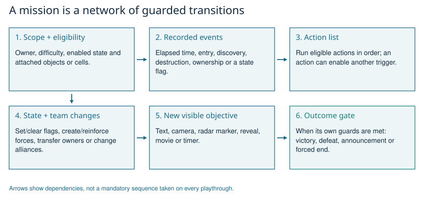

*Read a mission as a network of guarded transitions. Explanatory diagram derived from the guide and local data; not a screenshot.*
<!-- ILLUSTRATIONS:END -->

**Spoilers throughout.** The steps below are explanations of each scenario's intended progression and engine mechanisms, cross-checked against its local briefing, campaign table and full trigger ledger. They are not an optimized speedrun route or a claim that each branch has been tested by playing. Map events determine the exact outcome. The linked ledger provides every recovered trigger, attachment, activation link, ordered action, local team plan and explicit rule override.

1. Read the narrative workflow.
2. Open the mission ledger's terminal-gate table.
3. Follow its links to the guard conditions and incoming activators.
4. Follow team links when an action creates a force.
5. Check local overrides before applying ordinary skirmish unit/building rules.

## RA2 Allied campaign

| Stage | Mission | Detailed engine ledger |
| --- | --- | --- |
| 1 | Operation: Lone Guardian | [Open all01t.map](missions/ra2/all01t.md) |
| 2 | Operation: Eagle Dawn | [Open all02s.map](missions/ra2/all02s.md) |
| 3 | Operation: Hail to the Chief | [Open all03u.map](missions/ra2/all03u.md) |
| 4 | Operation: Last Chance | [Open all04u.map](missions/ra2/all04u.md) |
| 5 | Operation: Dark Night | [Open all05s.map](missions/ra2/all05s.md) |
| 6 | Operation: Liberty | [Open all06u.map](missions/ra2/all06u.md) |
| 7 | Operation: Deep Sea | [Open all07t.map](missions/ra2/all07t.md) |
| 8 | Operation: Free Gateway | [Open all08u.map](missions/ra2/all08u.md) |
| 9 | Operation: Sun Temple | [Open all09t.map](missions/ra2/all09t.md) |
| 10 | Operation: Mirage | [Open all10s.map](missions/ra2/all10s.md) |
| 11 | Operation: Fallout | [Open all11t.map](missions/ra2/all11t.md) |
| 12 | Operation: Chrono Storm | [Open all12s.map](missions/ra2/all12s.md) |

### 1. Operation: Lone Guardian

A hero-led introduction that becomes a small base-management mission.

1. Begin with Tanya and the local defenders. The opening ships are a scripted threat to the Statue of Liberty, not merely background decoration.
2. Use Tanya's permitted attacks to remove the Dreadnought threat while preserving her and the protected landmark. Their destruction/death events feed different mission branches.
3. Reach Fort Bradley. The contact/reveal sequence changes which forces and production opportunities you can use.
4. Restore the practical base workflow: power, infantry production and Engineer bridge repair where prompted. These are dependencies for progressing through the terrain, not cosmetic tutorial messages.
5. Destroy the Soviet supply base once the later objective is enabled. The victory sequence is a trigger chain with a delay; Tanya/landmark failure paths remain separate.

**Engine lesson:** Study how a single contact event can reveal an area, transfer forces, enable a hint and start another timer.

<!-- MAP:all01t -->

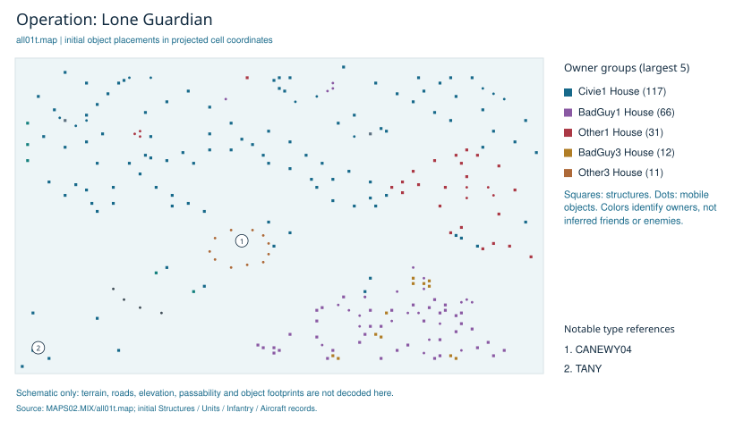

*Initial placement schematic for all01t.map. Explanatory diagram derived from the guide and local data; not a screenshot.*

[All conditions, teams and overrides](missions/ra2/all01t.md) | [Exact outcome gates](missions/ra2/all01t.md#terminal-gates-victory-defeat-or-forced-end)

### 2. Operation: Eagle Dawn

Recover infrastructure before fighting a conventional base battle.

1. Start with Tanya and move through the contact sequence that grants access to scattered friendly forces.
2. Preserve Tanya and use the infantry/specialist tools the mission makes available.
3. Use Engineers for the Soviet-held American facilities, including the Air Force Academy Chapel objective. Capture and destruction are different events.
4. Use the recovered economy and production facilities to build a force suited to the remaining threats.
5. Eliminate the required Soviet forces and let the outcome triggers run; Tanya's loss remains an independent failure.

**Engine lesson:** Study how ownership transfer changes both the objective state and the player's production capabilities.

<!-- MAP:all02s -->

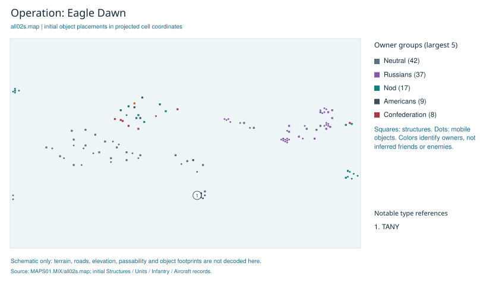

*Initial placement schematic for all02s.map. Explanatory diagram derived from the guide and local data; not a screenshot.*

[All conditions, teams and overrides](missions/ra2/all02s.md) | [Exact outcome gates](missions/ra2/all02s.md#terminal-gates-victory-defeat-or-forced-end)

### 3. Operation: Hail to the Chief

A conventional army must remove a mission-scale psychic-control objective.

1. Initialize the Allied base, economy and local defenders around the mission's starting position.
2. Respond to scripted attacks while producing a force that can reach the White House area.
3. Approach the Psychic Beacon through the available urban terrain; garrison and weapons rules still govern the route.
4. Destroy the tagged beacon rather than assuming that capturing arbitrary enemy buildings completes the story.
5. Allow the scripted release/outcome sequence to resolve after the beacon event.

**Engine lesson:** Separate an object's ordinary combat role from the scenario action that changes the leaders' control.

<!-- MAP:all03u -->

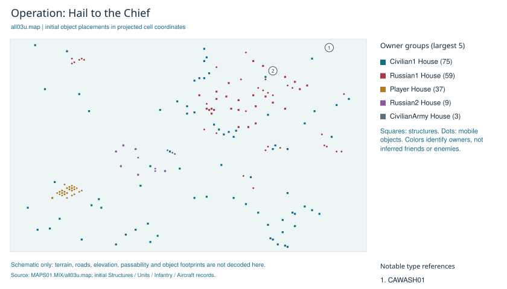

*Initial placement schematic for all03u.map. Explanatory diagram derived from the guide and local data; not a screenshot.*

[All conditions, teams and overrides](missions/ra2/all03u.md) | [Exact outcome gates](missions/ra2/all03u.md#terminal-gates-victory-defeat-or-forced-end)

### 4. Operation: Last Chance

A beachhead, economy and objective attack operate under a deadline.

1. Complete the shore landing and establish a usable base.
2. Begin harvesting and production quickly enough to support the coming attack.
3. Track the Psychic Amplifier countdown and its difficulty/activation triggers. The timer is a mission mechanism, not the recharge indicator of every enemy structure.
4. Reach and destroy the Chicago amplifier before its active failure condition is satisfied.
5. Let the destruction/success chain finish; expiration follows a separate branch even if much of the enemy army is already gone.

**Engine lesson:** Read the timer set/start actions and compare them with the destruction gate.

<!-- MAP:all04u -->

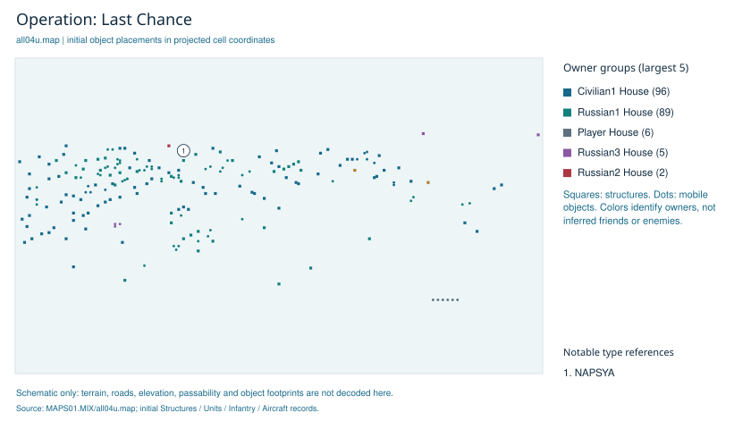

*Initial placement schematic for all04u.map. Explanatory diagram derived from the guide and local data; not a screenshot.*

[All conditions, teams and overrides](missions/ra2/all04u.md) | [Exact outcome gates](missions/ra2/all04u.md#terminal-gates-victory-defeat-or-forced-end)

### 5. Operation: Dark Night

Infiltration and demolition use different specialists and event types.

1. Keep Tanya alive while scouting the route to the Soviet research facilities.
2. Use the mission's infiltration tools to enter the Soviet Battle Lab and reveal/progress the objective chain.
3. Use disguise, power disruption and direct attacks according to each unit's supported interactions; a Spy is not an Engineer capture unit.
4. Neutralize both nuclear silos required by the objective. Removing just one does not satisfy the pair's completion logic.
5. Preserve Tanya until the mission issues its outcome after the silo conditions.

**Engine lesson:** Compare infiltration, reveal actions and multiple-object destruction conditions.

<!-- MAP:all05s -->

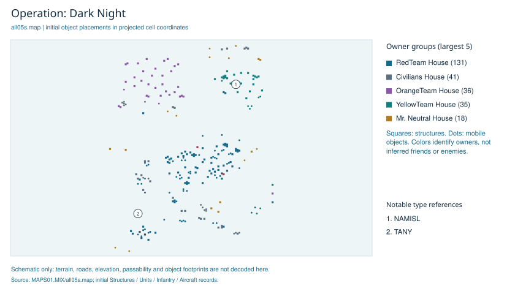

*Initial placement schematic for all05s.map. Explanatory diagram derived from the guide and local data; not a screenshot.*

[All conditions, teams and overrides](missions/ra2/all05s.md) | [Exact outcome gates](missions/ra2/all05s.md#terminal-gates-victory-defeat-or-forced-end)

### 6. Operation: Liberty

Recover the capital through a sustained production battle.

1. Connect with the Allied Pentagon forces through the mission's initial command-transfer sequence.
2. Keep the recovered base functional with income, power and accessible production exits.
3. Defend against the scripted Soviet attacks while assembling suitable ground and support forces.
4. Push into the occupied city and remove the required Soviet force/base ownership scopes.
5. Wait for the all-required-enemies completion gate and score sequence.

**Engine lesson:** Study the difference between a new unit being reinforced and an existing unit changing owner.

<!-- MAP:all06u -->

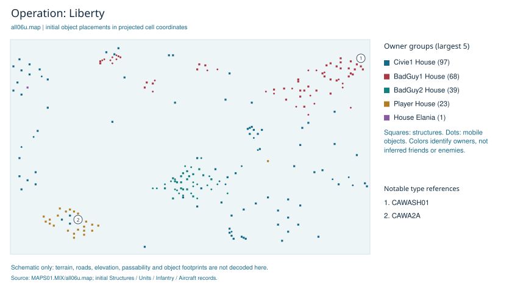

*Initial placement schematic for all06u.map. Explanatory diagram derived from the guide and local data; not a screenshot.*

[All conditions, teams and overrides](missions/ra2/all06u.md) | [Exact outcome gates](missions/ra2/all06u.md#terminal-gates-victory-defeat-or-forced-end)

### 7. Operation: Deep Sea

Naval control, land infrastructure and scripted reinforcements interact.

1. Organize the Hawaiian position and its land-based economy.
2. Use appropriate naval units for surface ships, submarines and aircraft; one naval weapon does not cover every target domain.
3. Respond to the arriving Soviet fleet and island-related wave triggers.
4. Remove the required Soviet sea and land presence using suitable bombardment and landing tools.
5. Satisfy the mission's destruction gates rather than assuming that sinking a single named ship ends the battle.

**Engine lesson:** Follow naval target eligibility and the separate team arrival scripts.

<!-- MAP:all07t -->

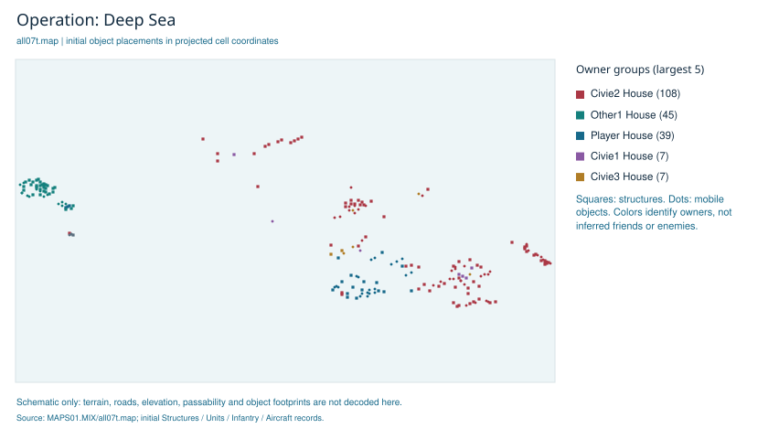

*Initial placement schematic for all07t.map. Explanatory diagram derived from the guide and local data; not a screenshot.*

[All conditions, teams and overrides](missions/ra2/all07t.md) | [Exact outcome gates](missions/ra2/all07t.md#terminal-gates-victory-defeat-or-forced-end)

### 8. Operation: Free Gateway

A hero strike releases a city before the remaining battle is finished.

1. Keep Tanya safe while advancing through the St. Louis opening.
2. Find the Soviet Psychic Beacon and plan an attack using legal targets/routes.
3. Destroy the beacon to invoke the mission's control-release and progression actions.
4. Use the resulting position and available army to remove the remaining required Soviet forces.
5. Keep Tanya alive through the actual victory gate; beacon destruction and complete mission success are separate stages.

**Engine lesson:** Read how an objective event changes ownership and enables the next objective.

<!-- MAP:all08u -->

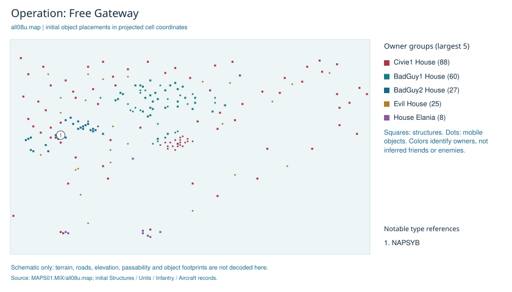

*Initial placement schematic for all08u.map. Explanatory diagram derived from the guide and local data; not a screenshot.*

[All conditions, teams and overrides](missions/ra2/all08u.md) | [Exact outcome gates](missions/ra2/all08u.md#terminal-gates-victory-defeat-or-forced-end)

### 9. Operation: Sun Temple

Deny stolen technology and then remove its defenders.

1. Use the supplied strike force to approach the Yucatan research area.
2. Identify the Soviet attempts to reproduce Prism technology.
3. Capture or destroy the relevant technology targets as the objective permits. This is one of the cases where the briefing explicitly allows more than one kind of result.
4. Eliminate the base defending the research site with the facilities and specialists made available.
5. Complete both the technology-denial and base-destruction parts of the scenario.

**Engine lesson:** Compare alternative permitted objective outcomes with a mission that requires capture only.

<!-- MAP:all09t -->

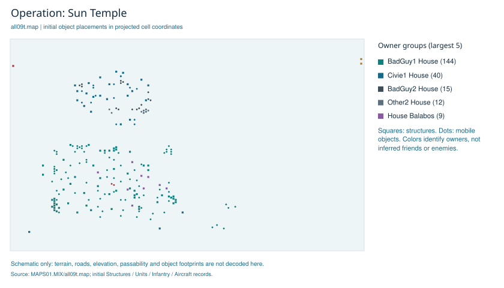

*Initial placement schematic for all09t.map. Explanatory diagram derived from the guide and local data; not a screenshot.*

[All conditions, teams and overrides](missions/ra2/all09t.md) | [Exact outcome gates](missions/ra2/all09t.md#terminal-gates-victory-defeat-or-forced-end)

### 10. Operation: Mirage

Protect a critical laboratory while destroying the attacking army.

1. Identify Einstein's laboratory as the protected object and organize defenses around usable approaches.
2. Keep economy, power and production functioning during the enemy's attack sequences.
3. Use the available Allied technology to counter the mix of ground and air threats.
4. Move from defense to eliminating the required Soviet forces without exposing the laboratory.
5. Reach the victory conditions while avoiding the lab-destruction failure branch.

**Engine lesson:** A defend objective remains relevant during your offensive; it is not automatically cleared by building a large army.

<!-- MAP:all10s -->

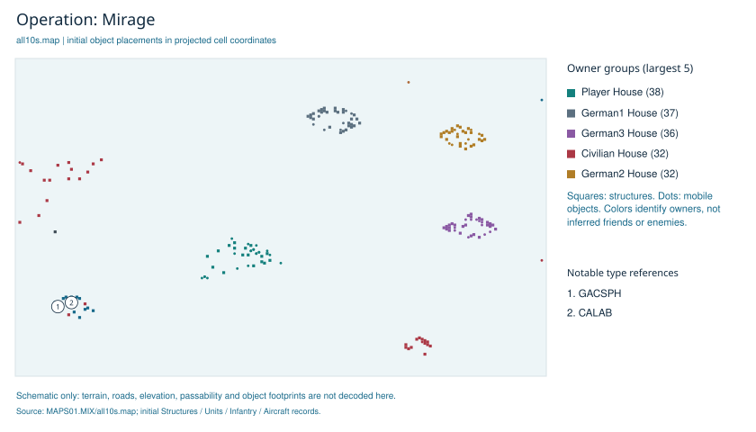

*Initial placement schematic for all10s.map. Explanatory diagram derived from the guide and local data; not a screenshot.*

[All conditions, teams and overrides](missions/ra2/all10s.md) | [Exact outcome gates](missions/ra2/all10s.md#terminal-gates-victory-defeat-or-forced-end)

### 11. Operation: Fallout

A construction milestone is followed by neutralizing a nuclear threat.

1. Establish a sustainable base near Soviet-controlled Cuba.
2. Meet the relevant prerequisites and construct the Chronosphere objective.
3. Watch the mission actions that respond to the building milestone and nuclear threat.
4. Use the available transfer, transport and assault tools to neutralize the specified Soviet missile threat on Cuba.
5. Satisfy the objective flags and outcome gate; a completed Chronosphere alone is not the whole mission.

**Engine lesson:** Compare a build-type event with later destruction-based objective gates.

<!-- MAP:all11t -->

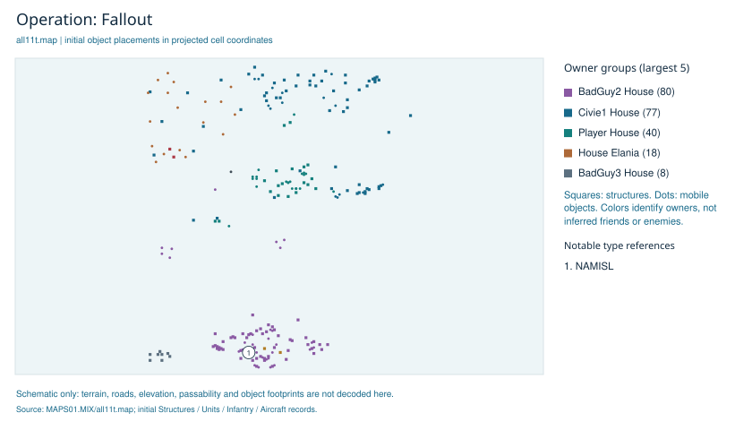

*Initial placement schematic for all11t.map. Explanatory diagram derived from the guide and local data; not a screenshot.*

[All conditions, teams and overrides](missions/ra2/all11t.md) | [Exact outcome gates](missions/ra2/all11t.md#terminal-gates-victory-defeat-or-forced-end)

### 12. Operation: Chrono Storm

A staged invasion uses reinforcement and defended-area conditions.

1. Secure the initial Moscow arrival area with the supplied strike force.
2. Clear the required arrival zone so the chrono reinforcement sequence can proceed.
3. Use the reinforced army to penetrate the capital and approach the Kremlin area.
4. Eliminate the designated Elite Black Guard defenses rather than interpreting the briefing as a requirement to destroy every city prop.
5. Let Tanya's Romanov capture/finale sequence and the mission outcome actions complete.

**Engine lesson:** The ending combines combat conditions and a scripted story sequence; it is not simply a tank-damage calculation on Romanov.

<!-- MAP:all12s -->

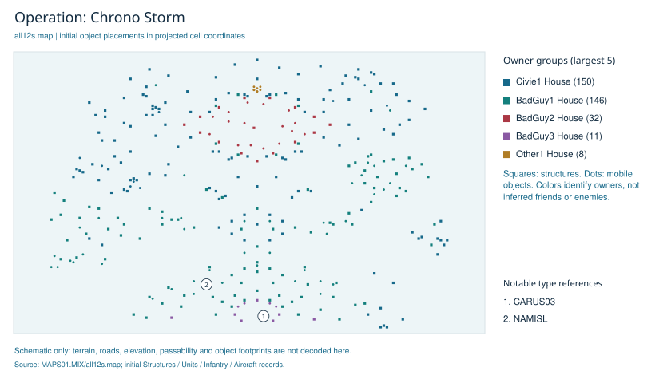

*Initial placement schematic for all12s.map. Explanatory diagram derived from the guide and local data; not a screenshot.*

[All conditions, teams and overrides](missions/ra2/all12s.md) | [Exact outcome gates](missions/ra2/all12s.md#terminal-gates-victory-defeat-or-forced-end)

## RA2 Soviet campaign

| Stage | Mission | Detailed engine ledger |
| --- | --- | --- |
| 1 | Operation: Red Dawn | [Open sov01t.map](missions/ra2/sov01t.md) |
| 2 | Operation: Hostile Shore | [Open sov02t.map](missions/ra2/sov02t.md) |
| 3 | Operation: Big Apple | [Open sov03u.map](missions/ra2/sov03u.md) |
| 4 | Operation: Home Front | [Open sov04s.map](missions/ra2/sov04s.md) |
| 5 | Operation: City of Lights | [Open sov05u.map](missions/ra2/sov05u.md) |
| 6 | Operation: Sub-Divide | [Open sov06t.map](missions/ra2/sov06t.md) |
| 7 | Operation: Chrono Defense | [Open sov07s.map](missions/ra2/sov07s.md) |
| 8 | Operation: Desecration | [Open sov08u.map](missions/ra2/sov08u.md) |
| 9 | Operation: The Fox and the Hound | [Open sov09u.map](missions/ra2/sov09u.md) |
| 10 | Operation: Weathered Alliance | [Open sov10t.map](missions/ra2/sov10t.md) |
| 11 | Operation: Red Revolution | [Open sov11s.map](missions/ra2/sov11s.md) |
| 12 | Operation: Polar Storm | [Open sov12s.map](missions/ra2/sov12s.md) |

### 1. Operation: Red Dawn

A scripted invasion teaches basic force control and urban fighting.

1. Take command of the Soviet landing/invasion force and follow the initial contact sequences.
2. Use the provided production and reinforcement opportunities to maintain the attack.
3. Advance through Washington while using garrison, anti-infantry and demolition tools appropriately.
4. Destroy the required Pentagon objective parts/linked scope.
5. Allow the objective-destruction chain to declare the mission outcome.

**Engine lesson:** A visually large landmark can consist of multiple placed type records and associated tags.

<!-- MAP:sov01t -->

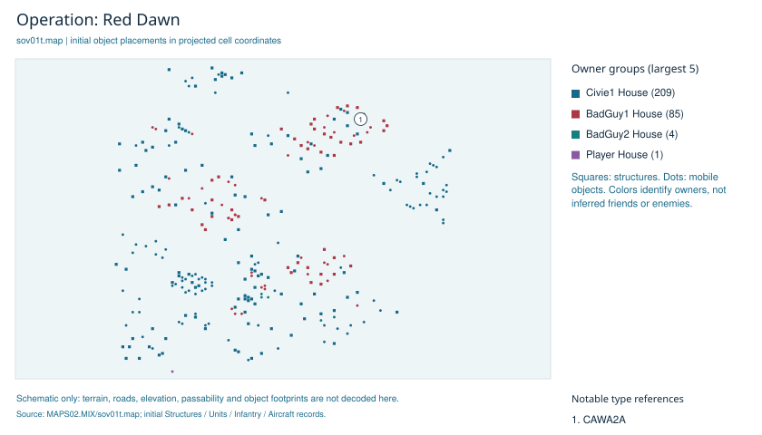

*Initial placement schematic for sov01t.map. Explanatory diagram derived from the guide and local data; not a screenshot.*

[All conditions, teams and overrides](missions/ra2/sov01t.md) | [Exact outcome gates](missions/ra2/sov01t.md#terminal-gates-victory-defeat-or-forced-end)

### 2. Operation: Hostile Shore

An amphibious landing develops into an annihilation objective.

1. Use the supplied naval support to establish a safe Florida landing.
2. Deploy a base on a legal site and begin the normal resource/production cycle.
3. Use Vladimir's support according to its scripted role; it is separate from your own factory queue.
4. Remove enemy positions and naval threats with appropriate land/sea weapon domains.
5. Eliminate the required remaining enemy forces and satisfy the outcome trigger.

**Engine lesson:** Distinguish autonomous/scripted allied support from directly owned player units.

<!-- MAP:sov02t -->

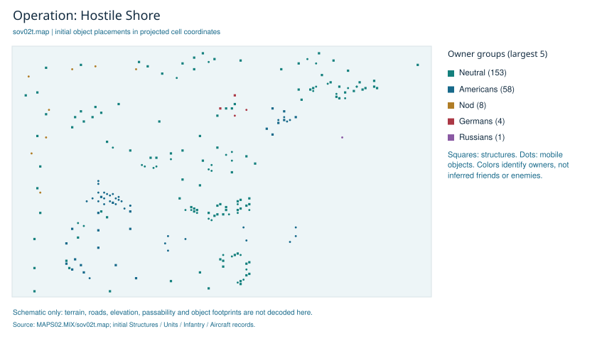

*Initial placement schematic for sov02t.map. Explanatory diagram derived from the guide and local data; not a screenshot.*

[All conditions, teams and overrides](missions/ra2/sov02t.md) | [Exact outcome gates](missions/ra2/sov02t.md#terminal-gates-victory-defeat-or-forced-end)

### 3. Operation: Big Apple

Capture enables construction, then defense enables mission completion.

1. Reach the Allied Battle Lab in New York with a viable capture force.
2. Enter it with an Engineer rather than destroying it; this objective depends on captured technology.
3. Use the newly enabled Psychic Beacon construction opportunity.
4. Build and defend the beacon through the mission's attack/countdown sequence.
5. Keep the objective alive until the completion/control sequence resolves.

**Engine lesson:** This is a clear state machine: acquire technology, build objective, defend while a timer/flags progress, complete.

<!-- MAP:sov03u -->

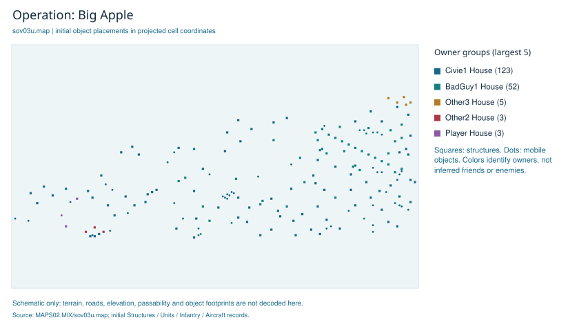

*Initial placement schematic for sov03u.map. Explanatory diagram derived from the guide and local data; not a screenshot.*

[All conditions, teams and overrides](missions/ra2/sov03u.md) | [Exact outcome gates](missions/ra2/sov03u.md#terminal-gates-victory-defeat-or-forced-end)

### 4. Operation: Home Front

Defend the home territory, then remove the invading force.

1. Develop the Soviet base and its economy.
2. Prepare ground and air defenses against the Korean invasion scripts.
3. Preserve operational power and production as waves arrive.
4. Counterattack the invading enemy positions and remaining forces.
5. Satisfy the mission's required enemy-destruction gates.

**Engine lesson:** Country identity affects available aircraft, while mission scripts determine when attacks arrive.

<!-- MAP:sov04s -->

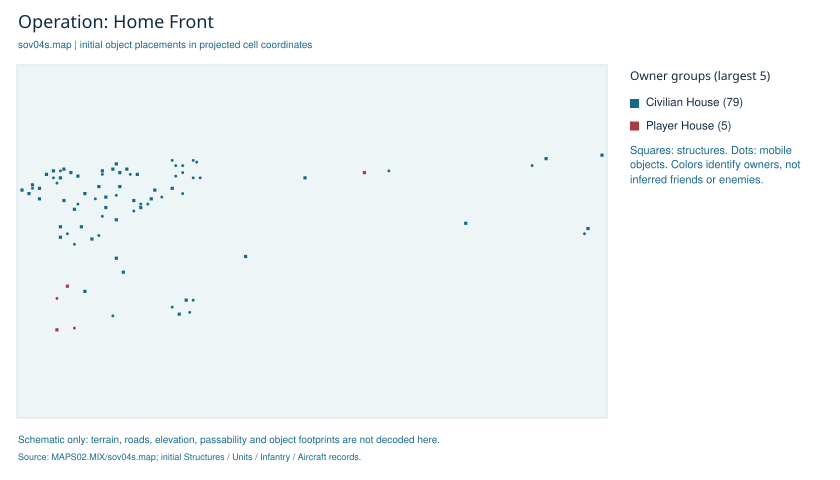

*Initial placement schematic for sov04s.map. Explanatory diagram derived from the guide and local data; not a screenshot.*

[All conditions, teams and overrides](missions/ra2/sov04s.md) | [Exact outcome gates](missions/ra2/sov04s.md#terminal-gates-victory-defeat-or-forced-end)

### 5. Operation: City of Lights

A landmark becomes a scenario-specific weapon through support conditions.

1. Advance the supplied Soviet infantry through Paris.
2. Bring the required Tesla Troopers into the Paris Tower's supported charging interaction.
3. Energize the tower with the required trooper support; it is a special map setup, not an ordinary buildable tower queue.
4. Defend the tower and its support while its enabled weapon attacks the Allied opposition.
5. Remove the remaining required Allied troops without losing the protected objective.

**Engine lesson:** Follow the local Paris Tower rules and tags instead of copying the global Tesla Coil description blindly.

<!-- MAP:sov05u -->

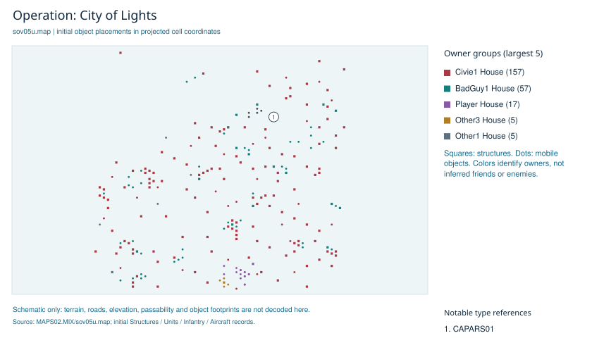

*Initial placement schematic for sov05u.map. Explanatory diagram derived from the guide and local data; not a screenshot.*

[All conditions, teams and overrides](missions/ra2/sov05u.md) | [Exact outcome gates](missions/ra2/sov05u.md#terminal-gates-victory-defeat-or-forced-end)

### 6. Operation: Sub-Divide

Island economy supports a naval destruction objective.

1. Establish a working base in the Hawaiian island position.
2. Develop income and naval production with usable shoreline exits.
3. Respond to American defenses and the Korean fleet-related reinforcement scripts.
4. Use submarine, anti-air and bombardment roles against the targets each can legally engage.
5. Destroy the required Allied Navy ownership scope to reach the outcome chain.

**Engine lesson:** The mission explicitly emphasizes naval survival/destruction, which can differ from a generic all-buildings objective.

<!-- MAP:sov06t -->

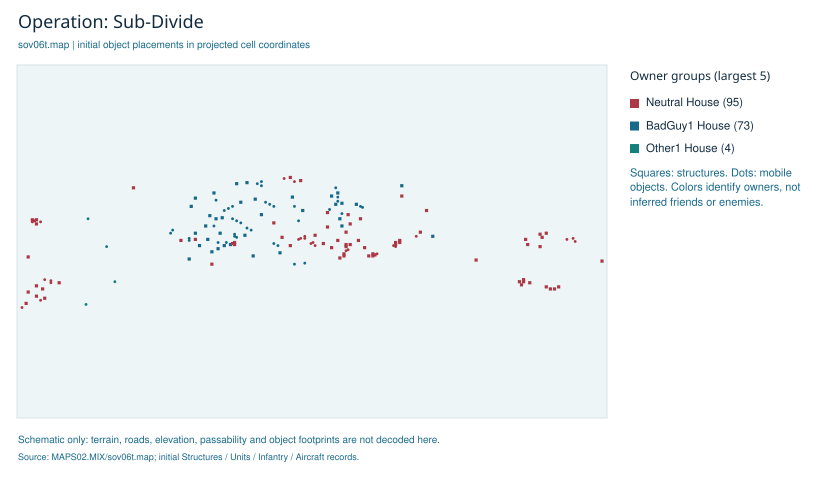

*Initial placement schematic for sov06t.map. Explanatory diagram derived from the guide and local data; not a screenshot.*

[All conditions, teams and overrides](missions/ra2/sov06t.md) | [Exact outcome gates](missions/ra2/sov06t.md#terminal-gates-victory-defeat-or-forced-end)

### 7. Operation: Chrono Defense

A protected Battle Lab must survive successive chrono attacks.

1. Identify the Soviet Battle Lab and organize defenses around its possible attack directions.
2. Develop economy and production while preserving that lab.
3. Respond to chrono reinforcement waves, which need not travel visibly from the edge of the map.
4. Track the scenario's staged timers and flags; a quiet interval can be a preparation period.
5. Keep the lab alive through the required defense sequence and its final completion condition.

**Engine lesson:** Study repeated timer resets and reinforcements that arrive at internal waypoints.

<!-- MAP:sov07s -->

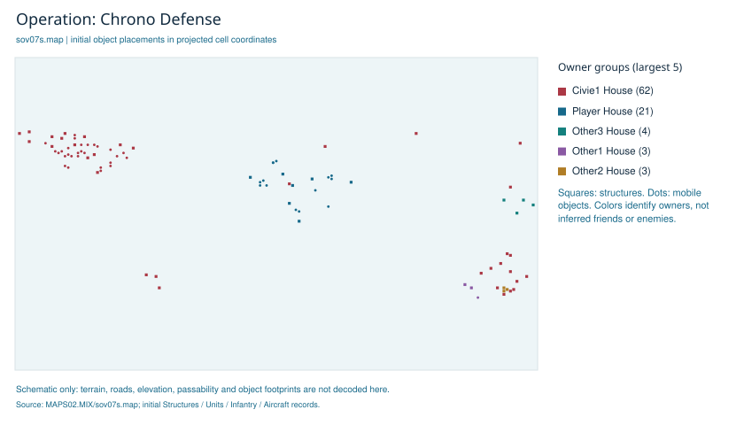

*Initial placement schematic for sov07s.map. Explanatory diagram derived from the guide and local data; not a screenshot.*

[All conditions, teams and overrides](missions/ra2/sov07s.md) | [Exact outcome gates](missions/ra2/sov07s.md#terminal-gates-victory-defeat-or-forced-end)

### 8. Operation: Desecration

The target must change owner, so demolition is the wrong final interaction.

1. Establish your forces in the Washington battle against Vladimir's army.
2. Maintain economy, power and an escort capable of clearing a route.
3. Approach the White House while preserving the target structure for capture.
4. Send a surviving Engineer through the legal entry to take control of the White House.
5. Let the capture/ownership event advance the victory sequence.

**Engine lesson:** A capture objective uses a different terminal gate from a destroy-the-headquarters objective.

<!-- MAP:sov08u -->

*Initial placement schematic for sov08u.map. Explanatory diagram derived from the guide and local data; not a screenshot.*

[All conditions, teams and overrides](missions/ra2/sov08u.md) | [Exact outcome gates](missions/ra2/sov08u.md#terminal-gates-victory-defeat-or-forced-end)

### 9. Operation: The Fox and the Hound

A small force exploits disguise and mind control rather than base production.

1. Begin with the mission's supplied psychic/infiltration tools near San Antonio.
2. Use susceptible enemy soldiers as a resource through supported mind control.
3. Use infiltrators and power disruption where useful to open access around the Alamo.
4. Expose and acquire the President through mind control, keeping the target alive for that interaction.
5. Complete the President-control event; destroying him is not a substitute for capturing him.

**Engine lesson:** Ownership effects can be the required result even when almost no ordinary production is available.

<!-- MAP:sov09u -->

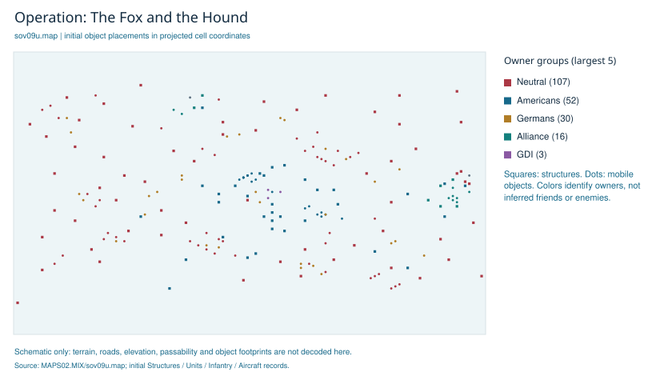

*Initial placement schematic for sov09u.map. Explanatory diagram derived from the guide and local data; not a screenshot.*

[All conditions, teams and overrides](missions/ra2/sov09u.md) | [Exact outcome gates](missions/ra2/sov09u.md#terminal-gates-victory-defeat-or-forced-end)

### 10. Operation: Weathered Alliance

Information acquisition reveals the real objective.

1. Build up the Soviet position in the Virgin Islands.
2. Reach the Allied Battle Lab with an Engineer while protecting the capture target.
3. Capture the lab to locate/reveal the Weather Control Device through the scenario actions.
4. Reach and destroy that device with suitable ground/naval/transport tools.
5. Complete the target-destruction gate after the information stage.

**Engine lesson:** A map reveal is an action caused by an objective, not proof that the target was created at that instant.

<!-- MAP:sov10t -->

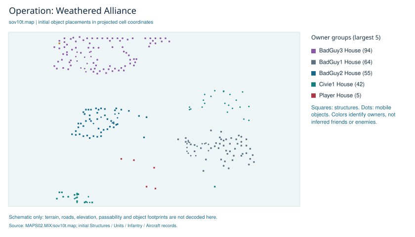

*Initial placement schematic for sov10t.map. Explanatory diagram derived from the guide and local data; not a screenshot.*

[All conditions, teams and overrides](missions/ra2/sov10t.md) | [Exact outcome gates](missions/ra2/sov10t.md#terminal-gates-victory-defeat-or-forced-end)

### 11. Operation: Red Revolution

An offensive must survive scripted pressure on its economy and base.

1. Prepare the Soviet base for the Moscow battle against Yuri's forces.
2. Keep income and power available during the scenario's timed and reactive attacks.
3. Build a force that can cope with psychic-control threats and defended approaches.
4. Penetrate the Kremlin area and destroy the designated Yuri headquarters scope.
5. Allow the headquarters-destruction chain to declare success.

**Engine lesson:** Separate baseline unit immunity/counterplay from mission-specific waves and available resources.

<!-- MAP:sov11s -->

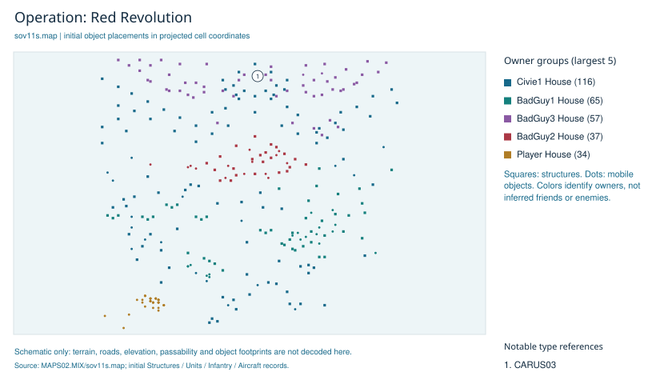

*Initial placement schematic for sov11s.map. Explanatory diagram derived from the guide and local data; not a screenshot.*

[All conditions, teams and overrides](missions/ra2/sov11s.md) | [Exact outcome gates](missions/ra2/sov11s.md#terminal-gates-victory-defeat-or-forced-end)

### 12. Operation: Polar Storm

A final base assault opposes an enemy transfer network.

1. Establish the Soviet position near Point Hope, Alaska, with the limited starting force.
2. Create a reliable economy and defenses against the Allied attacks.
3. Use the available high-technology assault options to reach the defended Chronosphere.
4. Destroy the designated Chronosphere objective before the enemy's pressure defeats you.
5. Resolve the objective event and campaign ending; unrelated scenery is not an extra victory requirement.

**Engine lesson:** Enemy chrono arrivals are scenario-controlled attack delivery, while destroying the objective ends the strategic threat.

<!-- MAP:sov12s -->

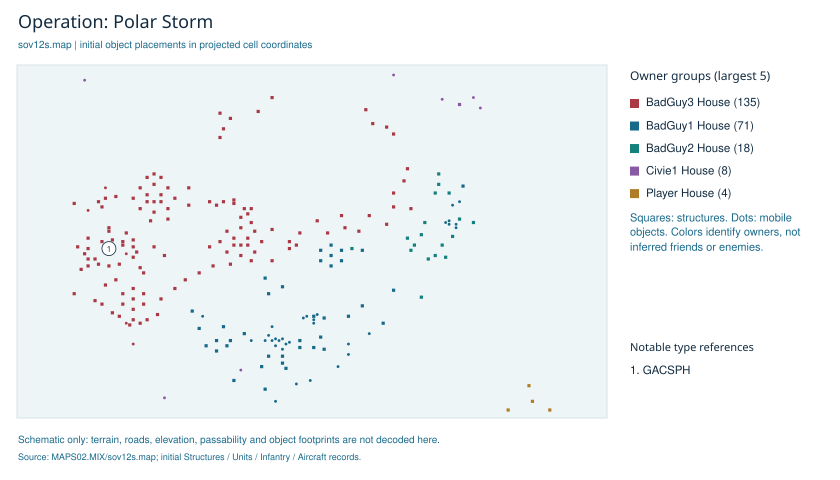

*Initial placement schematic for sov12s.map. Explanatory diagram derived from the guide and local data; not a screenshot.*

[All conditions, teams and overrides](missions/ra2/sov12s.md) | [Exact outcome gates](missions/ra2/sov12s.md#terminal-gates-victory-defeat-or-forced-end)

## Yuri's Revenge Allied campaign

| Stage | Mission | Detailed engine ledger |
| --- | --- | --- |
| 1 | Operation: Time Lapse | [Open all01umd.map](missions/yr/all01umd.md) |
| 2 | Operation: Hollywood and Vain | [Open all02umd.map](missions/yr/all02umd.md) |
| 3 | Operation: Power Play | [Open all03umd.map](missions/yr/all03umd.md) |
| 4 | Operation: Tomb Raided | [Open all04dmd.map](missions/yr/all04dmd.md) |
| 5 | Operation: Clones Down Under | [Open all05umd.map](missions/yr/all05umd.md) |
| 6 | Operation: Trick or Treaty | [Open all06umd.map](missions/yr/all06umd.md) |
| 7 | Operation: Brain Dead | [Open all07smd.map](missions/yr/all07smd.md) |

### 1. Operation: Time Lapse

A mission-specific power network drives a time-travel state change.

1. Defend the Time Machine and organize the starting San Francisco forces.
2. Capture the marked power sources so the mission's power-objective conditions become satisfied.
3. Preserve the machine while the scripted travel sequence changes the scenario state.
4. Use the post-travel position and available forces to reach Alcatraz.
5. Destroy the Psychic Dominator and complete the mission outcome while respecting machine/failure conditions.

**Engine lesson:** The map defines individual power-plant copies and counting flags. This is more specific than simply having any four ordinary Power Plants.

<!-- MAP:all01umd -->

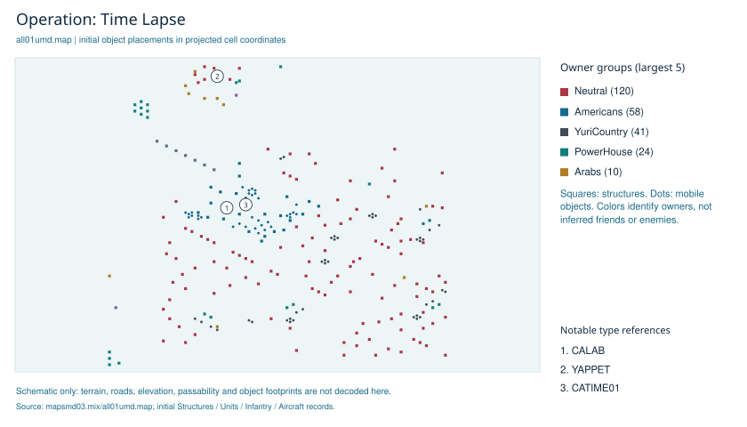

*Initial placement schematic for all01umd.map. Explanatory diagram derived from the guide and local data; not a screenshot.*

[All conditions, teams and overrides](missions/yr/all01umd.md) | [Exact outcome gates](missions/yr/all01umd.md#terminal-gates-victory-defeat-or-forced-end)

### 2. Operation: Hollywood and Vain

Disable an economic network before finishing the enemy base.

1. Establish the Allied force in Los Angeles and defend its production/economy.
2. Find the individual Grinder objectives and the civilian/hero-related contact opportunities.
3. Destroy all Grinders counted by the mission flags. A visible cash-generating story process is represented by scripts and object relationships.
4. Destroy the remaining required Yuri buildings.
5. Let the combined Grinder/base completion gates declare victory.

**Engine lesson:** The patch archive supplies the effective version of this map. Individual Grinder flags combine into the larger objective.

<!-- MAP:all02umd -->

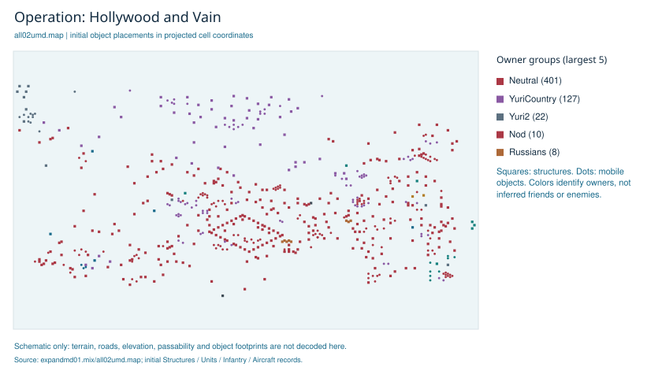

*Initial placement schematic for all02umd.map. Explanatory diagram derived from the guide and local data; not a screenshot.*

[All conditions, teams and overrides](missions/yr/all02umd.md) | [Exact outcome gates](missions/yr/all02umd.md#terminal-gates-victory-defeat-or-forced-end)

### 3. Operation: Power Play

A nuclear threat and a liberation objective are separate stages.

1. Develop the Allied position in Seattle while monitoring the silo-related time pressure.
2. Produce a force suited to reaching Yuri's Nuclear Silo.
3. Destroy the specified silo to remove the immediate threat.
4. Liberate the MassiveSoft campus through the mission's required object/ownership conditions.
5. Complete both parts of the objective network rather than stopping at the silo explosion.

**Engine lesson:** A story company/campus label is implemented through placed objects and trigger scopes.

<!-- MAP:all03umd -->

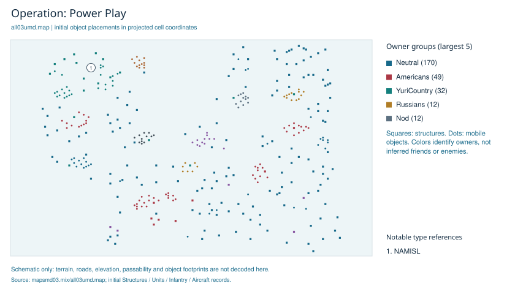

*Initial placement schematic for all03umd.map. Explanatory diagram derived from the guide and local data; not a screenshot.*

[All conditions, teams and overrides](missions/yr/all03umd.md) | [Exact outcome gates](missions/yr/all03umd.md#terminal-gates-victory-defeat-or-forced-end)

### 4. Operation: Tomb Raided

Removing power structures releases a captive and changes mission capability.

1. Approach the Egyptian Great Pyramid objective and identify its associated Bio Reactors.
2. Destroy the required reactors around the prison/research location.
3. Allow the Einstein rescue sequence and any resulting special capability to occur.
4. Use the available force and enabled tools against Yuri's base.
5. Destroy the required base scope while avoiding the scenario's protected-unit failure branches.

**Engine lesson:** Rescue can be implemented as an enabled sequence following several object-destruction flags.

<!-- MAP:all04dmd -->

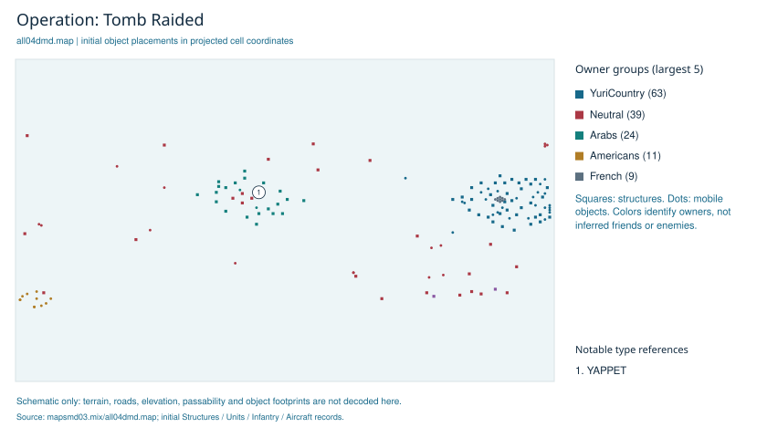

*Initial placement schematic for all04dmd.map. Explanatory diagram derived from the guide and local data; not a screenshot.*

[All conditions, teams and overrides](missions/yr/all04dmd.md) | [Exact outcome gates](missions/yr/all04dmd.md#terminal-gates-victory-defeat-or-forced-end)

### 5. Operation: Clones Down Under

A technology-production facility is the first objective, not the entire battle.

1. Establish the Allied Sydney position and a functioning economy.
2. Scout for Yuri's cloning facilities while responding to the local attack teams.
3. Destroy the specified Cloning Vats to interrupt that objective branch.
4. Remove the remaining required Yuri forces with appropriate counters to their control/air/armor roles.
5. Complete the remaining-force and cloning-objective gates.

**Engine lesson:** Destroying a technology building may alter future production while the surviving army remains active.

<!-- MAP:all05umd -->

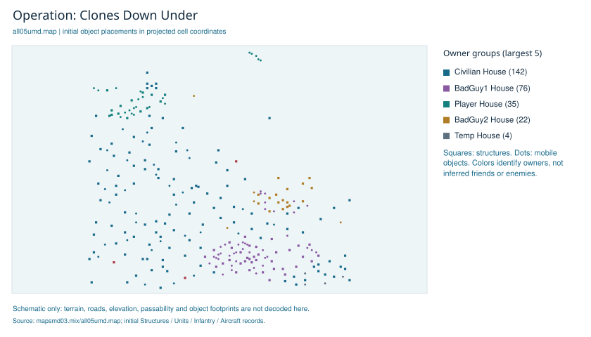

*Initial placement schematic for all05umd.map. Explanatory diagram derived from the guide and local data; not a screenshot.*

[All conditions, teams and overrides](missions/yr/all05umd.md) | [Exact outcome gates](missions/yr/all05umd.md#terminal-gates-victory-defeat-or-forced-end)

### 6. Operation: Trick or Treaty

Protect the summit, then destroy its attacker.

1. Identify Parliament and the protected world-leader/summit scenario state.
2. Build a defensive economy and protect the approaches against Yuri's staged assaults.
3. Keep the protected objective intact through the defense sequence.
4. Move against Yuri's base after the scenario makes the offensive objective available.
5. Destroy the required Yuri base while continuing to avoid protected-object failure.

**Engine lesson:** A timed defense objective and a base-destruction objective can coexist, with explicit enabling links between their stages.

<!-- MAP:all06umd -->

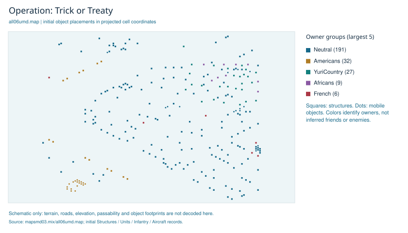

*Initial placement schematic for all06umd.map. Explanatory diagram derived from the guide and local data; not a screenshot.*

[All conditions, teams and overrides](missions/yr/all06umd.md) | [Exact outcome gates](missions/yr/all06umd.md#terminal-gates-victory-defeat-or-forced-end)

### 7. Operation: Brain Dead

Recovered Soviet infrastructure enables a combined-faction finale.

1. Bring the abandoned Soviet base at Tierra del Fuego into a usable owned/operational state.
2. Build the Soviet Radar Dish required by the mission; this is a specific construction event.
3. Follow the resulting reveal/location sequence toward Antarctica.
4. Use the combined available technology to destroy the final Psychic Dominator.
5. Eliminate the remaining required Yuri forces and let the final outcome sequence complete.

**Engine lesson:** Captured/recovered technology changes the set of eligible production paths without merging the two games' entire rulebooks.

<!-- MAP:all07smd -->

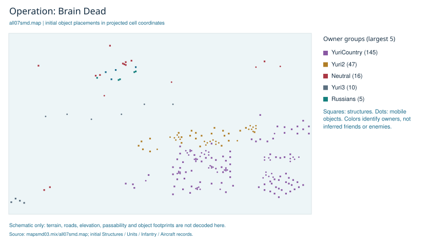

*Initial placement schematic for all07smd.map. Explanatory diagram derived from the guide and local data; not a screenshot.*

[All conditions, teams and overrides](missions/yr/all07smd.md) | [Exact outcome gates](missions/yr/all07smd.md#terminal-gates-victory-defeat-or-forced-end)

## Yuri's Revenge Soviet campaign

| Stage | Mission | Detailed engine ledger |
| --- | --- | --- |
| 1 | Operation: Time Shift | [Open sov01umd.map](missions/yr/sov01umd.md) |
| 2 | Operation: Deja Vu | [Open sov02smd.map](missions/yr/sov02smd.md) |
| 3 | Operation: Brain Wash | [Open sov03umd.map](missions/yr/sov03umd.md) |
| 4 | Operation: Romanov on the Run | [Open sov04dmd.map](missions/yr/sov04dmd.md) |
| 5 | Operation: Escape Velocity | [Open sov05umd.map](missions/yr/sov05umd.md) |
| 6 | Operation: To The Moon | [Open sov06lmd.map](missions/yr/sov06lmd.md) |
| 7 | Operation: Head Games | [Open sov07tmd.map](missions/yr/sov07tmd.md) |

### 1. Operation: Time Shift

Several sequential objective gates control two different time periods.

1. Destroy the required Allied naval defenses and Grand Cannons around the approach.
2. Remove the Pill Boxes around the Time Machine so the scenario can transfer/control it.
3. Capture the required four power sources and defend the critical machine while the travel sequence proceeds.
4. Assume control of the available Soviet base after the scripted state changes, including the intermediate time-travel diversion.
5. Use that base/army to destroy the Psychic Dominator and satisfy the final mission gate.

**Engine lesson:** Time travel is a carefully staged map script with ownership, camera and object changes; it is not a universal ability every unit gains.

<!-- MAP:sov01umd -->

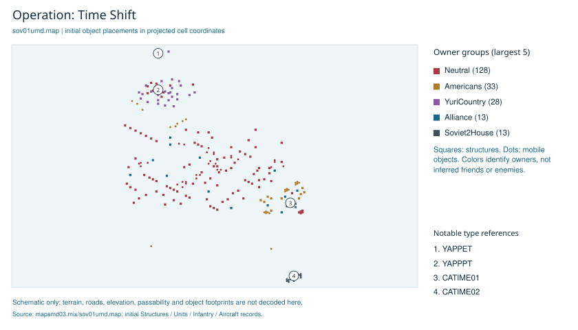

*Initial placement schematic for sov01umd.map. Explanatory diagram derived from the guide and local data; not a screenshot.*

[All conditions, teams and overrides](missions/yr/sov01umd.md) | [Exact outcome gates](missions/yr/sov01umd.md#terminal-gates-victory-defeat-or-forced-end)

### 2. Operation: Deja Vu

A revised attack targets both research and transfer technology.

1. Begin the return to the Black Forest with the available Soviet army and support.
2. Destroy the border outposts specified by the opening objective.
3. Develop the force and economy needed to reach the defended research site.
4. Destroy Einstein's Laboratory and the Chronosphere required by the mission.
5. Complete the combined objective flags and success sequence.

**Engine lesson:** Track the two objective structures independently; destroying one technology does not automatically count the other.

<!-- MAP:sov02smd -->

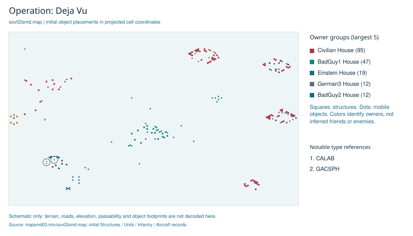

*Initial placement schematic for sov02smd.map. Explanatory diagram derived from the guide and local data; not a screenshot.*

[All conditions, teams and overrides](missions/yr/sov02smd.md) | [Exact outcome gates](missions/yr/sov02smd.md#terminal-gates-victory-defeat-or-forced-end)

### 3. Operation: Brain Wash

Free a captured army, then cooperate against the controlling enemy.

1. Advance the Soviet force toward the Psychic Beacon in London.
2. Destroy that beacon to trigger the release of the mind-controlled Allied strike force.
3. Use the changed ownership/alliance state and available forces against the near-complete Psychic Dominator.
4. Destroy the Dominator before its active threat/failure sequence succeeds.
5. Finish the remaining required Yuri forces and resolve the mission outcome.

**Engine lesson:** A mass ownership/alliance change is scripted; it must not be mistaken for every unit independently acquiring mind-control immunity.

<!-- MAP:sov03umd -->

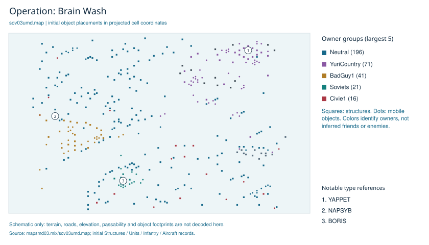

*Initial placement schematic for sov03umd.map. Explanatory diagram derived from the guide and local data; not a screenshot.*

[All conditions, teams and overrides](missions/yr/sov03umd.md) | [Exact outcome gates](missions/yr/sov03umd.md#terminal-gates-victory-defeat-or-forced-end)

### 4. Operation: Romanov on the Run

Escort completion requires both a safe destination and a living passenger.

1. Locate Romanov through the search/contact sequence.
2. Protect him as a critical unit while assembling a force to clear the extraction route.
3. Destroy Yuri's airport-guarding base as the objective requires.
4. Move the living Romanov to the now-valid airport extraction area.
5. Let the entry/evacuation sequence complete; clearing the airport without delivering him is insufficient.

**Engine lesson:** This joins a destruction condition, a protected-unit failure condition and a destination-entry condition.

<!-- MAP:sov04dmd -->

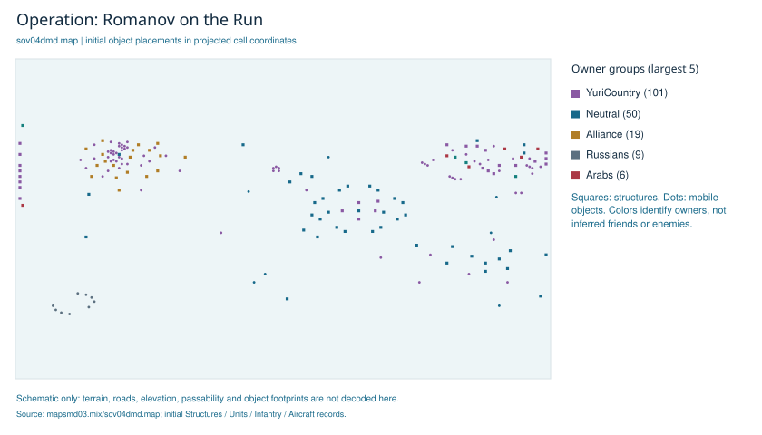

*Initial placement schematic for sov04dmd.map. Explanatory diagram derived from the guide and local data; not a screenshot.*

[All conditions, teams and overrides](missions/yr/sov04dmd.md) | [Exact outcome gates](missions/yr/sov04dmd.md#terminal-gates-victory-defeat-or-forced-end)

### 5. Operation: Escape Velocity

Choose a beachhead and remove naval production before the remaining cleanup.

1. Select a useful landing zone and establish a functioning Soviet base.
2. Prepare against the threat from Yuri's Boomer submarines and other scripted attacks.
3. Locate the specified Submarine Pen/naval production objective.
4. Destroy that pen and then remove the remaining required Yuri forces.
5. Complete the mission flags and transition sequence that prepares the lunar stage.

**Engine lesson:** Destroying a factory prevents/changes future production but does not itself erase already launched missiles or existing ships.

<!-- MAP:sov05umd -->

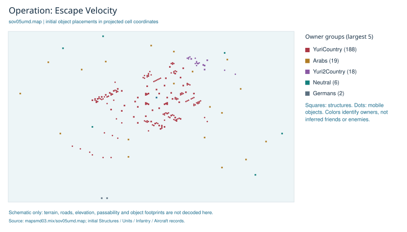

*Initial placement schematic for sov05umd.map. Explanatory diagram derived from the guide and local data; not a screenshot.*

[All conditions, teams and overrides](missions/yr/sov05umd.md) | [Exact outcome gates](missions/yr/sov05umd.md#terminal-gates-victory-defeat-or-forced-end)

### 6. Operation: To The Moon

A different theater changes the available army and its movement context.

1. Find a legal site and establish the lunar Soviet base.
2. Use the mission's lunar economy, production and available Cosmonaut/vehicle options.
3. Locate Yuri's Lunar Command Center amid the moon bases.
4. Destroy that center and the remaining required base scope.
5. Complete the lunar objective flags and return/progression sequence.

**Engine lesson:** The moon mission uses a distinct map theater and local overrides; ordinary Earth skirmish assumptions are insufficient.

<!-- MAP:sov06lmd -->

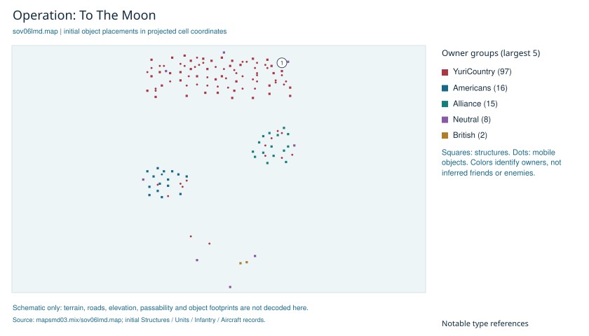

*Initial placement schematic for sov06lmd.map. Explanatory diagram derived from the guide and local data; not a screenshot.*

[All conditions, teams and overrides](missions/yr/sov06lmd.md) | [Exact outcome gates](missions/yr/sov06lmd.md#terminal-gates-victory-defeat-or-forced-end)

### 7. Operation: Head Games

A fortified target is protected by several factions and scenario threats.

1. Establish the Soviet force in Transylvania and inspect the available captured/starting technologies.
2. Maintain economy and protection against Yuri's control effects and scripted enemy forces.
3. Break through the defended approaches using suitable anti-control, anti-air and anti-armor roles.
4. Destroy the designated Yuri Fortress objective.
5. Allow the fortress-destruction/finale actions to complete rather than treating every surviving enemy object as an unstated objective.

**Engine lesson:** The final fortress is a mission-tagged structure. Its story importance comes from the scenario network, not just its global health value.

<!-- MAP:sov07tmd -->

*Initial placement schematic for sov07tmd.map. Explanatory diagram derived from the guide and local data; not a screenshot.*

[All conditions, teams and overrides](missions/yr/sov07tmd.md) | [Exact outcome gates](missions/yr/sov07tmd.md#terminal-gates-victory-defeat-or-forced-end)

## Training and the additional recovered map

### trn01t

A sequence of instruction gates teaches direct control.

1. Let the instructor's opening sequence enable the first exercise.
2. Select and move the supplied units to the indicated area.
3. Perform the prompted attack and interaction exercises in their enabled order.
4. Use the local contact/selection/entry events to advance each lesson.
5. Complete the final training gate; later exercises need not be active before their predecessor is completed.

**Engine lesson:** A tutorial is an ordinary scenario with tightly controlled enabling and input/selection events.

<!-- MAP:trn01t -->

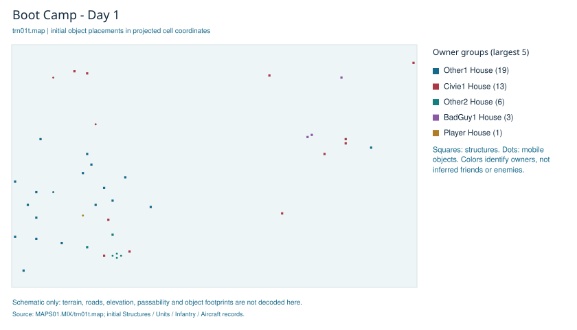

*Initial placement schematic for trn01t.map. Explanatory diagram derived from the guide and local data; not a screenshot.*

[Full scenario ledger](missions/ra2/trn01t.md)

### trn02t

Base management is taught as a dependency sequence.

1. Follow the supplied construction/deployment instruction.
2. Establish the prompted power and economy facilities.
3. Produce the requested units through eligible factories.
4. Perform the indicated defense/attack exercises as their triggers are enabled.
5. Complete the final boot-camp sequence and proceed to campaign selection/progression.

**Engine lesson:** A build-type event can serve as a lesson-completion condition without destroying any enemy object.

<!-- MAP:trn02t -->

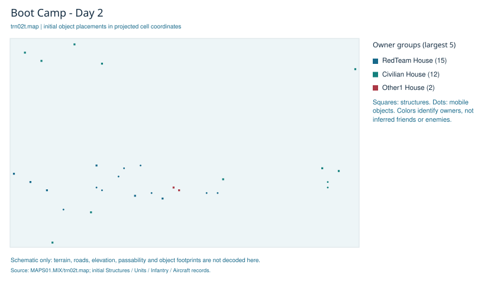

*Initial placement schematic for trn02t.map. Explanatory diagram derived from the guide and local data; not a screenshot.*

[Full scenario ledger](missions/ra2/trn02t.md)

### sov09t

An additional older/alternate map is present but is not the campaign-selected ninth Soviet mission.

1. Treat this file as a separate recovered scenario, not a second mandatory stage after The Fox and the Hound.
2. Inspect its starting SovStar House ownership and its own task forces.
3. Follow its local trigger conditions and attached scopes when analyzing what it would do.
4. Do not transfer its short trigger list or starting army to sov09u.map.
5. Use the mission progression table's sov09u.map for the ordinary campaign route.

**Engine lesson:** A file existing in an archive does not prove that the campaign menu ever selects it.

<!-- MAP:sov09t -->

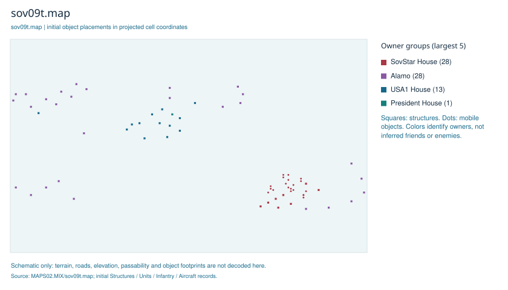

*Initial placement schematic for sov09t.map. Explanatory diagram derived from the guide and local data; not a screenshot.*

[Full scenario ledger](missions/ra2/sov09t.md)
