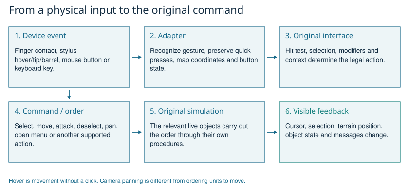
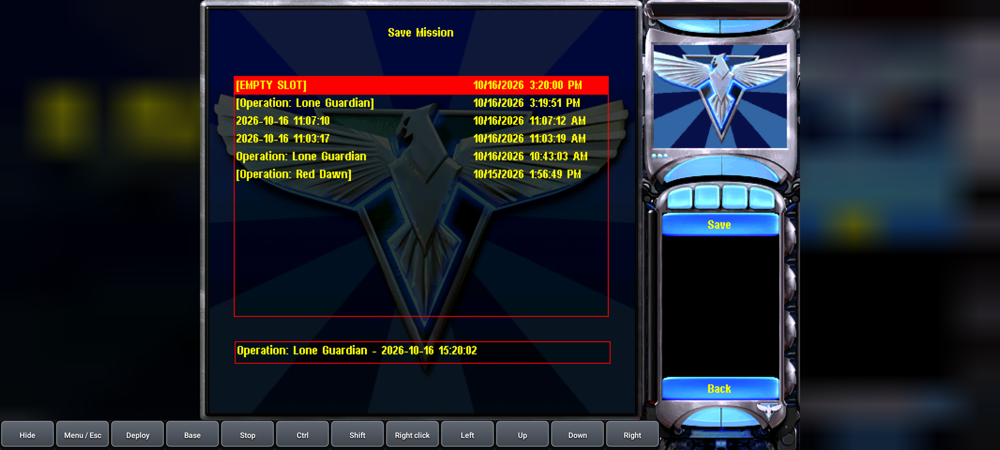
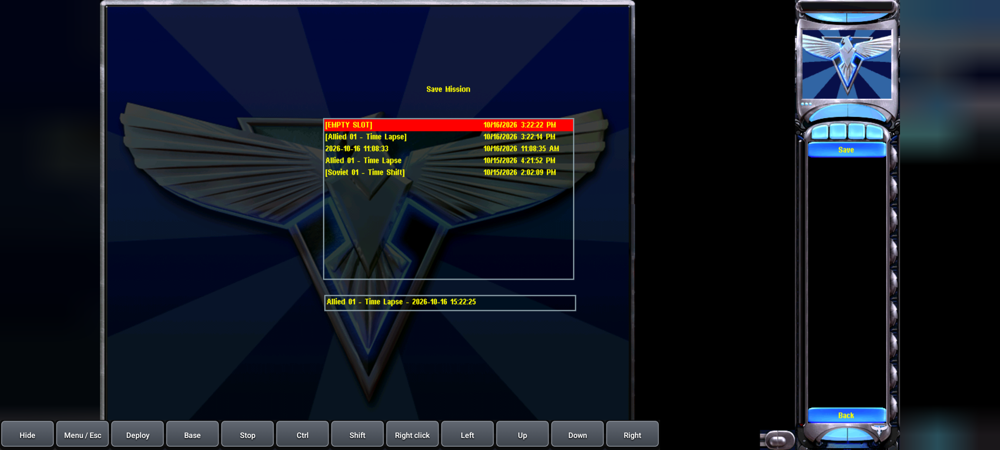

# How the Android version connects to the original game

[Guide index](README.md) | [Player controls](../INPUTS.md)

<!-- ILLUSTRATIONS:START -->

*Input conversion preserves the original command interpretation. Explanatory diagram derived from the guide and local data; not a screenshot.*

*Version 0.1.4 save dialog: the current mission precedes the complete local timestamp. Recorded RA2 save-name QA, injected finger input on an emulator.*

*Yuri uses the same mission-first naming bridge while retaining the original save interface. Recorded version 0.1.4 Yuri save-name QA on an emulator.*
<!-- ILLUSTRATIONS:END -->

This chapter is specific to the delivered native development APK. It describes the local implementation and recorded QA, not a promise that every Samsung accessory or campaign has been tested.

## 1. Original logic on ARM64

1. Offline tools analyze the supplied original executables.
2. Recovered procedures are lifted into another compilable representation.
3. The Android compiler builds that representation as native ARM64 libraries.
4. At runtime, the host provides the operating-system services the original procedures expect.
5. The original initialized data/resources and packaged game archives provide required game content.

This is static recompilation with a compatibility layer. Preserving 32-bit guest addresses as values does not mean the APK executes the original x86 instructions. It also does not mean the recovered representation is the original developers' handwritten source or that every function has a trustworthy descriptive name.

## 2. Input conversion

1. Android reports the input device and event: finger, pen, mouse or keyboard.
2. The adapter recognizes the intended gesture/button combination.
3. Coordinates are mapped into the game's displayed picture.
4. Mouse movement/button state or a keyboard event reaches the original interface.
5. The original game decides selection, commands, deselection and map panning.

For fingers, a single contact is held provisionally until movement/release distinguishes a selection from a multi-finger chord. This avoids accidentally issuing a left click while preparing a two-finger right click. Two-finger movement holds right for panning; lifting either releases it. Three-finger quick taps send Escape. A drag selection followed by extra fingers is not reinterpreted as a fresh quick tap.

Pen hover forwards cursor movement without pressing a button. Pen tip and barrel events use the mouse-button path. A physical OTG/Bluetooth mouse follows the same full-button-state path. The toolbar can hold right for a pan or provide keyboard-like commands. See [INPUTS](../INPUTS.md) for the exact player-facing controls and limitations, including wheel behavior.

## 3. Preserving quick presses

1. Android can deliver press and release within one native event-pump interval.
2. If the game polls only after both, a naive adapter can make the button appear never pressed.
3. The local adapter retains a bounded down state so the guest can observe a quick click.
4. Button states are tracked independently.
5. Cancellation or pause releases held buttons and modifiers to avoid stuck inputs.

This changes event delivery, not the meaning of a tank attack or the underlying right-click command.

## 4. Saving without a keyboard

1. Open Save Game in the original mission menu.
2. Let the original dialog initialize its current mission title.
3. Read that title through the original custom Unicode edit-control messages.
4. Append the full local date and time, keeping the mission title first.
5. If needed, shorten only the title to fit the original 79-UTF-16-unit capacity.
6. Write the resulting name back to the original edit control.
7. The original save procedure writes the save file.
8. An Android confirmation bridge sends the original acknowledgement back on the game thread.

The application does not require a soft keyboard for this flow. Existing saved labels are not renamed. Recorded version 0.1.4 tests checked formatter edge cases, RA2 and Yuri saves, restart/load, continued simulation and preservation of five pre-existing manual saves.

## 5. Movies, sound and presentation

1. The original game requests its movie or sound.
2. The host provides the relevant decoding/audio service.
3. FFmpeg decodes the original Bink movie content in this implementation.
4. SDL supplies the Android surface, event and audio connection.
5. End-of-file, seeking and decoded-frame timing have to agree with the game's polling expectations.

The local movie-end fix prevents a completed clip from trapping the game in a repeated final-frame poll. Full-screen movie Escape handling has recorded control QA. In-mission radar-movie skipping and audible output on each physical Samsung device are separate questions; the book does not claim they were all verified.

## 6. Returning home

1. The player uses the original Exit Game path.
2. The game requests a normal process exit.
3. Before that exit, the host brings the title chooser forward.
4. The isolated game process terminates.
5. A later title launch starts with a fresh game process while the chooser remains available.

This architecture protects the chooser from the original program's process-lifetime assumptions. It is different from returning only to the game's own main menu or leaving the Android app entirely.

## 7. What the recorded checks establish

| Evidence | What it supports | What it does not establish |
|---|---|---|
| Effective archives and map extraction | Rules, declared objects, trigger data and content provenance | Every map branch is reachable or correct in a real run |
| Function and class catalogues | Recovered binary structure and identified responsibilities | Complete recovery of original source-level intent |
| Existing campaign startup captures | Particular missions reached visible gameplay | Completion of all campaigns |
| Existing input injection checks | Tested adapter paths in their recorded environment | Physical S Pen/OTG behavior on every Samsung setup |
| Version 0.1.4 save/reload QA | Specific original save flows work across restart | Every possible saved state is compatible |
| This guide's automated coverage check | Declared items/mission records are represented and references resolve | A substitute for playing every mission |

No new full campaign playthrough was performed to write this guide. The [study exercises](08-STUDY-EXERCISES.md) explain how to compare the documented logic with your own play without confusing predictions with observations.
