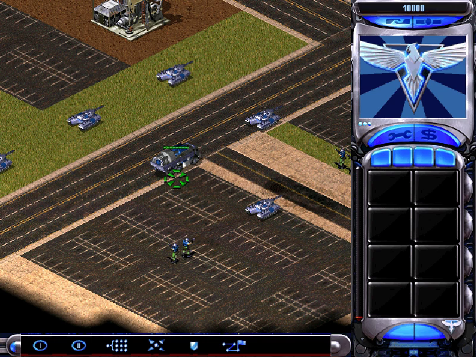

# Reading while playing: small engine experiments

[Guide index](README.md) | [Controls](../INPUTS.md)

<!-- ILLUSTRATIONS:START -->

*Use a small, recognizable group of objects for controlled observation. Upstream project screenshot retained locally; illustrative desktop evidence, not an Android-device test.*
<!-- ILLUSTRATIONS:END -->

These are proposed observation exercises, not tests already completed by the author. Use a fresh disposable save before an experiment. Keep your important saves separate and use the correct game title when loading. The current APK fills new save names with mission and time, so you can distinguish checkpoints without typing.

## 1. Trace one GI

1. Select a GI in a safe location.
2. Move it and observe its mobile state.
3. Deploy it, then compare the permitted movement and attack state.
4. Undeploy and move again.
5. Where a suitable civilian building exists, enter and then unload.
6. Read the GI card and distinguish its standing, deployed and occupant weapons.

Record which action you requested and which state changed. Do not infer that the deployed weapon and garrison weapon are identical just because both produce heavier fire.

## 2. Trace an IFV and a passenger

1. Obtain an empty IFV and an Engineer in a suitable battle.
2. Observe the IFV's empty role.
3. Load the Engineer and observe the changed role/cursor/turret.
4. Use it on an eligible damaged friendly vehicle.
5. Unload and observe the return to the default role.
6. Compare with a different eligible infantry passenger and its IFV mode on the card.

This demonstrates a state-dependent vehicle configuration. It does not establish every possible passenger combination from one example.

## 3. Follow a resource cycle

1. Choose a safe miner and identify its refinery/delivery destination.
2. Follow the outward journey to the resource.
3. Watch cargo collection and the return procedure.
4. Observe unloading and the owner's credits.
5. Repeat with the other faction's miner in another battle.
6. For Yuri, compare the mobile Slave Miner, deployed form and worker trips.

Keep transport time, gathering time, docking time and delivery value as separate observations. Comparing only vehicle speed cannot establish complete income efficiency.

## 4. Observe power and services

1. Find a battle with a powered defense or Robot Control Center.
2. Save before altering the power balance.
3. Note current supply/demand and which services are working.
4. Reduce power through an ordinary available game action.
5. Observe which services stop, slow or remain functional.
6. Restore power and compare recovery with the structure/unit cards.

Do not destroy an irreplaceable campaign objective just to run this exercise. A quiet skirmish is a better setting when the required facilities are available.

## 5. Trace Lone Guardian's objective handoff

1. Read the [mission explanation](05-CAMPAIGNS.md) and [ledger](missions/ra2/all01t.md).
2. Identify the opening Dreadnought/Tanya/landmark roles.
3. Observe the first objective without assuming all later hints are active.
4. Reach Fort Bradley and note changes in ownership, revealed terrain and available production.
5. Follow the bridge/production hints to the later supply-base objective.
6. Compare each observed transition with its trigger's events, attachments and actions.

A camera movement is not the same as a new unit spawning. A revealed building may have existed from the start. Watch these separately.

## 6. Compare two kinds of capture objective

1. Read Big Apple's Engineer/Battle Lab progression.
2. Read The Fox and the Hound's President-control progression.
3. Identify the different specialist and target-eligibility checks.
4. Observe the required ownership/control result in your play.
5. Compare with a mission that explicitly asks for destruction.

The practical lesson is that capture, infiltration, mind control and destruction are four distinct interactions even when each can remove an enemy obstacle.

## 7. Observe a staged attack

1. Save before a known wave interval or mission boundary.
2. Observe where the arriving force appears and which units it contains.
3. Find its reinforcement/create-team action in the ledger.
4. Follow the linked roster and script.
5. Compare staging, movement, unloading and final attack with the plan.
6. If something differs, check difficulty, earlier flag changes and unit losses before concluding the data is wrong.

Do not expect a static file listing to prove the exact random choice or timing of every run. Record the conditions under which you observed it.

## 8. Check the input-to-command boundary

1. In a safe area, move a mouse or hover the S Pen without pressing.
2. Observe cursor movement without a unit order.
3. Select with a left click/tip/finger action.
4. Deselect with a short right click or quick two-finger tap.
5. Pan with right-drag or two-finger drag.
6. Open the menu with Escape or a quick three-finger tap.

This exercise separates the Android adapter from the original command interpretation. Record the device and peripheral used; emulator injection does not qualify the physical accessory.

## 9. Read a save/reload as a state-restoration experiment

1. Stop at a recognizable, safe moment and make a new save.
2. Record a few visible facts: units, health, location, credits and current objective.
3. Change the battle briefly.
4. Load the saved game from the corresponding original menu.
5. Check that the earlier state returns and the simulation continues advancing.
6. Distinguish a changed save description from a changed save-file format; this APK's naming bridge leaves original serialization in charge.

## Observation sheet

| Record | What to write |
|---|---|
| Game and mission | RA2 or Yuri; mission title; difficulty |
| Starting checkpoint | Automatically generated save label |
| Device/input | Phone/tablet, finger/pen/mouse and relevant accessory |
| Requested action | What you deliberately did |
| Prediction | Which card or trigger suggested the expected result |
| Observed result | Visible state changes, messages, ownership, timing or failure |
| Source locator | Object ID or trigger ID from the guide |
| Remaining uncertainty | What this one observation did not establish |

Keep predictions and observations in separate columns. That is the most useful habit for learning an engine from binaries and play.
