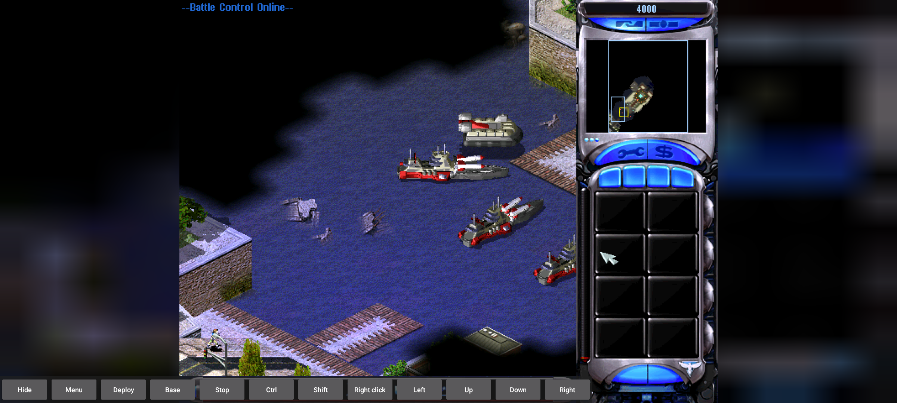
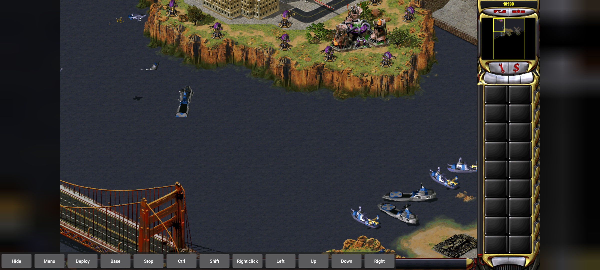
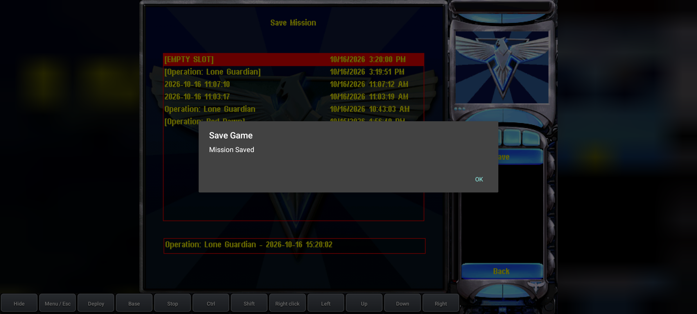
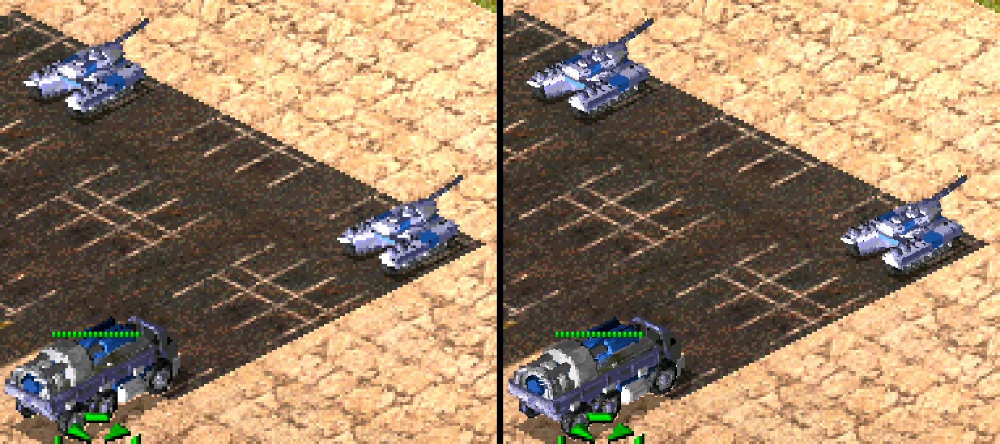

# Images, screenshots and their provenance

[Guide index](README.md)

The screenshots below are existing project captures copied byte-for-byte. They are not newly recorded complete playthroughs. Diagram figures are separate authored explanations. Mission layout figures use initial placed-object coordinates; they do not decode terrain or prove reachable paths.

## ra2-allied-start.png

*RA2 Allied opening: Lone Guardian. Dreadnoughts, the river approach and the original sidebar are visible. Historical local Android-emulator campaign-start capture; not a complete mission playthrough.*

Source in original workspace: Native-APK/qa/ra2-allied-mission.png. SHA-256: 9eb4c15dfe5202c95dc44d1b1dc2dbeb69b9262ba46bad7a004e23ba38f712ff.

## ra2-soviet-start.png

*RA2 Soviet opening: Red Dawn. The initial Washington scene is visible with the Android command toolbar. Historical local Android-emulator campaign-start capture; not physical Samsung testing.*

Source in original workspace: Native-APK/qa/ra2-soviet-mission.png. SHA-256: 399cf758b9c2b714dab7cdd85c1a86190334a3b5182bda15a841ea76560b86bd.

## yuri-allied-start.png

*Yuri Allied opening: Time Lapse. The starting base contains multiple building roles and a visible Dominator countdown. Historical local Android-emulator campaign-start capture; not a completed campaign.*

Source in original workspace: Native-APK/qa/yuri-allied-mission.png. SHA-256: 8f7a70bb6ab11438cdecfc935f5f6306ef0971f18c40daa203a666637ad094da.

## yuri-soviet-start.png

*Yuri Soviet opening: Time Shift. Naval forces and the defended shore show why target domains and arrival scripts matter. Historical local Android-emulator campaign-start capture.*

Source in original workspace: Native-APK/qa/yuri-soviet-mission.png. SHA-256: ffd4a96e17bf0fadd3d6967e07a6d92af5fc66bea7b7fd190c8590c40eda7ec4.

## save-name-ra2.png

*Version 0.1.4 save dialog: the current mission precedes the complete local timestamp. Recorded RA2 save-name QA, injected finger input on an emulator.*

Source in original workspace: Native-APK/qa/save-0.1.4/classic-finger/save-name.png. SHA-256: cad32c48726286c007ab00bd99731d955337a985682816cd5990a6a953ba3e78.

## save-confirmation-ra2.png

*The original save flow reaches its acknowledgement through the Android bridge. Recorded version 0.1.4 save QA; read with its report and limits.*

Source in original workspace: Native-APK/qa/save-0.1.4/classic-finger/save-confirmation.png. SHA-256: c85b8d8011ee855337368ab0681ab3b81dc2d06620c506a5b4e9c10643597d88.

## save-name-yuri.png

*Yuri uses the same mission-first naming bridge while retaining the original save interface. Recorded version 0.1.4 Yuri save-name QA on an emulator.*

Source in original workspace: Native-APK/qa/save-0.1.4/yuri-finger/save-name.png. SHA-256: 2c6aac384ff4d528acef3a06727d966e8bc1d400f8d63677c16a4d5467dffff4.

## unit-roster-desktop.png

*A supplied desktop-runtime capture shows mobile objects sharing a battlefield: the selected MCV, tanks and infantry. Upstream project screenshot retained locally; illustrative desktop evidence, not an Android-device test.*

Source in original workspace: native-ra2/docs/screenshots/skirmish-units.png. SHA-256: a78c7dcdc53fd8aeffa824148c17fddfbabc0caa2d7e2b569e41dcd635af5c89.

## voxel-comparison.png

*The local renderer notes compare normal and enhanced voxel presentation. Read this as a rendering example. Supplied upstream desktop comparison; does not establish that the Android APK enables this enhancement.*

Source in original workspace: native-ra2/docs/screenshots/hd-voxels.png. SHA-256: 7329b4975ae22bde3118ef2b0e6727b5b307393194b851c283836975c2a902ac.

## Diagram sources

Eight workflow diagrams explain engine layers, unit decisions, combat, economy, buildings, triggers, AI teams and Android input. Forty-one placement schematics derive from the recovered scenario maps. Owner colors distinguish source owners; they are not an assertion of allies or enemies. Initial placements do not include units later created by triggers.
