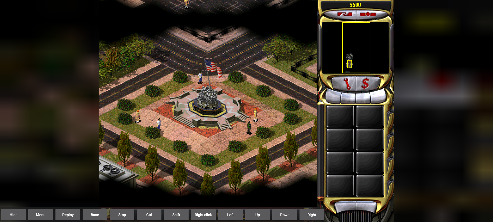

# Operation: Red Dawn

[Campaign reading guide](../../05-CAMPAIGNS.md) | [Engine](../../01-ENGINE-WORKFLOW.md)

<!-- ILLUSTRATIONS:START -->

*RA2 Soviet opening: Red Dawn. The initial Washington scene is visible with the Android command toolbar. Historical local Android-emulator campaign-start capture; not physical Samsung testing.*

*Initial placement schematic for sov01t.map. Explanatory diagram derived from the guide and local data; not a screenshot.*
<!-- ILLUSTRATIONS:END -->

**Map:** sov01t.map. **Effective extracted member:** MAPS02.MIX/sov01t.map. **Trigger definitions:** 132.

This is a translated static ledger, not a recorded playthrough. Trigger numbering below is browsing order, not chronological execution. Each trigger still requires eligibility, enabling, relevant attachments and its event logic. Values called time units remain in the source scale; no unverified wall-clock conversion is applied.

Read an event as applying to the trigger's attached scope when it is object/cell-specific. Multiple event entries are recorded conditions for the trigger, not alternative objectives unless the runtime's event logic makes them so. Tag persistence modes: 0 consumes on the relevant first occurrence; 1 waits for the applicable attached-object completion; 2 permits repeating. Not all definitions have a live attached instance.

[All team rosters and ordered plans](sov01t-teams.md) | [All mission overrides](sov01t-overrides.md)

## Starting world

| Part | Recorded value |
| --- | --- |
| Player house | Player House |
| Theater | URBAN |
| Map size | 0,0,55,100 |
| Visible local rectangle | 2,5,51,89 |
| Placed vehicles | 78 |
| Placed infantry | 60 |
| Placed structures | 161 |
| Placed aircraft | 0 |
| Team templates | 44 |

### Houses

| Map house slot | Owner name | Starting credits setting | Country |
| --- | --- | --- | --- |
| 0 | Player House | 55 | Player |
| 1 | BadGuy1 House | 100 | BadGuy1 |
| 2 | BadGuy2 House | 100 | BadGuy2 |
| 3 | BadGuy3 House | 100 | BadGuy3 |
| 4 | Civie1 House | 0 | Civilian1 |
| 5 | Other1 House | 20 | Other1 |
| 6 | Other2 House | 20 | Other2 |
| 7 | Other3 House | 20 | Other3 |

### Local state flags at initialization

| Flag | Meaning label and initial value |
| --- | --- |
| 0 | Need Reinforcements,0 |
| 1 | Win 1,1 |
| 2 | Win 2,0 |
| 3 | Win 3,0 |
| 4 | Win 4,0 |
| 5 | Baseball Panic,0 |
| 6 | Bridge Discovered,0 |
| 7 | Engineer Built,0 |

## Terminal gates: victory, defeat or forced end

These records can issue an outcome or its announcement. An announcement is distinguished from the actual winner/loser action. Follow the linked trigger for all guards and action order.

| Gate | Conditions recorded | Terminal-related actions |
| --- | --- | --- |
| [VICTORY! (0A301C50)](#trigger-0a301c50) | 10 configured time units have elapsed since the trigger timer was initialized/reset. | Declare owner selector 13 (country/type PLAYER; placed owner Player House) the winner. |
| [Mission Fail (0A115A1C)](#trigger-0a115a1c) | 4 configured time units have elapsed since the trigger timer was initialized/reset. | Declare owner selector 13 (country/type PLAYER; placed owner Player House) the loser. |

## Every trigger, in file order

### 1. Start AI Teams - 08F7F100

Owner reference: BadGuy1. Initially disabled. Difficulty eligibility: Easy 1, Normal 1, Hard 1 (1 means included). Linked trigger: none.

Attached scope: tag definitions 08F7C180 (persistence 0); no placed object/cell attachment found by this extraction.

**Wait for the recorded events:**

1. 0 configured time units have elapsed since the trigger timer was initialized/reset.

**Then perform these actions in order:**

1. AI triggers begin: owner selector 14 (country/type BADGUY1; placed owner BadGuy1 House).
2. Production Begins: owner selector 14 (country/type BADGUY1; placed owner BadGuy1 House).

Source locator: MAPS02.MIX/sov01t.map; Triggers line 4981, Events line 5115, Actions line 5249.

### 2. Bridge Audio a - 09367F40

Owner reference: Player. Initially enabled. Difficulty eligibility: Easy 1, Normal 1, Hard 1 (1 means included). Linked trigger: none.

Attached scope: 13 tagged map cells: (93, 83), (90, 84), (91, 84), (92, 84), (93, 84), (90, 85), (91, 85), (92, 85), (93, 85), (90, 86), (91, 86), (92, 86), (93, 86); tag 09367AC0, persistence mode 0.

**Wait for the recorded events:**

1. Entered by: owner selector 13 (country/type PLAYER; placed owner Player House).

**Then perform these actions in order:**

1. Play voice notification Mis_S1_SofiaRepairBridge.
2. Create radar-event marker type 1 at waypoint 0 (cell 90, 85).
3. Reveal terrain around waypoint 1 (cell 90, 85).
4. Enable and reset applicable timers for [Bridge Audio b (0A0FC9DC)](#trigger-0a0fc9dc).
5. Enable and reset applicable timers for [Bridge Audio 1 (080F340C)](#trigger-080f340c).
6. Enable and reset applicable timers for [Bridge Audio 2 (080F4F3C)](#trigger-080f4f3c).
7. Play sound Bonus.
8. Enable and reset applicable timers for [Bridge Hut Anim (083182BC)](#trigger-083182bc).
9. Enable and reset applicable timers for [Repair Bridge Hint (079D64BC)](#trigger-079d64bc).

Source locator: MAPS02.MIX/sov01t.map; Triggers line 4982, Events line 5116, Actions line 5250.

### 3. Bridge Audio b - 0A0FC9DC

Owner reference: Player. Initially disabled. Difficulty eligibility: Easy 1, Normal 1, Hard 1 (1 means included). Linked trigger: none.

Incoming activation links: enable from [Bridge Audio a (09367F40)](#trigger-09367f40).

Attached scope: tag definitions 0A0FC63C (persistence 0); no placed object/cell attachment found by this extraction.

**Wait for the recorded events:**

1. 0 configured time units have elapsed since the trigger timer was initialized/reset.

**Then perform these actions in order:**

1. Destroy current instances of [Bridge Audio 2 (080F4F3C)](#trigger-080f4f3c).

Source locator: MAPS02.MIX/sov01t.map; Triggers line 4983, Events line 5117, Actions line 5251.

### 4. Bridge Audio 1 - 080F340C

Owner reference: Player. Initially disabled. Difficulty eligibility: Easy 1, Normal 1, Hard 1 (1 means included). Linked trigger: none.

Incoming activation links: enable from [Bridge Audio a (09367F40)](#trigger-09367f40).

Attached scope: tag definitions 080F306C (persistence 0); no placed object/cell attachment found by this extraction.

**Wait for the recorded events:**

1. 1 configured time units have elapsed since the trigger timer was initialized/reset.

**Then perform these actions in order:**

1. Display message “HINT: Construct a BARRACKS in order to produce ENGINEERS to repair the bridge” (MISSION:ALL01f).
2. Flash cameo/type 11; additional configured duration/location argument 90.
3. Switch the sidebar to tab 2.
4. Enable and reset applicable timers for [Repair Bridge Hint (079D64BC)](#trigger-079d64bc).

Source locator: MAPS02.MIX/sov01t.map; Triggers line 4984, Events line 5118, Actions line 5252.

### 5. Bridge Audio 2 - 080F4F3C

Owner reference: Player. Initially disabled. Difficulty eligibility: Easy 1, Normal 1, Hard 1 (1 means included). Linked trigger: none.

Incoming activation links: enable from [Bridge Audio a (09367F40)](#trigger-09367f40).

Attached scope: tag definitions 080F4BBC (persistence 0); no placed object/cell attachment found by this extraction.

**Wait for the recorded events:**

1. 1 configured time units have elapsed since the trigger timer was initialized/reset.

**Then perform these actions in order:**

1. Display message “HINT: Order an ENGINEER into the BRIDGE HUT to repair the bridge” (MISSION:Sov1b).
2. Switch the sidebar to tab 2.
3. Flash cameo/type 388; additional configured duration/location argument 90.
4. Enable and reset applicable timers for [Repair Bridge Hint (079D64BC)](#trigger-079d64bc).

Source locator: MAPS02.MIX/sov01t.map; Triggers line 4985, Events line 5119, Actions line 5253.

### 6. Bridge Hut Anim - 083182BC

Owner reference: Player. Initially disabled. Difficulty eligibility: Easy 1, Normal 1, Hard 1 (1 means included). Linked trigger: none.

Incoming activation links: enable from [Bridge Audio a (09367F40)](#trigger-09367f40); enable from [Hint: Engineer 2 (0A0FAE5C)](#trigger-0a0fae5c).

Attached scope: tag definitions 08319B4C (persistence 2); no placed object/cell attachment found by this extraction.

**Wait for the recorded events:**

1. 2 configured time units have elapsed since the trigger timer was initialized/reset.

**Then perform these actions in order:**

1. Play Anim At; main setting 479.

Source locator: MAPS02.MIX/sov01t.map; Triggers line 4986, Events line 5120, Actions line 5254.

### 7. Repair Bridge Hint - 079D64BC

Owner reference: Player. Initially disabled. Difficulty eligibility: Easy 1, Normal 1, Hard 1 (1 means included). Linked trigger: none.

Incoming activation links: enable from [Bridge Audio a (09367F40)](#trigger-09367f40); enable from [Bridge Audio 1 (080F340C)](#trigger-080f340c); enable from [Bridge Audio 2 (080F4F3C)](#trigger-080f4f3c); enable from [Hint: Engineer 2 (0A0FAE5C)](#trigger-0a0fae5c).

Attached scope: tag definitions 079D790C (persistence 2); no placed object/cell attachment found by this extraction.

**Wait for the recorded events:**

1. 60 configured time units have elapsed since the trigger timer was initialized/reset.

**Then perform these actions in order:**

1. Play voice notification Mis_S1_SofiaRepairBridge.
2. Create radar-event marker type 1 at waypoint 0 (cell 90, 85).
3. Play sound MessageText.
4. Display message “HINT: Order an ENGINEER into the BRIDGE HUT to repair the bridge” (MISSION:Sov1b).

Source locator: MAPS02.MIX/sov01t.map; Triggers line 4987, Events line 5121, Actions line 5255.

### 8. Disable Bridge Audio - 093679E0

Owner reference: Player. Initially enabled. Difficulty eligibility: Easy 1, Normal 1, Hard 1 (1 means included). Linked trigger: none.

Attached scope: Bridge Repair Hut (CABHUT), owner Civie1 House, cell (92, 87), tag 09367560, persistence mode 0.

**Wait for the recorded events:**

1. Entered by: owner selector 13 (country/type PLAYER; placed owner Player House).

**Then perform these actions in order:**

1. Disable [Bridge Audio a (09367F40)](#trigger-09367f40).
2. Reveal terrain around waypoint 1 (cell 90, 85).
3. Destroy current instances of [Bridge Hut Anim (083182BC)](#trigger-083182bc).
4. Destroy current instances of [Repair Bridge Hint (079D64BC)](#trigger-079d64bc).

Source locator: MAPS02.MIX/sov01t.map; Triggers line 4988, Events line 5122, Actions line 5256.

### 9. Tech Building 1 - 0934F880

Owner reference: Player. Initially enabled. Difficulty eligibility: Easy 1, Normal 1, Hard 1 (1 means included). Linked trigger: none.

Attached scope: 9 tagged map cells: (69, 82), (70, 82), (69, 83), (68, 84), (69, 84), (68, 85), (68, 86), (68, 87), (69, 87); tag 0934DEB0, persistence mode 0.

**Wait for the recorded events:**

1. Entered by: owner selector 13 (country/type PLAYER; placed owner Player House).

**Then perform these actions in order:**

1. Reveal terrain around waypoint 2 (cell 64, 78).
2. Create radar-event marker type 1 at waypoint 2 (cell 64, 78).
3. Display message “HINT: Capture the AIRPORT with an ENGINEER to allow your paratroopers to land in the area” (MISSION:Sov1g).
4. Play voice notification Mis_S1_SofiaAirportHint1.
5. Enable and reset applicable timers for [Reinforcements 4 (08E58F40)](#trigger-08e58f40).
6. Play sound Bonus.
7. Enable and reset applicable timers for [Airport Animation (08498E5C)](#trigger-08498e5c).
8. Disable [Urban Combat Anim (0848833C)](#trigger-0848833c).
9. Disable [Urban Combat Anim 2 (08489CEC)](#trigger-08489cec).

Source locator: MAPS02.MIX/sov01t.map; Triggers line 4989, Events line 5123, Actions line 5257.

### 10. Reinforcements 4 - 08E58F40

Owner reference: Player. Initially disabled. Difficulty eligibility: Easy 1, Normal 1, Hard 1 (1 means included). Linked trigger: none.

Incoming activation links: enable from [Tech Building 1 (0934F880)](#trigger-0934f880); force from [Force Reinforcements 4 (0BB5779C)](#trigger-0bb5779c).

Attached scope: tag definitions 08E5A8D0 (persistence 0); no placed object/cell attachment found by this extraction.

**Wait for the recorded events:**

1. 1 configured time units have elapsed since the trigger timer was initialized/reset.

**Then perform these actions in order:**

1. Supply reinforcement team [Paratroopers 1b (08263EFC)](sov01t-teams.md#team-08263efc) at waypoint 12 (cell 63, 85).
2. Enable and reset applicable timers for [Reinforcements 4b (079AA110)](#trigger-079aa110).

Source locator: MAPS02.MIX/sov01t.map; Triggers line 4990, Events line 5124, Actions line 5258.

### 11. Airport Animation - 08498E5C

Owner reference: Player. Initially enabled. Difficulty eligibility: Easy 1, Normal 1, Hard 1 (1 means included). Linked trigger: none.

Incoming activation links: enable from [Tech Building 1 (0934F880)](#trigger-0934f880).

Attached scope: tag definitions 0849891C (persistence 2); no placed object/cell attachment found by this extraction.

**Wait for the recorded events:**

1. 2 configured time units have elapsed since the trigger timer was initialized/reset.

**Then perform these actions in order:**

1. Play Anim At; main setting 479; location/duration field C.

Source locator: MAPS02.MIX/sov01t.map; Triggers line 4991, Events line 5125, Actions line 5259.

### 12. Urban Combat Anim - 0848833C

Owner reference: Player. Initially disabled. Difficulty eligibility: Easy 1, Normal 1, Hard 1 (1 means included). Linked trigger: none.

Incoming activation links: enable from [Urban Combat 1 (079A71F0)](#trigger-079a71f0).

Attached scope: tag definitions 08489DDC (persistence 2); no placed object/cell attachment found by this extraction.

**Wait for the recorded events:**

1. 2 configured time units have elapsed since the trigger timer was initialized/reset.

**Then perform these actions in order:**

1. Play Anim At; main setting 479; location/duration field CJ.

Source locator: MAPS02.MIX/sov01t.map; Triggers line 4992, Events line 5126, Actions line 5260.

### 13. Urban Combat Anim 2 - 08489CEC

Owner reference: Player. Initially disabled. Difficulty eligibility: Easy 1, Normal 1, Hard 1 (1 means included). Linked trigger: none.

Incoming activation links: enable from [Urban Combat 1 (079A71F0)](#trigger-079a71f0).

Attached scope: tag definitions 08489AEC (persistence 2); no placed object/cell attachment found by this extraction.

**Wait for the recorded events:**

1. 2 configured time units have elapsed since the trigger timer was initialized/reset.

**Then perform these actions in order:**

1. Play Anim At; main setting 479; location/duration field CI.

Source locator: MAPS02.MIX/sov01t.map; Triggers line 4993, Events line 5127, Actions line 5261.

### 14. Reinforcements 4b - 079AA110

Owner reference: Player. Initially disabled. Difficulty eligibility: Easy 1, Normal 1, Hard 1 (1 means included). Linked trigger: none.

Incoming activation links: enable from [Reinforcements 4 (08E58F40)](#trigger-08e58f40).

Attached scope: tag definitions 079AC090 (persistence 0); no placed object/cell attachment found by this extraction.

**Wait for the recorded events:**

1. 9 configured time units have elapsed since the trigger timer was initialized/reset.

**Then perform these actions in order:**

1. Create radar-event marker type 2 at waypoint 12 (cell 63, 85).
2. Play voice notification EVA_ReinforcementsHaveArrived.

Source locator: MAPS02.MIX/sov01t.map; Triggers line 4994, Events line 5128, Actions line 5262.

### 15. Urban Combat 1 - 079A71F0

Owner reference: Player. Initially enabled. Difficulty eligibility: Easy 1, Normal 1, Hard 1 (1 means included). Linked trigger: none.

Attached scope: 14 tagged map cells: (81, 82), (82, 82), (81, 83), (82, 83), (81, 84), (82, 84), (81, 85), (82, 85), (81, 86), (82, 86), (81, 87), (82, 87), (81, 88), (82, 88); tag 09362180, persistence mode 0.

**Wait for the recorded events:**

1. Entered by: owner selector 13 (country/type PLAYER; placed owner Player House).

**Then perform these actions in order:**

1. Reveal terrain around waypoint 4 (cell 75, 85).
2. Create radar-event marker type 1 at waypoint 4 (cell 75, 85).
3. Play sound MessageText.
4. Display message “HINT: Order your CONSCRIPTS to enter CIVILIAN BUILDINGS to fortify them” (MISSION:Sov1c).
5. Play voice notification Mis_S1_SofiaUrbanHint.
6. Enable and reset applicable timers for [Urban Combat Anim (0848833C)](#trigger-0848833c).
7. Enable and reset applicable timers for [Urban Combat Anim 2 (08489CEC)](#trigger-08489cec).

Source locator: MAPS02.MIX/sov01t.map; Triggers line 4995, Events line 5129, Actions line 5263.

### 16. Reinforcements 1 - 08ECC6D0

Owner reference: Player. Initially enabled. Difficulty eligibility: Easy 1, Normal 1, Hard 1 (1 means included). Linked trigger: none.

Attached scope: 6 tagged map cells: (98, 92), (99, 92), (100, 92), (98, 93), (99, 93), (100, 93); tag 08ECC0E0, persistence mode 0.

**Wait for the recorded events:**

1. Entered by: owner selector 13 (country/type PLAYER; placed owner Player House).

**Then perform these actions in order:**

1. Supply reinforcement team [Paratroopers 1 (09CCDC8C)](sov01t-teams.md#team-09ccdc8c) at waypoint 53 (cell 99, 88).
2. Enable and reset applicable timers for [Reinforcements 1b (08D07E80)](#trigger-08d07e80).

Source locator: MAPS02.MIX/sov01t.map; Triggers line 4996, Events line 5130, Actions line 5264.

### 17. Reinforcements 1b - 08D07E80

Owner reference: Player. Initially disabled. Difficulty eligibility: Easy 1, Normal 1, Hard 1 (1 means included). Linked trigger: none.

Incoming activation links: enable from [Reinforcements 1 (08ECC6D0)](#trigger-08ecc6d0).

Attached scope: tag definitions 08D079C0 (persistence 0); no placed object/cell attachment found by this extraction.

**Wait for the recorded events:**

1. 4 configured time units have elapsed since the trigger timer was initialized/reset.

**Then perform these actions in order:**

1. Create radar-event marker type 2 at waypoint 53 (cell 99, 88).
2. Play voice notification EVA_ReinforcementsHaveArrived.

Source locator: MAPS02.MIX/sov01t.map; Triggers line 4997, Events line 5131, Actions line 5265.

### 18. Reinforcements 2b - 07A94480

Owner reference: Player. Initially disabled. Difficulty eligibility: Easy 1, Normal 1, Hard 1 (1 means included). Linked trigger: none.

Incoming activation links: enable from [Reinforcements 2 (08DE3B80)](#trigger-08de3b80).

Attached scope: tag definitions 07A95C00 (persistence 0); no placed object/cell attachment found by this extraction.

**Wait for the recorded events:**

1. 4 configured time units have elapsed since the trigger timer was initialized/reset.

**Then perform these actions in order:**

1. Create radar-event marker type 2 at waypoint 10 (cell 91, 38).
2. Play voice notification EVA_ReinforcementsHaveArrived.

Source locator: MAPS02.MIX/sov01t.map; Triggers line 4998, Events line 5132, Actions line 5266.

### 19. Reinforcements 3b - 07A95B20

Owner reference: Player. Initially disabled. Difficulty eligibility: Easy 1, Normal 1, Hard 1 (1 means included). Linked trigger: none.

Incoming activation links: enable from [Reinforcements 3 (08DE67E0)](#trigger-08de67e0).

Attached scope: tag definitions 07A95880 (persistence 0); no placed object/cell attachment found by this extraction.

**Wait for the recorded events:**

1. 4 configured time units have elapsed since the trigger timer was initialized/reset.

**Then perform these actions in order:**

1. Create radar-event marker type 2 at waypoint 11 (cell 84, 85).
2. Play voice notification EVA_ReinforcementsHaveArrived.

Source locator: MAPS02.MIX/sov01t.map; Triggers line 4999, Events line 5133, Actions line 5267.

### 20. Reinforcements 5b - 079B4200

Owner reference: Player. Initially disabled. Difficulty eligibility: Easy 1, Normal 1, Hard 1 (1 means included). Linked trigger: none.

Incoming activation links: enable from [Reinforcements 5 (07A1BB70)](#trigger-07a1bb70).

Attached scope: tag definitions 079B2210 (persistence 0); no placed object/cell attachment found by this extraction.

**Wait for the recorded events:**

1. 15 configured time units have elapsed since the trigger timer was initialized/reset.

**Then perform these actions in order:**

1. Create radar-event marker type 2 at waypoint 9 (cell 60, 78).
2. Play voice notification EVA_ReinforcementsHaveArrived.

Source locator: MAPS02.MIX/sov01t.map; Triggers line 5000, Events line 5134, Actions line 5268.

### 21. Reinforcements 6b - 079B2130

Owner reference: Player. Initially disabled. Difficulty eligibility: Easy 1, Normal 1, Hard 1 (1 means included). Linked trigger: none.

Incoming activation links: enable from [Reinforcements 6 (08ECC510)](#trigger-08ecc510).

Attached scope: tag definitions 079B74E0 (persistence 0); no placed object/cell attachment found by this extraction.

**Wait for the recorded events:**

1. 4 configured time units have elapsed since the trigger timer was initialized/reset.

**Then perform these actions in order:**

1. Create radar-event marker type 2 at waypoint 14 (cell 60, 57).
2. Play voice notification EVA_ReinforcementsHaveArrived.

Source locator: MAPS02.MIX/sov01t.map; Triggers line 5001, Events line 5135, Actions line 5269.

### 22. Reinforcements 7B - 092F5B30

Owner reference: Player. Initially disabled. Difficulty eligibility: Easy 1, Normal 1, Hard 1 (1 means included). Linked trigger: none.

Incoming activation links: enable from [Reinforcements 7 (08DF42C0)](#trigger-08df42c0).

Attached scope: tag definitions 092F5200 (persistence 0); no placed object/cell attachment found by this extraction.

**Wait for the recorded events:**

1. 20 configured time units have elapsed since the trigger timer was initialized/reset.

**Then perform these actions in order:**

1. Create radar-event marker type 2 at waypoint 15 (cell 61, 44).
2. Create radar-event marker type 2 at waypoint 16 (cell 65, 38).
3. Create radar-event marker type 2 at waypoint 17 (cell 54, 39).
4. Create radar-event marker type 2 at waypoint 18 (cell 57, 34).
5. Play voice notification EVA_ReinforcementsHaveArrived.

Source locator: MAPS02.MIX/sov01t.map; Triggers line 5002, Events line 5136, Actions line 5270.

### 23. Reinforcements - 08ECE880

Owner reference: Player. Initially enabled. Difficulty eligibility: Easy 1, Normal 1, Hard 1 (1 means included). Linked trigger: none.

Attached scope: tag definitions 092F5D30 (persistence 0); no placed object/cell attachment found by this extraction.

**Wait for the recorded events:**

1. 10 configured time units have elapsed since the trigger timer was initialized/reset.

**Then perform these actions in order:**

1. Supply reinforcement team [Initial Paratroopers (0BDAE1FC)](sov01t-teams.md#team-0bdae1fc).
2. Supply reinforcement team [Initial Paratroopers 2 (08E14F00)](sov01t-teams.md#team-08e14f00).
3. Supply reinforcement team [Initial Paratroopers 3 (08E14D10)](sov01t-teams.md#team-08e14d10).
4. Enable and reset applicable timers for [Reinforcements b (0810671C)](#trigger-0810671c).

Source locator: MAPS02.MIX/sov01t.map; Triggers line 5003, Events line 5137, Actions line 5271.

### 24. Reinforcements b - 0810671C

Owner reference: Other3. Initially disabled. Difficulty eligibility: Easy 1, Normal 1, Hard 1 (1 means included). Linked trigger: none.

Incoming activation links: enable from [Reinforcements (08ECE880)](#trigger-08ece880).

Attached scope: tag definitions 08107DDC (persistence 0); no placed object/cell attachment found by this extraction.

**Wait for the recorded events:**

1. 1 configured time units have elapsed since the trigger timer was initialized/reset.

**Then perform these actions in order:**

1. Supply reinforcement team [Occupy Memorial (0A0C1A7C)](sov01t-teams.md#team-0a0c1a7c).

Source locator: MAPS02.MIX/sov01t.map; Triggers line 5004, Events line 5138, Actions line 5272.

### 25. Reinforcements 2 - 08DE3B80

Owner reference: Player. Initially enabled. Difficulty eligibility: Easy 1, Normal 1, Hard 1 (1 means included). Linked trigger: none.

Attached scope: tag definitions 08DE68C0 (persistence 0); no placed object/cell attachment found by this extraction.

**Wait for the recorded events:**

1. Entered by: owner selector 13 (country/type PLAYER; placed owner Player House).

**Then perform these actions in order:**

1. Supply reinforcement team [Paratroopers 1 (09CCDC8C)](sov01t-teams.md#team-09ccdc8c) at waypoint 10 (cell 91, 38).
2. Enable and reset applicable timers for [Reinforcements 2b (07A94480)](#trigger-07a94480).

Source locator: MAPS02.MIX/sov01t.map; Triggers line 5005, Events line 5139, Actions line 5273.

### 26. Reinforcements 3 - 08DE67E0

Owner reference: Player. Initially enabled. Difficulty eligibility: Easy 1, Normal 1, Hard 1 (1 means included). Linked trigger: none.

Attached scope: 3 tagged map cells: (86, 84), (86, 85), (86, 86); tag 08DE64C0, persistence mode 0.

**Wait for the recorded events:**

1. Entered by: owner selector 13 (country/type PLAYER; placed owner Player House).

**Then perform these actions in order:**

1. Supply reinforcement team [Paratroopers 1 (09CCDC8C)](sov01t-teams.md#team-09ccdc8c) at waypoint 11 (cell 84, 85).
2. Enable and reset applicable timers for [Reinforcements 3b (07A95B20)](#trigger-07a95b20).

Source locator: MAPS02.MIX/sov01t.map; Triggers line 5006, Events line 5140, Actions line 5274.

### 27. Reinforcements 5 - 07A1BB70

Owner reference: Player. Initially disabled. Difficulty eligibility: Easy 1, Normal 1, Hard 1 (1 means included). Linked trigger: none.

Incoming activation links: enable from [Airport Captured (0A3030B0)](#trigger-0a3030b0).

Attached scope: tag definitions 07A1B470 (persistence 0); no placed object/cell attachment found by this extraction.

**Wait for the recorded events:**

1. 3 configured time units have elapsed since the trigger timer was initialized/reset.

**Then perform these actions in order:**

1. Supply reinforcement team [Paratroopers 1b (08263EFC)](sov01t-teams.md#team-08263efc) at waypoint 9 (cell 60, 78).
2. Enable and reset applicable timers for [Reinforcements 5b (079B4200)](#trigger-079b4200).

Source locator: MAPS02.MIX/sov01t.map; Triggers line 5007, Events line 5141, Actions line 5275.

### 28. Reinforcements 6 - 08ECC510

Owner reference: Player. Initially enabled. Difficulty eligibility: Easy 1, Normal 1, Hard 1 (1 means included). Linked trigger: none.

Attached scope: 3 tagged map cells: (59, 64), (60, 64), (61, 64); tag 08ECACC0, persistence mode 0.

**Wait for the recorded events:**

1. Entered by: owner selector 13 (country/type PLAYER; placed owner Player House).

**Then perform these actions in order:**

1. Supply reinforcement team [Paratroopers 1 (09CCDC8C)](sov01t-teams.md#team-09ccdc8c) at waypoint 14 (cell 60, 57).
2. Enable and reset applicable timers for [Reinforcements 6b (079B2130)](#trigger-079b2130).

Source locator: MAPS02.MIX/sov01t.map; Triggers line 5008, Events line 5142, Actions line 5276.

### 29. Reinforcements 7 - 08DF42C0

Owner reference: Player. Initially enabled. Difficulty eligibility: Easy 1, Normal 1, Hard 1 (1 means included). Linked trigger: none.

Incoming activation links: force from [Force Reinforcements 7 (080F4DAC)](#trigger-080f4dac).

Attached scope: 11 tagged map cells: (47, 39), (48, 39), (72, 39), (73, 39), (47, 40), (48, 40), (72, 40), (73, 40), (59, 47), (60, 47), (61, 47); tag 08DF4BB0, persistence mode 0.

**Wait for the recorded events:**

1. Entered by: owner selector 13 (country/type PLAYER; placed owner Player House).

**Then perform these actions in order:**

1. Supply reinforcement team [Paratroopers 1 (09CCDC8C)](sov01t-teams.md#team-09ccdc8c) at waypoint 15 (cell 61, 44).
2. Supply reinforcement team [Paratroopers 1 (09CCDC8C)](sov01t-teams.md#team-09ccdc8c) at waypoint 16 (cell 65, 38).
3. Supply reinforcement team [Paratroopers 1 (09CCDC8C)](sov01t-teams.md#team-09ccdc8c) at waypoint 17 (cell 54, 39).
4. Supply reinforcement team [Paratroopers 1 (09CCDC8C)](sov01t-teams.md#team-09ccdc8c) at waypoint 18 (cell 57, 34).
5. Enable and reset applicable timers for [Reinforcements 7B (092F5B30)](#trigger-092f5b30).
6. Play voice notification Mis_S1_SofiaDestroyPentagon.
7. Disable [Force Reinforcements 7 (080F4DAC)](#trigger-080f4dac).
8. Supply reinforcement team [Secret Tanks (0836F59C)](sov01t-teams.md#team-0836f59c).
9. Supply reinforcement team [Secret Tanks 2 (0826D22C)](sov01t-teams.md#team-0826d22c).

Source locator: MAPS02.MIX/sov01t.map; Triggers line 5009, Events line 5143, Actions line 5277.

### 30. Force Reinforcements 7 - 080F4DAC

Owner reference: Player. Initially enabled. Difficulty eligibility: Easy 1, Normal 1, Hard 1 (1 means included). Linked trigger: none.

Attached scope: GI (E1), owner BadGuy1 House, cell (65, 39), tag 080FF60C, persistence mode 0; GI (E1), owner BadGuy1 House, cell (54, 40), tag 080FF60C, persistence mode 0; GI (E1), owner BadGuy1 House, cell (64, 37), tag 080FF60C, persistence mode 0; GI (E1), owner BadGuy1 House, cell (64, 42), tag 080FF60C, persistence mode 0; GI (E1), owner BadGuy1 House, cell (60, 44), tag 080FF60C, persistence mode 0; GI (E1), owner BadGuy1 House, cell (57, 44), tag 080FF60C, persistence mode 0; GI (E1), owner BadGuy1 House, cell (55, 36), tag 080FF60C, persistence mode 0; GI (E1), owner BadGuy1 House, cell (59, 34), tag 080FF60C, persistence mode 0; Pentagon (CAWA2A), owner Civie1 House, cell (60, 36), tag 080FF60C, persistence mode 0; Pentagon (CAWA2B), owner Civie1 House, cell (60, 40), tag 080FF60C, persistence mode 0; Pentagon (CAWA2D), owner Civie1 House, cell (56, 36), tag 080FF60C, persistence mode 0; US Flag (CAUSFGL), owner BadGuy1 House, cell (56, 33), tag 080FF60C, persistence mode 0; US Flag (CAUSFGL), owner BadGuy1 House, cell (56, 46), tag 080FF60C, persistence mode 0; US Flag (CAUSFGL), owner BadGuy1 House, cell (64, 33), tag 080FF60C, persistence mode 0; US Flag (CAUSFGL), owner BadGuy1 House, cell (64, 46), tag 080FF60C, persistence mode 0; Pentagon (CAWA2C), owner Civie1 House, cell (56, 40), tag 080FF60C, persistence mode 0; Patriot Missile (NASAM), owner BadGuy1 House, cell (54, 45), tag 080FF60C, persistence mode 0; Patriot Missile (NASAM), owner BadGuy1 House, cell (54, 34), tag 080FF60C, persistence mode 0; Patriot Missile (NASAM), owner BadGuy1 House, cell (66, 45), tag 080FF60C, persistence mode 0; Patriot Missile (NASAM), owner BadGuy1 House, cell (66, 34), tag 080FF60C, persistence mode 0; US Flag (CAUSFGL), owner BadGuy1 House, cell (53, 43), tag 080FF60C, persistence mode 0; US Flag (CAUSFGL), owner BadGuy1 House, cell (53, 36), tag 080FF60C, persistence mode 0; US Flag (CAUSFGL), owner BadGuy1 House, cell (67, 43), tag 080FF60C, persistence mode 0; US Flag (CAUSFGL), owner BadGuy1 House, cell (67, 36), tag 080FF60C, persistence mode 0; Pill Box (GAPILL), owner BadGuy1 House, cell (59, 46), tag 080FF60C, persistence mode 0; Pill Box (GAPILL), owner BadGuy1 House, cell (61, 46), tag 080FF60C, persistence mode 0.

**Wait for the recorded events:**

1. Attacked by any house. See attached-object/cell scope below.

**Then perform these actions in order:**

1. Force [Reinforcements 7 (08DF42C0)](#trigger-08df42c0).

Source locator: MAPS02.MIX/sov01t.map; Triggers line 5010, Events line 5144, Actions line 5278.

### 31. Pentagon 1 - 08696820

Owner reference: Civilian1. Initially enabled. Difficulty eligibility: Easy 1, Normal 1, Hard 1 (1 means included). Linked trigger: none.

Attached scope: tag definitions 086963D0 (persistence 0); no placed object/cell attachment found by this extraction.

**Wait for the recorded events:**

1. Building does not exist: type index 131 (global list position: Pentagon (CAWA2A)). A map-local type-list change can affect index interpretation.

**Then perform these actions in order:**

1. Set local flag 1 (Win 1).
2. Enable and reset applicable timers for [Angry GI's 3 (084584CC)](#trigger-084584cc).

Source locator: MAPS02.MIX/sov01t.map; Triggers line 5011, Events line 5145, Actions line 5279.

### 32. Angry GI's 3 - 084584CC

Owner reference: BadGuy1. Initially disabled. Difficulty eligibility: Easy 0, Normal 1, Hard 1 (1 means included). Linked trigger: none.

Incoming activation links: enable from [Pentagon 1 (08696820)](#trigger-08696820).

Attached scope: tag definitions 084582CC (persistence 0); no placed object/cell attachment found by this extraction.

**Wait for the recorded events:**

1. 1 configured time units have elapsed since the trigger timer was initialized/reset.

**Then perform these actions in order:**

1. Supply reinforcement team [Angry GI's (09BDD6FC)](sov01t-teams.md#team-09bdd6fc) at waypoint 93 (cell 61, 38).

Source locator: MAPS02.MIX/sov01t.map; Triggers line 5012, Events line 5146, Actions line 5280.

### 33. Win Condition 1 - 08691C50

Owner reference: Player. Initially disabled. Difficulty eligibility: Easy 1, Normal 1, Hard 1 (1 means included). Linked trigger: none.

Incoming activation links: enable from [Clear Pentagon (08F2E200)](#trigger-08f2e200).

Attached scope: tag definitions 08691660 (persistence 0); no placed object/cell attachment found by this extraction.

**Wait for the recorded events:**

1. local flag 1 (Win 1) is set.
2. local flag 2 (Win 2) is set.
3. local flag 3 (Win 3) is set.
4. local flag 4 (Win 4) is set.

Flag writers in this mission: set local flag 1 (Win 1) at [Pentagon 1 (08696820)](#trigger-08696820); clear local flag 1 (Win 1) at [Clear Pentagon (08F2E200)](#trigger-08f2e200); set local flag 2 (Win 2) at [Pentagon 2 (086919B0)](#trigger-086919b0); clear local flag 2 (Win 2) at [Clear Pentagon (08F2E200)](#trigger-08f2e200); set local flag 3 (Win 3) at [Pentagon 3 (086958C0)](#trigger-086958c0); clear local flag 3 (Win 3) at [Clear Pentagon (08F2E200)](#trigger-08f2e200); set local flag 4 (Win 4) at [Pentagon 4 (08692CF0)](#trigger-08692cf0); clear local flag 4 (Win 4) at [Clear Pentagon (08F2E200)](#trigger-08f2e200). Script steps can also change flags; see teams below.

**Then perform these actions in order:**

1. Play voice notification Mis_S1_SofiaVictorySpeech.
2. Enable and reset applicable timers for [VICTORY! (0A301C50)](#trigger-0a301c50).
3. Disable [Objective 1 (0A2F5090)](#trigger-0a2f5090).
4. Enable and reset applicable timers for [Cheer (0CD2F0BC)](#trigger-0cd2f0bc).

Source locator: MAPS02.MIX/sov01t.map; Triggers line 5013, Events line 5147, Actions line 5281.

### 34. VICTORY! - 0A301C50

Owner reference: Player. Initially disabled. Difficulty eligibility: Easy 1, Normal 1, Hard 1 (1 means included). Linked trigger: none.

Incoming activation links: enable from [Win Condition 1 (08691C50)](#trigger-08691c50).

Attached scope: tag definitions 0A3069F0 (persistence 0); no placed object/cell attachment found by this extraction.

**Wait for the recorded events:**

1. 10 configured time units have elapsed since the trigger timer was initialized/reset.

**Then perform these actions in order:**

1. Declare owner selector 13 (country/type PLAYER; placed owner Player House) the winner.

Source locator: MAPS02.MIX/sov01t.map; Triggers line 5014, Events line 5148, Actions line 5282.

### 35. Objective 1 - 0A2F5090

Owner reference: Player. Initially disabled. Difficulty eligibility: Easy 1, Normal 1, Hard 1 (1 means included). Linked trigger: none.

Incoming activation links: enable from [Enable Objective 1 (08DE7A00)](#trigger-08de7a00).

Attached scope: tag definitions 0A2F1A80 (persistence 2); no placed object/cell attachment found by this extraction.

**Wait for the recorded events:**

1. 90 configured time units have elapsed since the trigger timer was initialized/reset.

**Then perform these actions in order:**

1. Play sound MessageText.
2. Create radar-event marker type 1 at waypoint 47 (cell 60, 40).
3. Display message “Objective 1: Destroy the Pentagon” (MISSION:Sov01a).

Source locator: MAPS02.MIX/sov01t.map; Triggers line 5015, Events line 5149, Actions line 5283.

### 36. Cheer - 0CD2F0BC

Owner reference: Player. Initially disabled. Difficulty eligibility: Easy 1, Normal 1, Hard 1 (1 means included). Linked trigger: none.

Incoming activation links: enable from [Win Condition 1 (08691C50)](#trigger-08691c50).

Attached scope: tag definitions 0CD2B05C (persistence 2); no placed object/cell attachment found by this extraction.

**Wait for the recorded events:**

1. 3 configured time units have elapsed since the trigger timer was initialized/reset.

**Then perform these actions in order:**

1. Make side cheer: owner selector 13 (country/type PLAYER; placed owner Player House).

Source locator: MAPS02.MIX/sov01t.map; Triggers line 5016, Events line 5150, Actions line 5284.

### 37. Pentagon 2 - 086919B0

Owner reference: Civilian1. Initially enabled. Difficulty eligibility: Easy 1, Normal 1, Hard 1 (1 means included). Linked trigger: none.

Attached scope: tag definitions 08692EA0 (persistence 0); no placed object/cell attachment found by this extraction.

**Wait for the recorded events:**

1. Building does not exist: type index 132 (global list position: Pentagon (CAWA2B)). A map-local type-list change can affect index interpretation.

**Then perform these actions in order:**

1. Set local flag 2 (Win 2).
2. Enable and reset applicable timers for [Angry GI's 4 (084581DC)](#trigger-084581dc).

Source locator: MAPS02.MIX/sov01t.map; Triggers line 5017, Events line 5151, Actions line 5285.

### 38. Angry GI's 4 - 084581DC

Owner reference: Player. Initially disabled. Difficulty eligibility: Easy 0, Normal 1, Hard 1 (1 means included). Linked trigger: none.

Incoming activation links: enable from [Pentagon 2 (086919B0)](#trigger-086919b0).

Attached scope: tag definitions 08459F4C (persistence 0); no placed object/cell attachment found by this extraction.

**Wait for the recorded events:**

1. 1 configured time units have elapsed since the trigger timer was initialized/reset.

**Then perform these actions in order:**

1. Supply reinforcement team [Angry GI's (09BDD6FC)](sov01t-teams.md#team-09bdd6fc) at waypoint 92 (cell 61, 41).

Source locator: MAPS02.MIX/sov01t.map; Triggers line 5018, Events line 5152, Actions line 5286.

### 39. Pentagon 3 - 086958C0

Owner reference: Civilian1. Initially enabled. Difficulty eligibility: Easy 1, Normal 1, Hard 1 (1 means included). Linked trigger: none.

Attached scope: tag definitions 08692DD0 (persistence 0); no placed object/cell attachment found by this extraction.

**Wait for the recorded events:**

1. Building does not exist: type index 133 (global list position: Pentagon (CAWA2C)). A map-local type-list change can affect index interpretation.

**Then perform these actions in order:**

1. Set local flag 3 (Win 3).
2. Enable and reset applicable timers for [Angry GI's 1 (079EF4FC)](#trigger-079ef4fc).

Source locator: MAPS02.MIX/sov01t.map; Triggers line 5019, Events line 5153, Actions line 5287.

### 40. Angry GI's 1 - 079EF4FC

Owner reference: BadGuy1. Initially disabled. Difficulty eligibility: Easy 0, Normal 1, Hard 1 (1 means included). Linked trigger: none.

Incoming activation links: enable from [Pentagon 3 (086958C0)](#trigger-086958c0).

Attached scope: tag definitions 08498D0C (persistence 0); no placed object/cell attachment found by this extraction.

**Wait for the recorded events:**

1. 1 configured time units have elapsed since the trigger timer was initialized/reset.

**Then perform these actions in order:**

1. Supply reinforcement team [Angry GI's (09BDD6FC)](sov01t-teams.md#team-09bdd6fc) at waypoint 91 (cell 58, 41).

Source locator: MAPS02.MIX/sov01t.map; Triggers line 5020, Events line 5154, Actions line 5288.

### 41. Pentagon 4 - 08692CF0

Owner reference: Civilian1. Initially enabled. Difficulty eligibility: Easy 1, Normal 1, Hard 1 (1 means included). Linked trigger: none.

Attached scope: tag definitions 08692950 (persistence 0); no placed object/cell attachment found by this extraction.

**Wait for the recorded events:**

1. Building does not exist: type index 134 (global list position: Pentagon (CAWA2D)). A map-local type-list change can affect index interpretation.

**Then perform these actions in order:**

1. Set local flag 4 (Win 4).
2. Enable and reset applicable timers for [Angry GI's 2 (08458F3C)](#trigger-08458f3c).

Source locator: MAPS02.MIX/sov01t.map; Triggers line 5021, Events line 5155, Actions line 5289.

### 42. Angry GI's 2 - 08458F3C

Owner reference: BadGuy1. Initially disabled. Difficulty eligibility: Easy 0, Normal 1, Hard 1 (1 means included). Linked trigger: none.

Incoming activation links: enable from [Pentagon 4 (08692CF0)](#trigger-08692cf0).

Attached scope: tag definitions 084587DC (persistence 0); no placed object/cell attachment found by this extraction.

**Wait for the recorded events:**

1. 1 configured time units have elapsed since the trigger timer was initialized/reset.

**Then perform these actions in order:**

1. Supply reinforcement team [Angry GI's (09BDD6FC)](sov01t-teams.md#team-09bdd6fc) at waypoint 94 (cell 57, 37).

Source locator: MAPS02.MIX/sov01t.map; Triggers line 5022, Events line 5156, Actions line 5290.

### 43. Unlock Input 2 - 09396C40

Owner reference: Player. Initially disabled. Difficulty eligibility: Easy 1, Normal 1, Hard 1 (1 means included). Linked trigger: none.

Incoming activation links: enable from [Unlock Input 1 (0A51522C)](#trigger-0a51522c).

Attached scope: tag definitions 093969F0 (persistence 0); no placed object/cell attachment found by this extraction.

**Wait for the recorded events:**

1. 4 configured time units have elapsed since the trigger timer was initialized/reset.

**Then perform these actions in order:**

1. Enable player input.
2. Enable and reset applicable timers for [Enable Objective 1 (08DE7A00)](#trigger-08de7a00).
3. Play sound MessageText.
4. Play voice notification EVA_BattlefieldControlOnline.
5. Display message “--Battle Control Online--” (MISSION:All01q).
6. Remove instances of the team organization (not automatically its surviving objects) [Initial Paratroopers (0BDAE1FC)](sov01t-teams.md#team-0bdae1fc).
7. Remove instances of the team organization (not automatically its surviving objects) [Initial Paratroopers 2 (08E14F00)](sov01t-teams.md#team-08e14f00).
8. Remove instances of the team organization (not automatically its surviving objects) [Initial Paratroopers 3 (08E14D10)](sov01t-teams.md#team-08e14d10).
9. Create/recruit team [Initial Guys (0AEE832C)](sov01t-teams.md#team-0aee832c).

Source locator: MAPS02.MIX/sov01t.map; Triggers line 5023, Events line 5157, Actions line 5291.

### 44. Enable Objective 1 - 08DE7A00

Owner reference: Player. Initially disabled. Difficulty eligibility: Easy 1, Normal 1, Hard 1 (1 means included). Linked trigger: none.

Incoming activation links: enable from [Unlock Input 2 (09396C40)](#trigger-09396c40).

Attached scope: tag definitions 08DE7210 (persistence 0); no placed object/cell attachment found by this extraction.

**Wait for the recorded events:**

1. 8 configured time units have elapsed since the trigger timer was initialized/reset.

**Then perform these actions in order:**

1. Play sound MessageText.
2. Display message “Objective 1: Destroy the Pentagon” (MISSION:Sov01a).
3. Create radar-event marker type 1 at waypoint 47 (cell 60, 40).
4. Enable and reset applicable timers for [Objective 1 (0A2F5090)](#trigger-0a2f5090).
5. Play voice notification EVA_NewObjectiveReceived.
6. Reveal terrain around waypoint 47 (cell 60, 40).

Source locator: MAPS02.MIX/sov01t.map; Triggers line 5024, Events line 5158, Actions line 5292.

### 45. Start Scroll - 0A16AD50

Owner reference: Player. Initially enabled. Difficulty eligibility: Easy 1, Normal 1, Hard 1 (1 means included). Linked trigger: none.

Attached scope: tag definitions 0A16A6F0 (persistence 0); no placed object/cell attachment found by this extraction.

**Wait for the recorded events:**

1. 22 configured time units have elapsed since the trigger timer was initialized/reset.

**Then perform these actions in order:**

1. Move the camera to waypoint 7 (cell 102, 128) with speed setting 0.

Source locator: MAPS02.MIX/sov01t.map; Triggers line 5025, Events line 5159, Actions line 5293.

### 46. Building 8 - 08E7CC10

Owner reference: Civilian1. Initially enabled. Difficulty eligibility: Easy 1, Normal 1, Hard 1 (1 means included). Linked trigger: none.

Attached scope: McBurger Kong (CAMSC10), owner Civie1 House, cell (92, 99), tag 08E7C730, persistence mode 0.

**Wait for the recorded events:**

1. Destroyed by anything. See attached-object/cell scope below.

**Then perform these actions in order:**

1. Play Anim At; main setting 238; location/duration field AL.
2. Play Anim At; main setting 238; location/duration field AL.
3. Particle Anim at; main setting 2; location/duration field AL.

Source locator: MAPS02.MIX/sov01t.map; Triggers line 5026, Events line 5160, Actions line 5294.

### 47. Building 9 - 08E7C1C0

Owner reference: Civilian1. Initially enabled. Difficulty eligibility: Easy 1, Normal 1, Hard 1 (1 means included). Linked trigger: none.

Attached scope: Building (CAWASH07), owner Civie1 House, cell (110, 113), tag 08E7AE20, persistence mode 0.

**Wait for the recorded events:**

1. Destroyed by anything. See attached-object/cell scope below.

**Then perform these actions in order:**

1. Particle Anim at; main setting 12; location/duration field AM.

Source locator: MAPS02.MIX/sov01t.map; Triggers line 5027, Events line 5161, Actions line 5295.

### 48. Clear Pentagon - 08F2E200

Owner reference: Player. Initially enabled. Difficulty eligibility: Easy 1, Normal 1, Hard 1 (1 means included). Linked trigger: none.

Attached scope: tag definitions 08F29120 (persistence 0); no placed object/cell attachment found by this extraction.

**Wait for the recorded events:**

1. 0 configured time units have elapsed since the trigger timer was initialized/reset.

**Then perform these actions in order:**

1. Clear local flag 1 (Win 1).
2. Clear local flag 2 (Win 2).
3. Clear local flag 3 (Win 3).
4. Clear local flag 4 (Win 4).
5. Enable and reset applicable timers for [Win Condition 1 (08691C50)](#trigger-08691c50).

Source locator: MAPS02.MIX/sov01t.map; Triggers line 5028, Events line 5162, Actions line 5296.

### 49. Low Power - 07A82BE0

Owner reference: Player. Initially enabled. Difficulty eligibility: Easy 1, Normal 1, Hard 1 (1 means included). Linked trigger: none.

Attached scope: tag definitions 07AAD030 (persistence 0); no placed object/cell attachment found by this extraction.

**Wait for the recorded events:**

1. Low Power: owner selector 13 (country/type PLAYER; placed owner Player House).

**Then perform these actions in order:**

1. Display message “HINT: Your base is OUT OF POWER, build Power Plants” (MISSION:Sov1e).
2. Play voice notification Mis_S1_SofiaBuildPower.

Source locator: MAPS02.MIX/sov01t.map; Triggers line 5029, Events line 5163, Actions line 5297.

### 50. Lock Input - 08B380F0

Owner reference: Player. Initially enabled. Difficulty eligibility: Easy 1, Normal 1, Hard 1 (1 means included). Linked trigger: none.

Attached scope: tag definitions 08E0F1A0 (persistence 0); no placed object/cell attachment found by this extraction.

**Wait for the recorded events:**

1. 0 configured time units have elapsed since the trigger timer was initialized/reset.

**Then perform these actions in order:**

1. Disable player input.
2. Play voice notification EVA_EstablishBattlefieldControl.

Source locator: MAPS02.MIX/sov01t.map; Triggers line 5030, Events line 5164, Actions line 5298.

### 51. Create Crates - 0A2F5D80

Owner reference: Player. Initially enabled. Difficulty eligibility: Easy 1, Normal 1, Hard 1 (1 means included). Linked trigger: none.

Attached scope: tag definitions 0A2F5890 (persistence 0); no placed object/cell attachment found by this extraction.

**Wait for the recorded events:**

1. 1 configured time units have elapsed since the trigger timer was initialized/reset.

**Then perform these actions in order:**

1. Create crate type 11 at waypoint 42 (cell 75, 94).
2. Create crate type 11 at waypoint 48 (cell 75, 75).

Source locator: MAPS02.MIX/sov01t.map; Triggers line 5031, Events line 5165, Actions line 5299.

### 52. Airport Captured - 0A3030B0

Owner reference: Player. Initially enabled. Difficulty eligibility: Easy 1, Normal 1, Hard 1 (1 means included). Linked trigger: none.

Attached scope: tag definitions 0A302830 (persistence 0); no placed object/cell attachment found by this extraction.

**Wait for the recorded events:**

1. Building exists: type index 70 (global list position: Tech Airport (CAAIRP)). A map-local type-list change can affect index interpretation.

**Then perform these actions in order:**

1. Create radar-event marker type 1 at waypoint 2 (cell 64, 78).
2. Play voice notification Mis_S1_SofiaAirportHint2.
3. Enable and reset applicable timers for [Reinforcements 5 (07A1BB70)](#trigger-07a1bb70).
4. Disable [Airport Animation (08498E5C)](#trigger-08498e5c).
5. Switch the sidebar to tab 1.

Source locator: MAPS02.MIX/sov01t.map; Triggers line 5032, Events line 5166, Actions line 5300.

### 53. Sofia Line 2 - 08D875B0

Owner reference: Player. Initially disabled. Difficulty eligibility: Easy 1, Normal 1, Hard 1 (1 means included). Linked trigger: none.

Incoming activation links: enable from [Sofia Line 1 (0C6701CC)](#trigger-0c6701cc).

Attached scope: tag definitions 08D81810 (persistence 0); no placed object/cell attachment found by this extraction.

**Wait for the recorded events:**

1. 2 configured time units have elapsed since the trigger timer was initialized/reset.

**Then perform these actions in order:**

1. Play voice notification Mis_S1_SofiaReinforcements.

Source locator: MAPS02.MIX/sov01t.map; Triggers line 5033, Events line 5167, Actions line 5301.

### 54. CrateHint1 - 0AFA0F34

Owner reference: Player. Initially enabled. Difficulty eligibility: Easy 1, Normal 1, Hard 1 (1 means included). Linked trigger: none.

Attached scope: 1 tagged map cells: (115, 103); tag 0AFA0814, persistence mode 0.

**Wait for the recorded events:**

1. Entered by: owner selector 13 (country/type PLAYER; placed owner Player House).

**Then perform these actions in order:**

1. Play sound MessageText.
2. Create radar-event marker type 1 at waypoint 43 (cell 115, 103).
3. Display message “Power-up Crate discovered!” (MISSION:Sov11g).

Source locator: MAPS02.MIX/sov01t.map; Triggers line 5034, Events line 5168, Actions line 5302.

### 55. CrateHint2 - 0AFA0274

Owner reference: Player. Initially enabled. Difficulty eligibility: Easy 1, Normal 1, Hard 1 (1 means included). Linked trigger: none.

Attached scope: 1 tagged map cells: (116, 93); tag 0AFA1AB4, persistence mode 0.

**Wait for the recorded events:**

1. Entered by: owner selector 13 (country/type PLAYER; placed owner Player House).

**Then perform these actions in order:**

1. Play sound MessageText.
2. Create radar-event marker type 1 at waypoint 44 (cell 116, 93).
3. Display message “Power-up Crate discovered!” (MISSION:Sov11g).

Source locator: MAPS02.MIX/sov01t.map; Triggers line 5035, Events line 5169, Actions line 5303.

### 56. Building 1 - 093A09B4

Owner reference: Player. Initially enabled. Difficulty eligibility: Easy 1, Normal 1, Hard 1 (1 means included). Linked trigger: none.

Attached scope: Building (CAWASH06), owner Civie1 House, cell (101, 101), tag 093A0444, persistence mode 0.

**Wait for the recorded events:**

1. Destroyed by anything. See attached-object/cell scope below.

**Then perform these actions in order:**

1. Particle Anim at; main setting 2; location/duration field Y.

Source locator: MAPS02.MIX/sov01t.map; Triggers line 5036, Events line 5170, Actions line 5304.

### 57. Start Ambients - 07300F34

Owner reference: Player. Initially enabled. Difficulty eligibility: Easy 1, Normal 1, Hard 1 (1 means included). Linked trigger: none.

Attached scope: tag definitions 073009C4 (persistence 0); no placed object/cell attachment found by this extraction.

**Wait for the recorded events:**

1. 0 configured time units have elapsed since the trigger timer was initialized/reset.

**Then perform these actions in order:**

1. Play sound _Amb_BirdsPark at waypoint 8 (cell 89, 103).
2. Play sound _Amb_CricketChirps at waypoint 45 (cell 90, 103).
3. Play sound _Amb_OceanLight at waypoint 35 (cell 70, 98).
4. Play sound _Amb_OceanLight at waypoint 50 (cell 80, 90).
5. Play sound _Amb_BirdsBeach at waypoint 75 (cell 88, 85).
6. Play sound _Amb_UrbanMurmur1 at waypoint 37 (cell 93, 100).
7. Play sound _Amb_BirdsHarbor at waypoint 53 (cell 99, 88).
8. Play sound _Amb_OceanLight at waypoint 72 (cell 45, 84).
9. Play sound _Amb_BirdsTemperate1 at waypoint 28 (cell 37, 83).
10. Play sound _Amb_UrbanMurmur2 at waypoint 6 (cell 35, 70).

Source locator: MAPS02.MIX/sov01t.map; Triggers line 5037, Events line 5171, Actions line 5305.

### 58. Disable Reveal Barrels - 08F2D42C

Owner reference: Player. Initially enabled. Difficulty eligibility: Easy 1, Normal 1, Hard 1 (1 means included). Linked trigger: none.

Attached scope: tag definitions 0934410C (persistence 0); no placed object/cell attachment found by this extraction.

**Wait for the recorded events:**

1. Destroyed by anything. See attached-object/cell scope below.

**Then perform these actions in order:**

1. Disable 0 (not a defined local trigger).

Source locator: MAPS02.MIX/sov01t.map; Triggers line 5038, Events line 5172, Actions line 5306.

### 59. Start Ambients 2 - 08119E5C

Owner reference: Player. Initially enabled. Difficulty eligibility: Easy 1, Normal 1, Hard 1 (1 means included). Linked trigger: none.

Attached scope: tag definitions 0811AB2C (persistence 0); no placed object/cell attachment found by this extraction.

**Wait for the recorded events:**

1. 0 configured time units have elapsed since the trigger timer was initialized/reset.

**Then perform these actions in order:**

1. Play sound _Amb_OceanLight at waypoint 80 (cell 126, 104).
2. Play sound _Amb_BirdsHarbor at waypoint 66 (cell 123, 113).
3. Play sound _Amb_BirdsBeach at waypoint 67 (cell 122, 123).
4. Play sound _Amb_OceanLight at waypoint 65 (cell 127, 118).
5. Play sound _Amb_UrbanMurmur1 at waypoint 64 (cell 93, 138).
6. Play sound _Amb_UrbanMurmur2 at waypoint 38 (cell 111, 114).
7. Play sound _Amb_BirdsMorning at waypoint 54 (cell 75, 119).
8. Play sound _Amb_BirdsTemperate1 at waypoint 32 (cell 98, 124).
9. Play sound _Amb_BirdsMorning at waypoint 40 (cell 83, 115).
10. Play sound _Amb_OceanLight at waypoint 36 (cell 52, 98).

Source locator: MAPS02.MIX/sov01t.map; Triggers line 5039, Events line 5173, Actions line 5307.

### 60. Start Ambients 3 - 0811AA3C

Owner reference: Player. Initially enabled. Difficulty eligibility: Easy 1, Normal 1, Hard 1 (1 means included). Linked trigger: none.

Attached scope: tag definitions 081192EC (persistence 0); no placed object/cell attachment found by this extraction.

**Wait for the recorded events:**

1. 0 configured time units have elapsed since the trigger timer was initialized/reset.

**Then perform these actions in order:**

1. Play sound _Amb_BirdsBeach at waypoint 57 (cell 49, 66).
2. Play sound _Amb_OceanLight at waypoint 89 (cell 66, 66).
3. Play sound _Amb_OceanHeavy at waypoint 55 (cell 76, 66).
4. Play sound _Amb_BirdsBeach at waypoint 56 (cell 84, 66).
5. Play sound _Amb_OceanLight at waypoint 13 (cell 84, 76).
6. Play sound _Amb_OceanHeavy at waypoint 52 (cell 93, 69).
7. Play sound _Amb_BirdsHarbor at waypoint 58 (cell 102, 69).
8. Play sound _Amb_OceanLight at waypoint 62 (cell 113, 71).
9. Play sound _Amb_OceanHeavy at waypoint 51 (cell 121, 83).
10. Play sound _Amb_BirdsBeach at waypoint 63 (cell 126, 96).

Source locator: MAPS02.MIX/sov01t.map; Triggers line 5040, Events line 5174, Actions line 5308.

### 61. Soviet MCV - 0822190C

Owner reference: Player. Initially enabled. Difficulty eligibility: Easy 1, Normal 1, Hard 1 (1 means included). Linked trigger: none.

Attached scope: tag definitions 0822289C (persistence 0); no placed object/cell attachment found by this extraction.

**Wait for the recorded events:**

1. 38 configured time units have elapsed since the trigger timer was initialized/reset.

**Then perform these actions in order:**

1. Create/recruit team [Soviet MCV (0815EB2C)](sov01t-teams.md#team-0815eb2c).
2. Play voice notification Mis_S1_SofiaCrushPentagon.

Source locator: MAPS02.MIX/sov01t.map; Triggers line 5041, Events line 5175, Actions line 5309.

### 62. Hint: Barracks - 0A0D76DC

Owner reference: Player. Initially enabled. Difficulty eligibility: Easy 1, Normal 1, Hard 1 (1 means included). Linked trigger: none.

Incoming activation links: enable from [Enable: Hint: Barracks (0A0C277C)](#trigger-0a0c277c).

Attached scope: tag definitions 0A0FF70C (persistence 0); no placed object/cell attachment found by this extraction.

**Wait for the recorded events:**

1. Building exists: type index 11 (global list position: Soviet Barracks (NAHAND)). A map-local type-list change can affect index interpretation.

**Then perform these actions in order:**

1. Enable and reset applicable timers for [Hint: Barracks 2 (0A0F065C)](#trigger-0a0f065c).
2. Destroy current instances of [Bridge Audio b (0A0FC9DC)](#trigger-0a0fc9dc).
3. Destroy current instances of [Bridge Audio 1 (080F340C)](#trigger-080f340c).

Source locator: MAPS02.MIX/sov01t.map; Triggers line 5042, Events line 5176, Actions line 5310.

### 63. Hint: Barracks 2 - 0A0F065C

Owner reference: Player. Initially disabled. Difficulty eligibility: Easy 1, Normal 1, Hard 1 (1 means included). Linked trigger: none.

Incoming activation links: enable from [Hint: Barracks (0A0D76DC)](#trigger-0a0d76dc).

Attached scope: tag definitions 0A0F1E6C (persistence 0); no placed object/cell attachment found by this extraction.

**Wait for the recorded events:**

1. 5 configured time units have elapsed since the trigger timer was initialized/reset.

**Then perform these actions in order:**

1. Flash cameo/type 391; additional configured duration/location argument 90.
2. Play voice notification Unit_Sofia_Engineer.
3. Display message “HINT: Select the infantry TAB to view additional PRODUCTION OPTIONS” (MISSION:ALL01o).
4. Switch the sidebar to tab 3.

Source locator: MAPS02.MIX/sov01t.map; Triggers line 5043, Events line 5177, Actions line 5311.

### 64. Enable: Hint: Barracks - 0A0C277C

Owner reference: Player. Initially enabled. Difficulty eligibility: Easy 1, Normal 1, Hard 1 (1 means included). Linked trigger: none.

Attached scope: tag definitions 0A0C223C (persistence 0); no placed object/cell attachment found by this extraction.

**Wait for the recorded events:**

1. Discovered by player. See attached-object/cell scope below.

**Then perform these actions in order:**

1. Enable and reset applicable timers for [Hint: Barracks (0A0D76DC)](#trigger-0a0d76dc).

Source locator: MAPS02.MIX/sov01t.map; Triggers line 5044, Events line 5178, Actions line 5312.

### 65. Hint: Engineer - 0A0FF90C

Owner reference: Player. Initially enabled. Difficulty eligibility: Easy 1, Normal 1, Hard 1 (1 means included). Linked trigger: none.

Attached scope: tag definitions 0A0FAF4C (persistence 0); no placed object/cell attachment found by this extraction.

**Wait for the recorded events:**

1. Build Infantry Type: type index 27 (global list position: Engineer (SENGINEER)). A map-local type-list change can affect index interpretation.

**Then perform these actions in order:**

1. Enable and reset applicable timers for [Hint: Engineer 2 (0A0FAE5C)](#trigger-0a0fae5c).
2. Disable [Bridge Audio a (09367F40)](#trigger-09367f40).
3. Disable [Hint: Barracks (0A0D76DC)](#trigger-0a0d76dc).
4. Set local flag 7 (Engineer Built).

Source locator: MAPS02.MIX/sov01t.map; Triggers line 5045, Events line 5179, Actions line 5313.

### 66. Hint: Engineer 2 - 0A0FAE5C

Owner reference: Player. Initially disabled. Difficulty eligibility: Easy 1, Normal 1, Hard 1 (1 means included). Linked trigger: none.

Incoming activation links: enable from [Hint: Engineer (0A0FF90C)](#trigger-0a0ff90c).

Attached scope: tag definitions 0A0FA77C (persistence 0); no placed object/cell attachment found by this extraction.

**Wait for the recorded events:**

1. 3 configured time units have elapsed since the trigger timer was initialized/reset.
2. local flag 6 (Bridge Discovered) is set.
3. local flag 7 (Engineer Built) is set.

Flag writers in this mission: set local flag 6 (Bridge Discovered) at [Discovered Bridge (0D7F790C)](#trigger-0d7f790c); set local flag 7 (Engineer Built) at [Hint: Engineer (0A0FF90C)](#trigger-0a0ff90c). Script steps can also change flags; see teams below.

**Then perform these actions in order:**

1. Display message “HINT: Order your ENGINEER into one of the REPAIR HUTS in order to fix the bridge” (MISSION:ALL01p).
2. Reveal terrain around waypoint 1 (cell 90, 85).
3. Create radar-event marker type 1 at waypoint 0 (cell 90, 85).
4. Create/recruit team [Engineer 1 (0A0FD23C)](sov01t-teams.md#team-0a0fd23c).
5. Enable and reset applicable timers for [Bridge Hut Anim (083182BC)](#trigger-083182bc).
6. Enable and reset applicable timers for [Repair Bridge Hint (079D64BC)](#trigger-079d64bc).

Source locator: MAPS02.MIX/sov01t.map; Triggers line 5046, Events line 5180, Actions line 5314.

### 67. Begin Production - 0BB24A9C

Owner reference: BadGuy1. Initially enabled. Difficulty eligibility: Easy 0, Normal 1, Hard 1 (1 means included). Linked trigger: none.

Attached scope: tag definitions 0BB2456C (persistence 0); no placed object/cell attachment found by this extraction.

**Wait for the recorded events:**

1. 0 configured time units have elapsed since the trigger timer was initialized/reset.

**Then perform these actions in order:**

1. Production Begins: owner selector 14 (country/type BADGUY1; placed owner BadGuy1 House).
2. AI triggers begin: owner selector 14 (country/type BADGUY1; placed owner BadGuy1 House).
3. Make enemy: owner selector 13 (country/type PLAYER; placed owner Player House).

Source locator: MAPS02.MIX/sov01t.map; Triggers line 5047, Events line 5181, Actions line 5315.

### 68. Reveal Pillboxes 2 - 080CDF3C

Owner reference: Player. Initially enabled. Difficulty eligibility: Easy 1, Normal 1, Hard 1 (1 means included). Linked trigger: none.

Attached scope: GI (E1), owner BadGuy1 House, cell (60, 58), tag 080CDA4C, persistence mode 0; Pill Box (GAPILL), owner BadGuy1 House, cell (61, 53), tag 080CDA4C, persistence mode 0; Pill Box (GAPILL), owner BadGuy1 House, cell (59, 53), tag 080CDA4C, persistence mode 0.

**Wait for the recorded events:**

1. Discovered by player. See attached-object/cell scope below.

**Then perform these actions in order:**

1. Reveal terrain around waypoint 96 (cell 60, 53).
2. Create radar-event marker type 5 at waypoint 96 (cell 60, 53).
3. Play sound Bonus.

Source locator: MAPS02.MIX/sov01t.map; Triggers line 5048, Events line 5182, Actions line 5316.

### 69. Start Patrols - 0808945C

Owner reference: BadGuy1. Initially enabled. Difficulty eligibility: Easy 1, Normal 1, Hard 1 (1 means included). Linked trigger: none.

Attached scope: tag definitions 080891AC (persistence 0); no placed object/cell attachment found by this extraction.

**Wait for the recorded events:**

1. 0 configured time units have elapsed since the trigger timer was initialized/reset.

**Then perform these actions in order:**

1. Supply reinforcement team [Patrol 1 (080BB0BC)](sov01t-teams.md#team-080bb0bc) at waypoint 97 (cell 50, 49).
2. Supply reinforcement team [Patrol 2 (080C747C)](sov01t-teams.md#team-080c747c) at waypoint 30 (cell 70, 30).

Source locator: MAPS02.MIX/sov01t.map; Triggers line 5049, Events line 5183, Actions line 5317.

### 70. Hint: Unoccupy - 0B5B7F3C

Owner reference: Player. Initially enabled. Difficulty eligibility: Easy 1, Normal 1, Hard 1 (1 means included). Linked trigger: none.

Attached scope: tag definitions 0B5B1F4C (persistence 0); no placed object/cell attachment found by this extraction.

**Wait for the recorded events:**

1. Building exists: type index 109 (global list position: Building (CAWASH04)). A map-local type-list change can affect index interpretation.

**Then perform these actions in order:**

1. Play sound MessageText.
2. Display message “HINT: To REMOVE your troops, DOUBLE-CLICK on the occupied building” (MISSION:All01s).

Source locator: MAPS02.MIX/sov01t.map; Triggers line 5050, Events line 5184, Actions line 5318.

### 71. Force Reinforcements 4 - 0BB5779C

Owner reference: Player. Initially enabled. Difficulty eligibility: Easy 1, Normal 1, Hard 1 (1 means included). Linked trigger: none.

Attached scope: tag definitions 0BB573FC (persistence 0); no placed object/cell attachment found by this extraction.

**Wait for the recorded events:**

1. Attacked by (house): owner selector 13 (country/type PLAYER; placed owner Player House).

**Then perform these actions in order:**

1. Force [Reinforcements 4 (08E58F40)](#trigger-08e58f40).

Source locator: MAPS02.MIX/sov01t.map; Triggers line 5051, Events line 5185, Actions line 5319.

### 72. Mission Fail - 0A115A1C

Owner reference: Player. Initially disabled. Difficulty eligibility: Easy 1, Normal 1, Hard 1 (1 means included). Linked trigger: none.

Incoming activation links: enable from [Enable Mission Fail (0A1153EC)](#trigger-0a1153ec).

Attached scope: tag definitions 0A1154DC (persistence 0); no placed object/cell attachment found by this extraction.

**Wait for the recorded events:**

1. 4 configured time units have elapsed since the trigger timer was initialized/reset.

**Then perform these actions in order:**

1. Declare owner selector 13 (country/type PLAYER; placed owner Player House) the loser.

Source locator: MAPS02.MIX/sov01t.map; Triggers line 5052, Events line 5186, Actions line 5320.

### 73. Enable Mission Fail - 0A1153EC

Owner reference: Player. Initially enabled. Difficulty eligibility: Easy 1, Normal 1, Hard 1 (1 means included). Linked trigger: none.

Attached scope: tag definitions 0A1151EC (persistence 0); no placed object/cell attachment found by this extraction.

**Wait for the recorded events:**

1. Destroyed,  Units,  All: owner selector 13 (country/type PLAYER; placed owner Player House).
2. Destroyed,  Buildings,  All: owner selector 13 (country/type PLAYER; placed owner Player House).

**Then perform these actions in order:**

1. Enable and reset applicable timers for [Mission Fail (0A115A1C)](#trigger-0a115a1c).

Source locator: MAPS02.MIX/sov01t.map; Triggers line 5053, Events line 5187, Actions line 5321.

### 74. Reveal Iwo Jima - 0AE0928C

Owner reference: Player. Initially enabled. Difficulty eligibility: Easy 1, Normal 1, Hard 1 (1 means included). Linked trigger: none.

Attached scope: tag definitions 0AE09F4C (persistence 0); no placed object/cell attachment found by this extraction.

**Wait for the recorded events:**

1. 0 configured time units have elapsed since the trigger timer was initialized/reset.

**Then perform these actions in order:**

1. Reveal terrain around waypoint 32 (cell 98, 124).
2. Display message “Iwo Jima Victory Monument, Washington D.C.” (MISSION:Sov1h).
3. Play sound MessageText.

Source locator: MAPS02.MIX/sov01t.map; Triggers line 5054, Events line 5188, Actions line 5322.

### 75. Panic Female - 083DA7AC

Owner reference: Civilian1. Initially disabled. Difficulty eligibility: Easy 1, Normal 1, Hard 1 (1 means included). Linked trigger: none.

Incoming activation links: enable from [Enable Panics (082DC72C)](#trigger-082dc72c).

Attached scope: tag definitions 083DB7BC (persistence 0); no placed object/cell attachment found by this extraction.

**Wait for the recorded events:**

1. 0 configured time units have elapsed since the trigger timer was initialized/reset.

**Then perform these actions in order:**

1. Create/recruit team [Panic Female (08AAD22C)](sov01t-teams.md#team-08aad22c).
2. Create/recruit team [Panic Female (08AAD22C)](sov01t-teams.md#team-08aad22c).
3. Create/recruit team [Panic Female (08AAD22C)](sov01t-teams.md#team-08aad22c).
4. Create/recruit team [Panic Female (08AAD22C)](sov01t-teams.md#team-08aad22c).
5. Create/recruit team [Panic Female (08AAD22C)](sov01t-teams.md#team-08aad22c).
6. Create/recruit team [Panic Female (08AAD22C)](sov01t-teams.md#team-08aad22c).
7. Create/recruit team [Panic Female (08AAD22C)](sov01t-teams.md#team-08aad22c).
8. Create/recruit team [Panic Female (08AAD22C)](sov01t-teams.md#team-08aad22c).
9. Create/recruit team [Panic Female (08AAD22C)](sov01t-teams.md#team-08aad22c).
10. Create/recruit team [Panic Female (08AAD22C)](sov01t-teams.md#team-08aad22c).

Source locator: MAPS02.MIX/sov01t.map; Triggers line 5055, Events line 5189, Actions line 5323.

### 76. Panic Fat - 083D3DEC

Owner reference: Civilian1. Initially disabled. Difficulty eligibility: Easy 1, Normal 1, Hard 1 (1 means included). Linked trigger: none.

Incoming activation links: enable from [Enable Panics (082DC72C)](#trigger-082dc72c).

Attached scope: tag definitions 083D4DAC (persistence 0); no placed object/cell attachment found by this extraction.

**Wait for the recorded events:**

1. 0 configured time units have elapsed since the trigger timer was initialized/reset.

**Then perform these actions in order:**

1. Create/recruit team [Panic Fat (08AB2BFC)](sov01t-teams.md#team-08ab2bfc).
2. Create/recruit team [Panic Fat (08AB2BFC)](sov01t-teams.md#team-08ab2bfc).
3. Create/recruit team [Panic Fat (08AB2BFC)](sov01t-teams.md#team-08ab2bfc).
4. Create/recruit team [Panic Fat (08AB2BFC)](sov01t-teams.md#team-08ab2bfc).
5. Create/recruit team [Panic Fat (08AB2BFC)](sov01t-teams.md#team-08ab2bfc).
6. Create/recruit team [Panic Fat (08AB2BFC)](sov01t-teams.md#team-08ab2bfc).
7. Create/recruit team [Panic Fat (08AB2BFC)](sov01t-teams.md#team-08ab2bfc).
8. Create/recruit team [Panic Fat (08AB2BFC)](sov01t-teams.md#team-08ab2bfc).
9. Create/recruit team [Panic Fat (08AB2BFC)](sov01t-teams.md#team-08ab2bfc).
10. Create/recruit team [Panic Fat (08AB2BFC)](sov01t-teams.md#team-08ab2bfc).

Source locator: MAPS02.MIX/sov01t.map; Triggers line 5056, Events line 5190, Actions line 5324.

### 77. Panic Thin - 084634FC

Owner reference: Civilian1. Initially disabled. Difficulty eligibility: Easy 1, Normal 1, Hard 1 (1 means included). Linked trigger: none.

Incoming activation links: enable from [Enable Panics (082DC72C)](#trigger-082dc72c).

Attached scope: tag definitions 084644AC (persistence 0); no placed object/cell attachment found by this extraction.

**Wait for the recorded events:**

1. 0 configured time units have elapsed since the trigger timer was initialized/reset.

**Then perform these actions in order:**

1. Create/recruit team [Panic Thin (08AB5E3C)](sov01t-teams.md#team-08ab5e3c).
2. Create/recruit team [Panic Thin (08AB5E3C)](sov01t-teams.md#team-08ab5e3c).
3. Create/recruit team [Panic Thin (08AB5E3C)](sov01t-teams.md#team-08ab5e3c).
4. Create/recruit team [Panic Thin (08AB5E3C)](sov01t-teams.md#team-08ab5e3c).
5. Create/recruit team [Panic Thin (08AB5E3C)](sov01t-teams.md#team-08ab5e3c).
6. Create/recruit team [Panic Thin (08AB5E3C)](sov01t-teams.md#team-08ab5e3c).
7. Create/recruit team [Panic Thin (08AB5E3C)](sov01t-teams.md#team-08ab5e3c).
8. Create/recruit team [Panic Thin (08AB5E3C)](sov01t-teams.md#team-08ab5e3c).
9. Create/recruit team [Panic Thin (08AB5E3C)](sov01t-teams.md#team-08ab5e3c).
10. Create/recruit team [Panic Thin (08AB5E3C)](sov01t-teams.md#team-08ab5e3c).

Source locator: MAPS02.MIX/sov01t.map; Triggers line 5057, Events line 5191, Actions line 5325.

### 78. Enable Panics - 082DC72C

Owner reference: Civilian1. Initially enabled. Difficulty eligibility: Easy 1, Normal 1, Hard 1 (1 means included). Linked trigger: none.

Attached scope: tag definitions 082DDD0C (persistence 0); no placed object/cell attachment found by this extraction.

**Wait for the recorded events:**

1. 17 configured time units have elapsed since the trigger timer was initialized/reset.

**Then perform these actions in order:**

1. Play sound NukeSiren.
2. Enable and reset applicable timers for [Panic Fat (083D3DEC)](#trigger-083d3dec).
3. Enable and reset applicable timers for [Panic Female (083DA7AC)](#trigger-083da7ac).
4. Enable and reset applicable timers for [Panic Thin (084634FC)](#trigger-084634fc).
5. Play sound CivAllFear.
6. Enable and reset applicable timers for [Scream 1 (0A0DE2CC)](#trigger-0a0de2cc).
7. Enable and reset applicable timers for [Scream 2 (0A0DE81C)](#trigger-0a0de81c).
8. Enable and reset applicable timers for [Scream 3 (0A0DE59C)](#trigger-0a0de59c).
9. Play voice notification EVA_ReinforcementsHaveArrived.

Source locator: MAPS02.MIX/sov01t.map; Triggers line 5058, Events line 5192, Actions line 5326.

### 79. Scream 1 - 0A0DE2CC

Owner reference: Civilian1. Initially disabled. Difficulty eligibility: Easy 1, Normal 1, Hard 1 (1 means included). Linked trigger: none.

Incoming activation links: enable from [Enable Panics (082DC72C)](#trigger-082dc72c).

Attached scope: tag definitions 0A0DC14C (persistence 0); no placed object/cell attachment found by this extraction.

**Wait for the recorded events:**

1. 5 configured time units have elapsed since the trigger timer was initialized/reset.

**Then perform these actions in order:**

1. Play sound CivAllFear.

Source locator: MAPS02.MIX/sov01t.map; Triggers line 5059, Events line 5193, Actions line 5327.

### 80. Scream 2 - 0A0DE81C

Owner reference: Civilian1. Initially disabled. Difficulty eligibility: Easy 1, Normal 1, Hard 1 (1 means included). Linked trigger: none.

Incoming activation links: enable from [Enable Panics (082DC72C)](#trigger-082dc72c).

Attached scope: tag definitions 0A0DE68C (persistence 0); no placed object/cell attachment found by this extraction.

**Wait for the recorded events:**

1. 7 configured time units have elapsed since the trigger timer was initialized/reset.

**Then perform these actions in order:**

1. Play sound CivAllFear.
2. Play sound CivSovFear.

Source locator: MAPS02.MIX/sov01t.map; Triggers line 5060, Events line 5194, Actions line 5328.

### 81. Scream 3 - 0A0DE59C

Owner reference: Civilian1. Initially disabled. Difficulty eligibility: Easy 1, Normal 1, Hard 1 (1 means included). Linked trigger: none.

Incoming activation links: enable from [Enable Panics (082DC72C)](#trigger-082dc72c).

Attached scope: tag definitions 0A0DAC4C (persistence 0); no placed object/cell attachment found by this extraction.

**Wait for the recorded events:**

1. 8 configured time units have elapsed since the trigger timer was initialized/reset.

**Then perform these actions in order:**

1. Play sound CivAllFear.

Source locator: MAPS02.MIX/sov01t.map; Triggers line 5061, Events line 5195, Actions line 5329.

### 82. Play Nuke Siren - 08449D1C

Owner reference: Player. Initially enabled. Difficulty eligibility: Easy 1, Normal 1, Hard 1 (1 means included). Linked trigger: none.

Attached scope: tag definitions 0C5F2ACC (persistence 0); no placed object/cell attachment found by this extraction.

**Wait for the recorded events:**

1. 5 configured time units have elapsed since the trigger timer was initialized/reset.

**Then perform these actions in order:**

1. Play sound NukeSiren.

Source locator: MAPS02.MIX/sov01t.map; Triggers line 5062, Events line 5196, Actions line 5330.

### 83. Create Crate 1b - 07A6DF3C

Owner reference: Player. Initially disabled. Difficulty eligibility: Easy 1, Normal 1, Hard 1 (1 means included). Linked trigger: none.

Incoming activation links: enable from [Create Crate 1 (0828357C)](#trigger-0828357c).

Attached scope: tag definitions 07A6DC7C (persistence 0); no placed object/cell attachment found by this extraction.

**Wait for the recorded events:**

1. 1 configured time units have elapsed since the trigger timer was initialized/reset.

**Then perform these actions in order:**

1. Create crate type 14 at waypoint 43 (cell 115, 103).

Source locator: MAPS02.MIX/sov01t.map; Triggers line 5063, Events line 5197, Actions line 5331.

### 84. Create Crate 2b - 07A6DA9C

Owner reference: Player. Initially disabled. Difficulty eligibility: Easy 1, Normal 1, Hard 1 (1 means included). Linked trigger: none.

Incoming activation links: enable from [Create Crate 2 (08284AEC)](#trigger-08284aec).

Attached scope: tag definitions 07A6D89C (persistence 0); no placed object/cell attachment found by this extraction.

**Wait for the recorded events:**

1. 0 configured time units have elapsed since the trigger timer was initialized/reset.

**Then perform these actions in order:**

1. Create crate type 10 at waypoint 44 (cell 116, 93).

Source locator: MAPS02.MIX/sov01t.map; Triggers line 5064, Events line 5198, Actions line 5332.

### 85. Secret Transport - 0C60B51C

Owner reference: Other3. Initially enabled. Difficulty eligibility: Easy 1, Normal 1, Hard 1 (1 means included). Linked trigger: none.

Attached scope: 14 tagged map cells: (35, 79), (36, 79), (37, 79), (38, 79), (39, 79), (40, 79), (41, 79), (35, 80), (35, 81), (35, 82), (34, 83), (35, 83), (34, 84), (34, 85); tag 0C60C74C, persistence mode 0.

**Wait for the recorded events:**

1. Entered by: owner selector 13 (country/type PLAYER; placed owner Player House).

**Then perform these actions in order:**

1. Reveal terrain around waypoint 79 (cell 25, 69).
2. Play sound Bonus.
3. Play voice notification EVA_ReinforcementsHaveArrived.
4. Create radar-event marker type 2 at waypoint 79 (cell 25, 69).
5. Supply reinforcement team [Secret Transport (0AA795CC)](sov01t-teams.md#team-0aa795cc).

Source locator: MAPS02.MIX/sov01t.map; Triggers line 5065, Events line 5199, Actions line 5333.

### 86. Create Crate 1 - 0828357C

Owner reference: Player. Initially enabled. Difficulty eligibility: Easy 1, Normal 1, Hard 1 (1 means included). Linked trigger: none.

Attached scope: Pickup Truck (PICK), owner BadGuy2 House, cell (115, 103), tag 08284BDC, persistence mode 0.

**Wait for the recorded events:**

1. Destroyed by anything. See attached-object/cell scope below.

**Then perform these actions in order:**

1. Enable and reset applicable timers for [Create Crate 1b (07A6DF3C)](#trigger-07a6df3c).

Source locator: MAPS02.MIX/sov01t.map; Triggers line 5066, Events line 5200, Actions line 5334.

### 87. Create Crate 2 - 08284AEC

Owner reference: Player. Initially enabled. Difficulty eligibility: Easy 1, Normal 1, Hard 1 (1 means included). Linked trigger: none.

Attached scope: Pickup Truck (PICK), owner BadGuy1 House, cell (116, 93), tag 082848EC, persistence mode 0.

**Wait for the recorded events:**

1. Destroyed by anything. See attached-object/cell scope below.

**Then perform these actions in order:**

1. Enable and reset applicable timers for [Create Crate 2b (07A6DA9C)](#trigger-07a6da9c).

Source locator: MAPS02.MIX/sov01t.map; Triggers line 5067, Events line 5201, Actions line 5335.

### 88. CrateHint3 - 083573FC

Owner reference: Player. Initially enabled. Difficulty eligibility: Easy 1, Normal 1, Hard 1 (1 means included). Linked trigger: none.

Attached scope: 1 tagged map cells: (75, 94); tag 08284D0C, persistence mode 0.

**Wait for the recorded events:**

1. Entered by: owner selector 13 (country/type PLAYER; placed owner Player House).

**Then perform these actions in order:**

1. Play sound MessageText.
2. Create radar-event marker type 1 at waypoint 42 (cell 75, 94).
3. Display message “Power-up Crate discovered!” (MISSION:Sov11g).

Source locator: MAPS02.MIX/sov01t.map; Triggers line 5068, Events line 5202, Actions line 5336.

### 89. CrateHint4 - 082836EC

Owner reference: Player. Initially enabled. Difficulty eligibility: Easy 1, Normal 1, Hard 1 (1 means included). Linked trigger: none.

Attached scope: 1 tagged map cells: (75, 75); tag 083587EC, persistence mode 0.

**Wait for the recorded events:**

1. Entered by: owner selector 13 (country/type PLAYER; placed owner Player House).

**Then perform these actions in order:**

1. Play sound MessageText.
2. Create radar-event marker type 1 at waypoint 48 (cell 75, 75).
3. Display message “Power-up Crate discovered!” (MISSION:Sov11g).

Source locator: MAPS02.MIX/sov01t.map; Triggers line 5069, Events line 5203, Actions line 5337.

### 90. Reveal First Base - 0834F3BC

Owner reference: Player. Initially enabled. Difficulty eligibility: Easy 1, Normal 1, Hard 1 (1 means included). Linked trigger: none.

Attached scope: 24 tagged map cells: (90, 93), (90, 94), (90, 95), (90, 96), (91, 96), (92, 96), (105, 96), (106, 96), (107, 96), (108, 96), (92, 97), (93, 97), (94, 97), (95, 97), (96, 97), (97, 97), (98, 97), (99, 97), (100, 97), (101, 97), (102, 97), (103, 97), (104, 97), (105, 97); tag 083A0F4C, persistence mode 0.

**Wait for the recorded events:**

1. Entered by: owner selector 13 (country/type PLAYER; placed owner Player House).

**Then perform these actions in order:**

1. Reveal terrain around waypoint 53 (cell 99, 88).
2. Play sound Bonus.

Source locator: MAPS02.MIX/sov01t.map; Triggers line 5070, Events line 5204, Actions line 5338.

### 91. Introduce GI's - 0829F1FC

Owner reference: BadGuy2. Initially enabled. Difficulty eligibility: Easy 1, Normal 1, Hard 1 (1 means included). Linked trigger: none.

Attached scope: GI (E1), owner BadGuy2 House, cell (98, 104), tag 082A860C, persistence mode 0; GI (E1), owner BadGuy2 House, cell (99, 105), tag 082A860C, persistence mode 0; GI (E1), owner BadGuy2 House, cell (100, 104), tag 082A860C, persistence mode 0.

**Wait for the recorded events:**

1. Discovered by player. See attached-object/cell scope below.

**Then perform these actions in order:**

1. Reveal terrain around waypoint 3 (cell 98, 103).
2. Create radar-event marker type 5 at waypoint 3 (cell 98, 103).
3. Play voice notification EVA_EnemyInfantryBattalionDetected.
4. Enable and reset applicable timers for [Introduce GI's 2 (082A851C)](#trigger-082a851c).
5. Play sound Bonus.
6. Enable and reset applicable timers for [GI Anim (07F6864C)](#trigger-07f6864c).
7. Enable and reset applicable timers for [Disable GI Anim (07F69EFC)](#trigger-07f69efc).

Source locator: MAPS02.MIX/sov01t.map; Triggers line 5071, Events line 5205, Actions line 5339.

### 92. Introduce GI's 2 - 082A851C

Owner reference: BadGuy2. Initially disabled. Difficulty eligibility: Easy 1, Normal 1, Hard 1 (1 means included). Linked trigger: none.

Incoming activation links: enable from [Introduce GI's (0829F1FC)](#trigger-0829f1fc).

Attached scope: tag definitions 082A9F4C (persistence 0); no placed object/cell attachment found by this extraction.

**Wait for the recorded events:**

1. 6 configured time units have elapsed since the trigger timer was initialized/reset.

**Then perform these actions in order:**

1. Play voice notification Unit_Sofia_GI.
2. Create/recruit team [GI's Flash (0A7A16FC)](sov01t-teams.md#team-0a7a16fc).
3. Create/recruit team [GI's Flash (0A7A16FC)](sov01t-teams.md#team-0a7a16fc).
4. Create/recruit team [GI's Flash (0A7A16FC)](sov01t-teams.md#team-0a7a16fc).

Source locator: MAPS02.MIX/sov01t.map; Triggers line 5072, Events line 5206, Actions line 5340.

### 93. GI Anim - 07F6864C

Owner reference: Player. Initially disabled. Difficulty eligibility: Easy 1, Normal 1, Hard 1 (1 means included). Linked trigger: none.

Incoming activation links: enable from [Introduce GI's (0829F1FC)](#trigger-0829f1fc).

Attached scope: tag definitions 07F6810C (persistence 2); no placed object/cell attachment found by this extraction.

**Wait for the recorded events:**

1. 2 configured time units have elapsed since the trigger timer was initialized/reset.

**Then perform these actions in order:**

1. Play Anim At; main setting 479; location/duration field D.

Source locator: MAPS02.MIX/sov01t.map; Triggers line 5073, Events line 5207, Actions line 5341.

### 94. Disable GI Anim - 07F69EFC

Owner reference: Player. Initially disabled. Difficulty eligibility: Easy 1, Normal 1, Hard 1 (1 means included). Linked trigger: none.

Incoming activation links: enable from [Introduce GI's (0829F1FC)](#trigger-0829f1fc).

Attached scope: tag definitions 07F69CFC (persistence 0); no placed object/cell attachment found by this extraction.

**Wait for the recorded events:**

1. 10 configured time units have elapsed since the trigger timer was initialized/reset.

**Then perform these actions in order:**

1. Disable [GI Anim (07F6864C)](#trigger-07f6864c).

Source locator: MAPS02.MIX/sov01t.map; Triggers line 5074, Events line 5208, Actions line 5342.

### 95. Start Ambients 4 - 0822FD0C

Owner reference: Player. Initially enabled. Difficulty eligibility: Easy 1, Normal 1, Hard 1 (1 means included). Linked trigger: none.

Attached scope: tag definitions 0822F0EC (persistence 0); no placed object/cell attachment found by this extraction.

**Wait for the recorded events:**

1. 0 configured time units have elapsed since the trigger timer was initialized/reset.

**Then perform these actions in order:**

1. Play sound _Amb_BirdsBeach at waypoint 79 (cell 25, 69).
2. Play sound _Amb_OceanLight at waypoint 73 (cell 18, 65).
3. Play sound _Amb_BirdsHarbor at waypoint 59 (cell 21, 57).
4. Play sound _Amb_OceanHeavy at waypoint 74 (cell 30, 58).
5. Play sound _Amb_UrbanMurmur2 at waypoint 2 (cell 64, 78).
6. Play sound _Amb_BirdsMorning at waypoint 12 (cell 63, 85).
7. Play sound _Amb_BirdsTemperate1 at waypoint 48 (cell 75, 75).
8. Play sound _Amb_BirdsTemperate2 at waypoint 42 (cell 75, 94).
9. Play sound _Amb_BirdsMorning at waypoint 5 (cell 101, 52).
10. Play sound _Amb_BirdsTemperate1 at waypoint 61 (cell 86, 50).

Source locator: MAPS02.MIX/sov01t.map; Triggers line 5075, Events line 5209, Actions line 5343.

### 96. Start Ambients 5 - 0850F1FC

Owner reference: Player. Initially enabled. Difficulty eligibility: Easy 1, Normal 1, Hard 1 (1 means included). Linked trigger: none.

Attached scope: tag definitions 0825082C (persistence 0); no placed object/cell attachment found by this extraction.

**Wait for the recorded events:**

1. 0 configured time units have elapsed since the trigger timer was initialized/reset.

**Then perform these actions in order:**

1. Play sound _Amb_BirdsTemperate2 at waypoint 49 (cell 83, 37).
2. Play sound _Amb_OceanHeavy at waypoint 60 (cell 59, 14).
3. Play sound _Amb_BirdsBeach at waypoint 88 (cell 59, 31).
4. Play sound _Amb_UrbanMurmur1 at waypoint 46 (cell 94, 120).
5. Play sound _Amb_UrbanMurmur2 at waypoint 70 (cell 27, 46).
6. Play sound _Amb_BirdsTemperate1 at waypoint 82 (cell 45, 56).
7. Play sound _Amb_BirdsMorning at waypoint 83 (cell 69, 55).
8. Play sound _Amb_BirdsTemperate2 at waypoint 77 (cell 41, 43).
9. Play sound _Amb_BirdsHarbor at waypoint 81 (cell 96, 60).
10. Play sound _Amb_BirdsBeach at waypoint 96 (cell 60, 53).

Source locator: MAPS02.MIX/sov01t.map; Triggers line 5076, Events line 5210, Actions line 5344.

### 97. Start Ambients 6 - 08270C1C

Owner reference: Player. Initially enabled. Difficulty eligibility: Easy 1, Normal 1, Hard 1 (1 means included). Linked trigger: none.

Attached scope: tag definitions 0827037C (persistence 0); no placed object/cell attachment found by this extraction.

**Wait for the recorded events:**

1. 0 configured time units have elapsed since the trigger timer was initialized/reset.

**Then perform these actions in order:**

1. Play sound _Amb_OceanHeavy at waypoint 25 (cell 137, 101).
2. Play sound _Amb_BirdsBeach at waypoint 22 (cell 139, 90).

Source locator: MAPS02.MIX/sov01t.map; Triggers line 5077, Events line 5211, Actions line 5345.

### 98. CrateHint5 - 082384AC

Owner reference: Player. Initially enabled. Difficulty eligibility: Easy 1, Normal 1, Hard 1 (1 means included). Linked trigger: none.

Attached scope: 1 tagged map cells: (101, 113); tag 08239EAC, persistence mode 0.

**Wait for the recorded events:**

1. Entered by: owner selector 13 (country/type PLAYER; placed owner Player House).

**Then perform these actions in order:**

1. Create radar-event marker type 1 at waypoint 69 (cell 101, 113).
2. Display message “Power-up Crate discovered!” (MISSION:Sov11g).
3. Play sound MessageText.

Source locator: MAPS02.MIX/sov01t.map; Triggers line 5078, Events line 5212, Actions line 5346.

### 99. Create Crate 3b - 082398BC

Owner reference: Player. Initially disabled. Difficulty eligibility: Easy 1, Normal 1, Hard 1 (1 means included). Linked trigger: none.

Incoming activation links: enable from [Create Crate 3 (082395CC)](#trigger-082395cc).

Attached scope: tag definitions 082396BC (persistence 0); no placed object/cell attachment found by this extraction.

**Wait for the recorded events:**

1. 1 configured time units have elapsed since the trigger timer was initialized/reset.

**Then perform these actions in order:**

1. Create crate type 0 at waypoint 69 (cell 101, 113).

Source locator: MAPS02.MIX/sov01t.map; Triggers line 5079, Events line 5213, Actions line 5347.

### 100. Create Crate 3 - 082395CC

Owner reference: Player. Initially enabled. Difficulty eligibility: Easy 1, Normal 1, Hard 1 (1 means included). Linked trigger: none.

Attached scope: Pickup Truck (PICK), owner BadGuy1 House, cell (101, 113), tag 0823918C, persistence mode 0.

**Wait for the recorded events:**

1. Destroyed by anything. See attached-object/cell scope below.

**Then perform these actions in order:**

1. Enable and reset applicable timers for [Create Crate 3b (082398BC)](#trigger-082398bc).

Source locator: MAPS02.MIX/sov01t.map; Triggers line 5080, Events line 5214, Actions line 5348.

### 101. CrateHint6 - 0839AD6C

Owner reference: Player. Initially enabled. Difficulty eligibility: Easy 1, Normal 1, Hard 1 (1 means included). Linked trigger: none.

Attached scope: 1 tagged map cells: (64, 108); tag 0839A41C, persistence mode 0.

**Wait for the recorded events:**

1. Entered by: owner selector 13 (country/type PLAYER; placed owner Player House).

**Then perform these actions in order:**

1. Create radar-event marker type 1 at waypoint 23 (cell 64, 108).
2. Play sound MessageText.
3. Display message “Power-up Crate discovered!” (MISSION:Sov11g).

Source locator: MAPS02.MIX/sov01t.map; Triggers line 5081, Events line 5215, Actions line 5349.

### 102. CrateHint7 - 0839A15C

Owner reference: Player. Initially enabled. Difficulty eligibility: Easy 1, Normal 1, Hard 1 (1 means included). Linked trigger: none.

Attached scope: 1 tagged map cells: (86, 109); tag 0839BD3C, persistence mode 0.

**Wait for the recorded events:**

1. Entered by: owner selector 13 (country/type PLAYER; placed owner Player House).

**Then perform these actions in order:**

1. Create radar-event marker type 1 at waypoint 68 (cell 86, 109).
2. Play sound MessageText.
3. Display message “Power-up Crate discovered!” (MISSION:Sov11g).

Source locator: MAPS02.MIX/sov01t.map; Triggers line 5082, Events line 5216, Actions line 5350.

### 103. CrateHint8 - 0824A18C

Owner reference: Player. Initially enabled. Difficulty eligibility: Easy 1, Normal 1, Hard 1 (1 means included). Linked trigger: none.

Attached scope: 1 tagged map cells: (35, 66); tag 0824BACC, persistence mode 0.

**Wait for the recorded events:**

1. Entered by: owner selector 13 (country/type PLAYER; placed owner Player House).

**Then perform these actions in order:**

1. Create radar-event marker type 1 at waypoint 26 (cell 35, 66).
2. Play sound MessageText.
3. Display message “Power-up Crate discovered!” (MISSION:Sov11g).

Source locator: MAPS02.MIX/sov01t.map; Triggers line 5083, Events line 5217, Actions line 5351.

### 104. CrateHint9 - 084B3ACC

Owner reference: Player. Initially enabled. Difficulty eligibility: Easy 1, Normal 1, Hard 1 (1 means included). Linked trigger: none.

Attached scope: 1 tagged map cells: (96, 47); tag 084B345C, persistence mode 0.

**Wait for the recorded events:**

1. Entered by: owner selector 13 (country/type PLAYER; placed owner Player House).

**Then perform these actions in order:**

1. Create radar-event marker type 1 at waypoint 76 (cell 96, 47).
2. Play sound MessageText.
3. Display message “Power-up Crate discovered!” (MISSION:Sov11g).

Source locator: MAPS02.MIX/sov01t.map; Triggers line 5084, Events line 5218, Actions line 5352.

### 105. CrateHint10 - 084B336C

Owner reference: Player. Initially enabled. Difficulty eligibility: Easy 1, Normal 1, Hard 1 (1 means included). Linked trigger: none.

Attached scope: 1 tagged map cells: (22, 51); tag 084B4F4C, persistence mode 0.

**Wait for the recorded events:**

1. Entered by: owner selector 13 (country/type PLAYER; placed owner Player House).

**Then perform these actions in order:**

1. Play sound MessageText.
2. Create radar-event marker type 1 at waypoint 71 (cell 22, 51).
3. Display message “Power-up Crate discovered!” (MISSION:Sov11g).

Source locator: MAPS02.MIX/sov01t.map; Triggers line 5085, Events line 5219, Actions line 5353.

### 106. Create Crate 4b - 082931BC

Owner reference: Player. Initially disabled. Difficulty eligibility: Easy 1, Normal 1, Hard 1 (1 means included). Linked trigger: none.

Incoming activation links: enable from [Create Crate 4 (0827C1FC)](#trigger-0827c1fc).

Attached scope: tag definitions 08294C9C (persistence 0); no placed object/cell attachment found by this extraction.

**Wait for the recorded events:**

1. 1 configured time units have elapsed since the trigger timer was initialized/reset.

**Then perform these actions in order:**

1. Create crate type 9 at waypoint 23 (cell 64, 108).

Source locator: MAPS02.MIX/sov01t.map; Triggers line 5086, Events line 5220, Actions line 5354.

### 107. Create Crate 5b - 08294BAC

Owner reference: Player. Initially disabled. Difficulty eligibility: Easy 1, Normal 1, Hard 1 (1 means included). Linked trigger: none.

Incoming activation links: enable from [Create Crate 5 (0827D7FC)](#trigger-0827d7fc).

Attached scope: tag definitions 082946DC (persistence 0); no placed object/cell attachment found by this extraction.

**Wait for the recorded events:**

1. 1 configured time units have elapsed since the trigger timer was initialized/reset.

**Then perform these actions in order:**

1. Create crate type 11 at waypoint 68 (cell 86, 109).

Source locator: MAPS02.MIX/sov01t.map; Triggers line 5087, Events line 5221, Actions line 5355.

### 108. Create Crate 6b - 082945EC

Owner reference: Player. Initially disabled. Difficulty eligibility: Easy 1, Normal 1, Hard 1 (1 means included). Linked trigger: none.

Incoming activation links: enable from [Create Crate 6 (084D5A8C)](#trigger-084d5a8c).

Attached scope: tag definitions 082943EC (persistence 0); no placed object/cell attachment found by this extraction.

**Wait for the recorded events:**

1. 1 configured time units have elapsed since the trigger timer was initialized/reset.

**Then perform these actions in order:**

1. Create crate type 10 at waypoint 26 (cell 35, 66).

Source locator: MAPS02.MIX/sov01t.map; Triggers line 5088, Events line 5222, Actions line 5356.

### 109. Create Crate 7b - 083AC72C

Owner reference: Player. Initially disabled. Difficulty eligibility: Easy 1, Normal 1, Hard 1 (1 means included). Linked trigger: none.

Incoming activation links: enable from [Create Crate 7 (084D53AC)](#trigger-084d53ac).

Attached scope: tag definitions 083AC1EC (persistence 0); no placed object/cell attachment found by this extraction.

**Wait for the recorded events:**

1. 1 configured time units have elapsed since the trigger timer was initialized/reset.

**Then perform these actions in order:**

1. Create crate type 11 at waypoint 76 (cell 96, 47).

Source locator: MAPS02.MIX/sov01t.map; Triggers line 5089, Events line 5223, Actions line 5357.

### 110. Create Crate 8b - 083AC0FC

Owner reference: Player. Initially disabled. Difficulty eligibility: Easy 1, Normal 1, Hard 1 (1 means included). Linked trigger: none.

Incoming activation links: enable from [Create Crate 8 (084D50BC)](#trigger-084d50bc).

Attached scope: tag definitions 083ADDBC (persistence 0); no placed object/cell attachment found by this extraction.

**Wait for the recorded events:**

1. 1 configured time units have elapsed since the trigger timer was initialized/reset.

**Then perform these actions in order:**

1. Create crate type 2 at waypoint 71 (cell 22, 51).

Source locator: MAPS02.MIX/sov01t.map; Triggers line 5090, Events line 5224, Actions line 5358.

### 111. Create Crate 4 - 0827C1FC

Owner reference: Player. Initially enabled. Difficulty eligibility: Easy 1, Normal 1, Hard 1 (1 means included). Linked trigger: none.

Attached scope: Pickup Truck (PICK), owner Civie1 House, cell (64, 108), tag 0827DADC, persistence mode 0.

**Wait for the recorded events:**

1. Destroyed by anything. See attached-object/cell scope below.

**Then perform these actions in order:**

1. Enable and reset applicable timers for [Create Crate 4b (082931BC)](#trigger-082931bc).

Source locator: MAPS02.MIX/sov01t.map; Triggers line 5091, Events line 5225, Actions line 5359.

### 112. Create Crate 5 - 0827D7FC

Owner reference: Player. Initially enabled. Difficulty eligibility: Easy 1, Normal 1, Hard 1 (1 means included). Linked trigger: none.

Attached scope: Pickup Truck (PICK), owner Civie1 House, cell (86, 109), tag 0827D5FC, persistence mode 0.

**Wait for the recorded events:**

1. Destroyed by anything. See attached-object/cell scope below.

**Then perform these actions in order:**

1. Enable and reset applicable timers for [Create Crate 5b (08294BAC)](#trigger-08294bac).

Source locator: MAPS02.MIX/sov01t.map; Triggers line 5092, Events line 5226, Actions line 5360.

### 113. Create Crate 6 - 084D5A8C

Owner reference: Player. Initially enabled. Difficulty eligibility: Easy 1, Normal 1, Hard 1 (1 means included). Linked trigger: none.

Attached scope: Pickup Truck (PICK), owner Civie1 House, cell (35, 66), tag 084D549C, persistence mode 0.

**Wait for the recorded events:**

1. Destroyed by anything. See attached-object/cell scope below.

**Then perform these actions in order:**

1. Enable and reset applicable timers for [Create Crate 6b (082945EC)](#trigger-082945ec).

Source locator: MAPS02.MIX/sov01t.map; Triggers line 5093, Events line 5227, Actions line 5361.

### 114. Create Crate 7 - 084D53AC

Owner reference: Player. Initially enabled. Difficulty eligibility: Easy 1, Normal 1, Hard 1 (1 means included). Linked trigger: none.

Attached scope: Pickup Truck (PICK), owner Civie1 House, cell (96, 47), tag 084D51AC, persistence mode 0.

**Wait for the recorded events:**

1. Destroyed by anything. See attached-object/cell scope below.

**Then perform these actions in order:**

1. Enable and reset applicable timers for [Create Crate 7b (083AC72C)](#trigger-083ac72c).

Source locator: MAPS02.MIX/sov01t.map; Triggers line 5094, Events line 5228, Actions line 5362.

### 115. Create Crate 8 - 084D50BC

Owner reference: Player. Initially enabled. Difficulty eligibility: Easy 1, Normal 1, Hard 1 (1 means included). Linked trigger: none.

Attached scope: Pickup Truck (PICK), owner Civie1 House, cell (22, 51), tag 084D6E9C, persistence mode 0.

**Wait for the recorded events:**

1. Destroyed by anything. See attached-object/cell scope below.

**Then perform these actions in order:**

1. Enable and reset applicable timers for [Create Crate 8b (083AC0FC)](#trigger-083ac0fc).

Source locator: MAPS02.MIX/sov01t.map; Triggers line 5095, Events line 5229, Actions line 5363.

### 116. Break Bridge - 0823BDEC

Owner reference: Player. Initially enabled. Difficulty eligibility: Easy 1, Normal 1, Hard 1 (1 means included). Linked trigger: none.

Attached scope: tag definitions 0823B5BC (persistence 0); no placed object/cell attachment found by this extraction.

**Wait for the recorded events:**

1. 0 configured time units have elapsed since the trigger timer was initialized/reset.

**Then perform these actions in order:**

1. Apply 100 damage at; main setting 72; location/duration field BU.
2. Apply 100 damage at; main setting 72; location/duration field BU.
3. Apply 100 damage at; main setting 72; location/duration field BU.
4. Apply 100 damage at; main setting 72; location/duration field BU.
5. Apply 100 damage at; main setting 75; location/duration field BX.
6. Apply 100 damage at; main setting 75; location/duration field BX.
7. Apply 100 damage at; main setting 75; location/duration field BX.
8. Apply 100 damage at; main setting 75; location/duration field BX.

Source locator: MAPS02.MIX/sov01t.map; Triggers line 5096, Events line 5230, Actions line 5364.

### 117. Disable Urban Anim - 041A2F3C

Owner reference: Player. Initially enabled. Difficulty eligibility: Easy 1, Normal 1, Hard 1 (1 means included). Linked trigger: none.

Attached scope: tag definitions 041A294C (persistence 0); no placed object/cell attachment found by this extraction.

**Wait for the recorded events:**

1. Building exists: type index 109 (global list position: Building (CAWASH04)). A map-local type-list change can affect index interpretation.

**Then perform these actions in order:**

1. Disable [Urban Combat Anim (0848833C)](#trigger-0848833c).
2. Disable [Urban Combat Anim 2 (08489CEC)](#trigger-08489cec).

Source locator: MAPS02.MIX/sov01t.map; Triggers line 5097, Events line 5231, Actions line 5365.

### 118. Iwo Jima Sound - 07EE0D9C

Owner reference: Other3. Initially enabled. Difficulty eligibility: Easy 1, Normal 1, Hard 1 (1 means included). Linked trigger: none.

Attached scope: tag definitions 07EE061C (persistence 0); no placed object/cell attachment found by this extraction.

**Wait for the recorded events:**

1. Building exists: type index 209 (global list position: Iwo Jima Victory Monument (CAWASH19)). A map-local type-list change can affect index interpretation.

**Then perform these actions in order:**

1. Play sound IFVTransform.

Source locator: MAPS02.MIX/sov01t.map; Triggers line 5098, Events line 5232, Actions line 5366.

### 119. Disable Urban Anim 1 - 07ED0F3C

Owner reference: Player. Initially enabled. Difficulty eligibility: Easy 1, Normal 1, Hard 1 (1 means included). Linked trigger: none.

Attached scope: Building (CAWASH04), owner Civie1 House, cell (75, 88), tag 07ED09FC, persistence mode 0.

**Wait for the recorded events:**

1. Destroyed by anything. See attached-object/cell scope below.

**Then perform these actions in order:**

1. Destroy current instances of [Urban Combat Anim (0848833C)](#trigger-0848833c).

Source locator: MAPS02.MIX/sov01t.map; Triggers line 5099, Events line 5233, Actions line 5367.

### 120. Disable Urban Anim 2 - 07ED040C

Owner reference: Player. Initially enabled. Difficulty eligibility: Easy 1, Normal 1, Hard 1 (1 means included). Linked trigger: none.

Attached scope: Building (CAWASH04), owner Civie1 House, cell (75, 79), tag 07ED012C, persistence mode 0.

**Wait for the recorded events:**

1. Destroyed by anything. See attached-object/cell scope below.

**Then perform these actions in order:**

1. Destroy current instances of [Urban Combat Anim 2 (08489CEC)](#trigger-08489cec).

Source locator: MAPS02.MIX/sov01t.map; Triggers line 5100, Events line 5234, Actions line 5368.

### 121. Disable Airport Anim - 07F288FC

Owner reference: Player. Initially enabled. Difficulty eligibility: Easy 1, Normal 1, Hard 1 (1 means included). Linked trigger: none.

Attached scope: Tech Airport (CAAIRP), owner Civie1 House, cell (64, 78), tag 07F282DC, persistence mode 0.

**Wait for the recorded events:**

1. Destroyed by anything. See attached-object/cell scope below.

**Then perform these actions in order:**

1. Disable [Airport Animation (08498E5C)](#trigger-08498e5c).

Source locator: MAPS02.MIX/sov01t.map; Triggers line 5101, Events line 5235, Actions line 5369.

### 122. Disable Airport Anim b - 07F29CDC

Owner reference: Player. Initially enabled. Difficulty eligibility: Easy 1, Normal 1, Hard 1 (1 means included). Linked trigger: none.

Attached scope: tag definitions 07F2989C (persistence 0); no placed object/cell attachment found by this extraction.

**Wait for the recorded events:**

1. Building exists: type index 70 (global list position: Tech Airport (CAAIRP)). A map-local type-list change can affect index interpretation.

**Then perform these actions in order:**

1. Disable [Airport Animation (08498E5C)](#trigger-08498e5c).

Source locator: MAPS02.MIX/sov01t.map; Triggers line 5102, Events line 5236, Actions line 5370.

### 123. Disable GI Anim b - 07F92BEC

Owner reference: BadGuy2. Initially enabled. Difficulty eligibility: Easy 1, Normal 1, Hard 1 (1 means included). Linked trigger: none.

Attached scope: tag definitions 07F926AC (persistence 0); no placed object/cell attachment found by this extraction.

**Wait for the recorded events:**

1. Destroyed,  Units,  Land: owner selector 15 (country/type BADGUY2; placed owner BadGuy2 House).

**Then perform these actions in order:**

1. Disable [GI Anim (07F6864C)](#trigger-07f6864c).

Source locator: MAPS02.MIX/sov01t.map; Triggers line 5103, Events line 5237, Actions line 5371.

### 124. Sofia Line 1 - 0C6701CC

Owner reference: Player. Initially enabled. Difficulty eligibility: Easy 1, Normal 1, Hard 1 (1 means included). Linked trigger: none.

Attached scope: tag definitions 0C676E9C (persistence 0); no placed object/cell attachment found by this extraction.

**Wait for the recorded events:**

1. Build Infantry Type: type index 1 (global list position: Conscript (E2)). A map-local type-list change can affect index interpretation.

**Then perform these actions in order:**

1. Enable and reset applicable timers for [Sofia Line 2 (08D875B0)](#trigger-08d875b0).

Source locator: MAPS02.MIX/sov01t.map; Triggers line 5104, Events line 5238, Actions line 5372.

### 125. ByeByeTransport 2 - 0C67682C

Owner reference: Other3. Initially disabled. Difficulty eligibility: Easy 1, Normal 1, Hard 1 (1 means included). Linked trigger: none.

Incoming activation links: enable from [ByeByeTransport 1 (0C67649C)](#trigger-0c67649c).

Attached scope: tag definitions 0C67658C (persistence 0); no placed object/cell attachment found by this extraction.

**Wait for the recorded events:**

1. 6 configured time units have elapsed since the trigger timer was initialized/reset.

**Then perform these actions in order:**

1. Create/recruit team [ByeByeTransport (084311CC)](sov01t-teams.md#team-084311cc).

Source locator: MAPS02.MIX/sov01t.map; Triggers line 5105, Events line 5239, Actions line 5373.

### 126. ByeByeTransport 1 - 0C67649C

Owner reference: Other3. Initially enabled. Difficulty eligibility: Easy 1, Normal 1, Hard 1 (1 means included). Linked trigger: none.

Attached scope: 6 tagged map cells: (25, 68), (26, 68), (25, 69), (26, 69), (25, 70), (26, 70); tag 0C67630C, persistence mode 0.

**Wait for the recorded events:**

1. Entered by: owner selector 20 (country/type OTHER3; placed owner Other3 House).

**Then perform these actions in order:**

1. Enable and reset applicable timers for [ByeByeTransport 2 (0C67682C)](#trigger-0c67682c).

Source locator: MAPS02.MIX/sov01t.map; Triggers line 5106, Events line 5240, Actions line 5374.

### 127. Con Yard Destroyed - 0AE3D06C

Owner reference: Player. Initially disabled. Difficulty eligibility: Easy 1, Normal 1, Hard 1 (1 means included). Linked trigger: none.

Incoming activation links: enable from [Con Yard Exists (0AE3DBEC)](#trigger-0ae3dbec).

Attached scope: tag definitions 0AE3DCDC (persistence 0); no placed object/cell attachment found by this extraction.

**Wait for the recorded events:**

1. Building does not exist: type index 25 (global list position: Soviet Construction Yard (NACNST)). A map-local type-list change can affect index interpretation.

**Then perform these actions in order:**

1. Supply reinforcement team [Emergency Reinforcements (0A94465C)](sov01t-teams.md#team-0a94465c) at waypoint 33 (cell 108, 134).
2. Create radar-event marker type 2 at waypoint 33 (cell 108, 134).
3. Play voice notification EVA_ReinforcementsHaveArrived.

Source locator: MAPS02.MIX/sov01t.map; Triggers line 5107, Events line 5241, Actions line 5375.

### 128. Con Yard Exists - 0AE3DBEC

Owner reference: Player. Initially enabled. Difficulty eligibility: Easy 1, Normal 1, Hard 1 (1 means included). Linked trigger: none.

Attached scope: tag definitions 0AE38B9C (persistence 0); no placed object/cell attachment found by this extraction.

**Wait for the recorded events:**

1. Building exists: type index 25 (global list position: Soviet Construction Yard (NACNST)). A map-local type-list change can affect index interpretation.

**Then perform these actions in order:**

1. Enable and reset applicable timers for [Con Yard Destroyed (0AE3D06C)](#trigger-0ae3d06c).

Source locator: MAPS02.MIX/sov01t.map; Triggers line 5108, Events line 5242, Actions line 5376.

### 129. a - 0C72AAFC

Owner reference: Player. Initially enabled. Difficulty eligibility: Easy 1, Normal 1, Hard 1 (1 means included). Linked trigger: none.

Attached scope: 44 tagged map cells: (144, 94), (144, 95), (143, 96), (144, 96), (145, 96), (146, 96), (143, 97), (144, 97), (145, 97), (146, 97), (147, 97), (144, 98), (145, 98), (146, 98), (147, 98), (140, 99), (141, 99), (142, 99), (140, 100), (141, 100), (142, 100), (137, 101), (138, 101), (140, 101), (141, 101), (142, 101), (138, 102), (139, 102), (139, 103), (140, 103), (138, 104), (140, 104), (141, 104), (134, 105), (135, 105), (137, 105), (138, 105), (139, 105), (135, 106), (136, 106), (138, 106), (139, 106), (136, 107), (137, 107); tag 0C72A50C, persistence mode 0.

**Wait for the recorded events:**

1. Entered by: owner selector 13 (country/type PLAYER; placed owner Player House).

**Then perform these actions in order:**

1. Play sound HealCrate.
2. Display message “TSC&ACC” (MISSION:Sov11k).
3. Enable and reset applicable timers for [b (0C72A41C)](#trigger-0c72a41c).

Source locator: MAPS02.MIX/sov01t.map; Triggers line 5109, Events line 5243, Actions line 5377.

### 130. b - 0C72A41C

Owner reference: Player. Initially disabled. Difficulty eligibility: Easy 1, Normal 1, Hard 1 (1 means included). Linked trigger: none.

Incoming activation links: enable from [a (0C72AAFC)](#trigger-0c72aafc).

Attached scope: tag definitions 0C72A16C (persistence 0); no placed object/cell attachment found by this extraction.

**Wait for the recorded events:**

1. 2 configured time units have elapsed since the trigger timer was initialized/reset.

**Then perform these actions in order:**

1. Play sound MessageText.
2. Display message “11/21/98” (MISSION:Sov11f).

Source locator: MAPS02.MIX/sov01t.map; Triggers line 5110, Events line 5244, Actions line 5378.

### 131. Discovered Bridge - 0D7F790C

Owner reference: Player. Initially enabled. Difficulty eligibility: Easy 1, Normal 1, Hard 1 (1 means included). Linked trigger: none.

Attached scope: GI (E1), owner BadGuy1 House, cell (93, 87), tag 0D7F770C, persistence mode 0.

**Wait for the recorded events:**

1. Discovered by player. See attached-object/cell scope below.

**Then perform these actions in order:**

1. Set local flag 6 (Bridge Discovered).

Source locator: MAPS02.MIX/sov01t.map; Triggers line 5111, Events line 5245, Actions line 5379.

### 132. Unlock Input 1 - 0A51522C

Owner reference: Player. Initially enabled. Difficulty eligibility: Easy 1, Normal 1, Hard 1 (1 means included). Linked trigger: none.

Attached scope: 1 tagged map cells: (105, 131); tag 0A514BCC, persistence mode 0.

**Wait for the recorded events:**

1. Entered by: owner selector 13 (country/type PLAYER; placed owner Player House).

**Then perform these actions in order:**

1. Enable and reset applicable timers for [Unlock Input 2 (09396C40)](#trigger-09396c40).

Source locator: MAPS02.MIX/sov01t.map; Triggers line 5112, Events line 5246, Actions line 5380.

[All team rosters and ordered plans](sov01t-teams.md) | [All mission overrides](sov01t-overrides.md)
