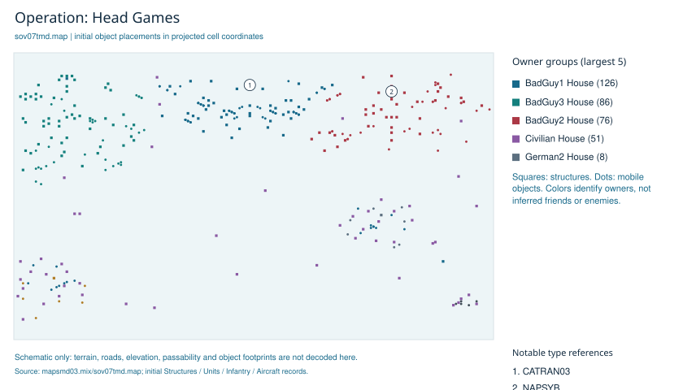

# Operation: Head Games

[Campaign reading guide](../../05-CAMPAIGNS.md) | [Engine](../../01-ENGINE-WORKFLOW.md)

<!-- ILLUSTRATIONS:START -->

*Initial placement schematic for sov07tmd.map. Explanatory diagram derived from the guide and local data; not a screenshot.*
<!-- ILLUSTRATIONS:END -->

**Map:** sov07tmd.map. **Effective extracted member:** mapsmd03.mix/sov07tmd.map. **Trigger definitions:** 126.

This is a translated static ledger, not a recorded playthrough. Trigger numbering below is browsing order, not chronological execution. Each trigger still requires eligibility, enabling, relevant attachments and its event logic. Values called time units remain in the source scale; no unverified wall-clock conversion is applied.

Read an event as applying to the trigger's attached scope when it is object/cell-specific. Multiple event entries are recorded conditions for the trigger, not alternative objectives unless the runtime's event logic makes them so. Tag persistence modes: 0 consumes on the relevant first occurrence; 1 waits for the applicable attached-object completion; 2 permits repeating. Not all definitions have a live attached instance.

[All team rosters and ordered plans](sov07tmd-teams.md) | [All mission overrides](sov07tmd-overrides.md)

## Starting world

| Part | Recorded value |
| --- | --- |
| Player house | Player House |
| Theater | TEMPERATE |
| Map size | 0,0,103,110 |
| Visible local rectangle | 5,5,93,99 |
| Placed vehicles | 37 |
| Placed infantry | 128 |
| Placed structures | 190 |
| Placed aircraft | 4 |
| Team templates | 129 |

### Houses

| Map house slot | Owner name | Starting credits setting | Country |
| --- | --- | --- | --- |
| 0 | Player House | 100 | Player |
| 1 | BadGuy1 House | 400 | BadGuy1 |
| 2 | BadGuy2 House | 400 | BadGuy2 |
| 3 | German1 House | 10 | Germany1 |
| 4 | Civilian House | 0 | Neutral |
| 5 | Einstein House | 100 | Einstein |
| 6 | BadGuy3 House | 400 | BadGuy3 |
| 7 | German2 House | 50 | Germany2 |
| 8 | German3 House | 50 | Germany3 |
| 9 | Temp House | 0 | Temp |

### Local state flags at initialization

| Flag | Meaning label and initial value |
| --- | --- |
| 0 | Minions Build,0 |
| 1 | Demo Driver L In,0 |
| 2 | Demo Driver R In,0 |
| 3 | Player MCV on map,0 |
| 4 | Deployed MCV,0 |
| 5 | Soviets Freed,0 |
| 6 | Allies Freed,0 |
| 7 | IFV for Combine 1,0 |
| 8 | Shock for Combine 1,0 |
| 9 | Combine 01,0 |
| 10 | Combine 02,0 |
| 11 | IFV for Combine 2,0 |
| 12 | Shock for Combine 2,0 |
| 13 | IFV for Combine 3,0 |
| 14 | Troops for Combine ,0 |
| 15 | Combine 03a,0 |
| 16 | Combine 03b,0 |
| 17 | Combine 03c,0 |
| 18 | Combine 03d,0 |
| 19 | Combine 03e,0 |
| 20 | WCryptKIA,0 |
| 21 | ECryptKIA,0 |
| 22 | SW Grinder KIA,0 |
| 23 | NE Grinder KIA,0 |

## Terminal gates: victory, defeat or forced end

These records can issue an outcome or its announcement. An announcement is distinguished from the actual winner/loser action. Follow the linked trigger for all guards and action order.

| Gate | Conditions recorded | Terminal-related actions |
| --- | --- | --- |
| [_Win (Game Over) (0B0A4B9C)](#trigger-0b0a4b9c) | 9 configured time units have elapsed since the trigger timer was initialized/reset. | Declare owner selector 15 (country/type PLAYER; placed owner Player House) the winner. |
| [_Lose (05FD863C)](#trigger-05fd863c) | Destroyed,  All: owner selector 15 (country/type PLAYER; placed owner Player House). | Declare owner selector 15 (country/type PLAYER; placed owner Player House) the loser. |

## Every trigger, in file order

### 1. Soviets Build Nuke (M) - 0D06808C

Owner reference: BadGuy2. Initially disabled. Difficulty eligibility: Easy 0, Normal 1, Hard 0 (1 means included). Linked trigger: none.

Incoming activation links: enable from [Soviets Build Nuke (On-Iron Curtain) (0D06981C)](#trigger-0d06981c); enable from [Soviets Build Nuke (On-nuke silo) (0D06925C)](#trigger-0d06925c).

Attached scope: no direct placed object/cell tag found; can be scenario-wide, linked or dynamically attached.

**Wait for the recorded events:**

1. local flag 5 (Soviets Freed) is clear.
2. 205 configured time units have elapsed since the trigger timer was initialized/reset.

Flag writers in this mission: set local flag 5 (Soviets Freed) at [Soviets Freed (0B5A6B7C)](#trigger-0b5a6b7c). Script steps can also change flags; see teams below.

**Then perform these actions in order:**

1. Create building NAMISL at waypoint 0 (cell 91, 48).
2. Play voice notification EVA_NuclearSiloDetected.

Source locator: mapsmd03.mix/sov07tmd.map; Triggers line 10615, Events line 10743, Actions line 10871.

### 2. Soviets Build Nuke (On-Iron Curtain) - 0D06981C

Owner reference: Player. Initially enabled. Difficulty eligibility: Easy 0, Normal 1, Hard 1 (1 means included). Linked trigger: none.

Attached scope: no direct placed object/cell tag found; can be scenario-wide, linked or dynamically attached.

**Wait for the recorded events:**

1. Build Building Type: type index 24 (global list position: Iron Curtain Device (NAIRON)). A map-local type-list change can affect index interpretation.

**Then perform these actions in order:**

1. Set local flag 0 (Minions Build).
2. Enable and reset applicable timers for [Soviets Build Nuke (M) (0D06808C)](#trigger-0d06808c).
3. Enable and reset applicable timers for [Soviets Build Nuke (H) (07F2570C)](#trigger-07f2570c).

Source locator: mapsmd03.mix/sov07tmd.map; Triggers line 10616, Events line 10744, Actions line 10872.

### 3. Soviets Build Nuke (H) - 07F2570C

Owner reference: BadGuy2. Initially disabled. Difficulty eligibility: Easy 0, Normal 0, Hard 1 (1 means included). Linked trigger: [Soviets Build Nuke (M) (0D06808C)](#trigger-0d06808c).

Incoming activation links: enable from [Soviets Build Nuke (On-Iron Curtain) (0D06981C)](#trigger-0d06981c); enable from [Soviets Build Nuke (On-nuke silo) (0D06925C)](#trigger-0d06925c).

Attached scope: tag definitions 0D06996C (persistence 0); no placed object/cell attachment found by this extraction.

**Wait for the recorded events:**

1. local flag 5 (Soviets Freed) is clear.
2. 280 configured time units have elapsed since the trigger timer was initialized/reset.

Flag writers in this mission: set local flag 5 (Soviets Freed) at [Soviets Freed (0B5A6B7C)](#trigger-0b5a6b7c). Script steps can also change flags; see teams below.

**Then perform these actions in order:**

1. Create building NAMISL at waypoint 0 (cell 91, 48).
2. Play voice notification EVA_NuclearSiloDetected.

Source locator: mapsmd03.mix/sov07tmd.map; Triggers line 10617, Events line 10745, Actions line 10873.

### 4. Allies Build Weather Controller (M) - 0CF90E6C

Owner reference: BadGuy3. Initially disabled. Difficulty eligibility: Easy 0, Normal 1, Hard 0 (1 means included). Linked trigger: none.

Incoming activation links: enable from [Allies Build Weather (On-Iron Curtain) (0B5A3C8C)](#trigger-0b5a3c8c); enable from [Allies Build Weather (On-Nuke) (0B5A7A8C)](#trigger-0b5a7a8c).

Attached scope: no direct placed object/cell tag found; can be scenario-wide, linked or dynamically attached.

**Wait for the recorded events:**

1. local flag 6 (Allies Freed) is clear.
2. 325 configured time units have elapsed since the trigger timer was initialized/reset.

Flag writers in this mission: set local flag 6 (Allies Freed) at [Allies Freed (0B5A5B5C)](#trigger-0b5a5b5c). Script steps can also change flags; see teams below.

**Then perform these actions in order:**

1. Create building GAWEAT at waypoint 1 (cell 18, 107).
2. Play voice notification EVA_WeatherDeviceReady.

Source locator: mapsmd03.mix/sov07tmd.map; Triggers line 10618, Events line 10746, Actions line 10874.

### 5. Soviets Build Nuke (On-nuke silo) - 0D06925C

Owner reference: Player. Initially enabled. Difficulty eligibility: Easy 0, Normal 1, Hard 1 (1 means included). Linked trigger: [Soviets Build Nuke (On-Iron Curtain) (0D06981C)](#trigger-0d06981c).

Attached scope: tag definitions 0D06934C (persistence 0); no placed object/cell attachment found by this extraction.

**Wait for the recorded events:**

1. Build Building Type: type index 54 (global list position: Nuclear Missile Silo (NAMISL)). A map-local type-list change can affect index interpretation.

**Then perform these actions in order:**

1. Set local flag 0 (Minions Build).
2. Enable and reset applicable timers for [Soviets Build Nuke (M) (0D06808C)](#trigger-0d06808c).
3. Enable and reset applicable timers for [Soviets Build Nuke (H) (07F2570C)](#trigger-07f2570c).

Source locator: mapsmd03.mix/sov07tmd.map; Triggers line 10619, Events line 10747, Actions line 10875.

### 6. Allies Freed - 0B5A5B5C

Owner reference: BadGuy3. Initially enabled. Difficulty eligibility: Easy 1, Normal 1, Hard 1 (1 means included). Linked trigger: none.

Attached scope: no direct placed object/cell tag found; can be scenario-wide, linked or dynamically attached.

**Wait for the recorded events:**

1. Destroyed by anything. See attached-object/cell scope below.

**Then perform these actions in order:**

1. All change house: owner selector 15 (country/type PLAYER; placed owner Player House).
2. Disable [Allies Build Weather (On-Iron Curtain) (0B5A3C8C)](#trigger-0b5a3c8c).
3. Disable [Allies Build Weather (On-Nuke) (0B5A7A8C)](#trigger-0b5a7a8c).
4. Disable [Allies Build Weather Controller (M) (0CF90E6C)](#trigger-0cf90e6c).
5. Set local flag 6 (Allies Freed).

Source locator: mapsmd03.mix/sov07tmd.map; Triggers line 10620, Events line 10748, Actions line 10876.

### 7. Allies Build Weather (On-Iron Curtain) - 0B5A3C8C

Owner reference: Player. Initially enabled. Difficulty eligibility: Easy 0, Normal 1, Hard 1 (1 means included). Linked trigger: none.

Attached scope: no direct placed object/cell tag found; can be scenario-wide, linked or dynamically attached.

**Wait for the recorded events:**

1. Build Building Type: type index 24 (global list position: Iron Curtain Device (NAIRON)). A map-local type-list change can affect index interpretation.

**Then perform these actions in order:**

1. Set local flag 0 (Minions Build).
2. Enable and reset applicable timers for [Allies Build Weather Controller (M) (0CF90E6C)](#trigger-0cf90e6c).
3. Enable and reset applicable timers for [Allies Build Weather Controller (H) (07F26E0C)](#trigger-07f26e0c).

Source locator: mapsmd03.mix/sov07tmd.map; Triggers line 10621, Events line 10749, Actions line 10877.

### 8. Allies Build Weather (On-Nuke) - 0B5A7A8C

Owner reference: Player. Initially enabled. Difficulty eligibility: Easy 0, Normal 1, Hard 1 (1 means included). Linked trigger: [Allies Build Weather (On-Iron Curtain) (0B5A3C8C)](#trigger-0b5a3c8c).

Attached scope: tag definitions 0B5A3A5C (persistence 0); no placed object/cell attachment found by this extraction.

**Wait for the recorded events:**

1. Build Building Type: type index 54 (global list position: Nuclear Missile Silo (NAMISL)). A map-local type-list change can affect index interpretation.

**Then perform these actions in order:**

1. Set local flag 0 (Minions Build).
2. Enable and reset applicable timers for [Allies Build Weather Controller (M) (0CF90E6C)](#trigger-0cf90e6c).
3. Enable and reset applicable timers for [Allies Build Weather Controller (H) (07F26E0C)](#trigger-07f26e0c).

Source locator: mapsmd03.mix/sov07tmd.map; Triggers line 10622, Events line 10750, Actions line 10878.

### 9. Allies Build Weather Controller (H) - 07F26E0C

Owner reference: BadGuy3. Initially disabled. Difficulty eligibility: Easy 0, Normal 0, Hard 1 (1 means included). Linked trigger: [Allies Build Weather Controller (M) (0CF90E6C)](#trigger-0cf90e6c).

Incoming activation links: enable from [Allies Build Weather (On-Iron Curtain) (0B5A3C8C)](#trigger-0b5a3c8c); enable from [Allies Build Weather (On-Nuke) (0B5A7A8C)](#trigger-0b5a7a8c).

Attached scope: tag definitions 0CF90C3C (persistence 0); no placed object/cell attachment found by this extraction.

**Wait for the recorded events:**

1. local flag 6 (Allies Freed) is clear.
2. 290 configured time units have elapsed since the trigger timer was initialized/reset.

Flag writers in this mission: set local flag 6 (Allies Freed) at [Allies Freed (0B5A5B5C)](#trigger-0b5a5b5c). Script steps can also change flags; see teams below.

**Then perform these actions in order:**

1. Create building GAWEAT at waypoint 1 (cell 18, 107).
2. Play voice notification EVA_WeatherDeviceReady.

Source locator: mapsmd03.mix/sov07tmd.map; Triggers line 10623, Events line 10751, Actions line 10879.

### 10. Soviets Freed - 0B5A6B7C

Owner reference: BadGuy2. Initially enabled. Difficulty eligibility: Easy 1, Normal 1, Hard 1 (1 means included). Linked trigger: none.

Attached scope: no direct placed object/cell tag found; can be scenario-wide, linked or dynamically attached.

**Wait for the recorded events:**

1. Destroyed by anything. See attached-object/cell scope below.

**Then perform these actions in order:**

1. All change house: owner selector 15 (country/type PLAYER; placed owner Player House).
2. Disable [Soviets Build Nuke (On-Iron Curtain) (0D06981C)](#trigger-0d06981c).
3. Disable [Soviets Build Nuke (On-nuke silo) (0D06925C)](#trigger-0d06925c).
4. Set local flag 5 (Soviets Freed).
5. Disable [Soviets Build Nuke (M) (0D06808C)](#trigger-0d06808c).

Source locator: mapsmd03.mix/sov07tmd.map; Triggers line 10624, Events line 10752, Actions line 10880.

### 11. _Win (Bldgs KIA) - 0B0A52BC

Owner reference: Player. Initially enabled. Difficulty eligibility: Easy 1, Normal 1, Hard 1 (1 means included). Linked trigger: none.

Attached scope: no direct placed object/cell tag found; can be scenario-wide, linked or dynamically attached.

**Wait for the recorded events:**

1. Destroyed by anything. See attached-object/cell scope below.

**Then perform these actions in order:**

1. Disable [_Win (Bldgs KIA) (0B0A52BC)](#trigger-0b0a52bc).
2. Enable and reset applicable timers for [_Win (Free Soviets) (0E2AB85C)](#trigger-0e2ab85c).
3. Enable and reset applicable timers for [_Win (Cheer) (0B0A72AC)](#trigger-0b0a72ac).
4. Enable and reset applicable timers for [_Win (Free Allies) (0CD9E15C)](#trigger-0cd9e15c).

Source locator: mapsmd03.mix/sov07tmd.map; Triggers line 10625, Events line 10753, Actions line 10881.

### 12. _Win (Free Soviets) - 0E2AB85C

Owner reference: BadGuy2. Initially disabled. Difficulty eligibility: Easy 1, Normal 1, Hard 1 (1 means included). Linked trigger: [Soviets Freed (0B5A6B7C)](#trigger-0b5a6b7c).

Incoming activation links: enable from [_Win (Bldgs KIA) (0B0A52BC)](#trigger-0b0a52bc).

Attached scope: Psychic Beacon (NAPSYB), owner BadGuy1 House, cell (95, 42), tag 0B5A680C, persistence mode 0.

**Wait for the recorded events:**

1. 3 configured time units have elapsed since the trigger timer was initialized/reset.

**Then perform these actions in order:**

1. Destroy the attached object through the scripted destruction action.
2. All change house: owner selector 15 (country/type PLAYER; placed owner Player House).
3. Disable [Soviets Build Nuke (M) (0D06808C)](#trigger-0d06808c).
4. Disable [Soviets Build Nuke (On-Iron Curtain) (0D06981C)](#trigger-0d06981c).
5. Disable [Soviets Build Nuke (On-nuke silo) (0D06925C)](#trigger-0d06925c).

Source locator: mapsmd03.mix/sov07tmd.map; Triggers line 10626, Events line 10754, Actions line 10882.

### 13. _Win (Cheer) - 0B0A72AC

Owner reference: Player. Initially disabled. Difficulty eligibility: Easy 1, Normal 1, Hard 1 (1 means included). Linked trigger: none.

Incoming activation links: enable from [_Win (Bldgs KIA) (0B0A52BC)](#trigger-0b0a52bc).

Attached scope: tag definitions 0B0A4C8C (persistence 0); no placed object/cell attachment found by this extraction.

**Wait for the recorded events:**

1. 3 configured time units have elapsed since the trigger timer was initialized/reset.

**Then perform these actions in order:**

1. Make side cheer: owner selector 15 (country/type PLAYER; placed owner Player House).
2. Enable and reset applicable timers for [_Win (Game Over) (0B0A4B9C)](#trigger-0b0a4b9c).
3. Enable and reset applicable timers for [Loop_Cheer for Win (094320DC)](#trigger-094320dc).

Source locator: mapsmd03.mix/sov07tmd.map; Triggers line 10627, Events line 10755, Actions line 10883.

### 14. _Win (Free Allies) - 0CD9E15C

Owner reference: BadGuy3. Initially disabled. Difficulty eligibility: Easy 1, Normal 1, Hard 1 (1 means included). Linked trigger: [Allies Freed (0B5A5B5C)](#trigger-0b5a5b5c).

Incoming activation links: enable from [_Win (Bldgs KIA) (0B0A52BC)](#trigger-0b0a52bc).

Attached scope: Psychic Beacon (NAPSYB), owner BadGuy1 House, cell (27, 100), tag 0B5A55EC, persistence mode 0.

**Wait for the recorded events:**

1. 3 configured time units have elapsed since the trigger timer was initialized/reset.

**Then perform these actions in order:**

1. Destroy the attached object through the scripted destruction action.
2. All change house: owner selector 15 (country/type PLAYER; placed owner Player House).
3. Disable [Allies Build Weather (On-Iron Curtain) (0B5A3C8C)](#trigger-0b5a3c8c).
4. Disable [Allies Build Weather (On-Nuke) (0B5A7A8C)](#trigger-0b5a7a8c).
5. Disable [Allies Build Weather Controller (M) (0CF90E6C)](#trigger-0cf90e6c).

Source locator: mapsmd03.mix/sov07tmd.map; Triggers line 10628, Events line 10756, Actions line 10884.

### 15. _Win (Game Over) - 0B0A4B9C

Owner reference: Player. Initially disabled. Difficulty eligibility: Easy 1, Normal 1, Hard 1 (1 means included). Linked trigger: none.

Incoming activation links: enable from [_Win (Cheer) (0B0A72AC)](#trigger-0b0a72ac).

Attached scope: tag definitions 0B0A47CC (persistence 0); no placed object/cell attachment found by this extraction.

**Wait for the recorded events:**

1. 9 configured time units have elapsed since the trigger timer was initialized/reset.

**Then perform these actions in order:**

1. Declare owner selector 15 (country/type PLAYER; placed owner Player House) the winner.

Source locator: mapsmd03.mix/sov07tmd.map; Triggers line 10629, Events line 10757, Actions line 10885.

### 16. Loop_Cheer for Win - 094320DC

Owner reference: Americans. Initially disabled. Difficulty eligibility: Easy 1, Normal 1, Hard 1 (1 means included). Linked trigger: none.

Incoming activation links: enable from [_Win (Cheer) (0B0A72AC)](#trigger-0b0a72ac).

Attached scope: tag definitions 09437F4C (persistence 2); no placed object/cell attachment found by this extraction.

**Wait for the recorded events:**

1. 3 configured time units have elapsed since the trigger timer was initialized/reset.

**Then perform these actions in order:**

1. Make side cheer: owner selector 15 (country/type PLAYER; placed owner Player House).

Source locator: mapsmd03.mix/sov07tmd.map; Triggers line 10630, Events line 10758, Actions line 10886.

### 17. Rally Volunteers 01 - 093C666C

Owner reference: Player. Initially enabled. Difficulty eligibility: Easy 1, Normal 1, Hard 1 (1 means included). Linked trigger: none.

Attached scope: Demolition Truck (DTRUCK), owner Einstein House, cell (193, 110), tag 093B806C, persistence mode 0; Demolition Truck (DTRUCK), owner Einstein House, cell (193, 107), tag 093B806C, persistence mode 0; Terrorist (TERROR), owner Einstein House, cell (190, 110), tag 093B806C, persistence mode 0; Terrorist (TERROR), owner Einstein House, cell (190, 112), tag 093B806C, persistence mode 0; Terrorist (TERROR), owner Einstein House, cell (191, 111), tag 093B806C, persistence mode 0.

**Wait for the recorded events:**

1. Discovered by player. See attached-object/cell scope below.

**Then perform these actions in order:**

1. Reveal terrain around waypoint 26 (cell 187, 110).
2. Reveal terrain around waypoint 24 (cell 193, 109).
3. Change House: owner selector 15 (country/type PLAYER; placed owner Player House).
4. Play voice notification Mis_xS7_ZofiaFreedomFighters.
5. Create radar-event marker type 1 at waypoint 26 (cell 187, 110).
6. Set local flag 1 (Demo Driver L In).
7. Set local flag 2 (Demo Driver R In).

Source locator: mapsmd03.mix/sov07tmd.map; Triggers line 10631, Events line 10759, Actions line 10887.

### 18. Rally Volunteers 02 - 093BB0FC

Owner reference: Player. Initially enabled. Difficulty eligibility: Easy 1, Normal 1, Hard 1 (1 means included). Linked trigger: none.

Attached scope: tag definitions 093B92BC (persistence 0); no placed object/cell attachment found by this extraction.

**Wait for the recorded events:**

1. local flag 2 (Demo Driver R In) is set.
2. local flag 1 (Demo Driver L In) is set.

Flag writers in this mission: set local flag 2 (Demo Driver R In) at [Rally Volunteers 01 (093C666C)](#trigger-093c666c); set local flag 1 (Demo Driver L In) at [Rally Volunteers 01 (093C666C)](#trigger-093c666c). Script steps can also change flags; see teams below.

**Then perform these actions in order:**

1. Create/recruit team [Rally Volunteers (0BF4446C)](sov07tmd-teams.md#team-0bf4446c).
2. Set Tech Level (Techno)[Level]; main setting TERROR; location/duration field 5.
3. Set Tech Level (Techno)[Level]; main setting DTRUCK; location/duration field 5.
4. Enable and reset applicable timers for [Rally Volunteers 03 (093B91CC)](#trigger-093b91cc).

Source locator: mapsmd03.mix/sov07tmd.map; Triggers line 10632, Events line 10760, Actions line 10888.

### 19. Rally Volunteers 03 - 093B91CC

Owner reference: Player. Initially disabled. Difficulty eligibility: Easy 1, Normal 1, Hard 1 (1 means included). Linked trigger: none.

Incoming activation links: enable from [Rally Volunteers 02 (093BB0FC)](#trigger-093bb0fc).

Attached scope: tag definitions 093CF0FC (persistence 0); no placed object/cell attachment found by this extraction.

**Wait for the recorded events:**

1. 5 configured time units have elapsed since the trigger timer was initialized/reset.

**Then perform these actions in order:**

1. Play sound Terrorist-Sov07.
2. Enable and reset applicable timers for [Rally Volunteers 04 (093CAF3C)](#trigger-093caf3c).

Source locator: mapsmd03.mix/sov07tmd.map; Triggers line 10633, Events line 10761, Actions line 10889.

### 20. Rally Volunteers 04 - 093CAF3C

Owner reference: Player. Initially disabled. Difficulty eligibility: Easy 1, Normal 1, Hard 1 (1 means included). Linked trigger: none.

Incoming activation links: enable from [Rally Volunteers 03 (093B91CC)](#trigger-093b91cc).

Attached scope: tag definitions 093CBE7C (persistence 0); no placed object/cell attachment found by this extraction.

**Wait for the recorded events:**

1. 5 configured time units have elapsed since the trigger timer was initialized/reset.

**Then perform these actions in order:**

1. Play sound DemoTruck-Sov07.

Source locator: mapsmd03.mix/sov07tmd.map; Triggers line 10634, Events line 10762, Actions line 10890.

### 21. Hello - 06A1603C

Owner reference: Player. Initially enabled. Difficulty eligibility: Easy 1, Normal 1, Hard 1 (1 means included). Linked trigger: none.

Attached scope: 1 tagged map cells: (118, 133); tag 06A2303C, persistence mode 0.

**Wait for the recorded events:**

1. Entered by: owner selector 15 (country/type PLAYER; placed owner Player House).

**Then perform these actions in order:**

1. Display message “KBO AEO” (MISSION:HiKBOAEO).

Source locator: mapsmd03.mix/sov07tmd.map; Triggers line 10635, Events line 10763, Actions line 10891.

### 22. BG3 Bunker Boys Go - 09389BBC

Owner reference: BadGuy3. Initially enabled. Difficulty eligibility: Easy 1, Normal 1, Hard 1 (1 means included). Linked trigger: none.

Attached scope: tag definitions 093A509C (persistence 0); no placed object/cell attachment found by this extraction.

**Wait for the recorded events:**

1. The unconditional/any-event condition is satisfied.

**Then perform these actions in order:**

1. Supply reinforcement team [Bunker Boys C (093953FC)](sov07tmd-teams.md#team-093953fc).
2. Supply reinforcement team [Bunker Boys D (0938E81C)](sov07tmd-teams.md#team-0938e81c).
3. Supply reinforcement team [Bunker Boys E (093A0EFC)](sov07tmd-teams.md#team-093a0efc).

Source locator: mapsmd03.mix/sov07tmd.map; Triggers line 10636, Events line 10764, Actions line 10892.

### 23. BG1 Bunker Boys Go - 093A68FC

Owner reference: BadGuy1. Initially enabled. Difficulty eligibility: Easy 1, Normal 1, Hard 1 (1 means included). Linked trigger: none.

Attached scope: tag definitions 093A642C (persistence 0); no placed object/cell attachment found by this extraction.

**Wait for the recorded events:**

1. The unconditional/any-event condition is satisfied.

**Then perform these actions in order:**

1. Supply reinforcement team [Bunker Boys F (093A5ADC)](sov07tmd-teams.md#team-093a5adc).
2. Supply reinforcement team [Bunker Boys G (0BD7BC8C)](sov07tmd-teams.md#team-0bd7bc8c).
3. Create/recruit team [BG1 Tank Bunkers (0A9F5B8C)](sov07tmd-teams.md#team-0a9f5b8c).

Source locator: mapsmd03.mix/sov07tmd.map; Triggers line 10637, Events line 10765, Actions line 10893.

### 24. BG2 Bunker Boys Go - 093A633C

Owner reference: BadGuy2. Initially enabled. Difficulty eligibility: Easy 1, Normal 1, Hard 1 (1 means included). Linked trigger: none.

Attached scope: tag definitions 093A2B4C (persistence 0); no placed object/cell attachment found by this extraction.

**Wait for the recorded events:**

1. The unconditional/any-event condition is satisfied.

**Then perform these actions in order:**

1. Supply reinforcement team [Bunker Boys H (093A2A1C)](sov07tmd-teams.md#team-093a2a1c).
2. Supply reinforcement team [Bunker Boys I (093A230C)](sov07tmd-teams.md#team-093a230c).
3. Supply reinforcement team [Bunker Boys M (093A7AEC)](sov07tmd-teams.md#team-093a7aec).
4. Create/recruit team [BG2 Tank Bunkers (07DA769C)](sov07tmd-teams.md#team-07da769c).

Source locator: mapsmd03.mix/sov07tmd.map; Triggers line 10638, Events line 10766, Actions line 10894.

### 25. Player Starters 1 Go - 0939307C

Owner reference: Player. Initially enabled. Difficulty eligibility: Easy 1, Normal 1, Hard 1 (1 means included). Linked trigger: none.

Attached scope: tag definitions 093A05EC (persistence 0); no placed object/cell attachment found by this extraction.

**Wait for the recorded events:**

1. The unconditional/any-event condition is satisfied.

**Then perform these actions in order:**

1. Supply reinforcement team [Player Starters MCV (093813CC)](sov07tmd-teams.md#team-093813cc).
2. Supply reinforcement team [Player Starters Armor L (08B8991C)](sov07tmd-teams.md#team-08b8991c).
3. Supply reinforcement team [Player Starters Armor R (08B8946C)](sov07tmd-teams.md#team-08b8946c).
4. Enable and reset applicable timers for [Player Starters 2 Go (093A04FC)](#trigger-093a04fc).
5. Disable player input.

Source locator: mapsmd03.mix/sov07tmd.map; Triggers line 10639, Events line 10767, Actions line 10895.

### 26. Player Starters 2 Go - 093A04FC

Owner reference: Player. Initially disabled. Difficulty eligibility: Easy 1, Normal 1, Hard 1 (1 means included). Linked trigger: none.

Incoming activation links: enable from [Player Starters 1 Go (0939307C)](#trigger-0939307c).

Attached scope: tag definitions 093A7CDC (persistence 0); no placed object/cell attachment found by this extraction.

**Wait for the recorded events:**

1. 3 configured time units have elapsed since the trigger timer was initialized/reset.

**Then perform these actions in order:**

1. Supply reinforcement team [Player Starters Infantry L (08B8843C)](sov07tmd-teams.md#team-08b8843c).
2. Supply reinforcement team [Player Starters Infantry R (08B89CBC)](sov07tmd-teams.md#team-08b89cbc).

Source locator: mapsmd03.mix/sov07tmd.map; Triggers line 10640, Events line 10768, Actions line 10896.

### 27. Briefing Begin - 0947BC0C

Owner reference: BadGuy1. Initially enabled. Difficulty eligibility: Easy 1, Normal 1, Hard 1 (1 means included). Linked trigger: none.

Attached scope: tag definitions 0947B5BC (persistence 0); no placed object/cell attachment found by this extraction.

**Wait for the recorded events:**

1. local flag 3 (Player MCV on map) is set.

**Then perform these actions in order:**

1. Play in-game movie 55.
2. Enable and reset applicable timers for [Briefing Audio (092D8F3C)](#trigger-092d8f3c).
3. Enable and reset applicable timers for [_Lose (05FD863C)](#trigger-05fd863c).

Source locator: mapsmd03.mix/sov07tmd.map; Triggers line 10641, Events line 10769, Actions line 10897.

### 28. Briefing Audio - 092D8F3C

Owner reference: BadGuy1. Initially disabled. Difficulty eligibility: Easy 1, Normal 1, Hard 1 (1 means included). Linked trigger: none.

Incoming activation links: enable from [Briefing Begin (0947BC0C)](#trigger-0947bc0c).

Attached scope: tag definitions 092D8E5C (persistence 0); no placed object/cell attachment found by this extraction.

**Wait for the recorded events:**

1. 10 configured time units have elapsed since the trigger timer was initialized/reset.

**Then perform these actions in order:**

1. Play voice notification S07_p01.
2. Enable and reset applicable timers for [Briefing Allies (0947B21C)](#trigger-0947b21c).
3. Display message “Objective: Destroy Yuri's Fortress.” (MISSION:Sov07Obj01).
4. Move the camera to waypoint 43 (cell 70, 72) with speed setting 3.
5. Reveal terrain around waypoint 43 (cell 70, 72).
6. Flash buildings of type CATRAN03; duration argument 120.

Source locator: mapsmd03.mix/sov07tmd.map; Triggers line 10642, Events line 10770, Actions line 10898.

### 29. _Lose - 05FD863C

Owner reference: Player. Initially disabled. Difficulty eligibility: Easy 1, Normal 1, Hard 1 (1 means included). Linked trigger: none.

Incoming activation links: enable from [Briefing Begin (0947BC0C)](#trigger-0947bc0c); enable from [Briefing End (0947C79C)](#trigger-0947c79c).

Attached scope: tag definitions 05FDA03C (persistence 0); no placed object/cell attachment found by this extraction.

**Wait for the recorded events:**

1. Destroyed,  All: owner selector 15 (country/type PLAYER; placed owner Player House).

**Then perform these actions in order:**

1. Declare owner selector 15 (country/type PLAYER; placed owner Player House) the loser.

Source locator: mapsmd03.mix/sov07tmd.map; Triggers line 10643, Events line 10771, Actions line 10899.

### 30. Briefing Allies - 0947B21C

Owner reference: BadGuy1. Initially disabled. Difficulty eligibility: Easy 1, Normal 1, Hard 1 (1 means included). Linked trigger: none.

Incoming activation links: enable from [Briefing Audio (092D8F3C)](#trigger-092d8f3c).

Attached scope: tag definitions 0947CD5C (persistence 0); no placed object/cell attachment found by this extraction.

**Wait for the recorded events:**

1. 10 configured time units have elapsed since the trigger timer was initialized/reset.

**Then perform these actions in order:**

1. Jump the camera to waypoint 44 (cell 29, 102).
2. Enable and reset applicable timers for [Briefing Soviets (0947CB9C)](#trigger-0947cb9c).
3. Reveal terrain around waypoint 44 (cell 29, 102).
4. Create radar-event marker type 5 at waypoint 44 (cell 29, 102).
5. Display message “Hint: Capture or Destroy the Psychic Beacon in the Allied Base to release them from Yuri's control.” (MISSION:AllyBeacon).
6. Flash buildings of type NAPSYB; duration argument 120.

Source locator: mapsmd03.mix/sov07tmd.map; Triggers line 10644, Events line 10772, Actions line 10900.

### 31. Briefing Soviets - 0947CB9C

Owner reference: BadGuy1. Initially disabled. Difficulty eligibility: Easy 1, Normal 1, Hard 1 (1 means included). Linked trigger: none.

Incoming activation links: enable from [Briefing Allies (0947B21C)](#trigger-0947b21c).

Attached scope: tag definitions 0947C95C (persistence 0); no placed object/cell attachment found by this extraction.

**Wait for the recorded events:**

1. 4 configured time units have elapsed since the trigger timer was initialized/reset.

**Then perform these actions in order:**

1. Jump the camera to waypoint 45 (cell 97, 44).
2. Enable and reset applicable timers for [Briefing End (0947C79C)](#trigger-0947c79c).
3. Reveal terrain around waypoint 45 (cell 97, 44).
4. Create radar-event marker type 5 at waypoint 45 (cell 97, 44).
5. Display message “Hint: Neutralize the Psychic Beacon controlling the Soviet Base and they will rally to your side against Yuri.” (MISSION:SovBeacon).
6. Flash buildings of type NAPSYB; duration argument 120.

Source locator: mapsmd03.mix/sov07tmd.map; Triggers line 10645, Events line 10773, Actions line 10901.

### 32. Briefing End - 0947C79C

Owner reference: Player. Initially disabled. Difficulty eligibility: Easy 1, Normal 1, Hard 1 (1 means included). Linked trigger: none.

Incoming activation links: enable from [Briefing Soviets (0947CB9C)](#trigger-0947cb9c).

Attached scope: tag definitions 0947AF4C (persistence 0); no placed object/cell attachment found by this extraction.

**Wait for the recorded events:**

1. 17 configured time units have elapsed since the trigger timer was initialized/reset.

**Then perform these actions in order:**

1. Move the camera to waypoint 17 (cell 149, 148) with speed setting 4.
2. Enable player input.
3. Play voice notification EVA_BattlefieldControlOnline.
4. Enable and reset applicable timers for [_Lose (05FD863C)](#trigger-05fd863c).

Source locator: mapsmd03.mix/sov07tmd.map; Triggers line 10646, Events line 10774, Actions line 10902.

### 33. Yuri Weary Taunt - 0BD60BFC

Owner reference: Player. Initially enabled. Difficulty eligibility: Easy 1, Normal 1, Hard 1 (1 means included). Linked trigger: none.

Attached scope: tag definitions 0BD6050C (persistence 0); no placed object/cell attachment found by this extraction.

**Wait for the recorded events:**

1. local flag 4 (Deployed MCV) is clear.
2. 120 configured time units have elapsed since scenario start.

Flag writers in this mission: set local flag 4 (Deployed MCV) at [Player Deployed MCV (0BD6041C)](#trigger-0bd6041c). Script steps can also change flags; see teams below.

**Then perform these actions in order:**

1. Play voice notification Mis_xS7_YuriGrowWeary.
2. Disable [1st Attkrs (Go) (0CBE5C3C)](#trigger-0cbe5c3c).
3. Supply reinforcement team [1st All Attkrs (0CBF1C4C)](sov07tmd-teams.md#team-0cbf1c4c).
4. Supply reinforcement team [1st Sov Attkrs (0CBF330C)](sov07tmd-teams.md#team-0cbf330c).
5. Supply reinforcement team [1st Yuri Attkrs (0CBF7D5C)](sov07tmd-teams.md#team-0cbf7d5c).

Source locator: mapsmd03.mix/sov07tmd.map; Triggers line 10647, Events line 10775, Actions line 10903.

### 34. 1st Attkrs (Go) - 0CBE5C3C

Owner reference: Player. Initially disabled. Difficulty eligibility: Easy 1, Normal 1, Hard 1 (1 means included). Linked trigger: none.

Incoming activation links: enable from [1st Attkrs (Enable) (0BED4ABC)](#trigger-0bed4abc).

Attached scope: tag definitions 0CBE4F4C (persistence 0); no placed object/cell attachment found by this extraction.

**Wait for the recorded events:**

1. 45 configured time units have elapsed since the trigger timer was initialized/reset.

**Then perform these actions in order:**

1. Supply reinforcement team [1st All Attkrs (0CBF1C4C)](sov07tmd-teams.md#team-0cbf1c4c).
2. Enable and reset applicable timers for [2nd Attkrs Go (H) (096653CC)](#trigger-096653cc).
3. Enable and reset applicable timers for [2nd Attkrs Go (M) (0B66ECBC)](#trigger-0b66ecbc).
4. Enable and reset applicable timers for [1st Attkrs (Sov) (05D9A29C)](#trigger-05d9a29c).
5. Enable and reset applicable timers for [1st Attkrs (Yuri) (05D9A0CC)](#trigger-05d9a0cc).

Source locator: mapsmd03.mix/sov07tmd.map; Triggers line 10648, Events line 10776, Actions line 10904.

### 35. 2nd Attkrs Go (H) - 096653CC

Owner reference: Player. Initially disabled. Difficulty eligibility: Easy 0, Normal 0, Hard 1 (1 means included). Linked trigger: none.

Incoming activation links: enable from [1st Attkrs (Go) (0CBE5C3C)](#trigger-0cbe5c3c).

Attached scope: no direct placed object/cell tag found; can be scenario-wide, linked or dynamically attached.

**Wait for the recorded events:**

1. 120 configured time units have elapsed since the trigger timer was initialized/reset.

**Then perform these actions in order:**

1. Supply reinforcement team [1st All Attkrs (0CBF1C4C)](sov07tmd-teams.md#team-0cbf1c4c).
2. Supply reinforcement team [1st Sov Attkrs (0CBF330C)](sov07tmd-teams.md#team-0cbf330c).
3. Supply reinforcement team [1st Yuri Attkrs (0CBF7D5C)](sov07tmd-teams.md#team-0cbf7d5c).

Source locator: mapsmd03.mix/sov07tmd.map; Triggers line 10649, Events line 10777, Actions line 10905.

### 36. 2nd Attkrs Go (M) - 0B66ECBC

Owner reference: Player. Initially disabled. Difficulty eligibility: Easy 0, Normal 1, Hard 0 (1 means included). Linked trigger: [2nd Attkrs Go (H) (096653CC)](#trigger-096653cc).

Incoming activation links: enable from [1st Attkrs (Go) (0CBE5C3C)](#trigger-0cbe5c3c).

Attached scope: tag definitions 0966641C (persistence 0); no placed object/cell attachment found by this extraction.

**Wait for the recorded events:**

1. 210 configured time units have elapsed since the trigger timer was initialized/reset.

**Then perform these actions in order:**

1. Supply reinforcement team [1st All Attkrs (0CBF1C4C)](sov07tmd-teams.md#team-0cbf1c4c).
2. Supply reinforcement team [1st Sov Attkrs (0CBF330C)](sov07tmd-teams.md#team-0cbf330c).
3. Supply reinforcement team [1st Yuri Attkrs (0CBF7D5C)](sov07tmd-teams.md#team-0cbf7d5c).

Source locator: mapsmd03.mix/sov07tmd.map; Triggers line 10650, Events line 10778, Actions line 10906.

### 37. 1st Attkrs (Sov) - 05D9A29C

Owner reference: Americans. Initially disabled. Difficulty eligibility: Easy 1, Normal 1, Hard 1 (1 means included). Linked trigger: none.

Incoming activation links: enable from [1st Attkrs (Go) (0CBE5C3C)](#trigger-0cbe5c3c).

Attached scope: tag definitions 05D9A1BC (persistence 0); no placed object/cell attachment found by this extraction.

**Wait for the recorded events:**

1. 30 configured time units have elapsed since the trigger timer was initialized/reset.

**Then perform these actions in order:**

1. Supply reinforcement team [1st Sov Attkrs (0CBF330C)](sov07tmd-teams.md#team-0cbf330c).

Source locator: mapsmd03.mix/sov07tmd.map; Triggers line 10651, Events line 10779, Actions line 10907.

### 38. 1st Attkrs (Yuri) - 05D9A0CC

Owner reference: Americans. Initially disabled. Difficulty eligibility: Easy 1, Normal 1, Hard 1 (1 means included). Linked trigger: none.

Incoming activation links: enable from [1st Attkrs (Go) (0CBE5C3C)](#trigger-0cbe5c3c).

Attached scope: tag definitions 05D9BF4C (persistence 0); no placed object/cell attachment found by this extraction.

**Wait for the recorded events:**

1. 45 configured time units have elapsed since the trigger timer was initialized/reset.

**Then perform these actions in order:**

1. Supply reinforcement team [1st Yuri Attkrs (0CBF7D5C)](sov07tmd-teams.md#team-0cbf7d5c).

Source locator: mapsmd03.mix/sov07tmd.map; Triggers line 10652, Events line 10780, Actions line 10908.

### 39. SW Peasent Grinder 01 - 07C1C26C

Owner reference: Germany1. Initially disabled. Difficulty eligibility: Easy 1, Normal 1, Hard 1 (1 means included). Linked trigger: none.

Incoming activation links: enable from [Enable_Peasant Grinders (08408E8C)](#trigger-08408e8c).

Attached scope: tag definitions 07C2D9DC (persistence 2); no placed object/cell attachment found by this extraction.

**Wait for the recorded events:**

1. A random delay centered on 60 configured time units expires (the editor describes a 50%-150% range).

**Then perform these actions in order:**

1. Supply reinforcement team [Grinder Peasent 01 SW (08FA906C)](sov07tmd-teams.md#team-08fa906c) at waypoint 13 (cell 90, 182).

Source locator: mapsmd03.mix/sov07tmd.map; Triggers line 10653, Events line 10781, Actions line 10909.

### 40. SW Peasent Grinder 02 - 07C1E3CC

Owner reference: Germany1. Initially disabled. Difficulty eligibility: Easy 1, Normal 1, Hard 1 (1 means included). Linked trigger: none.

Incoming activation links: enable from [Enable_Peasant Grinders (08408E8C)](#trigger-08408e8c).

Attached scope: tag definitions 07C30F4C (persistence 2); no placed object/cell attachment found by this extraction.

**Wait for the recorded events:**

1. A random delay centered on 60 configured time units expires (the editor describes a 50%-150% range).

**Then perform these actions in order:**

1. Supply reinforcement team [Grinder Peasent 02 SW (08FAAB7C)](sov07tmd-teams.md#team-08faab7c) at waypoint 16 (cell 111, 194).

Source locator: mapsmd03.mix/sov07tmd.map; Triggers line 10654, Events line 10782, Actions line 10910.

### 41. SW Peasent Grinder 03 - 08B932FC

Owner reference: Germany1. Initially disabled. Difficulty eligibility: Easy 1, Normal 1, Hard 1 (1 means included). Linked trigger: none.

Incoming activation links: enable from [Enable_Peasant Grinders (08408E8C)](#trigger-08408e8c).

Attached scope: tag definitions 0A9AA32C (persistence 2); no placed object/cell attachment found by this extraction.

**Wait for the recorded events:**

1. A random delay centered on 60 configured time units expires (the editor describes a 50%-150% range).

**Then perform these actions in order:**

1. Supply reinforcement team [Grinder Peasent 03 SW (08FAA93C)](sov07tmd-teams.md#team-08faa93c) at waypoint 15 (cell 103, 177).

Source locator: mapsmd03.mix/sov07tmd.map; Triggers line 10655, Events line 10783, Actions line 10911.

### 42. SW Peasent Grinder 04 - 07C1D25C

Owner reference: Germany1. Initially disabled. Difficulty eligibility: Easy 1, Normal 1, Hard 1 (1 means included). Linked trigger: none.

Incoming activation links: enable from [Enable_Peasant Grinders (08408E8C)](#trigger-08408e8c).

Attached scope: tag definitions 07C1E4BC (persistence 2); no placed object/cell attachment found by this extraction.

**Wait for the recorded events:**

1. A random delay centered on 60 configured time units expires (the editor describes a 50%-150% range).

**Then perform these actions in order:**

1. Supply reinforcement team [Grinder Peasent 01 SW (08FA906C)](sov07tmd-teams.md#team-08fa906c) at waypoint 14 (cell 94, 178).

Source locator: mapsmd03.mix/sov07tmd.map; Triggers line 10656, Events line 10784, Actions line 10912.

### 43. SW Peasent Grinder 05 - 07C1DE6C

Owner reference: Germany1. Initially disabled. Difficulty eligibility: Easy 1, Normal 1, Hard 1 (1 means included). Linked trigger: none.

Incoming activation links: enable from [Enable_Peasant Grinders (08408E8C)](#trigger-08408e8c).

Attached scope: tag definitions 07C1D34C (persistence 2); no placed object/cell attachment found by this extraction.

**Wait for the recorded events:**

1. A random delay centered on 60 configured time units expires (the editor describes a 50%-150% range).

**Then perform these actions in order:**

1. Supply reinforcement team [Grinder Cow SW (08FAA6FC)](sov07tmd-teams.md#team-08faa6fc) at waypoint 27 (cell 112, 201).

Source locator: mapsmd03.mix/sov07tmd.map; Triggers line 10657, Events line 10785, Actions line 10913.

### 44. Combine 01 (IFV) - 06B0394C

Owner reference: BadGuy3. Initially disabled. Difficulty eligibility: Easy 1, Normal 1, Hard 1 (1 means included). Linked trigger: none.

Incoming activation links: enable from [Combine Team Alpha_b (06A7E97C)](#trigger-06a7e97c); enable from [Combo Teams Initiate (Battle Lab) (07BA16AC)](#trigger-07ba16ac); enable from [Combo Teams Initiate (Timer H) (07BA277C)](#trigger-07ba277c); enable from [Combo Teams Initiate (Timer E_M) (07BA238C)](#trigger-07ba238c).

Attached scope: tag definitions 06B033CC (persistence 2); no placed object/cell attachment found by this extraction.

**Wait for the recorded events:**

1. 240 configured time units have elapsed since the trigger timer was initialized/reset.

**Then perform these actions in order:**

1. Create/recruit team [Combine 01 IFV (0C1E84DC)](sov07tmd-teams.md#team-0c1e84dc).
2. Enable and reset applicable timers for [Combine Team Alpha_a (06A7EEDC)](#trigger-06a7eedc).
3. Disable [Combine 01 (IFV) (06B0394C)](#trigger-06b0394c).

Source locator: mapsmd03.mix/sov07tmd.map; Triggers line 10658, Events line 10786, Actions line 10914.

### 45. Combine Team Alpha_a - 06A7EEDC

Owner reference: Temp. Initially disabled. Difficulty eligibility: Easy 1, Normal 1, Hard 1 (1 means included). Linked trigger: none.

Incoming activation links: enable from [Combine 01 (IFV) (06B0394C)](#trigger-06b0394c).

Attached scope: tag definitions 06A7EA6C (persistence 2); no placed object/cell attachment found by this extraction.

**Wait for the recorded events:**

1. local flag 10 (Combine 02) is set.
2. local flag 9 (Combine 01) is set.

Flag writers in this mission: clear local flag 10 (Combine 02) at [Combine Team Alpha_b (06A7E97C)](#trigger-06a7e97c); clear local flag 10 (Combine 02) at [Combine 02 (S_I) KIA (0954B2BC)](#trigger-0954b2bc); clear local flag 9 (Combine 01) at [Combine Team Alpha_b (06A7E97C)](#trigger-06a7e97c); clear local flag 9 (Combine 01) at [Combine 01 (S_I) KIA (0952AC5C)](#trigger-0952ac5c). Script steps can also change flags; see teams below.

**Then perform these actions in order:**

1. Enable and reset applicable timers for [Combine Team Alpha_b (06A7E97C)](#trigger-06a7e97c).
2. Disable [Combine 02 (Begin) (09554A8C)](#trigger-09554a8c).
3. Disable [Combine Team Alpha_a (06A7EEDC)](#trigger-06a7eedc).

Source locator: mapsmd03.mix/sov07tmd.map; Triggers line 10659, Events line 10787, Actions line 10915.

### 46. Combine Team Alpha_b - 06A7E97C

Owner reference: Temp. Initially disabled. Difficulty eligibility: Easy 1, Normal 1, Hard 1 (1 means included). Linked trigger: none.

Incoming activation links: enable from [Combine Team Alpha_a (06A7EEDC)](#trigger-06a7eedc).

Attached scope: tag definitions 06A7E73C (persistence 2); no placed object/cell attachment found by this extraction.

**Wait for the recorded events:**

1. 5 configured time units have elapsed since the trigger timer was initialized/reset.

**Then perform these actions in order:**

1. Create/recruit team [Combine Team Alpha (06A7C74C)](sov07tmd-teams.md#team-06a7c74c).
2. Enable and reset applicable timers for [Combine 01 (IFV) (06B0394C)](#trigger-06b0394c).
3. Enable and reset applicable timers for [Combine 01 (Shock) (06B032DC)](#trigger-06b032dc).
4. Clear local flag 9 (Combine 01).
5. Clear local flag 10 (Combine 02).
6. Disable [Combine Team Alpha_b (06A7E97C)](#trigger-06a7e97c).

Source locator: mapsmd03.mix/sov07tmd.map; Triggers line 10660, Events line 10788, Actions line 10916.

### 47. Combine 02 (Begin) - 09554A8C

Owner reference: Temp. Initially disabled. Difficulty eligibility: Easy 1, Normal 1, Hard 1 (1 means included). Linked trigger: none.

Incoming activation links: enable from [Combine 01b (Shock_IFV) (06B0190C)](#trigger-06b0190c).

Attached scope: tag definitions 0955450C (persistence 2); no placed object/cell attachment found by this extraction.

**Wait for the recorded events:**

1. 2 configured time units have elapsed since the trigger timer was initialized/reset.
2. local flag 10 (Combine 02) is clear.

Flag writers in this mission: clear local flag 10 (Combine 02) at [Combine Team Alpha_b (06A7E97C)](#trigger-06a7e97c); clear local flag 10 (Combine 02) at [Combine 02 (S_I) KIA (0954B2BC)](#trigger-0954b2bc). Script steps can also change flags; see teams below.

**Then perform these actions in order:**

1. Enable and reset applicable timers for [Combine 02 (IFV) (0BF1B7BC)](#trigger-0bf1b7bc).
2. Enable and reset applicable timers for [Combine 02 (Shock) (0BF1DF3C)](#trigger-0bf1df3c).
3. Disable [Combine 02 (Begin) (09554A8C)](#trigger-09554a8c).

Source locator: mapsmd03.mix/sov07tmd.map; Triggers line 10661, Events line 10789, Actions line 10917.

### 48. Combine 01 (Shock) - 06B032DC

Owner reference: BadGuy2. Initially disabled. Difficulty eligibility: Easy 1, Normal 1, Hard 1 (1 means included). Linked trigger: none.

Incoming activation links: enable from [Combine Team Alpha_b (06A7E97C)](#trigger-06a7e97c); enable from [Combo Teams Initiate (Battle Lab) (07BA16AC)](#trigger-07ba16ac); enable from [Combo Teams Initiate (Timer H) (07BA277C)](#trigger-07ba277c); enable from [Combo Teams Initiate (Timer E_M) (07BA238C)](#trigger-07ba238c).

Attached scope: tag definitions 06B0309C (persistence 2); no placed object/cell attachment found by this extraction.

**Wait for the recorded events:**

1. 240 configured time units have elapsed since the trigger timer was initialized/reset.

**Then perform these actions in order:**

1. Create/recruit team [Combine 01 Shock (0C1F7EFC)](sov07tmd-teams.md#team-0c1f7efc).
2. Enable and reset applicable timers for [Combine 01a (Shock_IFV) (06B01CCC)](#trigger-06b01ccc).
3. Disable [Combine 01 (Shock) (06B032DC)](#trigger-06b032dc).

Source locator: mapsmd03.mix/sov07tmd.map; Triggers line 10662, Events line 10790, Actions line 10918.

### 49. Combine 02 (IFV) - 0BF1B7BC

Owner reference: BadGuy3. Initially disabled. Difficulty eligibility: Easy 1, Normal 1, Hard 1 (1 means included). Linked trigger: none.

Incoming activation links: enable from [Combine 02 (Begin) (09554A8C)](#trigger-09554a8c).

Attached scope: tag definitions 0BF1B0EC (persistence 2); no placed object/cell attachment found by this extraction.

**Wait for the recorded events:**

1. 15 configured time units have elapsed since the trigger timer was initialized/reset.

**Then perform these actions in order:**

1. Create/recruit team [Combine 02 IFV (0C35943C)](sov07tmd-teams.md#team-0c35943c).
2. Disable [Combine 02 (IFV) (0BF1B7BC)](#trigger-0bf1b7bc).

Source locator: mapsmd03.mix/sov07tmd.map; Triggers line 10663, Events line 10791, Actions line 10919.

### 50. Combine 02 (Shock) - 0BF1DF3C

Owner reference: BadGuy2. Initially disabled. Difficulty eligibility: Easy 1, Normal 1, Hard 1 (1 means included). Linked trigger: none.

Incoming activation links: enable from [Combine 02 (Begin) (09554A8C)](#trigger-09554a8c).

Attached scope: tag definitions 0BF1DD8C (persistence 2); no placed object/cell attachment found by this extraction.

**Wait for the recorded events:**

1. 15 configured time units have elapsed since the trigger timer was initialized/reset.

**Then perform these actions in order:**

1. Create/recruit team [Combine 02 Shock (0C358EFC)](sov07tmd-teams.md#team-0c358efc).
2. Enable and reset applicable timers for [Combine 02a (Shock_IFV) (0BF1DC9C)](#trigger-0bf1dc9c).
3. Disable [Combine 02 (Shock) (0BF1DF3C)](#trigger-0bf1df3c).

Source locator: mapsmd03.mix/sov07tmd.map; Triggers line 10664, Events line 10792, Actions line 10920.

### 51. Combine 01a (Shock_IFV) - 06B01CCC

Owner reference: Temp. Initially enabled. Difficulty eligibility: Easy 1, Normal 1, Hard 1 (1 means included). Linked trigger: none.

Incoming activation links: enable from [Combine 01 (Shock) (06B032DC)](#trigger-06b032dc); enable from [Combine 01 (S_I) KIA (0952AC5C)](#trigger-0952ac5c).

Attached scope: tag definitions 06B019FC (persistence 2); no placed object/cell attachment found by this extraction.

**Wait for the recorded events:**

1. local flag 7 (IFV for Combine 1) is set.
2. local flag 8 (Shock for Combine 1) is set.

Flag writers in this mission: clear local flag 7 (IFV for Combine 1) at [Combine 01 (S_I) KIA (0952AC5C)](#trigger-0952ac5c); clear local flag 8 (Shock for Combine 1) at [Combine 01 (S_I) KIA (0952AC5C)](#trigger-0952ac5c). Script steps can also change flags; see teams below.

**Then perform these actions in order:**

1. Enable and reset applicable timers for [Combine 01b (Shock_IFV) (06B0190C)](#trigger-06b0190c).
2. Enable and reset applicable timers for [Combine Alert (E) (06B5903C)](#trigger-06b5903c).
3. Enable and reset applicable timers for [Combine Alert (M_H) (0BA1D7AC)](#trigger-0ba1d7ac).
4. Disable [Combine 01a (Shock_IFV) (06B01CCC)](#trigger-06b01ccc).

Source locator: mapsmd03.mix/sov07tmd.map; Triggers line 10665, Events line 10793, Actions line 10921.

### 52. Combine 02a (Shock_IFV) - 0BF1DC9C

Owner reference: Temp. Initially enabled. Difficulty eligibility: Easy 1, Normal 1, Hard 1 (1 means included). Linked trigger: none.

Incoming activation links: enable from [Combine 02 (Shock) (0BF1DF3C)](#trigger-0bf1df3c); enable from [Combine 02 (S_I) KIA (0954B2BC)](#trigger-0954b2bc).

Attached scope: tag definitions 0BF1D73C (persistence 2); no placed object/cell attachment found by this extraction.

**Wait for the recorded events:**

1. local flag 11 (IFV for Combine 2) is set.
2. local flag 12 (Shock for Combine 2) is set.

Flag writers in this mission: clear local flag 11 (IFV for Combine 2) at [Combine 02 (S_I) KIA (0954B2BC)](#trigger-0954b2bc); clear local flag 12 (Shock for Combine 2) at [Combine 02 (S_I) KIA (0954B2BC)](#trigger-0954b2bc). Script steps can also change flags; see teams below.

**Then perform these actions in order:**

1. Enable and reset applicable timers for [Combine 02b (Shock_IFV) (0BF1D64C)](#trigger-0bf1d64c).
2. Disable [Combine 02a (Shock_IFV) (0BF1DC9C)](#trigger-0bf1dc9c).

Source locator: mapsmd03.mix/sov07tmd.map; Triggers line 10666, Events line 10794, Actions line 10922.

### 53. Combine 01b (Shock_IFV) - 06B0190C

Owner reference: Temp. Initially disabled. Difficulty eligibility: Easy 1, Normal 1, Hard 1 (1 means included). Linked trigger: none.

Incoming activation links: enable from [Combine 01a (Shock_IFV) (06B01CCC)](#trigger-06b01ccc).

Attached scope: tag definitions 06B0154C (persistence 2); no placed object/cell attachment found by this extraction.

**Wait for the recorded events:**

1. 2 configured time units have elapsed since the trigger timer was initialized/reset.

**Then perform these actions in order:**

1. Create/recruit team [Combine Shock_IFV 01 (0C566A9C)](sov07tmd-teams.md#team-0c566a9c).
2. Enable and reset applicable timers for [Combine 02 (Begin) (09554A8C)](#trigger-09554a8c).
3. Disable [Combine 01b (Shock_IFV) (06B0190C)](#trigger-06b0190c).

Source locator: mapsmd03.mix/sov07tmd.map; Triggers line 10667, Events line 10795, Actions line 10923.

### 54. Combine Alert (E) - 06B5903C

Owner reference: Player. Initially disabled. Difficulty eligibility: Easy 1, Normal 0, Hard 0 (1 means included). Linked trigger: none.

Incoming activation links: enable from [Combine 01a (Shock_IFV) (06B01CCC)](#trigger-06b01ccc).

Attached scope: no direct placed object/cell tag found; can be scenario-wide, linked or dynamically attached.

**Wait for the recorded events:**

1. 2 configured time units have elapsed since the trigger timer was initialized/reset.

**Then perform these actions in order:**

1. Play voice notification Mis_xS7_ZofiaAllianceWarning.
2. Reveal terrain around waypoint 70 (cell 114, 98).
3. Create radar-event marker type 5 at waypoint 70 (cell 114, 98).
4. Display message “WARNING - Yuri has begun mixing the technologies at his disposal.” (MISSION:ComboWarn01).
5. Display message “Make ready for these attacks.” (MISSION:ComboWarn02).

Source locator: mapsmd03.mix/sov07tmd.map; Triggers line 10668, Events line 10796, Actions line 10924.

### 55. Combine Alert (M_H) - 0BA1D7AC

Owner reference: Player. Initially disabled. Difficulty eligibility: Easy 0, Normal 1, Hard 1 (1 means included). Linked trigger: [Combine Alert (E) (06B5903C)](#trigger-06b5903c).

Incoming activation links: enable from [Combine 01a (Shock_IFV) (06B01CCC)](#trigger-06b01ccc).

Attached scope: tag definitions 06B6C6AC (persistence 0); no placed object/cell attachment found by this extraction.

**Wait for the recorded events:**

1. 2 configured time units have elapsed since the trigger timer was initialized/reset.

**Then perform these actions in order:**

1. Play voice notification Mis_xS7_ZofiaAllianceWarning.
2. Create radar-event marker type 5 at waypoint 70 (cell 114, 98).
3. Display message “WARNING - Yuri has begun mixing the technologies at his disposal.” (MISSION:ComboWarn01).
4. Display message “Make ready for these attacks.” (MISSION:ComboWarn02).

Source locator: mapsmd03.mix/sov07tmd.map; Triggers line 10669, Events line 10797, Actions line 10925.

### 56. Combine 02b (Shock_IFV) - 0BF1D64C

Owner reference: Temp. Initially disabled. Difficulty eligibility: Easy 1, Normal 1, Hard 1 (1 means included). Linked trigger: none.

Incoming activation links: enable from [Combine 02a (Shock_IFV) (0BF1DC9C)](#trigger-0bf1dc9c).

Attached scope: tag definitions 0BF1D40C (persistence 2); no placed object/cell attachment found by this extraction.

**Wait for the recorded events:**

1. 2 configured time units have elapsed since the trigger timer was initialized/reset.

**Then perform these actions in order:**

1. Create/recruit team [Combine Shock_IFV 02 (0BF0622C)](sov07tmd-teams.md#team-0bf0622c).
2. Disable [Combine 02b (Shock_IFV) (0BF1D64C)](#trigger-0bf1d64c).

Source locator: mapsmd03.mix/sov07tmd.map; Triggers line 10670, Events line 10798, Actions line 10926.

### 57. Combine 03 (Begin) - 094920FC

Owner reference: Temp. Initially disabled. Difficulty eligibility: Easy 1, Normal 1, Hard 1 (1 means included). Linked trigger: none.

Incoming activation links: enable from [Combine Team Beta_b (0949370C)](#trigger-0949370c); enable from [Combo Teams Initiate (Battle Lab) (07BA16AC)](#trigger-07ba16ac); enable from [Combo Teams Initiate (Timer H) (07BA277C)](#trigger-07ba277c); enable from [Combo Teams Initiate (Timer E_M) (07BA238C)](#trigger-07ba238c).

Attached scope: tag definitions 09493F4C (persistence 2); no placed object/cell attachment found by this extraction.

**Wait for the recorded events:**

1. A random delay centered on 300 configured time units expires (the editor describes a 50%-150% range).

**Then perform these actions in order:**

1. Enable and reset applicable timers for [Combine 03 (IFV) (09490F3C)](#trigger-09490f3c).
2. Enable and reset applicable timers for [Combine 03 (Troops) (0949246C)](#trigger-0949246c).
3. Disable [Combine 03 (Begin) (094920FC)](#trigger-094920fc).

Source locator: mapsmd03.mix/sov07tmd.map; Triggers line 10671, Events line 10799, Actions line 10927.

### 58. Combine 03 (IFV) - 09490F3C

Owner reference: BadGuy3. Initially disabled. Difficulty eligibility: Easy 1, Normal 1, Hard 1 (1 means included). Linked trigger: none.

Incoming activation links: enable from [Combine 03 (Begin) (094920FC)](#trigger-094920fc).

Attached scope: tag definitions 094908EC (persistence 2); no placed object/cell attachment found by this extraction.

**Wait for the recorded events:**

1. 10 configured time units have elapsed since the trigger timer was initialized/reset.

**Then perform these actions in order:**

1. Create/recruit team [Combine 03 IFV (06A9AB9C)](sov07tmd-teams.md#team-06a9ab9c).
2. Enable and reset applicable timers for [Combine 03a (Combos) (094907FC)](#trigger-094907fc).
3. Disable [Combine 03 (IFV) (09490F3C)](#trigger-09490f3c).

Source locator: mapsmd03.mix/sov07tmd.map; Triggers line 10672, Events line 10800, Actions line 10928.

### 59. Combine 03 (Troops) - 0949246C

Owner reference: BadGuy2. Initially disabled. Difficulty eligibility: Easy 1, Normal 1, Hard 1 (1 means included). Linked trigger: none.

Incoming activation links: enable from [Combine 03 (Begin) (094920FC)](#trigger-094920fc).

Attached scope: tag definitions 094921EC (persistence 2); no placed object/cell attachment found by this extraction.

**Wait for the recorded events:**

1. 10 configured time units have elapsed since the trigger timer was initialized/reset.

**Then perform these actions in order:**

1. Create/recruit team [Combine 03 Troops (06A9E3BC)](sov07tmd-teams.md#team-06a9e3bc).
2. Disable [Combine 03 (Troops) (0949246C)](#trigger-0949246c).

Source locator: mapsmd03.mix/sov07tmd.map; Triggers line 10673, Events line 10801, Actions line 10929.

### 60. Combine 03a (Combos) - 094907FC

Owner reference: Temp. Initially disabled. Difficulty eligibility: Easy 1, Normal 1, Hard 1 (1 means included). Linked trigger: none.

Incoming activation links: enable from [Combine 03 (IFV) (09490F3C)](#trigger-09490f3c).

Attached scope: tag definitions 0949049C (persistence 2); no placed object/cell attachment found by this extraction.

**Wait for the recorded events:**

1. local flag 14 (Troops for Combine ) is set.
2. local flag 13 (IFV for Combine 3) is set.

**Then perform these actions in order:**

1. Enable and reset applicable timers for [Combine 03b (Combos) (0949024C)](#trigger-0949024c).
2. Disable [Combine 03a (Combos) (094907FC)](#trigger-094907fc).

Source locator: mapsmd03.mix/sov07tmd.map; Triggers line 10674, Events line 10802, Actions line 10930.

### 61. Combine 03b (Combos) - 0949024C

Owner reference: Temp. Initially disabled. Difficulty eligibility: Easy 1, Normal 1, Hard 1 (1 means included). Linked trigger: none.

Incoming activation links: enable from [Combine 03a (Combos) (094907FC)](#trigger-094907fc).

Attached scope: tag definitions 09491EBC (persistence 2); no placed object/cell attachment found by this extraction.

**Wait for the recorded events:**

1. 2 configured time units have elapsed since the trigger timer was initialized/reset.

**Then perform these actions in order:**

1. Create/recruit team [Combine Shock_IFV 03a (06AB166C)](sov07tmd-teams.md#team-06ab166c).
2. Create/recruit team [Combine Shock_IFV 03b (043E164C)](sov07tmd-teams.md#team-043e164c).
3. Create/recruit team [Combine Shock_IFV 03c (043E2EFC)](sov07tmd-teams.md#team-043e2efc).
4. Create/recruit team [Combine Flakker_IFV 03d (043E24CC)](sov07tmd-teams.md#team-043e24cc).
5. Create/recruit team [Combine Ivan_IFV 03e (043E476C)](sov07tmd-teams.md#team-043e476c).
6. Enable and reset applicable timers for [Combine Team Beta_a (09493B1C)](#trigger-09493b1c).
7. Disable [Combine 03b (Combos) (0949024C)](#trigger-0949024c).

Source locator: mapsmd03.mix/sov07tmd.map; Triggers line 10675, Events line 10803, Actions line 10931.

### 62. Combine Team Beta_a - 09493B1C

Owner reference: Temp. Initially disabled. Difficulty eligibility: Easy 1, Normal 1, Hard 1 (1 means included). Linked trigger: none.

Incoming activation links: enable from [Combine 03b (Combos) (0949024C)](#trigger-0949024c).

Attached scope: tag definitions 094937FC (persistence 2); no placed object/cell attachment found by this extraction.

**Wait for the recorded events:**

1. local flag 19 (Combine 03e) is set.
2. local flag 18 (Combine 03d) is set.
3. local flag 17 (Combine 03c) is set.
4. local flag 16 (Combine 03b) is set.
5. local flag 15 (Combine 03a) is set.

Flag writers in this mission: clear local flag 19 (Combine 03e) at [Combine Team Beta_b (0949370C)](#trigger-0949370c); clear local flag 18 (Combine 03d) at [Combine Team Beta_b (0949370C)](#trigger-0949370c); clear local flag 17 (Combine 03c) at [Combine Team Beta_b (0949370C)](#trigger-0949370c); clear local flag 16 (Combine 03b) at [Combine Team Beta_b (0949370C)](#trigger-0949370c); clear local flag 15 (Combine 03a) at [Combine Team Beta_b (0949370C)](#trigger-0949370c). Script steps can also change flags; see teams below.

**Then perform these actions in order:**

1. Enable and reset applicable timers for [Combine Team Beta_b (0949370C)](#trigger-0949370c).
2. Disable [Combine Team Beta_a (09493B1C)](#trigger-09493b1c).

Source locator: mapsmd03.mix/sov07tmd.map; Triggers line 10676, Events line 10804, Actions line 10932.

### 63. Combine Team Beta_b - 0949370C

Owner reference: Temp. Initially disabled. Difficulty eligibility: Easy 1, Normal 1, Hard 1 (1 means included). Linked trigger: none.

Incoming activation links: enable from [Combine Team Beta_a (09493B1C)](#trigger-09493b1c).

Attached scope: tag definitions 0949337C (persistence 2); no placed object/cell attachment found by this extraction.

**Wait for the recorded events:**

1. 2 configured time units have elapsed since the trigger timer was initialized/reset.

**Then perform these actions in order:**

1. Create/recruit team [Combine Team Beta (043E413C)](sov07tmd-teams.md#team-043e413c).
2. Clear local flag 15 (Combine 03a).
3. Clear local flag 16 (Combine 03b).
4. Clear local flag 17 (Combine 03c).
5. Clear local flag 18 (Combine 03d).
6. Clear local flag 19 (Combine 03e).
7. Enable and reset applicable timers for [Combine 03 (Begin) (094920FC)](#trigger-094920fc).
8. Disable [Combine Team Beta_b (0949370C)](#trigger-0949370c).

Source locator: mapsmd03.mix/sov07tmd.map; Triggers line 10677, Events line 10805, Actions line 10933.

### 64. Player Deployed MCV - 0BD6041C

Owner reference: Player. Initially enabled. Difficulty eligibility: Easy 1, Normal 1, Hard 1 (1 means included). Linked trigger: none.

Attached scope: tag definitions 0BD65B5C (persistence 0); no placed object/cell attachment found by this extraction.

**Wait for the recorded events:**

1. Building exists: type index 25 (global list position: Soviet Construction Yard (NACNST)). A map-local type-list change can affect index interpretation.

**Then perform these actions in order:**

1. Set local flag 4 (Deployed MCV).

Source locator: mapsmd03.mix/sov07tmd.map; Triggers line 10678, Events line 10806, Actions line 10934.

### 65. BG3 Defenders Spawn (E_M) - 043B17DC

Owner reference: BadGuy3. Initially enabled. Difficulty eligibility: Easy 1, Normal 1, Hard 0 (1 means included). Linked trigger: none.

Attached scope: no direct placed object/cell tag found; can be scenario-wide, linked or dynamically attached.

**Wait for the recorded events:**

1. The unconditional/any-event condition is satisfied.

**Then perform these actions in order:**

1. Supply reinforcement team [Def_AArmor Lt (0A2DDEFC)](sov07tmd-teams.md#team-0a2ddefc) at waypoint 1 (cell 18, 107).
2. Supply reinforcement team [Def_AInfantry (E_M) (0A2DEEFC)](sov07tmd-teams.md#team-0a2deefc) at waypoint 44 (cell 29, 102).

Source locator: mapsmd03.mix/sov07tmd.map; Triggers line 10679, Events line 10807, Actions line 10935.

### 66. BG3 Defenders Spawn (H) - 0DAFC42C

Owner reference: BadGuy3. Initially enabled. Difficulty eligibility: Easy 0, Normal 0, Hard 1 (1 means included). Linked trigger: [BG3 Defenders Spawn (E_M) (043B17DC)](#trigger-043b17dc).

Attached scope: 1 tagged map cells: (18, 107); tag 043AFE1C, persistence mode 0.

**Wait for the recorded events:**

1. The unconditional/any-event condition is satisfied.

**Then perform these actions in order:**

1. Supply reinforcement team [Def_AArmor Hvy (E_M) (0A2DDA4C)](sov07tmd-teams.md#team-0a2dda4c) at waypoint 1 (cell 18, 107).
2. Supply reinforcement team [Def_AInfantry (H) (0A2DECBC)](sov07tmd-teams.md#team-0a2decbc) at waypoint 44 (cell 29, 102).

Source locator: mapsmd03.mix/sov07tmd.map; Triggers line 10680, Events line 10808, Actions line 10936.

### 67. Yuri Superweapon Taunt (None Free) - 0DB0041C

Owner reference: Player. Initially enabled. Difficulty eligibility: Easy 0, Normal 1, Hard 1 (1 means included). Linked trigger: none.

Attached scope: no direct placed object/cell tag found; can be scenario-wide, linked or dynamically attached.

**Wait for the recorded events:**

1. local flag 5 (Soviets Freed) is clear.
2. local flag 6 (Allies Freed) is clear.
3. local flag 0 (Minions Build) is set.

Flag writers in this mission: set local flag 5 (Soviets Freed) at [Soviets Freed (0B5A6B7C)](#trigger-0b5a6b7c); set local flag 6 (Allies Freed) at [Allies Freed (0B5A5B5C)](#trigger-0b5a5b5c); set local flag 0 (Minions Build) at [Soviets Build Nuke (On-Iron Curtain) (0D06981C)](#trigger-0d06981c); set local flag 0 (Minions Build) at [Soviets Build Nuke (On-nuke silo) (0D06925C)](#trigger-0d06925c); set local flag 0 (Minions Build) at [Allies Build Weather (On-Iron Curtain) (0B5A3C8C)](#trigger-0b5a3c8c); set local flag 0 (Minions Build) at [Allies Build Weather (On-Nuke) (0B5A7A8C)](#trigger-0b5a7a8c). Script steps can also change flags; see teams below.

**Then perform these actions in order:**

1. Play voice notification Mis_xS7_YuriSuperweapons.

Source locator: mapsmd03.mix/sov07tmd.map; Triggers line 10681, Events line 10809, Actions line 10937.

### 68. Yuri Superweapon Taunt (Allies Free) - 0DB01CAC

Owner reference: Player. Initially enabled. Difficulty eligibility: Easy 0, Normal 1, Hard 1 (1 means included). Linked trigger: [Yuri Superweapon Taunt (None Free) (0DB0041C)](#trigger-0db0041c).

Attached scope: no direct placed object/cell tag found; can be scenario-wide, linked or dynamically attached.

**Wait for the recorded events:**

1. local flag 5 (Soviets Freed) is clear.
2. local flag 6 (Allies Freed) is set.
3. local flag 0 (Minions Build) is set.

Flag writers in this mission: set local flag 5 (Soviets Freed) at [Soviets Freed (0B5A6B7C)](#trigger-0b5a6b7c); set local flag 6 (Allies Freed) at [Allies Freed (0B5A5B5C)](#trigger-0b5a5b5c); set local flag 0 (Minions Build) at [Soviets Build Nuke (On-Iron Curtain) (0D06981C)](#trigger-0d06981c); set local flag 0 (Minions Build) at [Soviets Build Nuke (On-nuke silo) (0D06925C)](#trigger-0d06925c); set local flag 0 (Minions Build) at [Allies Build Weather (On-Iron Curtain) (0B5A3C8C)](#trigger-0b5a3c8c); set local flag 0 (Minions Build) at [Allies Build Weather (On-Nuke) (0B5A7A8C)](#trigger-0b5a7a8c). Script steps can also change flags; see teams below.

**Then perform these actions in order:**

1. Play voice notification Mis_xS7_YuriSuperweapons.

Source locator: mapsmd03.mix/sov07tmd.map; Triggers line 10682, Events line 10810, Actions line 10938.

### 69. Yuri Superweapon Taunt (Soviets Free) - 0DB018CC

Owner reference: Player. Initially enabled. Difficulty eligibility: Easy 0, Normal 1, Hard 1 (1 means included). Linked trigger: [Yuri Superweapon Taunt (Allies Free) (0DB01CAC)](#trigger-0db01cac).

Attached scope: tag definitions 0DB000BC (persistence 0); no placed object/cell attachment found by this extraction.

**Wait for the recorded events:**

1. local flag 5 (Soviets Freed) is set.
2. local flag 6 (Allies Freed) is clear.
3. local flag 0 (Minions Build) is set.

Flag writers in this mission: set local flag 5 (Soviets Freed) at [Soviets Freed (0B5A6B7C)](#trigger-0b5a6b7c); set local flag 6 (Allies Freed) at [Allies Freed (0B5A5B5C)](#trigger-0b5a5b5c); set local flag 0 (Minions Build) at [Soviets Build Nuke (On-Iron Curtain) (0D06981C)](#trigger-0d06981c); set local flag 0 (Minions Build) at [Soviets Build Nuke (On-nuke silo) (0D06925C)](#trigger-0d06925c); set local flag 0 (Minions Build) at [Allies Build Weather (On-Iron Curtain) (0B5A3C8C)](#trigger-0b5a3c8c); set local flag 0 (Minions Build) at [Allies Build Weather (On-Nuke) (0B5A7A8C)](#trigger-0b5a7a8c). Script steps can also change flags; see teams below.

**Then perform these actions in order:**

1. Play voice notification Mis_xS7_YuriSuperweapons.

Source locator: mapsmd03.mix/sov07tmd.map; Triggers line 10683, Events line 10811, Actions line 10939.

### 70. BG1 Bld Psy Dom (M) - 0DB01E6C

Owner reference: BadGuy1. Initially disabled. Difficulty eligibility: Easy 0, Normal 1, Hard 0 (1 means included). Linked trigger: none.

Incoming activation links: enable from [BG1 Build Psychic Dominator (On) (0DB011BC)](#trigger-0db011bc).

Attached scope: no direct placed object/cell tag found; can be scenario-wide, linked or dynamically attached.

**Wait for the recorded events:**

1. 445 configured time units have elapsed since the trigger timer was initialized/reset.

**Then perform these actions in order:**

1. Create building YAPPET at waypoint 60 (cell 58, 85).
2. Enable and reset applicable timers for [BG1 Build Genetic Mutator (095CB76C)](#trigger-095cb76c).
3. Play voice notification EVA_PsychicDominatorDetected.

Source locator: mapsmd03.mix/sov07tmd.map; Triggers line 10684, Events line 10812, Actions line 10940.

### 71. BG1 Build Genetic Mutator - 095CB76C

Owner reference: BadGuy1. Initially disabled. Difficulty eligibility: Easy 0, Normal 1, Hard 1 (1 means included). Linked trigger: none.

Incoming activation links: enable from [BG1 Bld Psy Dom (M) (0DB01E6C)](#trigger-0db01e6c); enable from [BG1 Bld Psy Dom (H) (07F1BF3C)](#trigger-07f1bf3c).

Attached scope: tag definitions 095CD28C (persistence 0); no placed object/cell attachment found by this extraction.

**Wait for the recorded events:**

1. 205 configured time units have elapsed since the trigger timer was initialized/reset.

**Then perform these actions in order:**

1. Create building YAGNTC at waypoint 61 (cell 75, 52).
2. Play in-game movie 56.
3. Display message “WARNING - Yuri's Genetic Mutator mutates normal soldiers, turning them into Brutes under Yuri's control.” (MISSION:GeneWarn).
4. Play voice notification EVA_GeneticMutatorDetected.

Source locator: mapsmd03.mix/sov07tmd.map; Triggers line 10685, Events line 10813, Actions line 10941.

### 72. BG1 Build Psychic Dominator (On) - 0DB011BC

Owner reference: Player. Initially enabled. Difficulty eligibility: Easy 0, Normal 1, Hard 1 (1 means included). Linked trigger: none.

Attached scope: tag definitions 0DB02F4C (persistence 0); no placed object/cell attachment found by this extraction.

**Wait for the recorded events:**

1. local flag 0 (Minions Build) is set.

Flag writers in this mission: set local flag 0 (Minions Build) at [Soviets Build Nuke (On-Iron Curtain) (0D06981C)](#trigger-0d06981c); set local flag 0 (Minions Build) at [Soviets Build Nuke (On-nuke silo) (0D06925C)](#trigger-0d06925c); set local flag 0 (Minions Build) at [Allies Build Weather (On-Iron Curtain) (0B5A3C8C)](#trigger-0b5a3c8c); set local flag 0 (Minions Build) at [Allies Build Weather (On-Nuke) (0B5A7A8C)](#trigger-0b5a7a8c). Script steps can also change flags; see teams below.

**Then perform these actions in order:**

1. Enable and reset applicable timers for [BG1 Bld Psy Dom (M) (0DB01E6C)](#trigger-0db01e6c).
2. Enable and reset applicable timers for [BG1 Bld Psy Dom (H) (07F1BF3C)](#trigger-07f1bf3c).

Source locator: mapsmd03.mix/sov07tmd.map; Triggers line 10686, Events line 10814, Actions line 10942.

### 73. BG1 Bld Psy Dom (H) - 07F1BF3C

Owner reference: BadGuy1. Initially disabled. Difficulty eligibility: Easy 0, Normal 0, Hard 1 (1 means included). Linked trigger: [BG1 Bld Psy Dom (M) (0DB01E6C)](#trigger-0db01e6c).

Incoming activation links: enable from [BG1 Build Psychic Dominator (On) (0DB011BC)](#trigger-0db011bc).

Attached scope: tag definitions 0DB012AC (persistence 0); no placed object/cell attachment found by this extraction.

**Wait for the recorded events:**

1. 300 configured time units have elapsed since the trigger timer was initialized/reset.

**Then perform these actions in order:**

1. Create building YAPPET at waypoint 60 (cell 58, 85).
2. Enable and reset applicable timers for [BG1 Build Genetic Mutator (095CB76C)](#trigger-095cb76c).
3. Play voice notification EVA_PsychicDominatorDetected.

Source locator: mapsmd03.mix/sov07tmd.map; Triggers line 10687, Events line 10815, Actions line 10943.

### 74. BG2 Defenders Spawn (E_M) - 0A49703C

Owner reference: BadGuy2. Initially enabled. Difficulty eligibility: Easy 1, Normal 1, Hard 0 (1 means included). Linked trigger: none.

Attached scope: no direct placed object/cell tag found; can be scenario-wide, linked or dynamically attached.

**Wait for the recorded events:**

1. The unconditional/any-event condition is satisfied.

**Then perform these actions in order:**

1. Supply reinforcement team [Def_SArmor Lt (0C39A04C)](sov07tmd-teams.md#team-0c39a04c) at waypoint 58 (cell 116, 60).
2. Supply reinforcement team [Def_SInfantry (E_M) (0CC7CB4C)](sov07tmd-teams.md#team-0cc7cb4c) at waypoint 49 (cell 91, 55).

Source locator: mapsmd03.mix/sov07tmd.map; Triggers line 10688, Events line 10816, Actions line 10944.

### 75. BG2 Defenders Spawn (H) - 0DB094AC

Owner reference: BadGuy2. Initially enabled. Difficulty eligibility: Easy 0, Normal 0, Hard 1 (1 means included). Linked trigger: [BG2 Defenders Spawn (E_M) (0A49703C)](#trigger-0a49703c).

Attached scope: tag definitions 0A4A004C (persistence 0); no placed object/cell attachment found by this extraction.

**Wait for the recorded events:**

1. The unconditional/any-event condition is satisfied.

**Then perform these actions in order:**

1. Supply reinforcement team [Def_SArmor Hvy (E_M) (0CC783EC)](sov07tmd-teams.md#team-0cc783ec) at waypoint 58 (cell 116, 60).
2. Supply reinforcement team [Def_SInfantry (H) (0CC7C0CC)](sov07tmd-teams.md#team-0cc7c0cc) at waypoint 49 (cell 91, 55).

Source locator: mapsmd03.mix/sov07tmd.map; Triggers line 10689, Events line 10817, Actions line 10945.

### 76. Backdoor Discovered - 0CBDEA2C

Owner reference: Player. Initially enabled. Difficulty eligibility: Easy 1, Normal 1, Hard 1 (1 means included). Linked trigger: none.

Attached scope: 10 tagged map cells: (105, 30), (106, 30), (107, 30), (108, 30), (104, 31), (105, 31), (106, 31), (107, 31), (108, 31), (109, 31); tag 0CBDCF4C, persistence mode 0.

**Wait for the recorded events:**

1. Discovered by player. See attached-object/cell scope below.

**Then perform these actions in order:**

1. Create radar-event marker type 5 at waypoint 53 (cell 107, 35).
2. Play voice notification Mis_xS7_ZofiaBackDoorNotice.

Source locator: mapsmd03.mix/sov07tmd.map; Triggers line 10690, Events line 10818, Actions line 10946.

### 77. BG1 Has ConYard - 0CBDC94C

Owner reference: BadGuy1. Initially enabled. Difficulty eligibility: Easy 1, Normal 1, Hard 1 (1 means included). Linked trigger: none.

Attached scope: tag definitions 0CBD8BAC (persistence 0); no placed object/cell attachment found by this extraction.

**Wait for the recorded events:**

1. Building does not exist: type index 300 (global list position: Bus Stop (CASTRT05)). A map-local type-list change can affect index interpretation.

**Then perform these actions in order:**

1. Disable [BG1 Build Psychic Dominator (On) (0DB011BC)](#trigger-0db011bc).
2. Disable [BG1 Bld Psy Dom (M) (0DB01E6C)](#trigger-0db01e6c).
3. Disable [BG1 Build Genetic Mutator (095CB76C)](#trigger-095cb76c).

Source locator: mapsmd03.mix/sov07tmd.map; Triggers line 10691, Events line 10819, Actions line 10947.

### 78. BG2 Has ConYard - 0CBD8ABC

Owner reference: BadGuy2. Initially enabled. Difficulty eligibility: Easy 1, Normal 1, Hard 1 (1 means included). Linked trigger: none.

Attached scope: tag definitions 0CBD834C (persistence 0); no placed object/cell attachment found by this extraction.

**Wait for the recorded events:**

1. Building does not exist: type index 25 (global list position: Soviet Construction Yard (NACNST)). A map-local type-list change can affect index interpretation.

**Then perform these actions in order:**

1. Disable [Soviets Build Nuke (M) (0D06808C)](#trigger-0d06808c).
2. Disable [Soviets Build Nuke (On-Iron Curtain) (0D06981C)](#trigger-0d06981c).
3. Disable [Soviets Build Nuke (On-nuke silo) (0D06925C)](#trigger-0d06925c).

Source locator: mapsmd03.mix/sov07tmd.map; Triggers line 10692, Events line 10820, Actions line 10948.

### 79. BG3 Has ConYard - 0CBD825C

Owner reference: BadGuy3. Initially enabled. Difficulty eligibility: Easy 1, Normal 1, Hard 1 (1 means included). Linked trigger: none.

Attached scope: tag definitions 0CBDF88C (persistence 0); no placed object/cell attachment found by this extraction.

**Wait for the recorded events:**

1. Building does not exist: type index 2 (global list position: Allied Construction Yard (GACNST)). A map-local type-list change can affect index interpretation.

**Then perform these actions in order:**

1. Disable [Allies Build Weather (On-Iron Curtain) (0B5A3C8C)](#trigger-0b5a3c8c).
2. Disable [Allies Build Weather (On-Nuke) (0B5A7A8C)](#trigger-0b5a7a8c).
3. Disable [Allies Build Weather Controller (M) (0CF90E6C)](#trigger-0cf90e6c).

Source locator: mapsmd03.mix/sov07tmd.map; Triggers line 10693, Events line 10821, Actions line 10949.

### 80. SW Grinder Setpiece 02 - 0CBE9A3C

Owner reference: BadGuy1. Initially enabled. Difficulty eligibility: Easy 1, Normal 1, Hard 1 (1 means included). Linked trigger: none.

Attached scope: tag definitions 0CBEF19C (persistence 1); no placed object/cell attachment found by this extraction.

**Wait for the recorded events:**

1. Destroyed by anything. See attached-object/cell scope below.

**Then perform these actions in order:**

1. Supply reinforcement team [SW Grinder Setpiece Team 03 (0BC1493C)](sov07tmd-teams.md#team-0bc1493c).
2. Enable and reset applicable timers for [Check on SW Grinder (ALL) (0CC9415C)](#trigger-0cc9415c).
3. Enable and reset applicable timers for [Check on SW Grinder (Sov) (0CC9453C)](#trigger-0cc9453c).

Source locator: mapsmd03.mix/sov07tmd.map; Triggers line 10694, Events line 10822, Actions line 10950.

### 81. Check on SW Grinder (ALL) - 0CC9415C

Owner reference: BadGuy3. Initially disabled. Difficulty eligibility: Easy 1, Normal 1, Hard 1 (1 means included). Linked trigger: none.

Incoming activation links: enable from [SW Grinder Setpiece 02 (0CBE9A3C)](#trigger-0cbe9a3c).

Attached scope: tag definitions 0CC91DEC (persistence 0); no placed object/cell attachment found by this extraction.

**Wait for the recorded events:**

1. 1 configured time units have elapsed since the trigger timer was initialized/reset.

**Then perform these actions in order:**

1. Create/recruit team [Check on SW Grinder (All) (0C06717C)](sov07tmd-teams.md#team-0c06717c).

Source locator: mapsmd03.mix/sov07tmd.map; Triggers line 10695, Events line 10823, Actions line 10951.

### 82. Check on SW Grinder (Sov) - 0CC9453C

Owner reference: BadGuy2. Initially disabled. Difficulty eligibility: Easy 1, Normal 1, Hard 1 (1 means included). Linked trigger: none.

Incoming activation links: enable from [SW Grinder Setpiece 02 (0CBE9A3C)](#trigger-0cbe9a3c).

Attached scope: tag definitions 0CC9424C (persistence 0); no placed object/cell attachment found by this extraction.

**Wait for the recorded events:**

1. 1 configured time units have elapsed since the trigger timer was initialized/reset.

**Then perform these actions in order:**

1. Create/recruit team [Check on SW Grinder (Sov) (0CCA46AC)](sov07tmd-teams.md#team-0cca46ac).

Source locator: mapsmd03.mix/sov07tmd.map; Triggers line 10696, Events line 10824, Actions line 10952.

### 83. SW Grinder Setpiece 01a - 0CBEE55C

Owner reference: Germany1. Initially enabled. Difficulty eligibility: Easy 1, Normal 1, Hard 1 (1 means included). Linked trigger: none.

Attached scope: no direct placed object/cell tag found; can be scenario-wide, linked or dynamically attached.

**Wait for the recorded events:**

1. Discovered by player. See attached-object/cell scope below.

**Then perform these actions in order:**

1. Create/recruit team [SW Grinder Setpiece Team 02 (0BC14DEC)](sov07tmd-teams.md#team-0bc14dec).
2. Enable and reset applicable timers for [SW Grinder Destroyed (0AA4409C)](#trigger-0aa4409c).
3. Disable [SW Grinder Setpiece 01a (0CBEE55C)](#trigger-0cbee55c).
4. Disable [SW Grinder Setpiece 01b (0CBF5A9C)](#trigger-0cbf5a9c).

Source locator: mapsmd03.mix/sov07tmd.map; Triggers line 10697, Events line 10825, Actions line 10953.

### 84. SW Grinder Destroyed - 0AA4409C

Owner reference: Germany1. Initially disabled. Difficulty eligibility: Easy 1, Normal 1, Hard 1 (1 means included). Linked trigger: [SW Grinder Setpiece 01b (0CBF5A9C)](#trigger-0cbf5a9c).

Incoming activation links: enable from [SW Grinder Setpiece 01a (0CBEE55C)](#trigger-0cbee55c); enable from [SW Grinder Setpiece 01b (0CBF5A9C)](#trigger-0cbf5a9c).

Attached scope: Initiate (INIT), owner BadGuy1 House, cell (106, 179), tag 0CBEE83C, persistence mode 2; Initiate (INIT), owner BadGuy1 House, cell (106, 182), tag 0CBEE83C, persistence mode 2; Initiate (INIT), owner BadGuy1 House, cell (106, 183), tag 0CBEE83C, persistence mode 2; Initiate (INIT), owner BadGuy1 House, cell (106, 180), tag 0CBEE83C, persistence mode 2; Yuri Clone (YURI), owner BadGuy1 House, cell (106, 185), tag 0CBEE83C, persistence mode 2; Virus (VIRUS), owner BadGuy1 House, cell (107, 177), tag 0CBEE83C, persistence mode 2; Brute (BRUTE), owner BadGuy1 House, cell (99, 187), tag 0CBEE83C, persistence mode 2; Brute (BRUTE), owner BadGuy1 House, cell (98, 175), tag 0CBEE83C, persistence mode 2; Brute (BRUTE), owner BadGuy1 House, cell (93, 179), tag 0CBEE83C, persistence mode 2; Grinder (YAGRND), owner German1 House, cell (102, 180), tag 0CBEE83C, persistence mode 2.

**Wait for the recorded events:**

1. Destroyed by anything. See attached-object/cell scope below.

**Then perform these actions in order:**

1. Set local flag 22 (SW Grinder KIA).
2. Disable [SW Grinder Destroyed (0AA4409C)](#trigger-0aa4409c).

Source locator: mapsmd03.mix/sov07tmd.map; Triggers line 10698, Events line 10826, Actions line 10954.

### 85. SW Grinder Setpiece 01b - 0CBF5A9C

Owner reference: Germany1. Initially enabled. Difficulty eligibility: Easy 1, Normal 1, Hard 1 (1 means included). Linked trigger: [SW Grinder Setpiece 01a (0CBEE55C)](#trigger-0cbee55c).

Attached scope: no direct placed object/cell tag found; can be scenario-wide, linked or dynamically attached.

**Wait for the recorded events:**

1. Attacked by any house. See attached-object/cell scope below.

**Then perform these actions in order:**

1. Create/recruit team [SW Grinder Setpiece Team 02 (0BC14DEC)](sov07tmd-teams.md#team-0bc14dec).
2. Enable and reset applicable timers for [SW Grinder Destroyed (0AA4409C)](#trigger-0aa4409c).
3. Disable [SW Grinder Setpiece 01a (0CBEE55C)](#trigger-0cbee55c).
4. Disable [SW Grinder Setpiece 01b (0CBF5A9C)](#trigger-0cbf5a9c).

Source locator: mapsmd03.mix/sov07tmd.map; Triggers line 10699, Events line 10827, Actions line 10955.

### 86. NE Grinder Setpiece 01 - 0CBE799C

Owner reference: Germany2. Initially enabled. Difficulty eligibility: Easy 1, Normal 1, Hard 1 (1 means included). Linked trigger: none.

Attached scope: Brute (BRUTE), owner BadGuy1 House, cell (151, 93), tag 0CBEB7DC, persistence mode 0; Brute (BRUTE), owner BadGuy1 House, cell (134, 94), tag 0CBEB7DC, persistence mode 0; Brute (BRUTE), owner BadGuy1 House, cell (144, 103), tag 0CBEB7DC, persistence mode 0; Yuri Clone (YURI), owner BadGuy1 House, cell (144, 99), tag 0CBEB7DC, persistence mode 0; Initiate (INIT), owner BadGuy1 House, cell (143, 98), tag 0CBEB7DC, persistence mode 0; Initiate (INIT), owner BadGuy1 House, cell (145, 98), tag 0CBEB7DC, persistence mode 0; Initiate (INIT), owner BadGuy1 House, cell (144, 98), tag 0CBEB7DC, persistence mode 0; Initiate (INIT), owner BadGuy1 House, cell (144, 98), tag 0CBEB7DC, persistence mode 0; Virus (VIRUS), owner BadGuy1 House, cell (143, 90), tag 0CBEB7DC, persistence mode 0; Grinder (YAGRND), owner German2 House, cell (141, 92), tag 0CBEB7DC, persistence mode 0.

**Wait for the recorded events:**

1. Discovered by player. See attached-object/cell scope below.

**Then perform these actions in order:**

1. Create/recruit team [NE Grinder Setpiece Team 01 (0BC12B7C)](sov07tmd-teams.md#team-0bc12b7c).
2. Enable and reset applicable timers for [NE Peasent Grinder 01 (07BEBCEC)](#trigger-07bebcec).

Source locator: mapsmd03.mix/sov07tmd.map; Triggers line 10700, Events line 10828, Actions line 10956.

### 87. NE Peasent Grinder 01 - 07BEBCEC

Owner reference: Germany2. Initially disabled. Difficulty eligibility: Easy 1, Normal 1, Hard 1 (1 means included). Linked trigger: none.

Incoming activation links: enable from [NE Grinder Setpiece 01 (0CBE799C)](#trigger-0cbe799c); enable from [Enable_Peasant Grinders (08408E8C)](#trigger-08408e8c).

Attached scope: tag definitions 07BE9A3C (persistence 2); no placed object/cell attachment found by this extraction.

**Wait for the recorded events:**

1. A random delay centered on 60 configured time units expires (the editor describes a 50%-150% range).

**Then perform these actions in order:**

1. Supply reinforcement team [Grinder Peasent 01 NE (0A9F81EC)](sov07tmd-teams.md#team-0a9f81ec) at waypoint 22 (cell 147, 107).

Source locator: mapsmd03.mix/sov07tmd.map; Triggers line 10701, Events line 10829, Actions line 10957.

### 88. NE Peasent Grinder 02 - 07BEABEC

Owner reference: Germany2. Initially disabled. Difficulty eligibility: Easy 1, Normal 1, Hard 1 (1 means included). Linked trigger: none.

Incoming activation links: enable from [Enable_Peasant Grinders (08408E8C)](#trigger-08408e8c).

Attached scope: tag definitions 07BED22C (persistence 2); no placed object/cell attachment found by this extraction.

**Wait for the recorded events:**

1. A random delay centered on 60 configured time units expires (the editor describes a 50%-150% range).

**Then perform these actions in order:**

1. Supply reinforcement team [Grinder Peasent 02 NE (0AA0B08C)](sov07tmd-teams.md#team-0aa0b08c) at waypoint 21 (cell 139, 105).

Source locator: mapsmd03.mix/sov07tmd.map; Triggers line 10702, Events line 10830, Actions line 10958.

### 89. NE Peasent Grinder 03 - 07BE91BC

Owner reference: Germany2. Initially disabled. Difficulty eligibility: Easy 1, Normal 1, Hard 1 (1 means included). Linked trigger: none.

Incoming activation links: enable from [Enable_Peasant Grinders (08408E8C)](#trigger-08408e8c).

Attached scope: tag definitions 07BEAF4C (persistence 2); no placed object/cell attachment found by this extraction.

**Wait for the recorded events:**

1. A random delay centered on 60 configured time units expires (the editor describes a 50%-150% range).

**Then perform these actions in order:**

1. Supply reinforcement team [Grinder Peasent 03 NE (0AA0CB1C)](sov07tmd-teams.md#team-0aa0cb1c) at waypoint 20 (cell 144, 89).

Source locator: mapsmd03.mix/sov07tmd.map; Triggers line 10703, Events line 10831, Actions line 10959.

### 90. NE Peasent Grinder 04 - 07BEA0FC

Owner reference: Germany2. Initially disabled. Difficulty eligibility: Easy 1, Normal 1, Hard 1 (1 means included). Linked trigger: none.

Incoming activation links: enable from [Enable_Peasant Grinders (08408E8C)](#trigger-08408e8c).

Attached scope: tag definitions 07BE92AC (persistence 2); no placed object/cell attachment found by this extraction.

**Wait for the recorded events:**

1. A random delay centered on 60 configured time units expires (the editor describes a 50%-150% range).

**Then perform these actions in order:**

1. Supply reinforcement team [Grinder Peasent 03 NE (0AA0CB1C)](sov07tmd-teams.md#team-0aa0cb1c) at waypoint 23 (cell 138, 95).

Source locator: mapsmd03.mix/sov07tmd.map; Triggers line 10704, Events line 10832, Actions line 10960.

### 91. BG1 Hates Player - 0965013C

Owner reference: BadGuy1. Initially enabled. Difficulty eligibility: Easy 1, Normal 1, Hard 1 (1 means included). Linked trigger: none.

Attached scope: 1 tagged map cells: (132, 112); tag 0965282C, persistence mode 0.

**Wait for the recorded events:**

1. The unconditional/any-event condition is satisfied.

**Then perform these actions in order:**

1. Make enemy: owner selector 15 (country/type PLAYER; placed owner Player House).
2. Play voice notification EVA_EstablishBattlefieldControl.

Source locator: mapsmd03.mix/sov07tmd.map; Triggers line 10705, Events line 10833, Actions line 10961.

### 92. BG2 Hates Player - 0965263C

Owner reference: BadGuy2. Initially enabled. Difficulty eligibility: Easy 1, Normal 1, Hard 1 (1 means included). Linked trigger: none.

Attached scope: 1 tagged map cells: (166, 115); tag 096523FC, persistence mode 0.

**Wait for the recorded events:**

1. The unconditional/any-event condition is satisfied.

**Then perform these actions in order:**

1. Make enemy: owner selector 15 (country/type PLAYER; placed owner Player House).

Source locator: mapsmd03.mix/sov07tmd.map; Triggers line 10706, Events line 10834, Actions line 10962.

### 93. BG3 Hates Player - 0965230C

Owner reference: BadGuy3. Initially enabled. Difficulty eligibility: Easy 1, Normal 1, Hard 1 (1 means included). Linked trigger: none.

Attached scope: 1 tagged map cells: (118, 178); tag 09657F4C, persistence mode 0.

**Wait for the recorded events:**

1. The unconditional/any-event condition is satisfied.

**Then perform these actions in order:**

1. Make enemy: owner selector 15 (country/type PLAYER; placed owner Player House).

Source locator: mapsmd03.mix/sov07tmd.map; Triggers line 10707, Events line 10835, Actions line 10963.

### 94. NE Grinder Setpiece 02 - 06B1C55C

Owner reference: BadGuy1. Initially enabled. Difficulty eligibility: Easy 0, Normal 1, Hard 1 (1 means included). Linked trigger: none.

Attached scope: tag definitions 06B1E68C (persistence 1); no placed object/cell attachment found by this extraction.

**Wait for the recorded events:**

1. Destroyed by anything. See attached-object/cell scope below.

**Then perform these actions in order:**

1. Create/recruit team [NE Grinder Setpiece Team 02 (06B1E1EC)](sov07tmd-teams.md#team-06b1e1ec).
2. Create/recruit team [Check on NE Grinder (Sov) (0D957EFC)](sov07tmd-teams.md#team-0d957efc).

Source locator: mapsmd03.mix/sov07tmd.map; Triggers line 10708, Events line 10836, Actions line 10964.

### 95. 1st Attkrs (Enable) - 0BED4ABC

Owner reference: Player. Initially enabled. Difficulty eligibility: Easy 1, Normal 1, Hard 1 (1 means included). Linked trigger: none.

Attached scope: tag definitions 0BED0B4C (persistence 0); no placed object/cell attachment found by this extraction.

**Wait for the recorded events:**

1. Building exists: type index 25 (global list position: Soviet Construction Yard (NACNST)). A map-local type-list change can affect index interpretation.

**Then perform these actions in order:**

1. Enable and reset applicable timers for [1st Attkrs (Go) (0CBE5C3C)](#trigger-0cbe5c3c).
2. Production Begins: owner selector 16 (country/type BADGUY1; placed owner BadGuy1 House).
3. Production Begins: owner selector 17 (country/type BADGUY2; placed owner BadGuy2 House).
4. Production Begins: owner selector 18 (country/type BADGUY3; placed owner BadGuy3 House).
5. AI triggers begin: owner selector 16 (country/type BADGUY1; placed owner BadGuy1 House).
6. AI triggers begin: owner selector 17 (country/type BADGUY2; placed owner BadGuy2 House).
7. AI triggers begin: owner selector 18 (country/type BADGUY3; placed owner BadGuy3 House).
8. Enable and reset applicable timers for [Enable_Peasant Grinders (08408E8C)](#trigger-08408e8c).

Source locator: mapsmd03.mix/sov07tmd.map; Triggers line 10709, Events line 10837, Actions line 10965.

### 96. Enable_Peasant Grinders - 08408E8C

Owner reference: Americans. Initially disabled. Difficulty eligibility: Easy 1, Normal 1, Hard 1 (1 means included). Linked trigger: none.

Incoming activation links: enable from [1st Attkrs (Enable) (0BED4ABC)](#trigger-0bed4abc).

Attached scope: tag definitions 08408DAC (persistence 0); no placed object/cell attachment found by this extraction.

**Wait for the recorded events:**

1. 3 configured time units have elapsed since the trigger timer was initialized/reset.

**Then perform these actions in order:**

1. Enable and reset applicable timers for [NE Peasent Grinder 01 (07BEBCEC)](#trigger-07bebcec).
2. Enable and reset applicable timers for [NE Peasent Grinder 02 (07BEABEC)](#trigger-07beabec).
3. Enable and reset applicable timers for [NE Peasent Grinder 03 (07BE91BC)](#trigger-07be91bc).
4. Enable and reset applicable timers for [NE Peasent Grinder 04 (07BEA0FC)](#trigger-07bea0fc).
5. Enable and reset applicable timers for [SW Peasent Grinder 01 (07C1C26C)](#trigger-07c1c26c).
6. Enable and reset applicable timers for [SW Peasent Grinder 02 (07C1E3CC)](#trigger-07c1e3cc).
7. Enable and reset applicable timers for [SW Peasent Grinder 03 (08B932FC)](#trigger-08b932fc).
8. Enable and reset applicable timers for [SW Peasent Grinder 04 (07C1D25C)](#trigger-07c1d25c).
9. Enable and reset applicable timers for [SW Peasent Grinder 05 (07C1DE6C)](#trigger-07c1de6c).

Source locator: mapsmd03.mix/sov07tmd.map; Triggers line 10710, Events line 10838, Actions line 10966.

### 97. Combine 01 (IFV) KIA_01 - 0DB2278C

Owner reference: BadGuy3. Initially enabled. Difficulty eligibility: Easy 1, Normal 1, Hard 1 (1 means included). Linked trigger: none.

Attached scope: tag definitions 0DB2206C (persistence 0); no placed object/cell attachment found by this extraction.

**Wait for the recorded events:**

1. Destroyed by anything. See attached-object/cell scope below.
2. local flag 7 (IFV for Combine 1) is clear.

Flag writers in this mission: clear local flag 7 (IFV for Combine 1) at [Combine 01 (S_I) KIA (0952AC5C)](#trigger-0952ac5c). Script steps can also change flags; see teams below.

**Then perform these actions in order:**

1. Enable and reset applicable timers for [Combine 01 (IFV) KIA_02 (0DB1703C)](#trigger-0db1703c).

Source locator: mapsmd03.mix/sov07tmd.map; Triggers line 10711, Events line 10839, Actions line 10967.

### 98. Combine 01 (IFV) KIA_02 - 0DB1703C

Owner reference: BadGuy3. Initially disabled. Difficulty eligibility: Easy 1, Normal 1, Hard 1 (1 means included). Linked trigger: none.

Incoming activation links: enable from [Combine 01 (IFV) KIA_01 (0DB2278C)](#trigger-0db2278c).

Attached scope: tag definitions 0DB1004C (persistence 2); no placed object/cell attachment found by this extraction.

**Wait for the recorded events:**

1. 2 configured time units have elapsed since the trigger timer was initialized/reset.

**Then perform these actions in order:**

1. Create/recruit team [Combine 01 IFV (0C1E84DC)](sov07tmd-teams.md#team-0c1e84dc).
2. Disable [Combine 01 (IFV) KIA_02 (0DB1703C)](#trigger-0db1703c).

Source locator: mapsmd03.mix/sov07tmd.map; Triggers line 10712, Events line 10840, Actions line 10968.

### 99. Combine 01 (Shock) KIA_01 - 0DB1203C

Owner reference: BadGuy2. Initially enabled. Difficulty eligibility: Easy 1, Normal 1, Hard 1 (1 means included). Linked trigger: none.

Attached scope: tag definitions 0DB1505C (persistence 0); no placed object/cell attachment found by this extraction.

**Wait for the recorded events:**

1. Destroyed by anything. See attached-object/cell scope below.
2. local flag 8 (Shock for Combine 1) is clear.

Flag writers in this mission: clear local flag 8 (Shock for Combine 1) at [Combine 01 (S_I) KIA (0952AC5C)](#trigger-0952ac5c). Script steps can also change flags; see teams below.

**Then perform these actions in order:**

1. Enable and reset applicable timers for [Combine 01 (Shock) KIA_02 (0DB2246C)](#trigger-0db2246c).

Source locator: mapsmd03.mix/sov07tmd.map; Triggers line 10713, Events line 10841, Actions line 10969.

### 100. Combine 01 (Shock) KIA_02 - 0DB2246C

Owner reference: BadGuy3. Initially disabled. Difficulty eligibility: Easy 1, Normal 1, Hard 1 (1 means included). Linked trigger: none.

Incoming activation links: enable from [Combine 01 (Shock) KIA_01 (0DB1203C)](#trigger-0db1203c).

Attached scope: tag definitions 0DB37C0C (persistence 2); no placed object/cell attachment found by this extraction.

**Wait for the recorded events:**

1. 2 configured time units have elapsed since the trigger timer was initialized/reset.

**Then perform these actions in order:**

1. Create/recruit team [Combine 01 Shock (0C1F7EFC)](sov07tmd-teams.md#team-0c1f7efc).
2. Disable [Combine 01 (Shock) KIA_02 (0DB2246C)](#trigger-0db2246c).

Source locator: mapsmd03.mix/sov07tmd.map; Triggers line 10714, Events line 10842, Actions line 10970.

### 101. Combine 02 (IFV) KIA_02 - 0DB55B5C

Owner reference: BadGuy3. Initially disabled. Difficulty eligibility: Easy 1, Normal 1, Hard 1 (1 means included). Linked trigger: none.

Incoming activation links: enable from [Combine 02 (IFV) KIA_01 (0DB5507C)](#trigger-0db5507c).

Attached scope: tag definitions 0DB561EC (persistence 2); no placed object/cell attachment found by this extraction.

**Wait for the recorded events:**

1. 2 configured time units have elapsed since the trigger timer was initialized/reset.

**Then perform these actions in order:**

1. Create/recruit team [Combine 02 IFV (0C35943C)](sov07tmd-teams.md#team-0c35943c).
2. Disable [Combine 02 (IFV) KIA_02 (0DB55B5C)](#trigger-0db55b5c).

Source locator: mapsmd03.mix/sov07tmd.map; Triggers line 10715, Events line 10843, Actions line 10971.

### 102. Combine 02 (Shock) KIA_02 - 0DB560FC

Owner reference: BadGuy2. Initially disabled. Difficulty eligibility: Easy 1, Normal 1, Hard 1 (1 means included). Linked trigger: none.

Incoming activation links: enable from [Combine 02 (Shock) KIA_01 (0DB5195C)](#trigger-0db5195c).

Attached scope: tag definitions 0DB5516C (persistence 2); no placed object/cell attachment found by this extraction.

**Wait for the recorded events:**

1. 2 configured time units have elapsed since the trigger timer was initialized/reset.

**Then perform these actions in order:**

1. Create/recruit team [Combine 02 Shock (0C358EFC)](sov07tmd-teams.md#team-0c358efc).
2. Disable [Combine 02 (Shock) KIA_02 (0DB560FC)](#trigger-0db560fc).

Source locator: mapsmd03.mix/sov07tmd.map; Triggers line 10716, Events line 10844, Actions line 10972.

### 103. Combine 02 (IFV) KIA_01 - 0DB5507C

Owner reference: BadGuy3. Initially enabled. Difficulty eligibility: Easy 1, Normal 1, Hard 1 (1 means included). Linked trigger: none.

Attached scope: tag definitions 0DB51A4C (persistence 0); no placed object/cell attachment found by this extraction.

**Wait for the recorded events:**

1. Destroyed by anything. See attached-object/cell scope below.
2. local flag 11 (IFV for Combine 2) is clear.

Flag writers in this mission: clear local flag 11 (IFV for Combine 2) at [Combine 02 (S_I) KIA (0954B2BC)](#trigger-0954b2bc). Script steps can also change flags; see teams below.

**Then perform these actions in order:**

1. Enable and reset applicable timers for [Combine 02 (IFV) KIA_02 (0DB55B5C)](#trigger-0db55b5c).

Source locator: mapsmd03.mix/sov07tmd.map; Triggers line 10717, Events line 10845, Actions line 10973.

### 104. Combine 02 (Shock) KIA_01 - 0DB5195C

Owner reference: BadGuy2. Initially enabled. Difficulty eligibility: Easy 1, Normal 1, Hard 1 (1 means included). Linked trigger: none.

Attached scope: tag definitions 0DB517AC (persistence 0); no placed object/cell attachment found by this extraction.

**Wait for the recorded events:**

1. Destroyed by anything. See attached-object/cell scope below.
2. local flag 12 (Shock for Combine 2) is clear.

Flag writers in this mission: clear local flag 12 (Shock for Combine 2) at [Combine 02 (S_I) KIA (0954B2BC)](#trigger-0954b2bc). Script steps can also change flags; see teams below.

**Then perform these actions in order:**

1. Enable and reset applicable timers for [Combine 02 (Shock) KIA_02 (0DB560FC)](#trigger-0db560fc).

Source locator: mapsmd03.mix/sov07tmd.map; Triggers line 10718, Events line 10846, Actions line 10974.

### 105. Combine 01 (S_I) KIA - 0952AC5C

Owner reference: Temp. Initially enabled. Difficulty eligibility: Easy 1, Normal 1, Hard 1 (1 means included). Linked trigger: none.

Attached scope: tag definitions 0952BF4C (persistence 0); no placed object/cell attachment found by this extraction.

**Wait for the recorded events:**

1. Destroyed by anything [not infiltrate]. See attached-object/cell scope below.
2. local flag 9 (Combine 01) is set.

Flag writers in this mission: clear local flag 9 (Combine 01) at [Combine Team Alpha_b (06A7E97C)](#trigger-06a7e97c); clear local flag 9 (Combine 01) at [Combine 01 (S_I) KIA (0952AC5C)](#trigger-0952ac5c). Script steps can also change flags; see teams below.

**Then perform these actions in order:**

1. Clear local flag 9 (Combine 01).
2. Clear local flag 7 (IFV for Combine 1).
3. Clear local flag 8 (Shock for Combine 1).
4. Create/recruit team [Combine 01 IFV (0C1E84DC)](sov07tmd-teams.md#team-0c1e84dc).
5. Create/recruit team [Combine 01 Shock (0C1F7EFC)](sov07tmd-teams.md#team-0c1f7efc).
6. Enable and reset applicable timers for [Combine 01a (Shock_IFV) (06B01CCC)](#trigger-06b01ccc).

Source locator: mapsmd03.mix/sov07tmd.map; Triggers line 10719, Events line 10847, Actions line 10975.

### 106. Combine 02 (S_I) KIA - 0954B2BC

Owner reference: Temp. Initially enabled. Difficulty eligibility: Easy 1, Normal 1, Hard 1 (1 means included). Linked trigger: none.

Attached scope: tag definitions 0954C86C (persistence 0); no placed object/cell attachment found by this extraction.

**Wait for the recorded events:**

1. local flag 10 (Combine 02) is set.
2. Destroyed by anything [not infiltrate]. See attached-object/cell scope below.

Flag writers in this mission: clear local flag 10 (Combine 02) at [Combine Team Alpha_b (06A7E97C)](#trigger-06a7e97c); clear local flag 10 (Combine 02) at [Combine 02 (S_I) KIA (0954B2BC)](#trigger-0954b2bc). Script steps can also change flags; see teams below.

**Then perform these actions in order:**

1. Clear local flag 10 (Combine 02).
2. Clear local flag 11 (IFV for Combine 2).
3. Clear local flag 12 (Shock for Combine 2).
4. Create/recruit team [Combine 02 IFV (0C35943C)](sov07tmd-teams.md#team-0c35943c).
5. Create/recruit team [Combine 02 Shock (0C358EFC)](sov07tmd-teams.md#team-0c358efc).
6. Enable and reset applicable timers for [Combine 02a (Shock_IFV) (0BF1DC9C)](#trigger-0bf1dc9c).

Source locator: mapsmd03.mix/sov07tmd.map; Triggers line 10720, Events line 10848, Actions line 10976.

### 107. West Crypt KIA - 0921D64C

Owner reference: Neutral. Initially enabled. Difficulty eligibility: Easy 1, Normal 1, Hard 1 (1 means included). Linked trigger: none.

Attached scope: tag definitions 0921FF4C (persistence 0); no placed object/cell attachment found by this extraction.

**Wait for the recorded events:**

1. Building does not exist: type index 268 (global list position: French Flag (CAFRFGL)). A map-local type-list change can affect index interpretation.

**Then perform these actions in order:**

1. Set local flag 20 (WCryptKIA).

Source locator: mapsmd03.mix/sov07tmd.map; Triggers line 10721, Events line 10849, Actions line 10977.

### 108. East Crypt KIA - 09220CCC

Owner reference: Neutral. Initially enabled. Difficulty eligibility: Easy 1, Normal 1, Hard 1 (1 means included). Linked trigger: none.

Attached scope: tag definitions 09220A8C (persistence 0); no placed object/cell attachment found by this extraction.

**Wait for the recorded events:**

1. Building does not exist: type index 140 (global list position: Crypt (CATRAN01)). A map-local type-list change can affect index interpretation.

**Then perform these actions in order:**

1. Set local flag 21 (ECryptKIA).

Source locator: mapsmd03.mix/sov07tmd.map; Triggers line 10722, Events line 10850, Actions line 10978.

### 109. West Crypt Lights Out - 0922057C

Owner reference: Neutral. Initially enabled. Difficulty eligibility: Easy 1, Normal 1, Hard 1 (1 means included). Linked trigger: none.

Attached scope: Orange Light Post (INORANLAMP), owner Civilian House, cell (81, 151), tag 09222F4C, persistence mode 0.

**Wait for the recorded events:**

1. local flag 20 (WCryptKIA) is set.

Flag writers in this mission: set local flag 20 (WCryptKIA) at [West Crypt KIA (0921D64C)](#trigger-0921d64c). Script steps can also change flags; see teams below.

**Then perform these actions in order:**

1. Destroy the attached object through the scripted destruction action.

Source locator: mapsmd03.mix/sov07tmd.map; Triggers line 10723, Events line 10851, Actions line 10979.

### 110. East Crypt Lights Out - 07DF0F3C

Owner reference: Neutral. Initially enabled. Difficulty eligibility: Easy 1, Normal 1, Hard 1 (1 means included). Linked trigger: none.

Attached scope: Orange Light Post (INORANLAMP), owner Civilian House, cell (162, 92), tag 07DF644C, persistence mode 0.

**Wait for the recorded events:**

1. local flag 21 (ECryptKIA) is set.

Flag writers in this mission: set local flag 21 (ECryptKIA) at [East Crypt KIA (09220CCC)](#trigger-09220ccc). Script steps can also change flags; see teams below.

**Then perform these actions in order:**

1. Destroy the attached object through the scripted destruction action.

Source locator: mapsmd03.mix/sov07tmd.map; Triggers line 10724, Events line 10852, Actions line 10980.

### 111. SW Grinder Eliminated - 0AA45A2C

Owner reference: Germany1. Initially enabled. Difficulty eligibility: Easy 1, Normal 1, Hard 1 (1 means included). Linked trigger: none.

Attached scope: tag definitions 0AA458BC (persistence 0); no placed object/cell attachment found by this extraction.

**Wait for the recorded events:**

1. local flag 22 (SW Grinder KIA) is set.

Flag writers in this mission: set local flag 22 (SW Grinder KIA) at [SW Grinder Destroyed (0AA4409C)](#trigger-0aa4409c). Script steps can also change flags; see teams below.

**Then perform these actions in order:**

1. Remove instances of the team organization (not automatically its surviving objects) [Grinder Cow SW (08FAA6FC)](sov07tmd-teams.md#team-08faa6fc).
2. Remove instances of the team organization (not automatically its surviving objects) [Grinder Peasent 01 SW (08FA906C)](sov07tmd-teams.md#team-08fa906c).
3. Remove instances of the team organization (not automatically its surviving objects) [Grinder Peasent 02 SW (08FAAB7C)](sov07tmd-teams.md#team-08faab7c).
4. Remove instances of the team organization (not automatically its surviving objects) [Grinder Peasent 03 SW (08FAA93C)](sov07tmd-teams.md#team-08faa93c).
5. Disable [SW Peasent Grinder 01 (07C1C26C)](#trigger-07c1c26c).
6. Disable [SW Peasent Grinder 02 (07C1E3CC)](#trigger-07c1e3cc).
7. Disable [SW Peasent Grinder 03 (08B932FC)](#trigger-08b932fc).
8. Disable [SW Peasent Grinder 04 (07C1D25C)](#trigger-07c1d25c).
9. Disable [SW Peasent Grinder 05 (07C1DE6C)](#trigger-07c1de6c).
10. All change house: owner selector 12 (country/type NEUTRAL; placed owner Civilian House).
11. Make side cheer: owner selector 12 (country/type NEUTRAL; placed owner Civilian House).
12. Create crate type 0 at waypoint 72 (cell 105, 181).

Source locator: mapsmd03.mix/sov07tmd.map; Triggers line 10725, Events line 10853, Actions line 10981.

### 112. NE Grinder Eliminated - 0AA466CC

Owner reference: Germany2. Initially enabled. Difficulty eligibility: Easy 1, Normal 1, Hard 1 (1 means included). Linked trigger: none.

Attached scope: tag definitions 0AA465EC (persistence 0); no placed object/cell attachment found by this extraction.

**Wait for the recorded events:**

1. Building does not exist: type index 311 (global list position: Industrial Plant (NAINDP)). A map-local type-list change can affect index interpretation.

**Then perform these actions in order:**

1. Remove instances of the team organization (not automatically its surviving objects) [Grinder Cow SW (08FAA6FC)](sov07tmd-teams.md#team-08faa6fc).
2. Remove instances of the team organization (not automatically its surviving objects) [Grinder Peasent 01 SW (08FA906C)](sov07tmd-teams.md#team-08fa906c).
3. Remove instances of the team organization (not automatically its surviving objects) [Grinder Peasent 02 SW (08FAAB7C)](sov07tmd-teams.md#team-08faab7c).
4. Remove instances of the team organization (not automatically its surviving objects) [Grinder Peasent 03 SW (08FAA93C)](sov07tmd-teams.md#team-08faa93c).
5. Disable [NE Peasent Grinder 01 (07BEBCEC)](#trigger-07bebcec).
6. Disable [NE Peasent Grinder 02 (07BEABEC)](#trigger-07beabec).
7. Disable [NE Peasent Grinder 03 (07BE91BC)](#trigger-07be91bc).
8. Disable [NE Peasent Grinder 04 (07BEA0FC)](#trigger-07bea0fc).
9. Create crate type 0 at waypoint 73 (cell 144, 93).
10. All change house: owner selector 12 (country/type NEUTRAL; placed owner Civilian House).
11. Make side cheer: owner selector 12 (country/type NEUTRAL; placed owner Civilian House).

Source locator: mapsmd03.mix/sov07tmd.map; Triggers line 10726, Events line 10854, Actions line 10982.

### 113. Combo Teams Initiate (Battle Lab) - 07BA16AC

Owner reference: Player. Initially enabled. Difficulty eligibility: Easy 1, Normal 1, Hard 1 (1 means included). Linked trigger: none.

Attached scope: no direct placed object/cell tag found; can be scenario-wide, linked or dynamically attached.

**Wait for the recorded events:**

1. Build Building Type: type index 10 (global list position: Soviet Battle Lab (NATECH)). A map-local type-list change can affect index interpretation.

**Then perform these actions in order:**

1. Enable and reset applicable timers for [Combine 01 (IFV) (06B0394C)](#trigger-06b0394c).
2. Enable and reset applicable timers for [Combine 01 (Shock) (06B032DC)](#trigger-06b032dc).
3. Enable and reset applicable timers for [Combine 03 (Begin) (094920FC)](#trigger-094920fc).

Source locator: mapsmd03.mix/sov07tmd.map; Triggers line 10727, Events line 10855, Actions line 10983.

### 114. Combo Teams Initiate (Timer H) - 07BA277C

Owner reference: Player. Initially enabled. Difficulty eligibility: Easy 0, Normal 0, Hard 1 (1 means included). Linked trigger: [Combo Teams Initiate (Battle Lab) (07BA16AC)](#trigger-07ba16ac).

Attached scope: no direct placed object/cell tag found; can be scenario-wide, linked or dynamically attached.

**Wait for the recorded events:**

1. 450 configured time units have elapsed since scenario start.

**Then perform these actions in order:**

1. Enable and reset applicable timers for [Combine 01 (IFV) (06B0394C)](#trigger-06b0394c).
2. Enable and reset applicable timers for [Combine 01 (Shock) (06B032DC)](#trigger-06b032dc).
3. Enable and reset applicable timers for [Combine 03 (Begin) (094920FC)](#trigger-094920fc).

Source locator: mapsmd03.mix/sov07tmd.map; Triggers line 10728, Events line 10856, Actions line 10984.

### 115. Combo Teams Initiate (Timer E_M) - 07BA238C

Owner reference: Player. Initially enabled. Difficulty eligibility: Easy 1, Normal 1, Hard 0 (1 means included). Linked trigger: [Combo Teams Initiate (Timer H) (07BA277C)](#trigger-07ba277c).

Attached scope: tag definitions 07BA286C (persistence 0); no placed object/cell attachment found by this extraction.

**Wait for the recorded events:**

1. 900 configured time units have elapsed since scenario start.

**Then perform these actions in order:**

1. Enable and reset applicable timers for [Combine 01 (IFV) (06B0394C)](#trigger-06b0394c).
2. Enable and reset applicable timers for [Combine 01 (Shock) (06B032DC)](#trigger-06b032dc).
3. Enable and reset applicable timers for [Combine 03 (Begin) (094920FC)](#trigger-094920fc).

Source locator: mapsmd03.mix/sov07tmd.map; Triggers line 10729, Events line 10857, Actions line 10985.

### 116. Castle Attacked - 05BC965C

Owner reference: Americans. Initially enabled. Difficulty eligibility: Easy 1, Normal 1, Hard 1 (1 means included). Linked trigger: [_Win (Bldgs KIA) (0B0A52BC)](#trigger-0b0a52bc).

Attached scope: Yuri's Fortress (CATRAN03), owner BadGuy1 House, cell (65, 67), tag 05BC8BAC, persistence mode 2.

**Wait for the recorded events:**

1. Attacked by any house. See attached-object/cell scope below.

**Then perform these actions in order:**

1. Disable [Castle Attacked (05BC965C)](#trigger-05bc965c).
2. Play sound NukeSiren at waypoint 43 (cell 70, 72).
3. Create/recruit team [TM_BG1_Engineers 4 Castle (079126AC)](sov07tmd-teams.md#team-079126ac).
4. Create/recruit team [TM_BG1_Castle Guard @ CD (093DDE5C)](sov07tmd-teams.md#team-093dde5c).
5. Create/recruit team [TM_BG1_Castle Guard @ CE (09091C8C)](sov07tmd-teams.md#team-09091c8c).
6. Create/recruit team [TM_BG2_Castle Guard @ CB (093DD3CC)](sov07tmd-teams.md#team-093dd3cc).
7. Create/recruit team [TM_BG3_Castle Guard @ CC (093DA83C)](sov07tmd-teams.md#team-093da83c).

Source locator: mapsmd03.mix/sov07tmd.map; Triggers line 10730, Events line 10858, Actions line 10986.

### 117. Detect_V House Dead - 08461EEC

Owner reference: Americans. Initially enabled. Difficulty eligibility: Easy 1, Normal 1, Hard 1 (1 means included). Linked trigger: none.

Attached scope: Farm House (CAFRMA), owner Civilian House, cell (137, 104), tag 08461E0C, persistence mode 0.

**Wait for the recorded events:**

1. Destroyed by anything. See attached-object/cell scope below.

**Then perform these actions in order:**

1. Disable [NE Peasent Grinder 02 (07BEABEC)](#trigger-07beabec).

Source locator: mapsmd03.mix/sov07tmd.map; Triggers line 10731, Events line 10859, Actions line 10987.

### 118. Detect_W House Dead - 08461D1C

Owner reference: Americans. Initially enabled. Difficulty eligibility: Easy 1, Normal 1, Hard 1 (1 means included). Linked trigger: none.

Attached scope: Cottage (CAEUR2), owner Civilian House, cell (145, 106), tag 08461C3C, persistence mode 0.

**Wait for the recorded events:**

1. Destroyed by anything. See attached-object/cell scope below.

**Then perform these actions in order:**

1. Disable [NE Peasent Grinder 01 (07BEBCEC)](#trigger-07bebcec).

Source locator: mapsmd03.mix/sov07tmd.map; Triggers line 10732, Events line 10860, Actions line 10988.

### 119. Detect_AB House Dead - 08461B4C

Owner reference: Americans. Initially enabled. Difficulty eligibility: Easy 1, Normal 1, Hard 1 (1 means included). Linked trigger: none.

Attached scope: Farm (CAFARM01), owner Civilian House, cell (112, 202), tag 08461A6C, persistence mode 0.

**Wait for the recorded events:**

1. Destroyed by anything. See attached-object/cell scope below.

**Then perform these actions in order:**

1. Disable [SW Peasent Grinder 05 (07C1DE6C)](#trigger-07c1de6c).

Source locator: mapsmd03.mix/sov07tmd.map; Triggers line 10733, Events line 10861, Actions line 10989.

### 120. Detect_P House Dead - 0846197C

Owner reference: Americans. Initially enabled. Difficulty eligibility: Easy 1, Normal 1, Hard 1 (1 means included). Linked trigger: none.

Attached scope: House (CAHSE01), owner Civilian House, cell (102, 175), tag 0846189C, persistence mode 0.

**Wait for the recorded events:**

1. Destroyed by anything. See attached-object/cell scope below.

**Then perform these actions in order:**

1. Disable [SW Peasent Grinder 03 (08B932FC)](#trigger-08b932fc).

Source locator: mapsmd03.mix/sov07tmd.map; Triggers line 10734, Events line 10862, Actions line 10990.

### 121. Detect_N House Dead - 084615BC

Owner reference: Americans. Initially enabled. Difficulty eligibility: Easy 1, Normal 1, Hard 1 (1 means included). Linked trigger: none.

Attached scope: House (CAHSE01), owner Civilian House, cell (89, 180), tag 084614DC, persistence mode 0.

**Wait for the recorded events:**

1. Destroyed by anything. See attached-object/cell scope below.

**Then perform these actions in order:**

1. Disable [SW Peasent Grinder 01 (07C1C26C)](#trigger-07c1c26c).
2. Disable [SW Peasent Grinder 04 (07C1D25C)](#trigger-07c1d25c).

Source locator: mapsmd03.mix/sov07tmd.map; Triggers line 10735, Events line 10863, Actions line 10991.

### 122. Detect_Q House Dead - 084613EC

Owner reference: Americans. Initially enabled. Difficulty eligibility: Easy 1, Normal 1, Hard 1 (1 means included). Linked trigger: none.

Attached scope: House (CAHSE01), owner Civilian House, cell (110, 192), tag 0846130C, persistence mode 0.

**Wait for the recorded events:**

1. Destroyed by anything. See attached-object/cell scope below.

**Then perform these actions in order:**

1. Disable [SW Peasent Grinder 02 (07C1E3CC)](#trigger-07c1e3cc).

Source locator: mapsmd03.mix/sov07tmd.map; Triggers line 10736, Events line 10864, Actions line 10992.

### 123. Detect_X House Dead - 084697FC

Owner reference: Americans. Initially enabled. Difficulty eligibility: Easy 1, Normal 1, Hard 1 (1 means included). Linked trigger: none.

Attached scope: House (CAHSE01), owner Civilian House, cell (137, 93), tag 0846971C, persistence mode 0.

**Wait for the recorded events:**

1. Destroyed by anything. See attached-object/cell scope below.

**Then perform these actions in order:**

1. Disable [NE Peasent Grinder 04 (07BEA0FC)](#trigger-07bea0fc).

Source locator: mapsmd03.mix/sov07tmd.map; Triggers line 10737, Events line 10865, Actions line 10993.

### 124. Detect_U House Dead - 0846962C

Owner reference: Americans. Initially enabled. Difficulty eligibility: Easy 1, Normal 1, Hard 1 (1 means included). Linked trigger: none.

Attached scope: Cottage (CAEUR1), owner Civilian House, cell (142, 88), tag 0846954C, persistence mode 0.

**Wait for the recorded events:**

1. Destroyed by anything. See attached-object/cell scope below.

**Then perform these actions in order:**

1. Disable [NE Peasent Grinder 03 (07BE91BC)](#trigger-07be91bc).

Source locator: mapsmd03.mix/sov07tmd.map; Triggers line 10738, Events line 10866, Actions line 10994.

### 125. Detect_O House Dead - 084887CC

Owner reference: Americans. Initially enabled. Difficulty eligibility: Easy 1, Normal 1, Hard 1 (1 means included). Linked trigger: none.

Attached scope: Building (CAEUR04), owner Civilian House, cell (92, 175), tag 0848BC4C, persistence mode 0.

**Wait for the recorded events:**

1. Destroyed by anything. See attached-object/cell scope below.

**Then perform these actions in order:**

1. Disable [SW Peasent Grinder 04 (07C1D25C)](#trigger-07c1d25c).

Source locator: mapsmd03.mix/sov07tmd.map; Triggers line 10739, Events line 10867, Actions line 10995.

### 126. Create_BG1_Bio Loaders - 094512EC

Owner reference: Americans. Initially enabled. Difficulty eligibility: Easy 1, Normal 1, Hard 1 (1 means included). Linked trigger: none.

Attached scope: tag definitions 0945120C (persistence 0); no placed object/cell attachment found by this extraction.

**Wait for the recorded events:**

1. 1 configured time units have elapsed since scenario start.

**Then perform these actions in order:**

1. Create/recruit team [TM_BG1_Bio Loaders @ BW (0945487C)](sov07tmd-teams.md#team-0945487c).
2. Create/recruit team [TM_BG1_Bio Loaders @ BX (094542DC)](sov07tmd-teams.md#team-094542dc).
3. Create/recruit team [TM_BG1_Bio Loaders @ BY (09451EFC)](sov07tmd-teams.md#team-09451efc).
4. Create/recruit team [TM_BG1_Bio Loaders @ BZ (09451DCC)](sov07tmd-teams.md#team-09451dcc).
5. Create/recruit team [TM_BG1_Bio Loaders @ CA (09451C9C)](sov07tmd-teams.md#team-09451c9c).

Source locator: mapsmd03.mix/sov07tmd.map; Triggers line 10740, Events line 10868, Actions line 10996.

[All team rosters and ordered plans](sov07tmd-teams.md) | [All mission overrides](sov07tmd-overrides.md)
